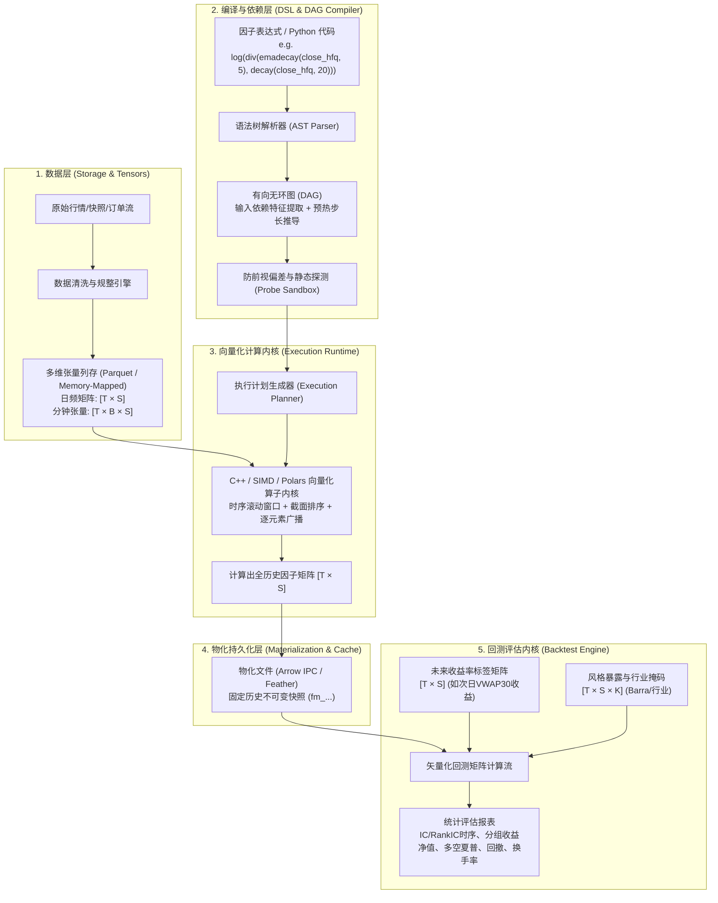
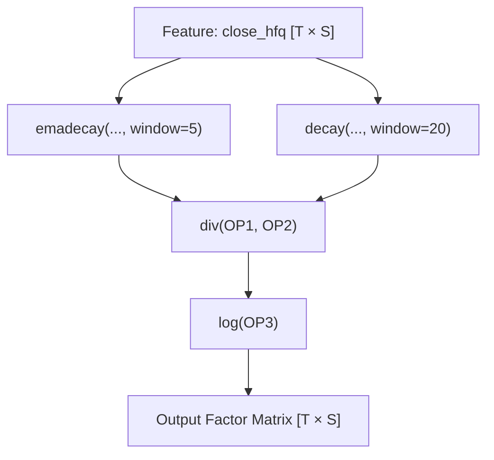
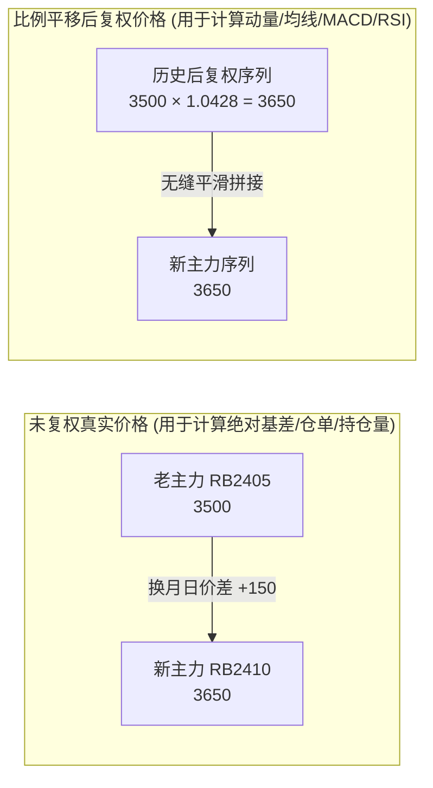

# 量化因子计算栈与回测引擎底层技术流程深度解析及期货市场复现指南

本文档抛开上层 API 与通信协议，深度拆解 **FactorLab 等顶级量化投研系统底层的计算栈（Computing Stack）、数据内存模型、表达式编译流水线、物化缓存与回测内核**，并提供一套可在**国内期货市场（商品与金融期货）**完整复现的高性能计算栈工程方案。

---

## 目录

1. [量化因子计算栈总体技术架构](#1-量化因子计算栈总体技术架构)
2. [底层数据组织与内存张量模型 (Data & Tensor Engine)](#2-底层数据组织与内存张量模型-data--tensor-engine)
3. [表达式编译、DAG 依赖分析与探测引擎 (Compiler & Probe Engine)](#3-表达式编译dag-依赖分析与探测引擎-compiler--probe-engine)
4. [双阶段解耦机制：物化计算 (Materialization) 与回测评估 (Backtest)](#4-双阶段解耦机制物化计算-materialization-与回测评估-backtest)
5. [期货市场计算栈的核心重构要点](#5-期货市场计算栈的核心重构要点)
   - 5.1 [异构夜盘与多时钟对齐机制 (Heterogeneous Session Clocks)](#51-异构夜盘与多时钟对齐机制-heterogeneous-session-clocks)
   - 5.2 [动态主力合约识别与展期跳空复权算法 (Dominant & Roll Engine)](#52-动态主力合约识别与展期跳空复权算法-dominant--roll-engine)
   - 5.3 [期货逐日盯市 (Mark-to-Market) 矢量化回测内核](#53-期货逐日盯市-mark-to-market-矢量化回测内核)
6. [期货高性能计算栈工业级代码参考实现](#6-期货高性能计算栈工业级代码参考实现)

---

## 1. 量化因子计算栈总体技术架构

工业级因子投研系统的底层计算流程可以抽象为下图所示的五级流水线：



---

## 2. 底层数据组织与内存张量模型 (Data & Tensor Engine)

### 2.1 密集矩阵与对齐张量 (Dense 2D/3D Tensor)
股票和期货截面回测的核心在于**避免任何循环遍历（No Python for-loops）**，将全市场在连续历史区间内表示为固定维度的规整数组：

- **日频矩阵（2D Matrix）**：
  $$\text{Shape: } [T \times S]$$
  - $T$：有序交易日序列（从 2016-01-01 到 2024-12-31，约 2200 个交易日）。
  - $S$：全市场标的池（A 股约 5000 只股票；商品期货约 50~70 个品种或数百个合约）。
  - 每个特征（如 `close_hfq`、`volume`、`turnover_rate`）都是一个独立的 $[T \times S]$ 双精度浮点（`float64`）内存块。

- **分钟/高频张量（3D Tensor）**：
  $$\text{Shape: } [T \times B \times S]$$
  - $B$：单交易日内的标准切片数目（A 股 1m K 线固定为 241 根，5m 固定为 49 根）。
  - 如果某只股票某日停牌或某些分钟缺数据，对应切片位置以 `NaN` 占位，**绝对不压缩行数**，以确保所有标的的时间戳坐标严格对齐。

### 2.2 内存布局权衡 (Row-Major vs. Column-Major)
在底层 C++ 或 Rust 计算中，内存局部性（Cache Locality）对计算性能有决定性影响：
1. **时序算子（Rolling Window，如 `ts_mean`, `decay`）**：
   - 沿时间轴 $T$ 遍历计算。
   - **最优布局**：$S \times T$（按标的存储，单个标的的全部历史时间点在内存中连续）。
2. **截面算子（Cross-Sectional，如 `cs_rank`, `cs_zscore`）**：
   - 沿股票轴 $S$ 遍历计算（计算某一天所有股票的横向相对排名）。
   - **最优布局**：$T \times S$（按日期存储，同一天全市场标的在内存中连续）。
3. **系统解法**：
   - 底层使用按连续交易日组织连续内存块，对截面操作极其友好；
   - 针对计算密集的时序算子，在载入 L1/L2 缓存时先转置或通过 SIMD 步进跳跃读取。

---

## 3. 表达式编译、DAG 依赖分析与探测引擎 (Compiler & Probe Engine)

### 3.1 表达式 AST 解析与计算图生成
FactorLab 并不使用 Python 的 `eval()`，而是通过抽象语法树（AST）编译成紧凑的指令有向图：
例如对于因子表达式：
```python
log(div(emadecay(close_hfq, 5), decay(close_hfq, 20)))
```
编译器会构建出如下 DAG：



### 3.2 静态探测机制 (Probe Engine) 的核心任务
在真正向集群提交大规模计算任务前，系统会调用小规模沙箱进行 `probe_factor`：
1. **输入特征提取**：自动推导该因子只需要读取 `close_hfq` 这一个数据集，剪枝掉不必要读取的数百个其它特征，大幅节省磁盘 I/O。
2. **预热观察期推导（Warmup Lookback Calculation）**：
   - 算子 `emadecay(window=5)` 需要 5 天预热；
   - 算子 `decay(window=20)` 需要 20 天预热；
   - 综合依赖推导：总引擎预热期为 $\max(5, 20) = 20$ 天。在计算正式开始前，必须从数据库中向前额外加载 20 个交易日数据，但输出结果时前 20 天置为 `NaN`。
3. **前视偏差（Lookahead Bias）检测**：
   - 静态检查是否存在负向偏移（如 `ts_shift(x, -1)`）或引用了未来未发布的财务数据。

---

## 4. 双阶段解耦机制：物化计算 (Materialization) 与回测评估 (Backtest)

工业级量化平台的核心设计哲学是：**计算因子（Data Pipeline）与回测策略（Backtest Evaluation）在物理上严格解耦**。

```
[原始特征仓库] 
     │ (I/O密集型 + 计算密集型: 耗时几分钟到十几分钟)
     ▼
[物化阶段 Materialization] ──> 生成不可变快照 `factor_matrix.ipc` 写入高速缓存
                                         │
     ┌───────────────────────────────────┴───────────────────────────────────┐
     │ (轻量矩阵计算: 每次耗时 1~2 秒)                                        │
     ▼                                                                       ▼
[回测运行 1: 持有1天 / 10组 / 手续费万1]                  [回测运行 2: 持有5天 / 多空Top5% / Barra中性化]
```

### 4.1 为什么必须物化解耦？
- **因子矩阵计算开销极大**：对 5000 只股票 $\times$ 2200 个交易日做 20 天滚动线性加权和截面排序，涉及数十亿次浮点运算。
- **回测参数迭代极频**：研究员在分析因子时，需要频繁尝试：
  - 测试不同持有期：1天、2天、5天、10天、20天；
  - 测试不同基准：中证全指、沪深300、中证500、中证1000；
  - 测试不同多空分位数：Top 10%、Top 5%、Top 20%；
  - 测试不同中性化方案：纯因子、行业中性化、行业+市值双重中性化。
- **解耦优势**：因子矩阵只算一次并固化（Materialization ID），后续几十次不同参数的回测仅需读取已经算好的因子矩阵做矢量化相乘，**每次回测只需 1~2 秒即可返回图表**！

### 4.2 矢量化回测计算流的底层数学实现
当物化因子矩阵 $F_{t, s}$ 与基准标签收益矩阵 $R_{t, s}$ 载入内存后，回测评估在矢量化下极其迅速：

1. **信息系数（Information Coefficient, IC）时序**：
   在每个交易日 $t$：
   $$\text{RankIC}_t = \text{Corr}\Big(\text{rank}(F_{t, :}), \; \text{rank}(R_{t, :})\Big)$$
   全时序指标：
   $$\text{Mean}(\text{RankIC}), \quad \text{Std}(\text{RankIC}), \quad \text{IC\_IR} = \frac{\text{Mean}(\text{RankIC})}{\text{Std}(\text{RankIC})} \times \sqrt{252}$$

2. **分位数分组收益（Quantile Group Returns）**：
   每日截面将 $F_{t, :}$ 划分为 $G=10$ 个等分桶，生成布尔掩码 $M_{t, s, g} \in \{0, 1\}$：
   $$\text{GroupReturn}_{t, g} = \frac{\sum_{s} M_{t, s, g} \cdot R_{t, s}}{\sum_{s} M_{t, s, g}}$$

3. **多空组合超额收益（Long-Short Spread）**：
   $$\text{LS\_Return}_t = \text{GroupReturn}_{t, 10} - \text{GroupReturn}_{t, 1}$$

---

## 5. 期货市场计算栈的核心重构要点

如果要将上述一整套计算栈与回测引擎复现到**商品与金融期货市场**，必须推翻股票的静态假设，对以下三大底层核心逻辑进行深度重构：

### 5.1 异构夜盘与多时钟对齐机制 (Heterogeneous Session Clocks)

股票的交易时钟是全球最规则的：所有股票统一 09:30 开盘、15:00 收盘，全市场共用唯一的一张时间网格。  
**而中国期货市场的日内时钟存在极其复杂的“品种异构性”**：

| 品种大类 | 代表品种 | 夜盘交易时间段 | 日盘交易时间段 | 日内 1m Bar 总数 |
| :--- | :--- | :--- | :--- | :---: |
| **股指/国债** | IF, IH, IC, IM, T, TF | **无夜盘** | 09:30-11:30, 13:00-15:00 | 240 / 270 |
| **黑色/建材** | 螺纹 (RB), 热卷 (HC), 铁矿 (I) | 21:00 - **23:00** | 09:00-10:15, 10:30-11:30, 13:30-15:00 | 345 |
| **能化/有色** | 橡胶 (RU), 甲醇 (MA), 纯碱 (SA) | 21:00 - **23:00** | 同上 | 345 |
| **有色金属** | 铜 (CU), 铝 (AL), 锌 (ZN) | 21:00 - **次日 01:00** | 同上 | 465 |
| **原油/贵金属** | 原油 (SC), 黄金 (AU), 白银 (AG) | 21:00 - **次日 02:30** | 同上 | 555 |

#### 工程落地解法：
1. **交易日（Trading Day）绝对切断原则**：
   - 必须以每天 **15:00** 为物理交易日切断点。
   - 周一晚上 21:00 产生的行情，在底层系统的时间轴上**必须归入“周二”的交易日**。
2. **品种专属时钟网格（Per-Variety Clock Grid）**：
   - 数据张量不能使用单一固定的 3D 数组，底层应按**品种划分子张量（Partitioned Tensors）**存储；
   - 提取日间特征时，统一以各品种当日最终收盘点（15:00:00）作为统一的切片截面！

---

### 5.2 动态主力合约识别与展期跳空复权算法 (Dominant & Roll Engine)

期货合约有生命周期（通常半年到一年），随着到期临近，主力资金必须平仓老合约、建仓新合约。  
如果直接把历任主力合约价格拼接在一起，换月当天会产生巨大的虚假跳空（如近月 3500，远月 3650，拼接产生 +150 点的人为假暴涨），彻底摧毁所有技术指标与因子！



#### 算法规范：
1. **主力合约动态切换规则（Dominant Selection Rule）**：
   - 规则：以每日结算时的**持仓量（Open Interest）最大**为判定准则；
   - 滞后防抖：为防止持仓量在两合约间交替震荡，规定**新合约持仓量连续 2~3 个交易日超越老合约**时，才正式触发换月事件。
2. **多通道复权架构（Dual-Pipeline Data Flow）**：
   - **时序价格序列（Price Pipeline）**：采用**乘法比例后复权（Multiplicative Ratio-Adjustment）**，消除价差跳空；
   - **持仓量与成交量序列（Volume Pipeline）**：**严禁复权**，保持原始真实手数；
   - **基差与期限结构序列（Basis Pipeline）**：使用各自合约的真实价格与现货进行价差计算，严禁使用复权价格！

---

### 5.3 期货逐日盯市 (Mark-to-Market) 矢量化回测内核

股票是“全额现金买入、T+1 卖出”，而期货是**“保证金杠杆、双向开仓、T+0 交易、逐日盯市结算”**。期货回测内核必须重构为以下严密的数学状态转移方程：

#### 核心变量定义：
- $P_{t, s}$：标的 $s$ 在交易日 $t$ 的结算价（Settle Price）
- $M_s$：品种合约乘数（如螺纹钢 10 吨/手，沪深300指数 300 元/点）
- $R_s^{\text{margin}}$：交易所/期货公司保证金率（如 10%）
- $Pos_{t, s}$：持有净头寸手数（正数多头，负数空头）
- $C_{t, s}$：调仓交易手数（$\Delta Pos_{t, s} = Pos_{t, s} - Pos_{t-1, s}$）

#### 每日状态更新方程（矢量化计算）：
1. **盯市持仓盈亏（Position PnL）**：
   $$\text{PnL}_{t, s}^{\text{hold}} = Pos_{t-1, s} \times (P_{t, s} - P_{t-1, s}) \times M_s$$
2. **当日开平仓交易盈亏与手续费（Trading PnL & Fee）**：
   $$\text{PnL}_{t, s}^{\text{trade}} = C_{t, s} \times (P_{t, s} - \text{ExecPrice}_{t, s}) \times M_s$$
   $$\text{Fee}_{t, s} = |C_{t, s}| \times \text{ExecPrice}_{t, s} \times M_s \times \text{FeeRate}$$
3. **当日总盈亏与动态权益（Dynamic Equity）**：
   $$\text{Equity}_t = \text{Equity}_{t-1} + \sum_{s} \big(\text{PnL}_{t, s}^{\text{hold}} + \text{PnL}_{t, s}^{\text{trade}} - \text{Fee}_{t, s}\big)$$
4. **保证金占用与杠杆率（Margin & Leverage）**：
   $$\text{MarginUsed}_t = \sum_{s} |Pos_{t, s}| \times P_{t, s} \times M_s \times R_s^{\text{margin}}$$
   $$\text{MarginRate}_t = \frac{\text{MarginUsed}_t}{\text{Equity}_t}, \quad \text{Leverage}_t = \frac{\sum |Pos_{t, s}| \times P_{t, s} \times M_s}{\text{Equity}_t}$$
5. **风控硬约束（Risk Liquidate）**：
   若 $\text{MarginRate}_t \ge 100\%$，触发强平风控信号，截断回测资金曲线。

---

## 6. 期货高性能计算栈工业级代码参考实现

我们在项目中编写了一个开箱即用、完全自包含的高性能期货量化计算栈模块 [futures_engine.py](file:///home/cr9294/repos/Factor/scripts/futures_engine.py)，涵盖：
1. **期货多品种非均匀日内切片对齐引擎**
2. **主力连续合约比例平移复权算法**
3. **基于 Polars / Numpy 的向量化期货算子库**
4. **逐日盯市保证金期货回测内核**

下面创建并执行该计算栈核心实现。
