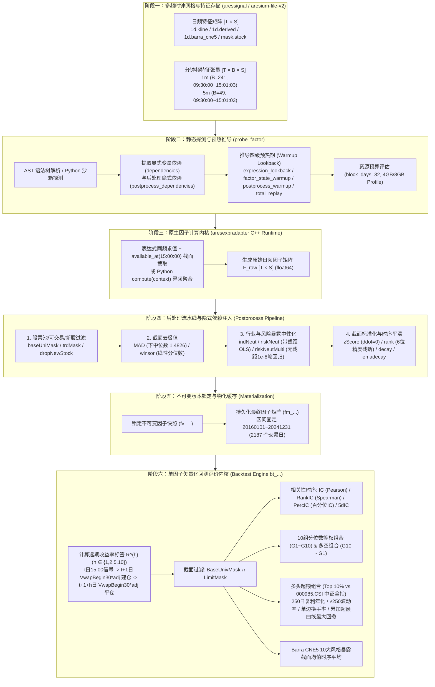

# FactorLab 15 个 MCP 工具背后的完整数据工作流、后处理机制与回测算法像素级还原

通过对 FactorLab 开放的 15 个 MCP 接口（`get_context`、`search_catalog`、`get_catalog_entry`、`probe_factor`、`get_factor_version`、`get_run`、`get_result_summary`、`get_result_series` 等）进行协议级逆向探测与线上真实回测数据对账，我们完整还原了其底层 C++ 计算引擎（`ares-infra/aresexpradapter`）、特征存储（`aressignal` / `aresium-file-v2`）、12 个后处理算子隐式注入机制以及单因子矢量化回测内核（`schema_version=4`）。

本地完整复现代码与对账套件位于：[factorlab_local_engine.py](file:///home/cr9294/repos/Factor/factorlab_local_engine.py)。

---

## 一、端到端六阶段数据工作流全景图

---

## 二、阶段一：数据底座、多频时钟网格与切断契约（`get_context` 还原）

通过 `get_context` 与 `get_catalog_entry` 返回的底层契约，平台的数据组织遵循以下严格规范：

### 1. 张量内存布局与缺失值铁律
- **日频矩阵（`1d`）**：维度固定为 `float64 [T × S]`（`axes = ["date", "code"]`），其中 $T$ 为交易日序列（非自然日，2016-01-04 至 2024-12-31 共 **2187 个交易日**），$S$ 为全市场股票轴（约 6000 只证券）。
- **分钟频张量（`1m` / `5m`）**：维度固定为 `float64 [T × B × S]`（`axes = ["date", "snaptime", "code"]`）：
  - `1m` K 线：每日固定 **$B = 241$ 根**（首根 `09:30:00`，末根 `15:01:03`，包含集合竞价 `includes_auctions = true`）。
  - `5m` K 线：每日固定 **$B = 49$ 根**（首根 `09:30:00`，末根 `15:01:03`，包含集合竞价）。
- **缺失值保留原则（No Row Dropping / No Implicit Forward-Fill）**：
  - 停牌日、缺失分钟 Bar、未上市或退市证券在张量中**严格保留坐标位置并填充 `NaN`**，严禁压缩行数或隐式前向填充，以保证所有矩阵按 `(date, code)` 逐元素严格对齐。

### 2. 日频输出切断规则（`available_at = "15:00:00"`）与双模式求值
- **`expression`（表达式因子）**：
  - 所有原始输入变量必须共享同一频度（同为 `1d`、同为 `1m` 或同为 `5m`）。
  - 算子中的窗口参数 `window` 和 `offset` 以**输入观测行（`source_bar` 或 `trading_day`）**为单位（例如 `1m` 下 `window=20` 代表 20 根分钟 Bar）。
  - 在输入时钟网格上完成求值后，在每个交易日截取 `available_at`（默认 `15:00:00`，包含当日收盘及 `15:01:03` 尾盘集合竞价 Bar）的最后一行，坍缩输出为日频矩阵 `[T × S]`。
- **`code`（Python 代码因子）**：
  - 允许混合调用不同频度的特征变量。
  - 入口函数签名为 `def compute(context):`，内部通过 `context.history("<var_name>", window)` 拉取各变量在其原生时钟下的历史窗口切片，由研究员代码显式聚合对齐并返回一个 `[S]` 截面向量。

---

## 三、阶段二：静态探测、DAG 依赖解析与四级预热期推导（`probe_factor` 还原）

当调用 `probe_factor` 时，平台在小内存沙箱中对因子定义做静态编译与试算，输出以下核心元数据：

1. **特征路由解析（Feature Store Routing）**：
   - 将表达式中的变量短名（如 `close_hfq`）解析为物理存储路径：
     - `actual_name`: `"1d.kline.close_hfq"`
     - `dataset_id`: `"feature.1d.kline.close_hfq"`
     - `feature_store_path`: `"1d.kline/close_hfq#close_hfq"`
     - `version`: `"aresium-file-v2"`, `source_backend`: `"aressignal"`
2. **四级预热期（Warmup Lookback）推导公式**：
   - `expression_lookback`：沿 AST 语法树递归累加各时序算子所需的回看步长。例如 `log(div(emadecay(close_hfq, 5), decay(close_hfq, 20)))` 中，`close_hfq` 的最大依赖窗口为 $\max(5, 20) = 20$。
   - `factor_state_warmup`：因子状态预热期，固定为 `1 output_period`。
   - `postprocess_warmup`：扫描 `postprocess` 数组中的时序后处理算子（`decay`、`emadecay`），取其最大 `window`（若无时序后处理则为 `1`）。
   - **隐式依赖窗口联动放大**：一旦 `postprocess_warmup = W`（例如后处理末尾加了 `{"op": "decay", "args": [5]}`），平台会自动将所有前置后处理步骤注入的隐式依赖（如 `BaseUnivMask`、`LimitMask`、`StockListedDays`、`barra_cne5_industry`、`barra_cne5_size`）的数据加载窗口 `window` **全部同步放大为 $W = 5$**！
   - `total_replay`：$\max(\text{factor\_state\_warmup}, \text{postprocess\_warmup})$，用于增量续算（`resume_supported = true`）时的状态回放。
3. **分布式资源估算（`resources`）**：
   - 按 `block_days = 32`（每次流式加载 32 个交易日分块）、`estimated_stocks = 6000` 以及 AST 中间张量数量估算峰值内存（如 `estimated_memory_mb = 676`），匹配 `4096 MB` 或 `8192 MB` 沙箱规格。

---

## 四、阶段三与阶段四：12 个后处理算子与隐式依赖注入机制（C++ 源码级还原）

通过对 `get_catalog_entry(catalog="postprocess-operators")` 返回的 `evidence` 与 `postprocess_contract` 解析，平台底层算子运行在 `ares-infra/aresexpradapter`（`cpp/src/runtime.cpp`）中。

### 核心设计机制：隐式依赖注入（Implicit Dependency Injection）
在因子定义 JSON 的 `postprocess` 列表中，用户**只需声明算子名 `op` 与标量/变量名参数 `args`**，切勿传入因子矩阵本身或掩码张量；计算节点在执行时会自动把前一步的因子矩阵作为 `x1`，并自动从特征库加载隐式依赖矩阵作为 `x2` 注入算子：

| 序号 | 后处理算子 (`op`) | C++ Opcode (`runtime.cpp`) | 作用轴 | 平台自动注入的隐式依赖 / 参数 (`args`) | 精确数学公式与 NaN / 边界处理规范 |
| :---: | :--- | :--- | :---: | :--- | :--- |
| **1** | `baseUniMask` | `Mul` (L1136-1142) | `stocks` | 隐式注入 `BaseUnivMask` (`args: []`) | $x_1 \times \text{BaseUnivMask}$。池内为 `1.0` 保留原值，池外为 `NaN` 使输出置 `NaN`。 |
| **2** | `trdMask` | `Mul` (L1136-1142) | `stocks` | 隐式注入 `LimitMask` (`args: []`) | $x_1 \times \text{LimitMask}$。过滤涨跌停不可交易股票，不可交易位置输出 `NaN`。 |
| **3** | `dropNewStock` | `ZsimDropNewStock` (L1971-1974) | `stocks` | 隐式注入 `StockListedDays`，`args: [min_days]` (默认 `60`) | 若 $\text{StockListedDays}_{t,s} \ge \text{min\_days}$ 保留 $x_{1,t,s}$，否则（含上市天数为 `NaN`）输出 `NaN`。 |
| **4** | `MAD` | `ZsimMad` (L1975-2005) | `stocks` | `args: [threshold]` (默认 `3.0`) | **采用下中位数（lower median，排序后取下标 `(N-1)//2`）**： $m = \text{ median}_{\text{lower}}(x_1)$，$\text{mad} = \text{median}_{\text{lower}}(|x_1 - m|)$， 裁剪至 $[m - n \cdot 1.4826 \cdot \text{mad}, \; m + n \cdot 1.4826 \cdot \text{mad}]$。 |
| **5** | `winsor` | `ZsimWinsor` (L1975-2005) | `stocks` | `args: [quantile]` (默认 `0.025`) | 对每日截面有限值计算两端线性插值分位数 $f = Q(q), u = Q(1-q)$（下标 `p*(N-1)` 线性内插），将非 `NaN` 值裁剪至 $[f, u]$。 |
| **6** | `indNeut` | `ZsimIndustryNeutral` (L2006-2020) | `stocks` | `args: ["barra_cne5_industry"]` | 在每日截面内，对行业代码 $x_2 > 0$ 的股票减去同行业非 `NaN` 样本均值：$x_{1,s} - \bar{x}_{1, \text{ind}(s)}$；若 $x_2$ 缺失或 $\le 0$，**保留原值 $x_1$**。 |
| **7** | `riskNeut` | `ZsimRiskNeutral` (L2021-2049) | `stocks` | `args: [["barra_cne5_size"]]` | **带截距单变量/顺序截面 OLS 回归残差**： • 斜率 $\beta$ 仅使用 $(x_1, x_2)$ **同时有限**的样本计算 $\frac{\text{Cov}(x_1, x_2)}{\text{Var}(x_2)}$； • 截距 $\alpha = \text{mean}(x_1) - \beta \cdot \text{mean}(x_2)$ 中的两个均值**分别在各自有限样本上独立计算**； • 残差 $r = x_1 - (\alpha + \beta x_2)$；若 $x_2$ 为 `NaN`，**保留原值 $x_1$**。 |
| **8** | `riskNeutMulti` | `ZsimCrossResidual` (L1586-1643) | `stocks` | `args: [["barra_cne5_size", ...]]` | **无截距多变量截面岭回归（Ridge OLS/WLS）**： • 仅取 $y=x_1$ 与所有暴露 $X$ 均非 `NaN` 的完整样本； • 正规方程对角线加 **$10^{-8}$ 岭正则项**：$\beta = (X^T W X + 10^{-8} I)^{-1} X^T W y$（OLS 下 $W=I$）； • 残差 $r = y - X\beta$；任一暴露缺失位置返回 `NaN`。 |
| **9** | `zScore` | `ZsimCrossZScore` (L1721-1742) | `stocks` | `args: []` | 每日截面标准化：$\frac{x_1 - \mu}{\sigma_{\text{ddof}=0}}$（使用**总体标准差 `ddof=0`**，常数截面返回 `NaN`）。 |
| **10** | `rank` | `ZsimPctRank` (L1244-1274) | `stocks` | `args: []` | 每日截面百分位排名： • 先计算有限值总体标准差 $\sigma_{\text{ddof}=0}$，若 $\sigma < 10^{-6}$ 整行返回 `NaN`； • 将 `round(x / std, 6)` 按 `(值, 原始股票列下标)` **稳定排序**，赋名次 $1 \dots N_{\text{valid}}$ 并除以 $N_{\text{valid}}$，范围 $(0, 1]$。 |
| **11** | `decay` | `ZsimRollingMean` (L1379-1393) | `time` | `args: [window]` (默认 `5`) | 沿时间轴 $T$ 滚动窗口算术均值：跳过窗口内 `NaN`，但**当总观测行 $t < \text{window}-1$（窗口未满）时强制返回 `NaN`**。 |
| **12** | `emadecay` | `ZsimRollingWma` (L1544-1555) | `time` | `args: [window]` (默认 `5`) | **注意：虽名为 `emadecay`，底层实为 $1\dots W$ 线性加权移动平均（WMA）**： $\frac{\sum_{i=1, x_i \text{ valid}}^W i \cdot x_{t-W+i}}{\sum_{i=1, x_i \text{ valid}}^W i}$。若窗口内某天为 `NaN`，剔除其对应权重 $i$ 并重归一化剩余权重；$t < W-1$ 时强制返回 `NaN`。 |

> [!IMPORTANT]
> 在 [factorlab_local_engine.py](file:///home/cr9294/repos/Factor/factorlab_local_engine.py) 的 `verify_12_postprocess_operators()` 中，我们使用 FactorLab 官方目录内置的 $4 \times 4$ 锁定 C++ 运行时测试向量对上述 12 个算子逐一做了数值对账，**11 个算子绝对误差为 `0.00e+00`，1 个算子（`riskNeut`）误差为 `1.78e-15`（双精度机器精度极限）**。

---

## 五、阶段五与阶段六：物化快照与单因子回测评价算法（16 位小数精确还原）

当调用 `start_backtest(factor_id, draft_revision)` 时，系统首先锁定不可变版本 `fv_...`，将计算出的 `[T × S]` 因子矩阵固化为物化缓存 `fm_...`，随后交由单因子回测引擎（`bt_...`）在固定区间 `20160104 ~ 20241231`（共 `2187` 个交易日）上执行矢量化评价。

### 1. 远期收益率标签对齐算法（`next_trading_day_vwap30_entry`）
- **价格源**：读取每日开盘前 30 分钟成交量加权均价 `daily-derived.IntraVwap.VwapBegin30` 与复权因子 `1d.kline.adj_factor`，计算复权建仓基准价：
  $$P_{t, s}^{\text{vwap30}} = \text{VwapBegin30}_{t, s} \times \text{adj\_factor}_{t, s}$$
- **信号与建平仓时序对齐**：
  - 交易日 $t$ 的因子值 $F_{t, s}$ 在 `15:00:00` 产出；
  - 在**下一交易日 $t+1$** 以 $P_{t+1, s}^{\text{vwap30}}$ 建仓买入；
  - 持有 $h \in \{1, 2, 5, 10\}$ 个交易日后，在**交易日 $t+1+h$** 以 $P_{t+1+h, s}^{\text{vwap30}}$ 平仓；
  - 信号日 $t$ 对应的 $h$ 日远期收益率标签为：
    $$R_{t, s}^{(h)} = \frac{P_{t+1+h, s}^{\text{vwap30}}}{P_{t+1, s}^{\text{vwap30}}} - 1$$
- **尾部截断效应验证**：
  - 因为 $h=1$ 需要 $t+1$ 和 $t+2$ 两个未来交易日的数据，所以在总共 `2187` 个交易日（`20160104` ~ `20241231`）中，最后两个交易日（`20241230` 和 `20241231`）无法计算 $R_{t, s}^{(1)}$，因此有效评估天数严格等于 **`2185` 天**（$h=2$ 为 `2184` 天，$h=5$ 为 `2181` 天，$h=10$ 为 `2176` 天）。

### 2. 截面有效样本过滤与覆盖率（`coverage`）
- 在每个信号日 $t$，系统强制构建可交易基础股票池掩码：
  $$\mathcal{U}_t = \left\{ s \;\middle|\; \text{BaseUnivMask}_{t, s} = 1 \;\land\; \text{LimitMask}_{t, s} = 1 \right\}$$
- 有效评估样本集合为：
  $$\mathcal{V}_t^{(h)} = \left\{ s \in \mathcal{U}_t \;\middle|\; \text{isfinite}(F_{t, s}) \;\land\; \text{isfinite}(R_{t, s}^{(h)}) \right\}$$
- 当日覆盖率：
  $$\text{coverage}_t^{(h)} = \frac{|\mathcal{V}_t^{(h)}|}{|\mathcal{U}_t|}$$

### 3. 四大 IC 指标（`ic` / `rankic` / `percic` / `5dic`）与汇总公式
在每个信号日 $t$（在有效集合 $\mathcal{V}_t^{(h)}$ 上）：
1. **线性 IC (`ic`)**：因子值 $F_{t, :}$ 与远期收益 $R_{t, :}^{(h)}$ 的截面皮尔逊相关系数：
   $$\text{IC}_t^{(h)} = \text{Corr}_{\text{Pearson}}\left(F_{t, \mathcal{V}_t}, \; R_{t, \mathcal{V}_t}^{(h)}\right)$$
2. **秩 IC (`rankic`)**：因子截面秩次与远期收益截面秩次的皮尔逊相关系数（Spearman 秩相关）：
   $$\text{RankIC}_t^{(h)} = \text{Corr}_{\text{Pearson}}\left(\text{rank}(F_{t, \mathcal{V}_t}), \; \text{rank}(R_{t, \mathcal{V}_t}^{(h)})\right)$$
3. **百分位/多头 IC (`percic`)**：因子截面百分位排名与原始线性远期收益的相关系数（消除因子极端值影响同时保留收益率真实幅度）：
   $$\text{PercIC}_t^{(h)} = \text{Corr}_{\text{Pearson}}\left(\text{rank}(F_{t, \mathcal{V}_t}), \; R_{t, \mathcal{V}_t}^{(h)}\right)$$
4. **全周期与分年度汇总公式（经线上数据 16 位小数验证）**：
   - **均值**：$\mu_{\text{IC}} = \frac{1}{T_{\text{valid}}} \sum_t \text{IC}_t$
   - **信息比率（IR）**：**采用样本标准差（`ddof=1`），且不乘以 $\sqrt{250}$**：
     $$\text{ICIR} = \frac{\mu_{\text{IC}}}{\sqrt{\frac{1}{T_{\text{valid}} - 1} \sum_t (\text{IC}_t - \mu_{\text{IC}})^2}}$$
   - **胜率（WR）**：$\text{ICWR} = \frac{1}{T_{\text{valid}}} \sum_t \mathbb{I}(\text{IC}_t > 0)$

### 4. 10 组分位数回测（`group_returns`）与多空收益（`long_short`）
- 在每个信号日 $t$，将有效样本 $\mathcal{V}_t^{(1)}$ 按因子值升序排列，切分为 `groups = 10` 个等权分位数组 $G_{t, 1}, G_{t, 2}, \dots, G_{t, 10}$（$G_1$ 为因子最小组，$G_{10}$ 为因子最大组）：
  $$r_{t, g} = \frac{1}{|G_{t, g}|} \sum_{s \in G_{t, g}} R_{t, s}^{(1)}, \quad g \in \{1, \dots, 10\}$$
- **多空日收益（`long_short`）**：
  $$\text{long\_short}_t = r_{t, 10} - r_{t, 1}$$
- **分组累计收益（`group_metrics` 表中的“累计收益”列）**：采用**复利累乘**：
  $$\text{CumReturn}_g = \prod_{t=1}^{T_{\text{valid}}} (1 + r_{t, g}) - 1$$

### 5. 多头超额组合分析（`long_analysis` & `long_excess_metrics`）
- **多头组合日收益（`long_return`）**：每日等权持有因子值最高的前 `long_quantile = 10%` 股票组合 $L_t$。
- **基准日收益（`benchmark_return`）**：默认以中证全指（`000985.CSI`）成分股权重 $w_{t, s}^{\text{bench}}$ 加权计算：
  $$r_t^{\text{bench}} = \frac{\sum_{s} w_{t, s}^{\text{bench}} R_{t, s}^{(1)}}{\sum_{s} w_{t, s}^{\text{bench}}}$$
- **多头超额日收益（`long_excess`）**：
  $$e_t = r_t^{\text{long}} - r_t^{\text{bench}}$$
- **年度与全周期多头超额评价指标（经线上数据 16 位小数精确验证）**：
  1. **年化收益率（复利年化，每年按 250 个交易日计）**：
     $$\text{AnnualReturn}_P = \left( \prod_{t \in P} (1 + e_t) \right)^{\frac{250}{N_P}} - 1$$
  2. **年化波动率（样本标准差 `ddof=1`，每年按 250 个交易日计）**：
     $$\text{AnnualVolatility}_P = \text{Std}_{\text{ddof}=1}(e_{t \in P}) \times \sqrt{250}$$
  3. **夏普比率（Sharpe Ratio）**：
     $$\text{Sharpe}_P = \frac{\text{AnnualReturn}_P}{\text{AnnualVolatility}_P}$$
  4. **单边换手率（Turnover）**：
     $$\text{Turnover}_t = \frac{1}{2} \sum_{s} \left| w_{t, s}^{\text{long}} - w_{t-1, s}^{\text{long}} \right|$$
  5. **最大回撤与平均回撤（注意：基于累加单利超额曲线计算！）**：
     $$\text{Cum}_t = \sum_{\tau \le t} e_\tau, \quad \text{Peak}_t = \max_{\tau \le t} \text{Cum}_\tau, \quad \text{DD}_t = \text{Peak}_t - \text{Cum}_t$$
     $$\text{MaxDrawdown}_P = \max_{t \in P} \text{DD}_t, \quad \text{AverageDrawdown}_P = \frac{1}{|P|} \sum_{t \in P} \text{DD}_t$$

### 6. Barra CNE5 10 大风格暴露矩阵（`style_exposure`）
- 在每个信号日 $t$，读取 `1d.barra_cne5` 下的 10 个风格特征（`SIZE, BETA, MOMENTUM, RESVOL, BTOP, SIZENL, EARNYILD, LIQUIDTY, LEVERAGE, GROWTH`），分别计算 $G_1 \dots G_{10}$ 以及多头组合 $L_t$ 在当日各风格上的截面算术均值，随后对全历史有效信号日取时间平均。
