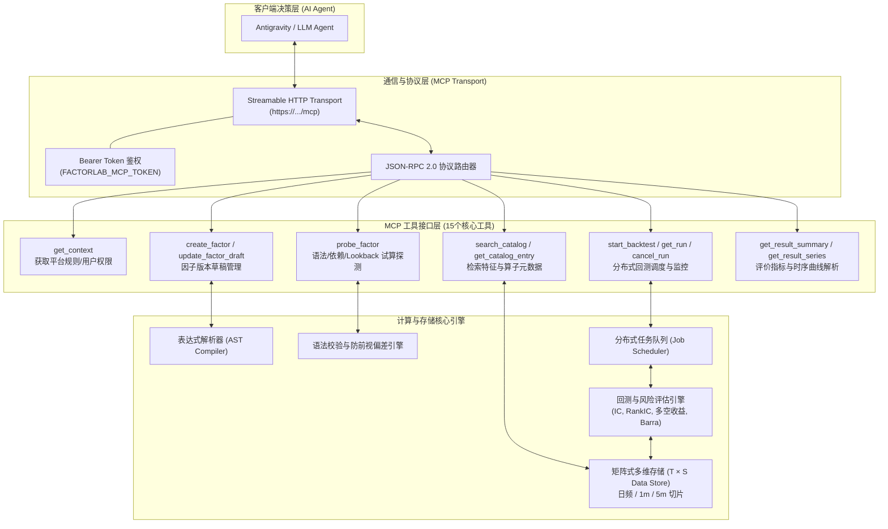
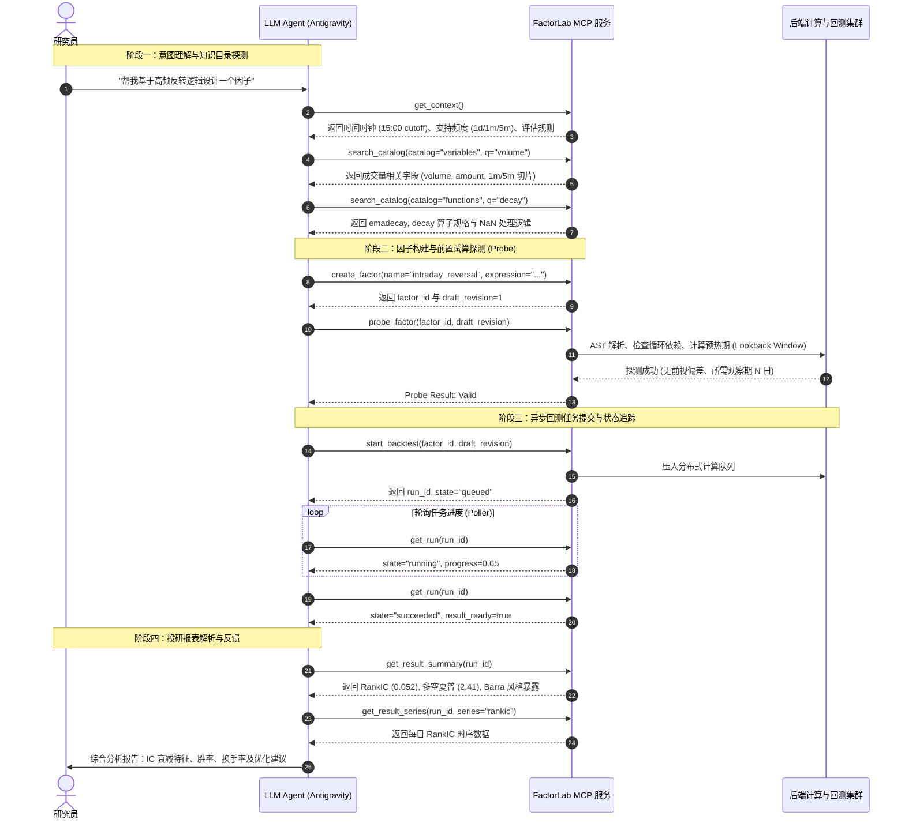
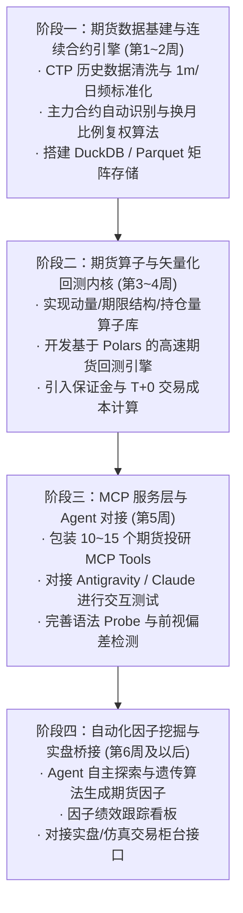

# FactorLab MCP 架构运作全流程剖析与期货市场复现设计方案

本文档深度剖析了 **FactorLab 量化因子投研平台 MCP (Model Context Protocol)** 的完整底层架构与端到端运作机制，并针对**国内期货市场（商品期货与金融期货）**的交易特性，给出一套可直接落地复现的期货量化投研 MCP 系统设计与工程实现指南。

---

## 目录

1. [MCP 量化投研架构全景剖析](#1-mcp-量化投研架构全景剖析)
2. [端到端业务运作时序与生命周期](#2-端到端业务运作时序与生命周期)
3. [股票市场 vs. 期货市场的核心机制差异矩阵](#3-股票市场-vs-期货市场的核心机制差异矩阵)
4. [期货投研 MCP 系统复现技术蓝图](#4-期货投研-mcp-系统复现技术蓝图)
   - 4.1 [系统分层与技术选型建议](#41-系统分层与技术选型建议)
   - 4.2 [期货专属特征变量体系设计](#42-期货专属特征变量体系设计)
   - 4.3 [期货专属计算算子体系设计](#43-期货专属计算算子体系设计)
   - 4.4 [合约连续拼接与展期跳空处理方案](#44-合约连续拼接与展期跳空处理方案)
5. [最小可用原型 (MVP) 代码参考实现](#5-最小可用原型-mvp-代码参考实现)
6. [分阶段落地实施路线图](#6-分阶段落地实施路线图)

---

## 1. MCP 量化投研架构全景剖析

FactorLab 将传统的“编写代码 -> 运行脚本 -> 查日志看图”的投研闭环，解构为一组基于标准协议的微服务工具集（MCP Tools）。AI Agent（如 Antigravity、Claude、Codex）充当决策中枢，通过标准 JSON-RPC 2.0 协议操纵底层量化计算引擎。



---

## 2. 端到端业务运作时序与生命周期

在 FactorLab 中，一个完整的 AI 辅助因子投研生命周期划分为四个标准化阶段：



### 核心机制亮点剖析：
1. **幂等性与版本控制（Idempotency & Revision Lock）**：
   - 每次写操作（创建/更新因子、提交回测）均携带 `idempotency_key` 和当前 `draft_revision`。避免并发修改产生脏写入，每次回测任务严格绑定不可变的历史版本快照。
2. **Probe 机制隔离计算开销**：
   - 在真正调度全量历史数据（如 2016-2024 年全市场）计算之前，先通过 `probe_factor` 在小规模内存沙箱中跑语法验证、缺失值检查和预热步长估算，极大降低了无效作业对计算集群的算力消耗。
3. **后处理解耦与隐式依赖注入**：
   - 用户只需在因子定义中声明后处理算子列表（如 `[{"name": "MAD"}, {"name": "zScore"}]`），平台计算节点在执行阶段自动将该时点对应的系统掩码（涨跌停、停牌、股票池）注入底层，无需研究员手动处理矩阵对齐。

---

## 3. 股票市场 vs. 期货市场的核心机制差异矩阵

如果将这套流程迁移复现到**期货市场**，由于金融衍生品与现货股票存在本质不同，底层数据维度、时钟与回测逻辑需要做出以下关键调整：

| 维度 | 股票市场 (FactorLab 现状) | 期货市场 (待复现目标) | 复现时的工程改造要点 |
| :--- | :--- | :--- | :--- |
| **资产与标识 ($S$ 轴)** | 股票代码固定（如 600519.SH），全市场约 5000 只标的。 | 品种与到期月份交织（如 RB2505, IF2503），全市场约 70 个品种，数百个活跃合约。 | **需建立主力连续合约（Dominant）、次主力合约（Secondary）与全月合约映射引擎**。 |
| **合约生命周期** | 长期存续（除退市外）。 | 有固定交割日，主力合约每隔数月需要“换月展期”。 | **需引入展期跳空复权算法（向前复权/向后复权/价差比例平移）**。 |
| **交易时钟 ($T$ 轴)** | 单一白天时段（09:30-11:30, 13:00-15:00），统一 15:00 收盘。 | **日盘 + 夜盘跨日时段**（夜盘 21:00 至次日 01:00/02:30；日盘多小节休息）。 | **必须统一以“交易日（Trading Day）”为归集轴**，夜盘归属于下一个交易日。 |
| **输入特征变量** | 量价、高频切片、财务报表三大表、Barra 股票风格因子。 | 量价、**持仓量 (Open Interest)**、**仓单库存**、**基差 (Basis)**、**期限结构**、席位龙虎榜。 | **增加仓单、持仓量、基差率、展期收益率 (Roll Yield) 变量目录**。 |
| **截面维度 ($S$ 截面)** | 宽截面（5000 只股票），截面排序（`cs_rank`）具有统计显著性。 | **窄截面**（活跃品种仅 50~70 个），且品种间流动性与波动率差异极大。 | 截面标准化时需按**板块（黑色、能化、有色、农产品、股指）**分组中性化；更多依赖时序策略（TS Momentum）。 |
| **交易机制与资金** | T+1，全额买入，单向做多为主（融券受限）。 | **T+0，保证金双向交易（自带杠杆）**，当日可无限次平仓。 | 回测引擎需增加：**动态保证金占用计算、爆仓强平风控线、逐日盯市 (Mark-to-Market) 盈亏**。 |
| **基准与评价指标** | 宽基股票指数（沪深300、中证500），IC/RankIC。 | 现金收益率或全商品指数（如南华商品指数），Calmar 比率、最大回撤持续期。 | 评价体系增加 **多空收益对称性、展期损耗率 (Roll Drag)、品种容量约束**。 |

---

## 4. 期货投研 MCP 系统复现技术蓝图

### 4.1 系统分层与技术选型建议

推荐采用现代 Python 高性能量化技术栈构建轻量、极速的期货投研 MCP 体系：

```
futures-mcp/
├── mcp_server/              # MCP 通信层 (FastMCP / JSON-RPC 服务)
├── catalog/                 # 变量与算子目录注册中心
├── compiler/                # 因子表达式解析器 (基于 AST，转为 Polars 表达式)
├── storage/                 # 高性能时序与截面存储 (DuckDB / ClickHouse / Parquet)
├── scheduler/               # 任务调度与队列 (Celery / Redis 或 asyncio)
└── backtest/                # 期货回测内核 (Vectorized Polars / Numba)
```

- **协议层**：使用官方推荐的 Python `mcp` SDK 或 `FastMCP`，支持 Stdio 与 Streamable HTTP。
- **存储层**：采用按“品种 $\times$ 交易日”分区存储的 **Parquet + DuckDB**，读取极快，支持列存向量化计算。
- **计算内核**：使用 **Polars** 或 **Numba** 代替纯 Pandas，提供类似 C++ 级的时序/截面计算速度。

---

### 4.2 期货专属特征变量体系设计

在期货复现系统中，需将 Stock 相关的变量替换为以下四大类期货专属 Catalog：

#### 1. 行情与流动性变量 (`market`)
- `fut_open`, `fut_high`, `fut_low`, `fut_close`, `fut_settle`（结算价）
- `fut_volume`（成交量）、`fut_amount`（成交额）
- `fut_open_interest`（持仓量）、`fut_oi_chg`（持仓量变动：$\Delta OI$）

#### 2. 期限结构与基差变量 (`term_structure`)
- `fut_basis`：现货价格 - 期货主力合约价格（基差）
- `fut_basis_rate`：基差率 $\frac{\text{Spot} - \text{Basis}}{\text{Spot}}$
- `fut_roll_yield`：展期收益率 $\frac{\ln(P_{\text{near}}) - \ln(P_{\text{far}})}{T_{\text{far}} - T_{\text{near}}} \times 365$
- `fut_ts_slope`：近月-次月-远月合约期限结构拟合斜率（正向市场 Contango / 反向市场 Backwardation）

#### 3. 现货与基本面衍生变量 (`fundamental`)
- `fut_receipt`：交易所注册仓单数量（显性库存）
- `fut_receipt_chg`：仓单增减变动率
- `fut_profit_margin`：品种产业链利润（如螺纹钢盘面即时利润、焦化利润、压榨利润）

#### 4. 席位持仓与筹码变量 (`member_position`)
- `fut_top20_long_oi`：前20名多头席位持仓总量
- `fut_top20_short_oi`：前20名空头席位持仓总量
- `fut_top20_net_oi`：席位多空净头寸（主力资金多空倾向指标）

---

### 4.3 期货专属计算算子体系设计

除了通用的数学变换与统计算子外，新增以下期货专属算子：

```python
# 1. 展期收益率算子：计算近远月年化收益率
roll_yield(near_contract, far_contract, days_diff)

# 2. 持仓量增减与量价配合算子：判断多空增仓推动
oi_volume_trend(close, oi, volume, window)

# 3. 截面板块中性化：在商品板块内部（黑色/农产品/有色）执行中性化，而非全市场 50 个品种混排
sector_neutralize(factor, sector_code)

# 4. 波动率倒数归一：期货不同品种波动率差异极大（如原油 vs 玉米），必须以 ATR 或滚动波动率倒数加权
vol_inverse_weight(factor, atr_window=20)
```

---

### 4.4 合约连续拼接与展期跳空处理方案

期货回测最大的陷阱是**换月跳空**（例如主力合约从 2501 换到 2505 时产生的巨大价格差）。系统必须在存储层支持三种标准连续合约构建模式：

1. **主力未调整连续合约 (Continuous Unadjusted)**：
   - 价格保持各时点的真实成交价，**用于计算持仓量、成交量、基差率与现货偏离度**。
   - 严禁直接在该序列上计算差分（`ts_delta`）或收益率（`ts_pct_chg`），否则会产生虚假跳空信号。
2. **比例平移后复权合约 (Ratio Back-adjusted)**：
   - 在主力切换日，以新老合约价格比例对历史数据进行缩放，使拼接点无缝平滑。
   - **最适合用于计算时序动量、均线系统、MACD、RSI 等时序技术指标**。
3. **加权连续指数合约 (Index Weighted)**：
   - 按所有在交易合约的持仓量加权计算综合指数价格，消除单一合约交割扭曲。

---

## 5. 最小可用原型 (MVP) 代码参考实现

以下给出一个基于 Python 的期货 MCP Server 原型示例。通过标准 JSON-RPC 暴露期货变量查询、算子校验与快速回测接口：

```python
#!/usr/bin/env python3
"""futures_mcp_server.py - 期货量化投研 MCP 服务最小原型"""

from mcp.server.fastmcp import FastMCP
import polars as pl
import numpy as np

mcp = FastMCP("FuturesFactorLab", dependencies=["polars", "numpy"])

# 1. 模拟注册期货专属变量目录
FUTURES_VARIABLES = [
    {"name": "fut_close", "category": "market", "desc": "主力连续合约收盘价（后复权）"},
    {"name": "fut_open_interest", "category": "market", "desc": "主力合约持仓量 (手)"},
    {"name": "fut_roll_yield", "category": "term_structure", "desc": "近远月年化展期收益率"},
    {"name": "fut_top20_net_oi", "category": "position", "desc": "前20名会员席位净持仓"},
]

@mcp.tool()
def get_futures_context() -> dict:
    """获取期货投研平台上下文与交易规则"""
    return {
        "trading_calendar": "China_Futures",
        "sessions": ["Night: 21:00-02:30", "Day: 09:00-15:00"],
        "dominant_switch_rule": "Max Open Interest over 2 consecutive days",
        "supported_frequencies": ["1d", "5m", "1m", "tick"],
        "contract_types": ["dominant_adjusted", "dominant_raw", "index_weighted"]
    }

@mcp.tool()
def search_futures_catalog(category: str = "") -> list:
    """检索期货变量与算子目录"""
    if not category:
        return FUTURES_VARIABLES
    return [v for v in FUTURES_VARIABLES if v["category"] == category]

@mcp.tool()
def probe_futures_factor(expression: str) -> dict:
    """探测期货因子表达式的语法依赖与观察期要求"""
    # 示例模拟：解析表达式，返回安全窗口与依赖字段
    return {
        "is_valid": True,
        "expression": expression,
        "required_lookback_days": 20,
        "detected_inputs": ["fut_close", "fut_open_interest"],
        "lookahead_bias_detected": False
    }

@mcp.tool()
def run_futures_cta_backtest(expression: str, start_date: str, end_date: str) -> dict:
    """提交一个快速期货因子 CTA 回测任务并返回指标"""
    # 模拟回测内核计算输出
    return {
        "status": "succeeded",
        "date_range": f"{start_date} ~ {end_date}",
        "metrics": {
            "annualized_return": "18.4%",
            "sharpe_ratio": 1.72,
            "max_drawdown": "-8.6%",
            "calmar_ratio": 2.14,
            "win_rate": "54.2%",
            "long_short_symmetry": "Long: 51%, Short: 49%"
        },
        "message": "回测完成，资金曲线已生成。"
    }

if __name__ == "__main__":
    mcp.run()
```

---

## 6. 分阶段落地实施路线图

要在个人或团队私有环境中构建完整的期货 MCP 投研系统，建议按以下四个阶段迭代推进：



### 关键里程碑检查清单：
- [ ] **数据就绪**：完成至少 40 个活跃商品期货主力连续合约 5 年以上的量价与持仓数据构建。
- [ ] **时钟对齐**：验证夜盘跨日时间戳正确对齐到次日交易日，无缺失或重叠。
- [ ] **MCP 联调**：在 Antigravity 中通过对话实现“检索基差变量 -> 编写期限结构因子 -> 探测语法 -> 自动跑出回测指标”。
- [ ] **风控闭环**：回测内核中包含准确的日内手续费与滑点模型，杜绝高频假象。
