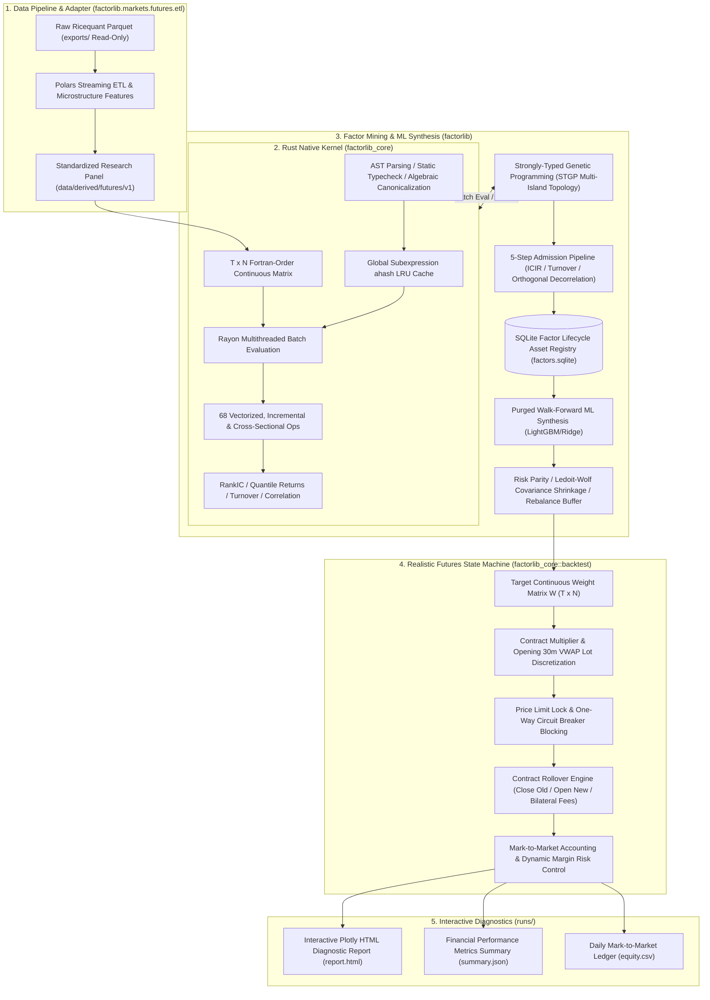

# FactorLibrary: Production-Grade Quantitative Futures Factor Mining & Backtesting Platform

<div align="center">

[](https://www.python.org/)
[](https://www.rust-lang.org/)
[](https://pyo3.rs/)
[](https://pola.rs/)
[](https://lightgbm.readthedocs.io/)
[](LICENSE)

<h3>Blazing-Fast Rust Native Core × Modern Python Scientific Computing Ecosystem</h3>
<p><b>High-Frequency Microstructure Features → DSL Symbolic Expressions → Strongly-Typed Genetic Programming (STGP) Mining → SQLite Factor Asset Lifecycle Registry → Purged Walk-Forward ML Synthesis → Zero Look-Ahead Bias & Discrete Futures Execution Backtesting</b></p>

[中文主手册 (README.md)](README.md) | [中文镜像 (README.zh-CN.md)](README.zh-CN.md)

</div>

---

## Table of Contents

- [Overview](#overview)
- [Architecture & Data Flow](#architecture--data-flow)
- [Key Features](#key-features)
- [Quickstart & Installation](#quickstart--installation)
  - [1. Environment Setup](#1-environment-setup)
  - [2. Pre-Commit Quality Verification](#2-pre-commit-quality-verification)
- [Data Pipeline & Panel Construction](#data-pipeline--panel-construction)
  - [1. Raw Data Assets](#1-raw-data-assets)
  - [2. Data Auditing](#2-data-auditing)
  - [3. Building Standard Research Panels](#3-building-standard-research-panels)
- [End-to-End One-Click Pipeline (CLI)](#end-to-end-one-click-pipeline-cli)
  - [Scenario A: Quick Single-Factor Backtest](#scenario-a-quick-single-factor-backtest)
  - [Scenario B: Factor Library Synthesis Backtest](#scenario-b-factor-library-synthesis-backtest)
  - [Scenario C: STGP Mining + ML Synthesis Pipeline](#scenario-c-stgp-mining--ml-synthesis-pipeline)
  - [Interpreting Experiment Artifacts](#interpreting-experiment-artifacts)
- [Modular Production CLI Scripts](#modular-production-cli-scripts)
- [Python SDK Core API & Programming Paradigm](#python-sdk-core-api--programming-paradigm)
  - [1. Panel Memory Container (`factorlib.core.panel`)](#1-panel-memory-container-factorlibcorepanel)
  - [2. DSL Syntax Sugar & Static Checking (`factorlib.core.dsl`)](#2-dsl-syntax-sugar--static-checking-factorlibcoredsl)
  - [3. Rust Native Engine (`factorlib_core.Engine`)](#3-rust-native-engine-factorlib_coreengine)
  - [4. SQLite Factor Registry (`factorlib.core.registry`)](#4-sqlite-factor-registry-factorlibcoreregistry)
  - [5. Portfolio Optimization & Futures Backtesting](#5-portfolio-optimization--futures-backtesting)
- [68 High-Performance Operators Cheat Sheet](#68-high-performance-operators-cheat-sheet)
- [Strict Anti-Lookahead Guarantee & Trading Semantics](#strict-anti-lookahead-guarantee--trading-semantics)
- [Repository Structure](#repository-structure)
- [Phase 2 Stock Market Adapter & Cross-Platform Backtesting](#phase-2-stock-market-adapter--cross-platform-backtesting)

---

## Overview

**FactorLibrary** is an industrial-grade factor mining, evaluation, and backtesting platform engineered specifically for Chinese commodity and index futures markets. It strictly follows the decoupling design principle of a **Market-Agnostic Calculation Kernel (`Core`)** and a **Market Adapter Layer (`MarketAdapter`)**. The computational hot-paths are implemented in native Rust and exposed to Python via PyO3, while the high-level research workflows are built in modern Python.

From microstructure feature extraction and execution price modeling (VWAP) to algebraic AST normalization, Strongly-Typed Genetic Programming (STGP) automated mining, five-step admission filtering, Purged Walk-Forward machine learning synthesis, and realistic discrete contract backtesting, the entire system guarantees **zero look-ahead bias** and delivers high-throughput evaluation of millions of expressions.

---

## Architecture & Data Flow



---

## Key Features

1. **Native Rust Computational Kernel**:
   - Fortran-order $(T, N)$ contiguous memory layout maximizing CPU cache locality and SIMD vectorization;
   - 68 vectorized operators (including $O(1)$ dual-stack Welford variance/skewness/kurtosis, monotonic deque extrema, cross-sectional ranking);
   - Multi-expression batch evaluation parallelized via Rayon, with global subexpression ahash LRU caching.
2. **Strongly-Typed Genetic Programming (STGP)**:
   - Type-safe node system (`Series`, `Window`, `Constant`, `Bool`), completely preventing invalid syntax and evaluation panics;
   - Supports subtree crossover, point mutation, hoist mutation (bloat control), and ring island migration.
3. **Five-Step Admission Funnel**:
   - Top-$K$ hall-of-fame screening $\to$ validation sign consistency & significance $\to$ turnover constraint $\to$ greedy orthogonal decorrelation ($\max |\rho| < 0.60$) $\to$ atomic registration into SQLite.
4. **SQLite Factor Lifecycle State Machine**:
   - De-duplicated via algebraic canonical fingerprint `canon_hash`;
   - State transition: `candidate` $\to$ `accepted` $\to$ `active` $\to$ `deprecated`;
   - Tracks cross-split (Train/Valid/Test) and multi-horizon ($h \in [1, 3, 5, 10, 20]$) performance metrics.
5. **Purged Walk-Forward ML Synthesis**:
   - Annual expanding and rolling retraining with strict Purge Window ($h$) and Embargo Window to eliminate label overlap leakage;
   - Cross-sectional MAD winsorization and Rank-Gauss normal transformation;
   - Supports Equal Weight, Rolling ICIR, Ridge regression, and LightGBM ranking models.
6. **Realistic Futures Execution Semantics**:
   - Day $T$ signal generates target weights; execution takes place at Day $T+1$ opening 30-minute volume-weighted average price ($\text{VWAP} = \sum (\text{close} \times \text{volume}) / \sum \text{volume}$);
   - Contract multiplier and lot integer rounding; price limit locks and rollover bilateral fees;
   - Strict Mark-to-Market accounting conservation: $\text{Cash}_d + \sum (\text{lots}_{i,d} \times \text{settle}_{i,d} \times \text{Multiplier}_i) == \text{Equity}_d$.
7. **Comprehensive Pre-Commit Verification Gates**:
   - `bash scripts/verify.sh --all` checks staging data leakage, `uv lock --check`, YAML/TOML syntaxes, Rust `rust-analyzer` / Clippy (zero warnings) / `cargo test` (31 unit & proptests), Python Ruff / Pytest (139 tests), anti-lookahead perturbation audits (2 tests), and 12 CLI `--help` entrypoints.
8. **A-Share Stock Adapter & Unified Zero-Leak Postprocessing**:
   - `StockMarketAdapter` and `StockPanelLoader` reshape `data/raw/stocks/` (5,323 A-shares) into Fortran-order matrices with unified `apply_postprocess_pipeline` enforcement and directional limit-up/limit-down execution simulation (`can_buy_mask` / `can_sell_mask` with forward exit deferral).

---

## Quickstart & Installation

### 1. Environment Setup

Prerequisites: Python 3.12+, Rust toolchain (`rustc >= 1.80`, `cargo`), `uv` or `pip`.

```bash
# 1. Verify Rust toolchain
rustc --version
cargo --version

# 2. Create and activate virtual environment
# Option A (Recommended using uv):
uv venv --python 3.12 .venv
source .venv/bin/activate

# Option B (Using standard python3.12):
python3.12 -m venv .venv
source .venv/bin/activate

# 3. Install Python dependencies in editable mode
pip install -e ".[dev]"

# 4. Compile and install the Rust extension in release mode
maturin develop --release --manifest-path rust/factorlib_core/Cargo.toml
```

### 2. Pre-Commit Quality Verification

```bash
# Fast sanity check (Format, Linters, Configs)
bash scripts/verify.sh --fast

# Full quality gate verification (Rust Clippy, Python Pytest, Proptests, Anti-Lookahead Audit)
bash scripts/verify.sh --all
```

---

## Data Pipeline & Panel Construction

### 1. Raw Data Assets

The platform reads Ricequant historical futures parquet datasets stored in `exports/` (read-only, ~12.7 GB), including daily bars (`bar_1d/`), 1-minute bars (`bar_1m/`), dominant mapping dictionaries (`dominant_mapping/`), roll yield tables (`roll_yield/`), warehouse stocks (`warehouse_stocks/`), and exchange member rank holdings (`member_rank/`).

### 2. Data Auditing

```bash
# Quick audit
python scripts/audit_data.py --quick

# Full audit with generated markdown report
python scripts/audit_data.py --output data/derived/futures/audit_report.md
```

### 3. Building Standard Research Panels

```bash
# Quick demo mode (builds 2024-02-01 ~ 2024-03-31)
python scripts/build_panel.py --quick

# Full historical panel construction (2018-01-01 to 2026-08-31)
python scripts/build_panel.py --start-date 2018-01-01 --end-date 2026-08-31 --version v1
```

The processed panel is stored under `data/derived/futures/v1/` (`panel_daily.parquet`, `labels.parquet`, `rolls.parquet`, `fields.json`, `meta.json`).

---

## End-to-End One-Click Pipeline (CLI)

`scripts/run_pipeline.py` provides a unified entrypoint for the complete research workflow:

### Scenario A: Quick Single-Factor Backtest

```bash
# Backtest 20-day momentum factor
python scripts/run_pipeline.py --factor "pct_change(close, 20)"

# Backtest 20-day time-series Z-Score factor
python scripts/run_pipeline.py --factor "ts_zscore(close, 20)"

# Backtest microstructure composite factor
python scripts/run_pipeline.py --factor "cs_rank(ts_mean(sub(close, open), 20))"
```

### Scenario B: Factor Library Synthesis Backtest

When `--factor` is omitted, the pipeline queries the SQLite factor registry for all `accepted` factors, applies ML synthesis, and executes realistic backtesting:

```bash
# Equal-weight multi-factor synthesis
python scripts/run_pipeline.py --ml-model equal_weight

# Ridge regression walk-forward synthesis
python scripts/run_pipeline.py --ml-model ridge

# LightGBM tree-based ranking synthesis
python scripts/run_pipeline.py --ml-model lgbm
```

### Scenario C: STGP Mining + ML Synthesis Pipeline

```bash
python scripts/run_pipeline.py \
  --run-gp \
  --gp-population 200 \
  --gp-generations 10 \
  --ml-model equal_weight \
  --output-dir runs/my_gp_experiment
```

### Interpreting Experiment Artifacts

Artifacts are automatically stored in `runs/pipeline_YYYYMMDD_HHMMSS/`:
- `report.html`: Interactive Plotly dashboard with equity curve, underwater drawdown chart, monthly returns heatmap, and turnover bars;
- `summary.json`: Comprehensive metrics: `annual_return`, `sharpe`, `max_drawdown`, `calmar`, `daily_turnover_mean`;
- `equity.csv`: Daily mark-to-market accounting ledger;
- `pipeline_summary.json`: Complete execution metadata, timing, and parameters.

---

## Modular Production CLI Scripts

| Script | Purpose & Example Usage |
|---|---|
| `scripts/verify.sh` | Pre-commit quality verification gate: `bash scripts/verify.sh --all` |
| `scripts/audit_data.py` | Raw data health check: `python scripts/audit_data.py --quick` |
| `scripts/build_panel.py` | ETL panel builder: `python scripts/build_panel.py --quick` |
| `scripts/init_seed_factors.py` | Registers 4 canonical academic seed factors: `python scripts/init_seed_factors.py` |
| `scripts/run_gp.py` | Standalone STGP multi-island mining: `python scripts/run_gp.py --population 500 --generations 30` |
| `scripts/run_ml.py` | Purged Walk-Forward ML synthesis: `python scripts/run_ml.py --start-year 2018 --end-year 2026` |
| `scripts/run_backtest.py` | Realistic futures backtesting: `python scripts/run_backtest.py --factor "ts_zscore(close, 20)"` |
| `scripts/run_pipeline.py` | Unified end-to-end research pipeline: `python scripts/run_pipeline.py` |
| `scripts/run_web.py` | 6-stage interactive quantitative research SPA studio: `python scripts/run_web.py --port 8080` |
| `scripts/download_rq_stocks.py` | Downloads Ricequant A-share daily bars and metadata into `data/raw/stocks/` |
| `scripts/backtest_volume_price_factor.py` | Single-factor (`Volume_Price_2_H5_2`) A-share backtest & FactorLab reconciliation (`--execution-simulation` optional) |
| `scripts/backtest_multi_factors.py` | Multi-factor A-share reconciliation across 5 canonical factors (`--execution-simulation`, `--tech-trend-high-low`) |

---

## Python SDK Core API & Programming Paradigm

### 1. Panel Memory Container (`factorlib.core.panel`)

```python
from factorlib.core.panel import Panel

panel = Panel.load("data/derived/futures/v1")
print(f"Shape: {panel.T} days x {panel.N} symbols")
close_matrix = panel.get_field("close")  # (T, N) Fortran-order float64
mask = panel.mask  # (T, N) bool tradable universe mask
```

### 2. DSL Syntax Sugar & Static Checking (`factorlib.core.dsl`)

```python
from factorlib.core.dsl import F, validate_expr

# Object-oriented operator chaining with operator overloading
alpha = (F("close") - F("open")).ts_mean(20).cs_rank()

# Static typechecking & anti-lookahead verification
res = validate_expr(str(alpha), available_fields=list(panel.fields.keys()))
assert res["valid"], "Expression is type-safe and lookahead-free!"
```

### 3. Rust Native Engine (`factorlib_core.Engine`)

```python
# Direct conversion into Rust Engine without memory copying
engine = panel.to_rust_engine(cache_mb=128, n_threads=4)

# Sub-millisecond single expression evaluation
scores = engine.eval("ts_zscore(close, 20)")

# Multi-expression batch evaluation parallelized across all CPU cores
batch_results = engine.eval_batch(["ts_mean(close, 5)", "ts_std(close, 20)"])
```

### 4. SQLite Factor Registry (`factorlib.core.registry`)

```python
from factorlib.core.registry import FactorRegistry

registry = FactorRegistry("data/registry/factors.sqlite")
accepted = registry.list_factors(status="accepted")
for f in accepted:
    print(f"ID {f.id}: {f.canon_expr} (sign={f.sign}, source={f.source})")
```

### 5. Portfolio Optimization & Futures Backtesting

```python
import yaml
from factorlib.core.backtest import run_backtest
from factorlib.core.portfolio import build_portfolio_weights
from factorlib.core.report import generate_html_report
from factorlib.markets.futures.adapter import FuturesMarketAdapter

with open("configs/futures/backtest.yaml", encoding="utf-8") as f:
    bt_cfg = yaml.safe_load(f)
adapter = FuturesMarketAdapter(fees_path="configs/futures/fees.yaml")

weights = build_portfolio_weights(
    scores=scores, returns=panel.fields["close"], mask=panel.mask, config=bt_cfg["portfolio"]
)
result = run_backtest(panel=panel, weights=weights, config=bt_cfg, adapter=adapter)

print(
    f"Sharpe: {result.metrics['sharpe']:.2f}, Max Drawdown: {result.metrics['max_drawdown']:.2%}"
)
generate_html_report(result, output_path="runs/report.html")
```

---

## 68 High-Performance Operators Cheat Sheet

| Category | Count | Operators & Signatures |
|---|:---:|---|
| **Elementwise Unary** | 12 | `neg(x)`, `abs(x)`, `sign(x)`, `inv(x)`, `slog(x)`, `ssqrt(x)`, `square(x)`, `cube(x)`, `sigmoid(x)`, `tanh(x)`, `relu(x)`, `atan(x)` |
| **Elementwise Binary** | 8 | `add(x, y)`, `sub(x, y)`, `mul(x, y)`, `div(x, y)`, `max2(x, y)`, `min2(x, y)`, `hypot(x, y)`, `copysign(x, y)` |
| **Scalar Constant** | 6 | `addc(x, c)`, `subc(x, c)`, `mulc(x, c)`, `divc(x, c)`, `spow(x, c)`, `clip(x, c)` |
| **Time-Series Rolling** | 25 | `delay(x, d)`, `delta(x, d)`, `pct_change(x, d)`, `log_return(x, d)` ($O(1)$ ring buffer)<br>`ts_mean`, `ts_sum`, `ts_var`, `ts_std` ($O(1)$ dual-stack Welford)<br>`ts_skew`, `ts_kurt` (incremental moments)<br>`ts_min`, `ts_max`, `ts_argmax`, `ts_argmin` ($O(1)$ monotonic deque)<br>`ts_rank`, `ts_zscore`, `ts_mad`, `ts_decay_linear`, `ts_ema`<br>`ts_corr`, `ts_cov`, `ts_beta` ($O(1)$ bivariate Welford)<br>`ts_wmean`, `ts_sharpe` |
| **Cross-Sectional** | 9 | `cs_rank(x)`, `cs_zscore(x)`, `cs_scale(x)`, `cs_demean(x)`, `cs_winsorize(x)`, `cs_mad(x)`, `cs_quantile(x, q)`, `cs_neutralize(x, g)` |
| **Grouping/Sector** | 3 | `group_rank(x, g)`, `group_demean(x, g)`, `group_zscore(x, g)` |
| **Logical/Conditional** | 5 | `gt(x, y)`, `lt(x, y)`, `gt_const(x, c)`, `lt_const(x, c)`, `if_else(cond, x, y)` |

---

## Strict Anti-Lookahead Guarantee & Trading Semantics

1. **Temporal Causality**: Day $T$ signals only consume data known up to 15:00 close on Day $T$. Static typechecker forbids negative shifts (`delay(x, -1)`) and future target labels.
2. **Execution Price**: Execution strictly uses the opening 30-minute volume-weighted average price at Day $T+1$:
   $$\text{VWAP}_{T+1} = \frac{\sum_{t=1}^{30} (\text{close}_t \times \text{volume}_t)}{\sum_{t=1}^{30} \text{volume}_t}$$
3. **Contract Rollover**: Follows `rule=3` (excluding delivery month illiquidity). Closing old contract and opening new contract are processed independently with bilateral commission and slippage.
4. **Purged Walk-Forward ML**: Strict Purge Window ($h$) between training and validation sets prevents overlapping return label leakage.
5. **Mark-to-Market Accounting Identity**:
   $$\text{Cash}_d + \sum_{i=1}^N (\text{lots}_{i,d} \times \text{settle}_{i,d} \times \text{Multiplier}_i) == \text{Equity}_d$$

---

## Repository Structure

```text
FactorLibrary/
├── python/factorlib/             # Main Python scientific algorithm package
│   ├── core/                     # Panel, DSL, evaluation, portfolio, backtesting, registry
│   ├── gp/                       # Strongly-Typed Genetic Programming (STGP) engine
│   ├── ml/                       # Purged Walk-Forward machine learning synthesis
│   └── markets/                  # Market adapters (futures ETL, stocks adapter & StockPanelLoader)
├── rust/factorlib_core/          # Native Rust calculation engine
│   ├── src/ops/                  # 68 vectorized and incremental operators
│   ├── src/expr/                 # AST parser, static typecheck, canonicalization, LRU cache
│   ├── src/metrics/              # Fast metrics (RankIC, quantile returns, turnover, correlation)
│   └── src/backtest/             # Futures realistic discrete execution state machine
├── configs/futures/              # Production YAML configurations
├── scripts/                      # Maintenance and execution scripts (verify.sh, audit, pipeline, stock backtests...)
├── tests/python/                 # Automated pytest suite (139 tests + 2 perturbation tests)
├── docs/                         # Technical documentation, code audit report & API reference
└── pyproject.toml                # Project metadata and dependencies
```

---

## Phase 2 Stock Market Adapter & Cross-Platform Backtesting

Chinese A-share stock evaluation and cross-platform FactorLab reconciliation are now implemented alongside `factorlib.markets.stocks.adapter.StockMarketAdapter`:
- **Market Contract**: 1 lot = 100 shares, multiplier 1.0, zero leverage (margin rate 1.0), asymmetric stamp duty on sells, T+1 settlement, and board-aware price limits ($\pm 10\%$ Main, $\pm 20\%$ ChiNext/STAR, $\pm 30\%$ BSE, $\pm 5\%$ ST);
- **Panel & Zero-Leak Aliases (`factorlib.markets.stocks.panel_loader.StockPanelLoader`)**: Reshapes full-market stock parquet data (5,323 A-shares) into Fortran-order `StockPanelData`, exposing zero-copy `listed_days` and `sector` aliases via `to_panel()` so `apply_postprocess_pipeline` enforces trailing `baseUniMask` / `trdMask` re-masking after `decay(5)`;
- **Directional Execution Simulation (`compute_forward_returns(..., execution_simulation=True)`)**: Uses separate `can_buy_mask` (blocking open limit-up / suspension entries at $t+1$) and `can_sell_mask` with vectorized backward-scan forward exit deferral past limit-down/suspension at $t+1+h$ (preserving limit-up holders rather than censoring them);
- **Verified Benchmark**: `scripts/backtest_volume_price_factor.py` and `scripts/backtest_multi_factors.py` reconcile `Volume_Price_2_H5_2` (`2016-01-04 ~ 2024-12-31`) across `open_adj` and `vwap_adj` modes with optional `--execution-simulation`.

---

## License & Contribution

- Licensed under the [MIT License](LICENSE).
- Pre-commit verification gate: `bash scripts/verify.sh --all`.
- Git commit message format: `<type>(<scope>): <subject>` (e.g. `feat(factor): add cross-sectional RankIC operator`).
