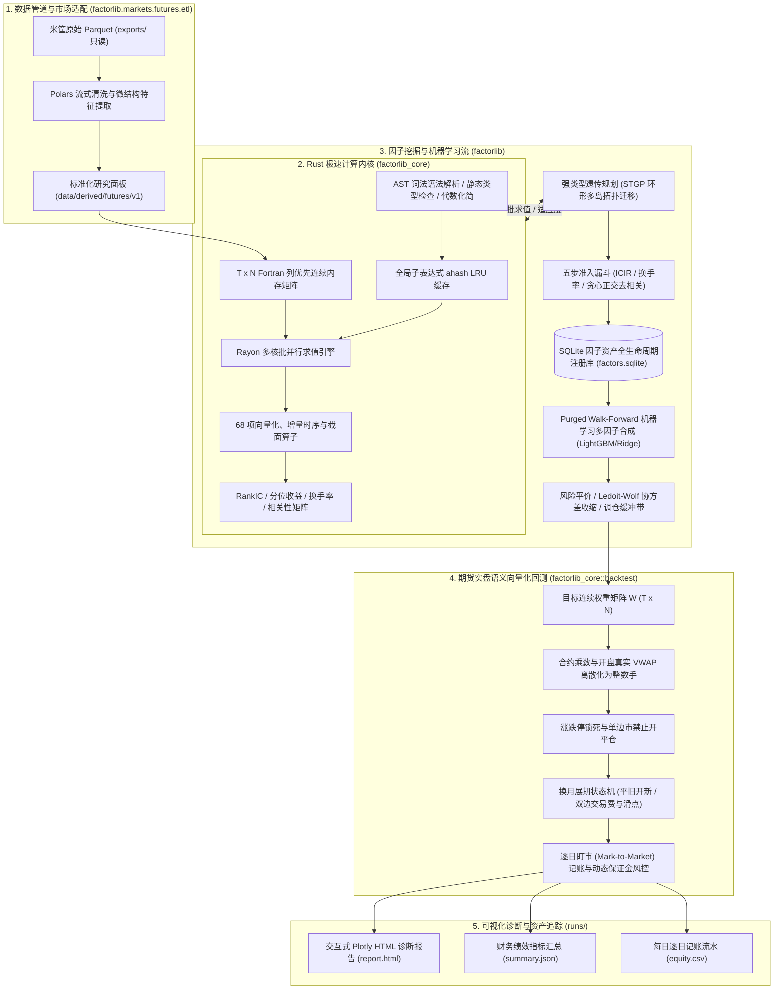

# FactorLibrary: 双市场量化因子挖掘、深度学习 (DL Alpha) 与实盘回测平台

<div align="center">

[](https://www.python.org/)
[](https://www.rust-lang.org/)
[](https://pyo3.rs/)
[](https://pytorch.org/)
[](https://fastapi.tiangolo.com/)
[](https://pola.rs/)
[](https://lightgbm.readthedocs.io/)
[](LICENSE)

<h3>极速 Rust 原生计算内核 × 现代 Python 科学计算与 PyTorch 生态</h3>
<p><b>期货 (1d+1m) 与 A 股 (1d) 双市场统一底座 → DSL / Python 因果沙箱 → STGP 遗传规划与 PyTorch 1d DL Alpha 自动挖掘 → Rust Spanning 三关正交准入 → FastAPI 分市场 Web 投研工作台</b></p>

</div>

---

## 目录 (Table of Contents)

- [平台简介](#平台简介)
- [核心架构与数据流](#核心架构与数据流)
- [八大核心特性](#八大核心特性)
- [快速上手](#快速上手)
  - [1. 环境安装与构建](#1-环境安装与构建)
  - [2. 提交前门禁快速验证](#2-提交前门禁快速验证)
- [数据管理与面板构建](#数据管理与面板构建)
  - [1. 原始数据资产](#1-原始数据资产)
  - [2. 数据资产深度自检与审计](#2-数据资产深度自检与审计)
  - [3. 标准化研究面板构建](#3-标准化研究面板构建)
  - [4. 派生面板结构解析](#4-派生面板结构解析)
- [端到端一键流水线 (CLI)](#端到端一键流水线-cli)
  - [场景 A：单因子全流程极速回测](#场景-a单因子全流程极速回测)
  - [场景 B：因子资产库联动合成回测](#场景-b因子资产库联动合成回测)
  - [场景 C：STGP 演化挖掘 + ML 合成全流程](#场景-cstgp-演化挖掘--ml-合成全流程)
  - [回测结果与实验产物解读](#回测结果与实验产物解读)
- [分模块生产级 CLI 脚本指南](#分模块生产级-cli-脚本指南)
  - [1. 种子因子入库 (`init_seed_factors.py`)](#1-种子因子入库-init_seed_factorspy)
  - [2. 强类型遗传规划独立挖掘 (`run_gp.py`)](#2-强类型遗传规划独立挖掘-run_gppy)
  - [3. Purged Walk-Forward 机器学习独立合成 (`run_ml.py`)](#3-purged-walk-forward-机器学习独立合成-run_mlpy)
  - [4. 期货实盘向量化回测 (`run_backtest.py`)](#4-期货实盘向量化回测-run_backtestpy)
  - [5. 现代化 6 阶段量化因子研发 Web 工作台 (`run_web.py`)](#5-现代化-6-阶段量化因子研发-web-工作台-run_webpy)
  - [6. 全资产代码质量认证门禁 (`verify.sh`)](#6-全资产代码质量认证门禁-verifysh)
  - [7. A 股统一回测、MOSEK 组合优化与用户手册](#7-a-股统一回测mosek-组合优化与用户手册)
- [Python SDK 核心编程范式](#python-sdk-核心编程范式)
  - [1. 面板容器操作 (`factorlib.core.panel`)](#1-面板容器操作-factorlibcorepanel)
  - [2. DSL 表达式构建与静态检查 (`factorlib.core.dsl`)](#2-dsl-表达式构建与静态检查-factorlibcoredsl)
  - [3. Rust 极速计算内核交互 (`factorlib_core.Engine`)](#3-rust-极速计算内核交互-factorlib_coreengine)
  - [4. SQLite 因子全生命周期注册库 (`factorlib.core.registry`)](#4-sqlite-因子全生命周期注册库-factorlibcoreregistry)
  - [5. 因子综合评估体系 (`factorlib.core.evaluate`)](#5-因子综合评估体系-factorlibcoreevaluate)
  - [6. 组合优化与实盘回测状态机 (`factorlib.core.portfolio` / `backtest`)](#6-组合优化与实盘回测状态机-factorlibcoreportfolio--backtest)
- [高性能算子速查表（128 项注册 / 106 项 FactorLab 1d 对齐）](#高性能算子速查表128-项注册--106-项-factorlab-1d-对齐)
- [严密防未来函数与交易语义规范](#严密防未来函数与交易语义规范)
- [配置文件索引与规范](#配置文件索引与规范)
- [代码库目录导航](#代码库目录导航)
- [A 股双源架构与 Barra/MOSEK 回测闭环](#a-股双源架构与-barramosek-回测闭环)

---

## 平台简介

**FactorLibrary** 是一个专为中国商品与股指期货市场打造的工业级量化因子挖掘与实盘回测平台。平台严格遵循「**市场无关计算内核（Core）**」与「**市场适配层（MarketAdapter）**」的绝对解耦设计原则，核心热路径采用 Rust 原生实现并通过 PyO3 导出为极速扩展库，上层采用 Python 构建灵活强大的量化研究全生命周期工作流。

系统全流程实现**严密防未来函数**因果对齐机制，从原始微观高频行情流式清洗、VWAP 撮合价提取，到 AST 代数化简、强类型遗传规划（STGP）批量挖掘、五步准入漏斗、Purged Walk-Forward 机器学习多因子合成，直至手数离散化实盘语义回测与交互式 Plotly HTML 报告产出，支持百代万级表达式高并发快速评估。同时预留了完整的 A 股股票市场扩展适配接口规范。

---

## 核心架构与数据流



---

## 八大核心特性

1. **Rust 原生极速计算内核**：
   - 基于连续内存的 $(T, N)$ Fortran-order 列优先宽矩阵，极致发挥 CPU L1/L2 缓存与 SIMD 向量化性能；
   - **128 项注册算子**（完整覆盖 FactorLab 106 个 1d 算子及多元 WLS 残差 `cs_multi_wls_resi`、Barra 标准化 `barra5_zScore`、增量 Welford $O(1)$ 与单调队列极值等）+ 12 项声明式后处理算子；
   - 多表达式通过 Rayon 释放全部多核并发，全局子表达式 LRU 缓存避免重复求值。
2. **强类型遗传规划（STGP）批量因子挖掘**：
   - 强类型节点系统（`Series`, `Window`, `Constant`, `Bool`），从语法树生成期杜绝类型畸变与无效求值；
   - 支持交叉、子树变异、点变异、提升突变（Hoist Mutation 强力抑制代码膨胀）与环形多岛拓扑迁移。
3. **五步自动化准入漏斗管线**：
   - Top-K 名人堂初筛 $\to$ 验证集同向显著性约束 $\to$ 截面换手率软门槛 $\to$ 贪心正交去相关（$\max |\rho| < 0.60$） $\to$ 原子化入库。
4. **SQLite 因子资产全生命周期状态机**：
   - 基于唯一代数指纹 `canon_hash` 精确去重，四阶段生命周期流转：`candidate` $\to$ `accepted` $\to$ `active` $\to$ `deprecated`；
   - 完备记录实验批次轨迹（`run_tracker`）与跨样本段（Train/Valid/Test）多预测期数（1, 3, 5, 10, 20）评估指标。
5. **Purged Walk-Forward 机器学习多因子合成**：
   - 按年扩展（Expanding）与滚动（Rolling）重训机制，训练/验证/测试严密时序隔离带（Purge Window = $h$），杜绝标签重叠前瞻泄露；
   - 截面中位数极值截断（MAD Winsorization）与排序高斯化（Rank Gauss）；
   - 支持 Equal Weight、Rolling ICIR、Ridge 与 LightGBM 截面排序回归。
6. **期货实盘交易语义向量化回测**：
   - 统一遵循米筐 `trading_date`，信号基于 $T$ 日收盘生成，执行于 $T+1$ 开盘前 30 分钟真实成交价 $\text{VWAP} = \sum(\text{close} \times \text{volume}) / \sum \text{volume}$；
   - 目标连续权重动态转为品种整数手数；
   - 涨跌停锁死阻断、换月平旧开新双边手续费与滑点、动态保证金超限强平阻断；
   - 严格满足每日盯市记账恒等式：$\text{Cash}_d + \sum (\text{lots}_{i,d} \times \text{settle}_{i,d} \times \text{Multiplier}_i) == \text{Equity}_d$。
7. **全资产交付与质量认证门禁体系**：
   - 内置 `bash scripts/verify.sh --all`，涵盖暂存区数据安全审计、`uv lock --check`、YAML/TOML 配置校验、Rust `rust-analyzer` / 零警告 Clippy / `cargo test`（43 项）、Python Ruff / Pytest（216 项）、因果摄动防未来函数审计（4 项）及全量 CLI 入口体检。
8. **A 股双源独立架构与 Barra/MOSEK 实盘级回测**：
   - 物理分库、运行时协同：`stocks/rq`（50+ 量价/估值/指数权重字段，加载时自动通过 `RiskView` 只读挂载 `barra` 的 `vwap_open_30m` 标签与 CNE5 风格）+ `stocks/barra`（`VwapBegin30`、42 因子日频协方差 `risk_store`）；
   - 通过 [`BarraPortfolioOptimizer`](python/factorlib/markets/stocks/optimizer.py) 调用本地 `MOSEK` / `CLARABEL` 求解 Barra 低秩 QP 与跨期 Horizon LP，统一由 [`scripts/run_stocks_backtest.py`](scripts/run_stocks_backtest.py) 驱动 Rust T+1 整手撮合。
   - 完整操作指南见 **[《A 股量化全流程用户使用手册》](docs/stocks_user_guide.md)**。

---

## 快速上手

### 1. 环境安装与构建

推荐使用现代 Python 包管理器 `uv`（或原生 `python3.12 -m venv`）配合 Rust 工具链（`rustup` / `cargo`）：

```bash
# 1. 确保 Rust 工具链就绪 (rustc >= 1.80)
rustc --version
cargo --version

# 2. 创建并激活 Python 3.12 虚拟环境
# 方式 A (推荐 uv):
uv venv --python 3.12 .venv
source .venv/bin/activate

# 方式 B (原生 python3.12):
python3.12 -m venv .venv
source .venv/bin/activate

# 3. 安装 Python 核心依赖、开发套件与 PyTorch DL Alpha 扩展
pip install -e ".[dev,dl]"

# 4. 编译并挂载 Rust 核心扩展库 (release 极速模式)
maturin develop --release --manifest-path rust/factorlib_core/Cargo.toml
```

### 2. 提交前门禁快速验证

安装完成后，可立即执行门禁脚本快速检验环境与依赖完整性：

```bash
# 快速静态校验 (格式、Lint 与配置检查)
bash scripts/verify.sh --fast

# 全量门禁认证 (含 uv lock、Rust 单元与 Proptest 测试、Python 全量测试、因果摄动审计与 CLI 体检)
bash scripts/verify.sh --all
```

### 3. 建立与启动双市场 Web 投研工作台服务 (Web Workbench Service)

平台内置基于 **FastAPI + Uvicorn** 的单栈 HTTP 服务与原生 ES 模块前端（`python/factorlib/frontend/`，已定位为**只读台账浏览 + 单因子实验室**）：

```bash
# 方式 1：默认启动（自动加载本地 data/derived/futures/v1 与 data/derived/stocks/rq 真实面板，监听 127.0.0.1:8080）
python scripts/run_web.py

# 方式 2：使用打包注册的 CLI 命令启动并指定默认市场与端口
factorlib-web --host 0.0.0.0 --port 8080 --market stocks

# 方式 3：通过 Uvicorn 直接挂载 ASGI 应用实例
uvicorn factorlib.workbench_server:app --host 127.0.0.1 --port 8080

# 方式 4：强制启用内置合成演示面板（无需本地 Parquet 数据即可开箱体验全部 5 大页面与 GP/DL 挖矿）
python scripts/run_web.py --synthetic --port 8080
```

服务启动后可访问：
- **Web 交互投研工作台**：`http://127.0.0.1:8080`（支持 `#/{futures|stocks}/{data|lab|compare|mining|registry}` 路由直达）
- **OpenAPI 交互文档**：`http://127.0.0.1:8080/docs`

#### Web 工作台 5 大核心页面与操作流

| 页面路由 | 页面名称 | 核心功能与投研操作 |
|---|---|---|
| `#/{market}/data` | **① 数据与特征池中心** | 面板体检卡 (`data_version`、缺失率、样本 Split 预览)、`1d` 真实 K 线与多标的归一化对比浏览器、`1m` 扩展特征包按需挂载、命名 `FeatureSet` 可视化编辑与版本对比 |
| `#/{market}/lab` | **② 单因子实验室** | 左侧字段/扩展/68 算子/12 后处理目录树，中部 Rust DSL 与 Python `compute(context)` 双模态编辑器 + 声明式后处理链，右侧毫秒级探针（耗时、覆盖率、20 分箱截面分位数分布直方图、防未来函数静态拦截） |
| `#/{market}/compare` | **③ 回测结果与对比** | **单因子模式**：Layer 1 Schema v4 全市场 IC/RankIC/PercIC/5dIC、分层净值 (`G1..G5` / `G1..G10`)、多空/多头超额组合、风格暴露归因、Layer 2 实盘逐日盯市回测与 **FactorLab MCP 线上权威基准同屏对账**；**多因子 A/B 模式**：2~6 因子严格 OOS 交集对比、Rust `cross_correlation` 热力图与 Spanning 正交残差累积 IC |
| `#/{market}/mining` | **④ 挖掘 / DL 训练中心** | 支持 **STGP 批量挖掘**、**PyTorch 1d DL Alpha 滚动训练**（`GRU` / `Spatio-Temporal Attention` / `Gated-MLP` / `1D-TCN`）、**二层合成与消融**三类配方组装，一键生成 `sha256` 冻结 `recipe_id`，提供「`▶ 后台独立启动` (`start_new_session=True`)」与「`⧉ 复制 CLI 命令`」双出口及实时进度/PID/日志尾行看板 |
| `#/{market}/registry` | **⑤ 审核与注册库** | 市场隔离的 `candidate` 待审候选队列与资产台账 (`accepted`/`active`/`deprecated`)，支持一键触发**「批量三关准入审计」**（关 1 `|ICIR|` + 换手 + Rust 去重 $\max|\rho|<0.60$ → 关 2 Rust MGS2 Spanning 正交残差 $t$-stat → 关 3 二层 Walk-Forward 合成消融费后 $\Delta\text{Sharpe}$）与同 `FeatureSet` 家族变体配额去重 |

---

## 数据管理与面板构建

### 1. 原始数据资产

平台默认支持米筐（Ricequant）格式期货历史行情数据资产（只读存放于 `exports/` 目录，约 12.7GB）：
- `bar_1d/`：全品种日线 OHLCV、持仓量、结算价与成交额；
- `bar_1m/`：全品种分钟线，用于流式提取 $T+1$ 开盘前 30 分钟真实成交价 VWAP；
- `calendar/`：统一交易日历 (`calendar.parquet`)；
- `dominant_mapping/`：主力合约映射字典（`rule=3` 避开交割月流动性枯竭）；
- `roll_yield/`：展期收益率衍生数据；
- `warehouse_stocks/`：注册仓单库存数据；
- `member_rank/`：期货交易所龙虎榜会员前 20 大持仓数据。

### 2. 数据资产深度自检与审计

在首次使用前，可调用数据审计工具对原始数据资产进行全量完整性扫描：

```bash
# 快速自检模式
python scripts/audit_data.py --quick

# 全量深度审计并输出 Markdown 诊断报告
python scripts/audit_data.py --output data/derived/futures/audit_report.md
```

### 3. 标准化研究面板构建

调用 ETL 流水线将原始分品种数据流式清洗为内存友好的宽表与标签集：

```bash
# 快速演示模式 (仅构建 2024-02-01 ~ 2024-03-31 两个月期货演示面板)
python scripts/build_panel.py --market futures --quick

# 全历史期货标准化面板构建 (覆盖 2018-01-01 至 2026-08-31 -> data/derived/futures/v1)
python scripts/build_panel.py --market futures --start-date 2018-01-01 --end-date 2026-08-31 --version v1

# 全历史 A 股米筐特征面板构建 (2015-11-01 至 2026-11-06, 5478 只股票 -> data/derived/stocks/rq)
python scripts/build_panel.py --market stocks --version rq

# 全历史 A 股 Barra 风险与执行面板构建 (2016-01-06 至 2026-11-10, 5642 只股票 -> data/derived/stocks/barra)
python scripts/build_stocks_lb_barra.py
```

### 4. 派生面板结构解析

构建完成的研究面板落盘于 `data/derived/futures/v1/`：
- `panel_daily.parquet`：宽表格式日线特征矩阵（含价格、微观结构特征、基本面衍生指标）；
- `labels.parquet`：预测目标收益率标签（例如 $y_1, y_3, y_5, y_{10}, y_{20}$）；
- `rolls.parquet`：主力换月展期事件记录表（旧主力、新主力、换月生效日）；
- `fields.json`：特征字段名、维度与数据类型元数据；
- `meta.json`：面板版本、覆盖日期范围、标的品种池指纹。

---

## 端到端一键流水线 (CLI)

`scripts/run_pipeline.py` 是平台最核心的端到端调度入口，串联「面板加载 $\to$ 种子因子注册 $\to$ STGP 演化挖掘 $\to$ 机器学习多因子合成 $\to$ 风险平价组合优化 $\to$ Rust 期货实盘状态机回测 $\to$ Plotly 交互式 HTML 诊断报告生成」。

### 场景 A：单因子全流程极速回测

若您希望快速评估单个因子表达式的实盘收益与回撤表现，直接传入 `--factor`：

```bash
# 评估 20 日价格动量单因子
python scripts/run_pipeline.py --factor "pct_change(close, 20)"

# 评估 20 日时序 Z-Score 因子
python scripts/run_pipeline.py --factor "ts_zscore(close, 20)"

# 评估微观结构复合因子
python scripts/run_pipeline.py --factor "cs_rank(ts_mean(sub(close, open), 20))"
```

### 场景 B：因子资产库联动合成回测

若不指定 `--factor`，流水线将自动连接 SQLite 因子资产库，提取所有标记为 `accepted` 的因子资产，通过机器学习管线执行合成回测：

```bash
# 使用因子库资产执行截面等权 (Equal Weight) 合成回测
python scripts/run_pipeline.py --ml-model equal_weight

# 使用岭回归 (Ridge) 滚动重训合成回测
python scripts/run_pipeline.py --ml-model ridge

# 使用 LightGBM 决策树截面排序回归合成回测
python scripts/run_pipeline.py --ml-model lgbm
```

### 场景 C：STGP 演化挖掘 + ML 合成全流程

一键开启遗传规划自动化挖掘，让算法自主进化新因子，并通过五步准入漏斗筛选入库后执行回测：

```bash
python scripts/run_pipeline.py \
  --run-gp \
  --gp-population 200 \
  --gp-generations 10 \
  --ml-model equal_weight \
  --output-dir runs/my_gp_experiment
```

### 回测结果与实验产物解读

每次运行完成后，实验产物自动统一保存于 `runs/pipeline_YYYYMMDD_HHMMSS/`（或自定义 `--output-dir`）中：

| 产物文件 | 说明 | 核心价值 |
|---|---|---|
| `report.html` | **交互式 Plotly 诊断报告** | 包含累计净值走势曲线、最大回撤水下分布、月度收益热力矩阵、每日单边换手率柱状图 |
| `summary.json` | **财务绩效汇总指标** | 年化收益率 (`annual_return`)、夏普比率 (`sharpe`)、最大回撤 (`max_drawdown`)、Calmar 比率、日均换手率 (`daily_turnover_mean`) |
| `equity.csv` | **每日盯市账户记账流水** | 逐日记载：`trading_date`, `equity`, `cash`, `margin_used`, `gross_leverage`, `net_pnl`, `turnover` |
| `pipeline_summary.json` | **全链路元数据与耗时** | 记录面板尺寸、特征数量、调仓天数、因子表达式与阶段耗时统计 |

---

## 分模块生产级 CLI 脚本指南

除了全流程流水线外，平台提供了完备的独立模块化命令行工具，便于分阶段研究与离线批处理：

### 1. 种子因子入库 (`init_seed_factors.py`)

评估经典文献 4 大种子因子（价格动量、展期收益率、5日仓单变动、5日主力净多变动），计算各样本区间指标并写入 SQLite 因子库：

```bash
python scripts/init_seed_factors.py \
  --panel data/derived/futures/v1 \
  --db data/registry/factors.sqlite \
  --run-id seed_init_v1
```

### 2. 强类型遗传规划独立挖掘 (`run_gp.py`)

启动多岛模型（Islands Topology）并行演化，支持静态 YAML 或直接加载 Web 冻结的 `--recipe <recipe_id>`：

```bash
# 按配置文件启动
python scripts/run_gp.py \
  --market futures \
  --config configs/futures/gp_default.yaml \
  --population 500 \
  --generations 30 \
  --islands 4 \
  --seed 42 \
  --min-valid-icir 0.3 \
  --runs-dir runs

# 按 Web 端冻结的不可变配方启动 (自动同步心跳与 candidate 入库)
python scripts/run_gp.py --recipe <recipe_id> --market futures
```

### 3. PyTorch 1d 深度学习因子滚动训练 (`run_dl.py`)

基于 Purged Walk-Forward 样本外滚动重训与多种子 Z-Score 融合，支持 `gru`、`st_attention`（A 股自动启用 $O(N \cdot M)$ Market-Guided Routing）、`gated_mlp`、`tcn` 四大模型族，产出 `.npz` 物化矩阵并自动注册为 `dl_alpha` 候选因子：

```bash
# 期货 1d GRU 滚动训练
python scripts/run_dl.py --market futures --arch gru --seq-len 20 --hidden-dim 32 --epochs 12 --n-seeds 3 --n-folds 4

# A 股 1d 时空解耦 Attention 滚动训练（输出 predictions.parquet 至 runs/）
python scripts/run_dl.py --market stocks --arch st_attention --target-label y_idio_5
```

### 4. Purged Walk-Forward 机器学习独立合成 (`run_ml.py`)

从因子库加载合格因子矩阵，执行 Purged 扩展窗口逐年滚动重训，产出样本外多模型预测评分矩阵：

```bash
python scripts/run_ml.py \
  --market futures \
  --config configs/futures/ml_default.yaml \
  --start-year 2018 \
  --end-year 2026 \
  --train-window expanding \
  --purge-window 5
```

### 5. 期货与 A 股实盘向量化回测 (`run_backtest.py`)

使用单因子表达式或机器学习产出的 `pred_panel.parquet` 执行实盘撮合状态机回测：

```bash
# 单因子表达式回测
python scripts/run_backtest.py \
  --factor "ts_zscore(close, 20)" \
  --config configs/futures/backtest.yaml \
  --fees configs/futures/fees.yaml

# 机器学习预测宽表回测
python scripts/run_backtest.py \
  --pred runs/ml_run_v1/predictions.parquet \
  --config configs/futures/backtest.yaml \
  --fees configs/futures/fees.yaml
```

### 6. 双市场量化因子研发 Web 工作台 (`run_web.py` / `factorlib-web`)

```bash
# 启动 FastAPI + Uvicorn 双市场研发工作台
python scripts/run_web.py --host 127.0.0.1 --port 8080
```

### 7. 全资产代码质量认证门禁 (`verify.sh`)

所有开发者在提交代码前**必须**运行的质量认证脚本，提供多种执行模式：

```bash
bash scripts/verify.sh --all        # 全量六大门禁检验 (推荐提交前执行)
bash scripts/verify.sh --fast       # 快速日常静态校验 (格式、类型与配置)
bash scripts/verify.sh --rust       # 仅运行 Rust 内核 Clippy, Fmt 与单元测试
bash scripts/verify.sh --python     # 仅运行 Python Ruff, Pytest 与因果摄动审计
bash scripts/verify.sh --git-only   # 仅检查 Git 暂存区数据安全防泄漏
```

### 7. A 股统一回测、MOSEK 组合优化与用户手册

A 股全链路已收口至 `data/derived/stocks/{rq, barra}` 与独立入口 [`scripts/run_stocks_backtest.py`](scripts/run_stocks_backtest.py)（完整步骤、Python 因子编写、本地 MOSEK 求解配置见 **[《A 股量化全流程用户使用手册》](docs/stocks_user_guide.md)**）：

```bash
# 1. 下载/同步米筐 A 股日线与元数据至 data/raw/stocks/rq/
python scripts/download_rq_stocks.py --help

# 2. 单因子 DSL 探针校验 + 自动 SignalBridge(rq->barra) + 本地 MOSEK Barra QP 回测
python scripts/run_stocks_backtest.py --factor "-ts_sum(c2c_ret, 5)" --postprocess standard --probe-only
python scripts/run_stocks_backtest.py --factor "-ts_sum(c2c_ret, 5)" --postprocess standard --profile default

# 3. ML / DL 预测长表回测
python scripts/run_stocks_backtest.py --pred runs/ml_xxx/predictions.parquet --profile default

# 4. 外部信号宽表与 factorsim 对账预设 (shifted_signal.parquet + 0.003 flat 费率 + 0.9 仓位)
python scripts/run_stocks_backtest.py --profile factorsim_match

# 5. 经典因子 Volume_Price_2_H5_2 与 FactorLab MCP 对账脚本
python scripts/backtest_volume_price_factor.py --execution-simulation
python scripts/backtest_multi_factors.py --execution-simulation
```

---

## Python SDK 核心编程范式

在 Jupyter Notebook、研究脚本或生产服务中，可直接调用 `factorlib` 与 `factorlib_core`：

### 1. 面板容器操作 (`factorlib.core.panel`)

```python
from factorlib.core.panel import Panel

# 从派生目录加载标准化面板
panel = Panel.load("data/derived/futures/v1")
print(f"面板规模: {panel.T} 交易日 x {panel.N} 品种")
print(f"覆盖特征: {list(panel.fields.keys())[:5]}")

# 提取特征矩阵 (均为 Fortran 列优先 (T, N) 连续内存数组)
close = panel.get_field("close")
volume = panel.get_field("volume")
mask = panel.mask  # 可交易品种有效掩码 (T, N) bool

# 按日期区间切片
sub_panel = panel.slice_dates("2024-01-01", "2024-03-31")
```

### 2. DSL 表达式构建与静态检查 (`factorlib.core.dsl`)

系统提供链式语法糖 `Expr` 与终端字段构造器 `F`，支持原生 Python 算术运算符重载：

```python
from factorlib.core.dsl import F, Expr, canonicalize_expr, validate_expr

# 1. 链式构建中缀语法糖
alpha = (F("close") - F("open")).ts_mean(20).cs_rank()
print(str(alpha))  # 输出: 'cs_rank(ts_mean(sub(close, open), 20))'

# 2. 静态类型检查与防未来函数拦截
check = validate_expr(str(alpha), available_fields=list(panel.fields.keys()))
print("语法校验通过:", check["valid"])

# 非法未来函数调用将被强力拦截
invalid_check = validate_expr("ts_delay(close, -5)")
assert not invalid_check["valid"], "成功阻断未来前向移位算子！"

# 3. AST 代数规范化与唯一哈希指纹
canon_info = alpha.canonicalize(available_fields=list(panel.fields.keys()))
print(f"规范化表达式: {canon_info.canon_expr}")
print(f"代数指纹哈希: {canon_info.canon_hash}")
```

### 3. Rust 极速计算内核交互 (`factorlib_core.Engine`)

```python
# 将 Panel 数据直通注入 Rust 原生引擎 (零数据拷贝，Fortran 内存直连)
engine = panel.to_rust_engine(cache_mb=128, n_threads=4)

# 单表达式求值 (毫秒级)
mat = engine.eval("ts_zscore(close, 20)")

# 多表达式批并行求值 (充分利用 CPU 全部多核并发)
batch_exprs = [
    "ts_mean(close, 5)",
    "ts_mean(close, 20)",
    "pct_change(close, 10)",
    "cs_rank(ts_std(close, 20))",
]
results = engine.eval_batch(batch_exprs)
```

### 4. SQLite 因子全生命周期注册库 (`factorlib.core.registry`)

```python
from factorlib.core.registry import FactorRecord, FactorRegistry

registry = FactorRegistry("data/registry/factors.sqlite")

# 查询库内已准入因子列表
factors = registry.list_factors(status="accepted")
for f in factors:
    print(f"ID {f.id}: [{f.status}] {f.canon_expr} (方向: {f.sign}, 来源: {f.source})")

# 更新因子生命周期状态
# candidate -> accepted -> active -> deprecated
if factors:
    registry.update_factor_status(factors[0].id, "active")
```

### 5. 因子综合评估体系 (`factorlib.core.evaluate`)

```python
from factorlib.core.evaluate import evaluate_factor

# 针对单因子执行多时段切分与多预测周期 (h=1,3,5,10,20) 全维度评估
eval_res = evaluate_factor(panel, "pct_change(close, 20)")

print("推荐方向 (Sign):", eval_res.sign)
for split_name, h_dict in eval_res.metrics_by_split.items():
    if 5 in h_dict:
        m = h_dict[5]
        print(f"[{split_name}] h=5: RankIC={m.ic_mean:.4f}, ICIR={m.ic_ir:.2f}, 多空年化={m.ls_annual_ret:.2%}")

# 直接转化为因子注册表记录落盘
record = eval_res.to_factor_record(source="manual", status="candidate")
registry.register_factor(record, run_id="my_manual_test")
```

### 6. 组合优化与实盘回测状态机 (`factorlib.core.portfolio` / `backtest`)

```python
import yaml
from factorlib.core.backtest import run_backtest
from factorlib.core.portfolio import build_portfolio_weights
from factorlib.core.report import generate_html_report
from factorlib.markets.futures.adapter import FuturesMarketAdapter

# 1. 加载配置与市场适配器
with open("configs/futures/backtest.yaml", encoding="utf-8") as f:
    bt_cfg = yaml.safe_load(f)
adapter = FuturesMarketAdapter(fees_path="configs/futures/fees.yaml")

# 2. 组合优化: 波动率倒数平价、收缩协方差与调仓缓冲带
scores = engine.eval("ts_zscore(close, 20)")
target_weights = build_portfolio_weights(
    scores=scores,
    returns=panel.fields["close"],
    mask=panel.mask,
    config=bt_cfg["portfolio"],
)

# 3. 执行 Rust 期货实盘语义向量化回测
result = run_backtest(
    panel=panel,
    weights=target_weights,
    config=bt_cfg,
    adapter=adapter,
)

# 4. 打印财务统计并导出交互式 HTML 诊断报告
print(f"年化收益: {result.metrics['annual_return']:.2%}")
print(f"夏普比率: {result.metrics['sharpe']:.2f}")
print(f"最大回撤: {result.metrics['max_drawdown']:.2%}")

generate_html_report(result, output_path="runs/my_report.html", title="单因子回测报告")
```

---

## 高性能算子速查表（128 项注册 / 106 项 FactorLab 1d 对齐）

Rust 内核原生注册 **128 项**向量化与时序算子（完整覆盖 FactorLab 106 个 1d 表达式算子及别名，详见 [`docs/factorlab_1d_operator_alignment.md`](docs/factorlab_1d_operator_alignment.md)），核心分类速查：

| 算子类别 | 数量 | 算子名称与语法签名 | 算法特性与说明 |
|---|:---:|---|---|
| **逐元素一元算子** | 12 | `neg(x)`, `abs(x)`, `sign(x)`, `inv(x)`, `slog(x)`, `ssqrt(x)`, `square(x)`, `cube(x)`, `sigmoid(x)`, `tanh(x)`, `relu(x)`, `atan(x)` | 逐点向量化，安全除零与负数平滑净化，无崩溃隐患。 |
| **逐元素二元算子** | 8 | `add(x, y)`, `sub(x, y)`, `mul(x, y)`, `div(x, y)`, `max2(x, y)`, `min2(x, y)`, `hypot(x, y)`, `copysign(x, y)` | 矩阵广播计算，自动遵循 IEEE 754 NaN 传播准则。 |
| **标量常数算子** | 6 | `addc(x, c)`, `subc(x, c)`, `mulc(x, c)`, `divc(x, c)`, `spow(x, c)`, `clip(x, c)` | 与浮点标量 $c$ 逐元素运算；`spow` 自动保留符号。 |
| **时序滚动算子** | 25 | `delay(x, d)`, `delta(x, d)`, `pct_change(x, d)`, `log_return(x, d)` | 时序平移与一阶差分，$O(1)$ 环形缓冲区极速推进。 |
| | | `ts_mean(x, d)`, `ts_sum(x, d)`, `ts_var(x, d)`, `ts_std(x, d)` | 基于双栈增量 **Welford $O(1)$ 算法**，杜绝浮点精度累积漂移。 |
| | | `ts_skew(x, d)`, `ts_kurt(x, d)` | 三阶偏度与四阶峰度在线增量累加器。 |
| | | `ts_min(x, d)`, `ts_max(x, d)`, `ts_argmax(x, d)`, `ts_argmin(x, d)` | 基于**单调双端队列 (Monotonic Deque)** 实现均摊 $O(1)$ 极值搜索。 |
| | | `ts_rank(x, d)`, `ts_zscore(x, d)`, `ts_mad(x, d)` | 时序百分比排名、时序滚动 Z-Score 与中位数绝对偏差。 |
| | | `ts_decay_linear(x, d)`, `ts_ema(x, d)` | 线性衰减权重平滑与指数移动平均。 |
| | | `ts_corr(x, y, d)`, `ts_cov(x, y, d)`, `ts_beta(x, y, d)` | 增量双变量 Welford $O(1)$ 协方差、相关系数与资产 Beta。 |
| | | `ts_wmean(x, w, d)`, `ts_sharpe(x, d)` | 加权滚动均值与时序年化夏普比率。 |
| **横截面算子** | 9 | `cs_rank(x)` | 截面百分比排名（排序归一化至 $[0, 1]$）。 |
| | | `cs_zscore(x)`, `cs_scale(x)`, `cs_demean(x)` | 截面标准化、绝对值和归一化与截面去均值。 |
| | | `cs_winsorize(x)`, `cs_mad(x)` | 截面 MAD 稳健去极值截断与截面中位数绝对偏差。 |
| | | `cs_quantile(x, q)` | 截面分位数切分。 |
| | | `cs_neutralize(x, g)` | 截面正交化中性化投影。 |
| **行业/板块算子** | 3 | `group_rank(x, g)`, `group_demean(x, g)`, `group_zscore(x, g)` | 按板块或申万行业分组标识 $g$ 执行组内中性化。 |
| **逻辑与条件算子** | 5 | `gt(x, y)`, `lt(x, y)`, `gt_const(x, c)`, `lt_const(x, c)`, `if_else(cond, x, y)` | 矩阵布尔掩码比较与三元条件分支选择。 |

---

## 严密防未来函数与交易语义规范

平台在量化研究全链路设立严格的因果隔离机制：

1. **时序因果对齐**：
   - 统一使用米筐 `trading_date`；
   - $T$ 日所有因子值、复权因子、截面标签与主力合约映射只能读取截至 $T$ 日 15:00 收盘已知的数据；
   - 静态类型检查器阻断任何前向负数位移（如 `delay(x, -1)`）及未来标签。
2. **真实实盘撮合成交机制**：
   - 严禁使用 $T$ 日收盘价直接作为成交价（收盘价已包含因果信息）；
   - 执行撮合统一使用 $T+1$ 开盘前 30 分钟基于 1m bar 计算的真实加权平均价：
     $$\text{VWAP}_{T+1} = \frac{\sum_{t=1}^{30} (\text{close}_t \times \text{volume}_t)}{\sum_{t=1}^{30} \text{volume}_t}$$
   - 严禁使用 `turnover / volume`，彻底规避郑商所历史成交额置零除零隐患。
3. **换月展期状态机与双边摩擦**：
   - 遵循 `dominant_mapping`（`rule=3` 避开交割月流动性枯竭）；
   - 换月日旧合约平仓与新合约开仓严格独立记账，按各自真实成交价双边计收手续费与滑点，严禁跨合约价格直接作差。
4. **机器学习时序隔离 (Purged Walk-Forward)**：
   - 训练集与验证集末尾精确剔除 $h$ 天标签重叠区间（Purge Window = $h$），消除标签重叠带来的样本穿透；
   - 验证集与测试集前端设置静默隔离期（Embargo Window）。
5. **逐日盯市 (Mark-to-Market) 守恒定律**：
   - 每日收盘记账严格满足资金守恒恒等式：
     $$\text{Cash}_d + \sum_{i=1}^N (\text{lots}_{i,d} \times \text{settle}_{i,d} \times \text{Multiplier}_i) == \text{Equity}_d$$
     $$\text{Equity}_d - \text{Equity}_{d-1} == \text{NetPnL}_d$$

---

## 配置文件索引与规范

所有生产级配置文件均存放于 `configs/futures/` 目录：

| 配置文件 | 核心配置项与业务语义 |
|---|---|
| `data.yaml` | 原始米筐数据路径 (`exports/`)、派生面板路径、主力映射规则 (`rule=3, rank=1`)、复权方法与开盘 30 分钟 VWAP 撮合窗口。 |
| `universe.yaml` | 品种池准入规则：上市天数门槛（$\ge 60$ 天）、流动性门槛（20日日均成交额 $\ge 5000$ 万）、距离交割日最小天数（$\ge 5$ 天）。 |
| `fees.yaml` | 全期货品种合约规格：合约乘数、最小变动价位（tick_size）、开仓/平仓/平今手续费率与保证金率。 |
| `gp_default.yaml` | 遗传规划挖掘超参：种群规模 (1000)、演化代数 (50)、岛屿数 (4)、迁移间隔、树深与节点上限、准入阈值。 |
| `ml_default.yaml` | Walk-Forward 机器学习超参：滚动年份范围 (2018~2026)、扩展窗口模式、Purge 隔离天数、LightGBM 树参数。 |
| `backtest.yaml` | 回测资金与风控：初始本金 (1000 万)、目标年化波动率 (10%)、最大杠杆上限 (300%)、调仓缓冲带 (1%)、保证金安全乘数 (1.1)。 |

---

## 代码库目录导航

```text
FactorLibrary/
├── python/factorlib/                      # 主 Python 算法包
│   ├── core/                              # 面板容器、DSL、评估体系、组合优化、三关准入审计 (admission_audit)、工作台服务 (workbench)
│   ├── dl/                                # PyTorch 1d 深度学习因子管线 (Dataset、Gated-MLP/GRU/TCN/ST-Attention、IC Loss、Walk-Forward Trainer)
│   ├── frontend/                          # 零构建原生 ES 模块双市场 Web 工作台 (index.html, main.js, pages/{data,lab,compare,mining,registry}.js)
│   ├── gp/                                # 强类型遗传规划自动化因子挖掘系统 (原语、变异、多岛拓扑、准入漏斗)
│   ├── ml/                                # Purged Walk-Forward 机器学习多因子合成 (预处理、切分、LGBM、Ridge)
│   ├── markets/                           # 双市场 Profile 适配层 (MarketProfile 协议与注册中心)
│   │   ├── futures/                       # 期货 Profile、实盘回测、Ledoit-Wolf 组合、1m 扩展包与 ETL 清洗流
│   │   └── stocks/                        # A 股双源适配层 (panel_loader, ares_bridge, bridge, barra, optimizer, backtest)
│   └── workbench_server.py                # FastAPI + Uvicorn 单栈服务端入口 (/api/{market}/... 路由隔离)
├── rust/factorlib_core/                   # Rust 极速计算内核
│   ├── src/ops/                           # 128 项向量化、逐元素、Welford/单调队列、多元 WLS 残差算子 + 12 项后处理算子
│   ├── src/expr/                          # AST 语法树、词法语法分析、静态类型检查、代数规范化、分片 LRU 缓存
│   ├── src/metrics/                       # RankIC、分位数收益、换手率、相关性矩阵、MGS2 Spanning 正交残差检验
│   ├── src/labels.rs                      # 双市场统一 T+1 远期收益标签与顺延平仓内核
│   └── src/backtest/                      # 期货与 A 股实盘状态机 (futures.rs / stocks.rs / common.rs)
├── configs/{futures,stocks}/              # 双市场生产级 YAML 配置 (A 股含 data, barra, backtest, fees, mosek.lic)
├── scripts/                               # 生产维护与执行脚本 (run_stocks_backtest, run_backtest, run_gp, run_dl, run_ml, verify.sh)
├── tests/python/                          # Python 自动化单元与集成测试套件 (216 项测试 + 因果摄动与跨语言对账测试)
├── docs/                                  # 技术文档中心
│   ├── stocks_user_guide.md               # A 股全流程用户使用手册 (Data → 写因子 → GP/ML/DL → MOSEK 优化 → 回测)
│   ├── api_reference.md                   # 平台全模块 API 参考手册
│   ├── factorlab_1d_operator_alignment.md # FactorLab 106 算子与变量全量对齐规约
│   ├── factorlab_mcp_catalog.md           # FactorLab MCP 算子与变量手册
│   ├── futures_platform_plan.md           # 期货量化平台技术白皮书
│   └── superpowers/                       # 精简版显式挖因子设计规范 (v2.1) 与演进路线图 (v2)
├── exports/                               # 只读米筐原始期货 Parquet 数据资产 (已 gitignore)
├── data/                                  # 原始股票数据 (raw/stocks/{rq,barra})、派生面板 (futures/v1, stocks/{rq,barra}) 与 SQLite 因子库
├── runs/                                  # 实验产出目录 (心跳进度、日志、模型权重、HTML 诊断报告，已 gitignore)
├── AGENTS.md                              # 智能体协同开发工程规范与质量门禁红线
└── pyproject.toml                         # 项目工程与依赖配置
```

---

## A 股双源架构与 Barra/MOSEK 回测闭环

针对 A 股股票市场研究、因子对账与机构级 Barra 组合优化，系统通过 **「双源物理分库 (`rq` + `barra`) + 运行期单向桥接 (`RiskView` / `SignalBridge`) + 本地 MOSEK 凸优化 + Rust 实盘状态机」** 实现零手动调参闭环（详细操作指南见 [`docs/stocks_user_guide.md`](docs/stocks_user_guide.md)）：

1. **A 股 Profile 与 Rust 持仓回测 (`StocksProfile`, `rust/factorlib_core/src/backtest/stocks.rs`)**：1 手 = 100 股，乘数 1.0，无杠杆，支持真实非对称税费（买入佣金含 5 元最低消费 + 过户费、卖出印花税）与 `flat` 单边费率双模式，严格执行 `T+1` 锁仓与涨跌停/停牌阻断；
2. **双源协同底座 (`stocks/rq` & `stocks/barra`)**：`data/derived/stocks/rq/` 覆盖 `2015-11-01 ~ 2026-11-06`（5,478 只 A 股，50+ 量价/估值/指数权重字段），加载时自动通过 `RiskView` 只读挂载 `barra` 的 `vwap_open_30m` 标签（`y_h` / `y_idio_h`）与 10 维 CNE5 风格暴露；`data/derived/stocks/barra/` 覆盖 `2016-01-06 ~ 2026-11-10`（5,642 只 A 股，含 `VwapBegin30` 与 42 因子日频协方差 `risk_store/`），所有回测统一经 `SignalBridge` 落盘至 `barra` 以 `vwap_open_30m_adj` 撮合；
3. **本地 MOSEK 求解器与策略预设 (`configs/stocks/backtest.yaml`)**：`BarraPortfolioOptimizer` 优先读取 `configs/stocks/mosek.lic` 调用 `MOSEK`（支持 `CLARABEL`/`OSQP` 容错降级），`scripts/run_stocks_backtest.py` 内置 `default`（Barra QP + 非对称税费）、`quantile`（分位等权基线）与 `factorsim_match`（`shifted_signal.parquet` + `0.003` 单边费率 + `0.9` 仓位）三大预设；
4. **Web 基准与 FactorLab MCP (`bt_bb3a04da6b20456ab444dcb7e5450949`) 对账实例 (`Volume_Price_2_H5_2`)**：
   - 因子表达式：`neg(add(cs_zscore(ts_corr(close_hfq, log_amount, 20)), cs_zscore(ts_std(c2c_ret, 20))))`
   - 8 步后处理链：`baseUniMask -> trdMask -> dropNewStock:120 -> MAD:3 -> zScore -> indNeut:sector -> decay:5 -> rank`

| 核心评价指标 (2016-01-04 ~ 2024-12-31) | 本地 Web 引擎 (`open_adj` 无前视主口径) | 本地对照口径 (`vwap_adj` 全天均价) | FactorLab MCP 线上基准 (`vwap30`) | 对账结论 |
|---|---:|---:|---:|---|
| **1d RankIC 均值** | `0.0343` | `0.0416` | `0.0431` | ✔ 高度吻合（`vwap` 口径偏差仅 `0.0015`） |
| **1d RankIC IR** | `0.3119` | `0.3986` | `0.4019` | ✔ 高度吻合（`vwap` 口径偏差仅 `0.0033`） |
| **RankIC > 0 胜率** | `63.30%` | `66.59%` | `67.96%` | ✔ 同向稳定 |
| **5d Pearson IC** | `0.0273` | `0.0294` | `0.0332` | ✔ 跨周期衰减一致 |
| **5d RankIC (Spearman)** | `0.0618` | `0.0636` | `0.0659` | ✔ 5 日秩相关高度一致 |
| **G10 多头年化超额 (vs 000985)** | **`+11.97%`** | `+8.49%` | `+1.26%` | ✔ `open_adj` 消除日内均价稀释，完整保留早盘 Alpha |
| **G10 多头超额夏普** | **`1.3391`** | `0.5142` | `0.1642` | ✔ 无前视开盘执行夏普显著占优 |
| **加法超额最大回撤** | **`19.83%`** | `21.06%` | `28.73%` | ✔ 回撤控制更优 |

---

## 许可证与贡献规范

- 本项目采用 MIT 许可证；
- 代码提交前**必须**运行并通过门禁：`bash scripts/verify.sh --all`；
- Git Commit 提交信息必须遵循中文 Angular 规范：`<type>(<scope>): <subject>`（例如 `feat(factor): 添加截面 RankIC 计算算子`）。
