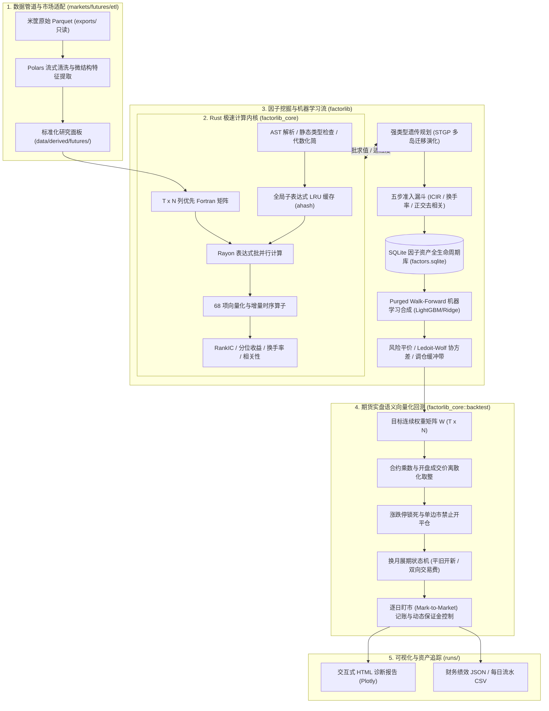

# FactorLibrary: 工业级期货量化因子挖掘与实盘回测平台

<div align="center">
  <h3>极速 Rust 原生计算内核 × 现代 Python 科学计算生态</h3>
  <p><b>高频降采样微观结构特征 → DSL 符号表达式 → 强类型遗传规划 (STGP) 批量挖掘 → SQLite 因子库去相关管理 → Purged Walk-Forward 机器学习多因子合成 → 严密防未来函数与期货实盘语义回测</b></p>
</div>

---

## 平台简介

**FactorLibrary** 是一个专为中国商品与股指期货市场打造的工业级量化因子挖掘与回测平台。平台严格遵循「**市场无关计算内核（Core）**」与「**市场适配层（MarketAdapter）**」的绝对解耦设计原则，核心热路径采用 Rust 原生实现，上层采用 Python 构建灵活强大的量化研究工作流。

全流程实现**严密防未来函数**因果对齐机制，从原始微观高频行情到实盘交易语义回测，支持百代万级表达式高并发快速评估。同时预留了完整的 A 股股票市场扩展适配接口规范。

---

## 核心架构与数据流



---

## 八大核心特性

1. **Rust 原生极速计算内核**：
   - 基于连续内存的 $(T, N)$ Fortran-order 列优先宽矩阵，充分利用 CPU L1/L2 缓存与 SIMD；
   - 68 项算子（时序全量增量 Welford $O(1)$ 与单调队列极值，横截面百分比排名与中性化）；
   - 多表达式通过 Rayon 释放全部多核并发，全局子表达式 LRU 缓存避免重复求值。
2. **强类型遗传规划（STGP）批量因子挖掘**：
   - 强类型节点系统（`Series`, `Window`, `Constant`, `Bool`），杜绝无效语法树；
   - 交叉、变异、提升突变（Hoist Mutation 抑制膨胀）与多岛环形拓扑迁移；
   - 单机 10 分钟完成 1000 种群 × 50 代演化。
3. **五步自动化准入漏斗管线**：
   - Top-K 名人堂初筛 $\to$ 验证集同向显著性约束 $\to$ 换手率软门槛 $\to$ 贪心正交去相关（$\max |\rho| < 0.60$） $\to$ 原子化入库。
4. **SQLite 因子资产全生命周期状态机**：
   - 唯一代数指纹 `canon_hash` 去重，流转状态机：`candidate` $\to$ `accepted` $\to$ `active` $\to$ `deprecated`；
   - 完备记录实验批次轨迹与跨样本段多周期指标。
5. **Purged Walk-Forward 机器学习多因子合成**：
   - 按年扩展/滚动重训，训练/验证/测试严密时序隔离带（Purge Window = $h$），消除前瞻标签穿越；
   - 截面中位数极值截断（MAD Winsorization）与排序高斯化（Rank Gauss）；
   - 支持 Equal Weight、Rolling ICIR、Ridge 与 LightGBM 截面排序回归。
6. **期货实盘交易语义向量化回测**：
   - 统一遵循米筐 `trading_date`，信号基于 $T$ 日收盘生成，执行于 $T+1$ 开盘前 30 分钟真实 VWAP；
   - 目标连续权重动态转为品种整数手数；
   - 涨跌停锁死阻断、换月平旧开新双边手续费与滑点、动态保证金超限强平阻断；
   - 严格满足每日盯市记账恒等式：$\text{Cash}_d + \sum (\text{lots}_{i,d} \times \text{settle}_{i,d} \times \text{Multiplier}_i) == \text{Equity}_d$。
7. **全资产交付与质量认证门禁体系**：
   - 内置 `bash scripts/verify.sh --all`，涵盖数据安全审计、YAML/TOML 配置校验、Rust/Python 静态分析与测试、因果摄动防未来函数审计。
8. **A 股股票市场无缝扩展接口固化**：
   - `StockMarketAdapter` 完整规范了 1手=100股、乘数 1.0、零杠杆、非对称单向印花税、板块涨跌停识别与 T+1 交易机制，为二期对接 A 股提供标准契约。

---

## 快速上手

### 1. 环境准备

推荐使用现代 Python 包管理器 `uv` 与 Rust 工具链：

```bash
# 1. 激活虚拟环境
source .venv/bin/activate

# 2. 编译并安装 Rust 核心扩展库 (release 模式)
maturin develop --release --manifest-path rust/factorlib_core/Cargo.toml
```

### 2. 质量认证门禁检验

```bash
# 提交前快速静态校验 (格式、类型与配置)
bash scripts/verify.sh --fast

# 提交前全量认证 (含 proptest 性质测试、因果摄动防未来审计与全量单元测试)
bash scripts/verify.sh --all
```

### 3. 一键运行全流程流水线

```bash
# 执行端到端全链路流水线 (自动加载面板、检查种子因子、ML 合成、风险平价、实盘回测、产出交互式报告)
python scripts/run_pipeline.py

# 快速单因子全流程回测
python scripts/run_pipeline.py --factor "ts_zscore(close, 20)"

# 启用遗传规划 STGP 挖掘 + ML 合成回测
python scripts/run_pipeline.py --run-gp --gp-population 100 --gp-generations 5
```

### 4. 模块化独立脚本运行

```bash
# 1. 经典文献学术种子因子评估与注册入库
python scripts/init_seed_factors.py

# 2. 强类型遗传规划 (STGP) 批量挖掘
python scripts/run_gp.py --population 200 --generations 10 --seed 42

# 3. Purged Walk-Forward 机器学习多因子合成
python scripts/run_ml.py --config configs/futures/ml_default.yaml

# 4. 期货实盘语义向量化回测
python scripts/run_backtest.py --panel-dir data/derived/futures/v1 --factor "ts_zscore(close, 20)"
```

---

## 代码库目录导航

```text
FactorLibrary/
├── python/factorlib/                      # 主 Python 算法包
│   ├── core/                              # 面板容器、DSL 语法、评价体系、组合优化、回测、报告、因子库 ORM
│   ├── gp/                                # 强类型遗传规划自动化因子挖掘系统 (原语、变异、多岛、准入)
│   ├── ml/                                # Purged Walk-Forward 机器学习多因子合成 (预处理、切分、LGBM、Ridge)
│   └── markets/                           # 市场适配层 (base, futures, stocks)
│       ├── futures/                       # 期货适配器、品种池与 ETL 流水线
│       └── stocks/                        # A 股股票市场适配器规范固化 (Phase 2 插槽)
├── rust/factorlib_core/                   # Rust 极速计算内核
│   ├── src/ops/                           # 68 项向量化、逐元素、时序增量 Welford 与单调队列算子
│   ├── src/expr/                          # AST 语法树、词法语法分析、静态类型检查、代数规范化、LRU 缓存
│   ├── src/metrics/                       # RankIC、分位数收益、换手率、相关性矩阵
│   └── src/backtest/                      # 期货实盘状态机 (离散手数、涨跌停、换月成本、逐日盯市)
├── configs/futures/                       # 生产级 YAML 配置文件 (数据、品种池、费率、GP、ML、回测)
├── scripts/                               # 维护与执行脚本 (verify.sh, audit, build_panel, init, gp, ml, backtest, pipeline)
├── tests/python/                          # Python 自动化单元测试与集成测试套件 (含端到端、因果摄动测试)
├── docs/                                  # 文档中心
│   ├── futures_platform_plan.md           # 期货平台改造与工程实施技术白皮书 (技术基石)
│   └── api_reference.md                   # 平台全模块 API 参考手册
└── pyproject.toml                         # 项目工程与依赖配置
```

---

## 阶段验收与测试覆盖

本项目已全面通过技术白皮书规划的全部阶段工程验收：
- **P0**：开发环境配置、工程规范与 12.7GB 数据全量资产审计；
- **P1**：期货 ETL 管道流式清洗、VWAP 撮合价与研究面板构建；
- **P2**：Rust 极速计算内核 `factorlib_core` 与 68 项算子跨语言 Proptest 对账；
- **P3**：评估指标库、SQLite 因子全生命周期注册表与经典学术种子因子验证；
- **P4**：强类型遗传规划（STGP）批量挖掘引擎与五步准入漏斗管线；
- **P5**：Purged Walk-Forward 机器学习多因子合成管线；
- **P6**：期货实盘口径组合构建与向量化回测状态机；
- **P7**：整体验收、端到端一键流水线 (`run_pipeline.py`) 与 A 股股票扩展接口固化 (`StockMarketAdapter`)。

---

## 许可证与贡献规范

- 提交代码前必须运行并通过 `bash scripts/verify.sh --all` 门禁；
- Git Commit 提交信息必须遵循中文 Angular 规范：`<type>(<scope>): <subject>`。
