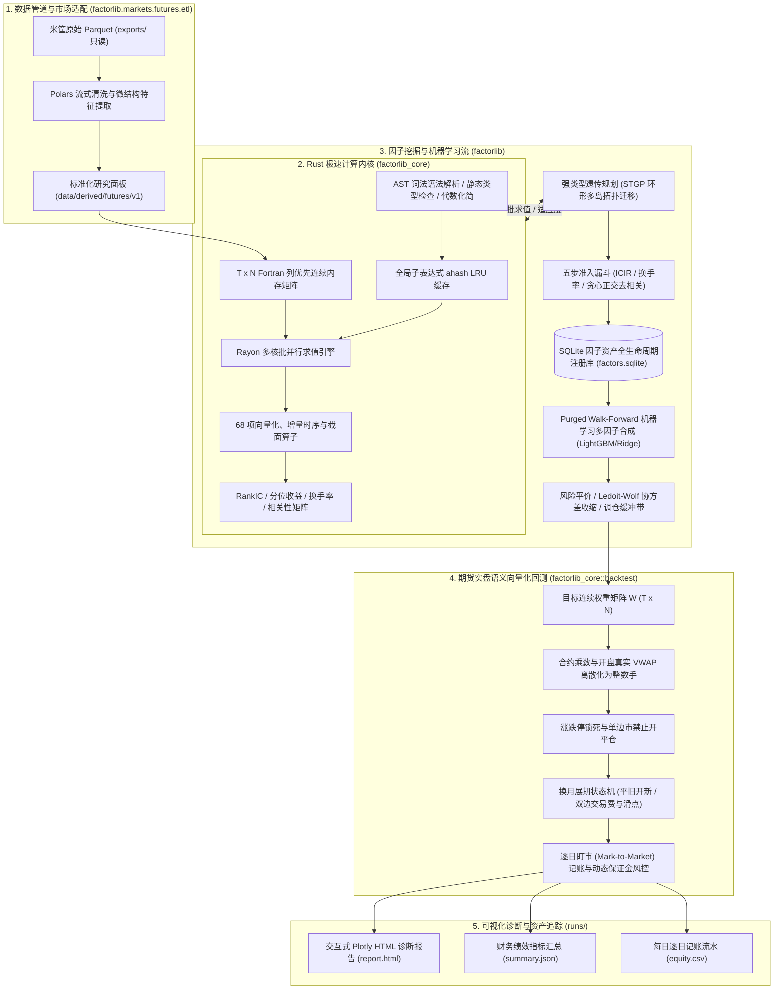

# FactorLibrary: 双市场量化因子挖掘、深度学习 (DL Alpha) 与实盘回测平台

> 本文档为中文主手册精简镜像。最新完整版请参阅 [README.md](README.md)。

<div align="center">

[](https://www.python.org/)
[](https://www.rust-lang.org/)
[](https://pyo3.rs/)
[](https://pytorch.org/)
[](https://fastapi.tiangolo.com/)
[](https://pola.rs/)
[](https://lightgbm.readthedocs.io/)
[](LICENSE)

<h3>极速 Rust 原生计算内核 × 现代 Python 科学计算与 PyTorch 生态</h3>
<p><b>期货 (1d+1m) 与 A 股 (1d) 双市场统一底座 → DSL / Python 因果沙箱 → STGP 遗传规划与 PyTorch 1d DL Alpha 自动挖掘 → Rust Spanning 三关正交准入 → FastAPI 分市场 Web 投研工作台</b></p>

</div>

---

## 目录 (Table of Contents)

- [平台简介](#平台简介)
- [核心架构与数据流](#核心架构与数据流)
- [八大核心特性](#八大核心特性)
- [快速上手](#快速上手)
  - [1. 环境安装与构建](#1-环境安装与构建)
  - [2. 提交前门禁快速验证](#2-提交前门禁快速验证)
- [数据管理与面板构建](#数据管理与面板构建)
- [端到端一键流水线 (CLI)](#端到端一键流水线-cli)
- [分模块生产级 CLI 脚本指南](#分模块生产级-cli-脚本指南)
- [Python SDK 核心编程范式](#python-sdk-核心编程范式)
- [68 项高性能算子速查表](#68-项高性能算子速查表)
- [严密防未来函数与交易语义规范](#严密防未来函数与交易语义规范)
- [配置文件索引与规范](#配置文件索引与规范)
- [代码库目录导航](#代码库目录导航)
- [A 股股票市场适配与全市场回测对账 (Phase 2 已可用)](#a-股股票市场适配与全市场回测对账-phase-2-已可用)

---

## 平台简介

**FactorLibrary** 是一个专为中国商品与股指期货市场打造的工业级量化因子挖掘与实盘回测平台。平台严格遵循「**市场无关计算内核（Core）**」与「**市场适配层（MarketAdapter）**」的绝对解耦设计原则，核心热路径采用 Rust 原生实现并通过 PyO3 导出为极速扩展库，上层采用 Python 构建灵活强大的量化研究全生命周期工作流。

系统全流程实现**严密防未来函数**因果对齐机制，从原始微观高频行情流式清洗、VWAP 撮合价提取，到 AST 代数化简、强类型遗传规划（STGP）批量挖掘、五步准入漏斗、Purged Walk-Forward 机器学习多因子合成，直至手数离散化实盘语义回测与交互式 Plotly HTML 报告产出，支持百代万级表达式高并发快速评估。同时预留了完整的 A 股股票市场扩展适配接口规范。

---

## 核心架构与数据流



---

## 八大核心特性

1. **Rust 原生极速计算内核**：
   - 基于连续内存的 $(T, N)$ Fortran-order 列优先宽矩阵，极致发挥 CPU L1/L2 缓存与 SIMD 向量化性能；
   - 68 项算子（包含时序增量 Welford $O(1)$ 均值/方差、单调队列极值、横截面百分比排名与板块中性化）；
   - 多表达式通过 Rayon 释放全部多核并发，全局子表达式 LRU 缓存避免重复求值。
2. **强类型遗传规划（STGP）批量因子挖掘**：
   - 强类型节点系统（`Series`, `Window`, `Constant`, `Bool`），从语法树生成期杜绝类型畸变与无效求值；
   - 支持交叉、子树变异、点变异、提升突变（Hoist Mutation 强力抑制代码膨胀）与环形多岛拓扑迁移。
3. **五步自动化准入漏斗管线**：
   - Top-K 名人堂初筛 $\to$ 验证集同向显著性约束 $\to$ 截面换手率软门槛 $\to$ 贪心正交去相关（$\max |\rho| < 0.60$） $\to$ 原子化入库。
4. **SQLite 因子资产全生命周期状态机**：
   - 基于唯一代数指纹 `canon_hash` 精确去重，四阶段生命周期流转：`candidate` $\to$ `accepted` $\to$ `active` $\to$ `deprecated`；
   - 完备记录实验批次轨迹（`run_tracker`）与跨样本段（Train/Valid/Test）多预测期数（1, 3, 5, 10, 20）评估指标。
5. **Purged Walk-Forward 机器学习多因子合成**：
   - 按年扩展（Expanding）与滚动（Rolling）重训机制，训练/验证/测试严密时序隔离带（Purge Window = $h$），杜绝标签重叠前瞻泄露；
   - 截面中位数极值截断（MAD Winsorization）与排序高斯化（Rank Gauss）；
   - 支持 Equal Weight、Rolling ICIR、Ridge 与 LightGBM 截面排序回归。
6. **期货实盘交易语义向量化回测**：
   - 统一遵循米筐 `trading_date`，信号基于 $T$ 日收盘生成，执行于 $T+1$ 开盘前 30 分钟真实成交价 $\text{VWAP} = \sum(\text{close} \times \text{volume}) / \sum \text{volume}$；
   - 目标连续权重动态转为品种整数手数；
   - 涨跌停锁死阻断、换月平旧开新双边手续费与滑点、动态保证金超限强平阻断；
   - 严格满足每日盯市记账恒等式：$\text{Cash}_d + \sum (\text{lots}_{i,d} \times \text{settle}_{i,d} \times \text{Multiplier}_i) == \text{Equity}_d$。
7. **全资产交付与质量认证门禁体系**：
   - 内置 `bash scripts/verify.sh --all`，涵盖暂存区数据安全审计、`uv lock --check`、YAML/TOML 配置校验、Rust 零警告 Clippy / `cargo test`（31 项）、Python Ruff / Pytest（139 项）与因果摄动防未来函数审计（2 项）。
8. **双市场 `MarketProfile`、PyTorch `1d` DL Alpha 与三关准入**：
   - 统一封装 `FuturesProfile` 与 `StocksProfile`，支持 `data/derived/stocks/v1`（5,323 只 A 股）T+1 整手持仓回测与 FactorLab MCP 同屏对账；
   - 提供 `factorlib.dl` PyTorch 滚动样本外训练管线（`GRU` / `Spatio-Temporal Attention` / `Gated-MLP` / `1D-TCN`）与 Rust MGS2 `spanning_test` 正交残差三关准入审计。

---

## 快速上手

### 1. 环境安装与构建

推荐使用现代 Python 包管理器 `uv`（或原生 `python3.12 -m venv`）配合 Rust 工具链（`rustup` / `cargo`）：

```bash
# 1. 确保 Rust 工具链就绪 (rustc >= 1.80)
rustc --version
cargo --version

# 2. 创建并激活 Python 3.12 虚拟环境
uv venv --python 3.12 .venv
source .venv/bin/activate

# 3. 安装 Python 核心依赖、开发套件与 PyTorch DL Alpha 扩展
pip install -e ".[dev,dl]"

# 4. 编译并挂载 Rust 核心扩展库 (release 极速模式)
maturin develop --release --manifest-path rust/factorlib_core/Cargo.toml
```

### 2. 提交前门禁快速验证

安装完成后，可立即执行门禁脚本快速检验环境与依赖完整性：

```bash
# 快速静态校验 (格式、Lint 与配置检查)
bash scripts/verify.sh --fast

# 全量门禁认证 (含 uv lock、Rust 测试、Python 155 项单元测试、因果摄动审计与 CLI 体检)
bash scripts/verify.sh --all
```

### 3. 建立与启动双市场 Web 投研工作台服务 (Web Workbench Service)

```bash
# 1. 构建期货与 A 股标准化研究面板 (若尚未构建)
python scripts/build_panel.py --market futures --version v1
python scripts/build_panel.py --market stocks --version v1

# 2. 启动 FastAPI + Uvicorn 双市场 Web 投研工作台 (访问 http://127.0.0.1:8080)
python scripts/run_web.py --host 127.0.0.1 --port 8080

# 或使用 CLI 入口 / Uvicorn 直接启动
factorlib-web --host 0.0.0.0 --port 8080 --market stocks
uvicorn factorlib.workbench_server:app --host 127.0.0.1 --port 8080

# 3. 强制启用内置合成演示面板 (无须本地 Parquet 数据即可开箱体验全部 5 大页面与 GP/DL 挖矿)
python scripts/run_web.py --synthetic --port 8080
```

---

## 分模块生产级 CLI 脚本指南

```bash
# 1. 种子因子评估入库
python scripts/init_seed_factors.py --panel data/derived/futures/v1 --db data/registry/factors.sqlite

# 2. 强类型遗传规划独立挖掘 (支持 --recipe <id>)
python scripts/run_gp.py --market futures --population 500 --generations 30 --islands 4 --seed 42

# 3. PyTorch 1d 深度学习因子滚动训练 (支持 --recipe <id>)
python scripts/run_dl.py --market futures --model gru --seq-len 20 --hidden-dim 32 --epochs 12 --n-seeds 3

# 4. Purged Walk-Forward 机器学习独立合成 (支持 --recipe <id>)
python scripts/run_ml.py --market futures --start-year 2018 --end-year 2026 --purge-window 5

# 5. 期货实盘向量化回测
python scripts/run_backtest.py --factor "ts_zscore(close, 20)"

# 6. 双市场量化因子研发 Web 工作台
python scripts/run_web.py --port 8080

# 7. 代码质量认证门禁
bash scripts/verify.sh --all

# 8. A 股股票市场单/多因子统一无渗漏回测与 FactorLab MCP 对账
python scripts/backtest_volume_price_factor.py --execution-simulation
python scripts/backtest_multi_factors.py --execution-simulation
```

---

## Python SDK 核心编程范式

```python
from factorlib.core.backtest import run_backtest
from factorlib.core.dsl import F, validate_expr
from factorlib.core.panel import Panel
from factorlib.core.portfolio import build_portfolio_weights
from factorlib.core.registry import FactorRegistry
from factorlib.core.report import generate_html_report
from factorlib.markets.futures.adapter import FuturesMarketAdapter

# 1. 加载标准化面板
panel = Panel.load("data/derived/futures/v1")

# 2. DSL 语法糖与静态检查
alpha = (F("close") - F("open")).ts_mean(20).cs_rank()
assert validate_expr(str(alpha), available_fields=list(panel.fields.keys()))["valid"]

# 3. 极速 Rust 计算内核求值
engine = panel.to_rust_engine(cache_mb=128, n_threads=4)
scores = engine.eval(str(alpha))

# 4. 组合优化与实盘回测
adapter = FuturesMarketAdapter(fees_path="configs/futures/fees.yaml")
weights = build_portfolio_weights(scores=scores, returns=panel.fields["close"], mask=panel.mask)
result = run_backtest(panel=panel, weights=weights, adapter=adapter)

print(
    f"夏普比率: {result.metrics['sharpe']:.2f}, 最大回撤: {result.metrics['max_drawdown']:.2%}"
)
generate_html_report(result, output_path="runs/my_report.html", title="量化因子回测报告")
```

---

## 更多参考文档

- [主手册 (README.md)](README.md)
- [English Documentation (README.en.md)](README.en.md)
- [期货量化平台技术白皮书 (docs/futures_platform_plan.md)](docs/futures_platform_plan.md)
- [架构与代码深度审查报告与重构计划 (docs/code_audit_and_refactor_plan.md)](docs/code_audit_and_refactor_plan.md)
- [平台全模块 API 参考手册 (docs/api_reference.md)](docs/api_reference.md)
- [米筐数据资产字典与规范 (DATA_DOCUMENTATION.md)](DATA_DOCUMENTATION.md)
