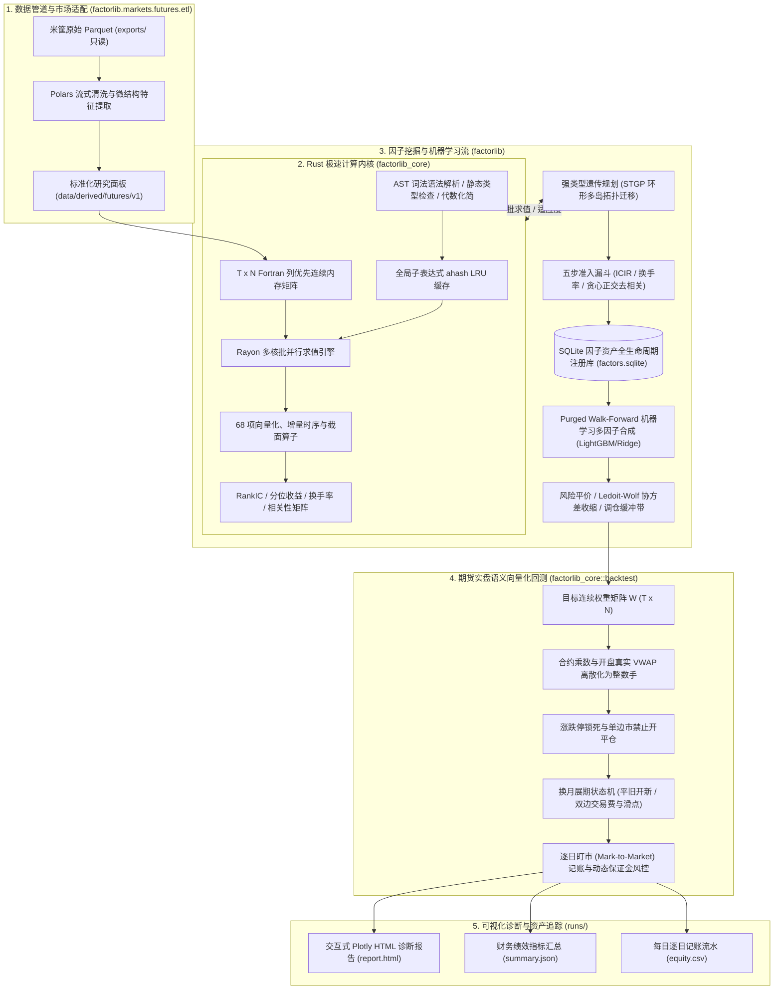

# FactorLibrary: 工业级期货量化因子挖掘与实盘回测平台

> 本文档为中文主手册镜像。最新完整版请参阅 [README.md](README.md)。

<div align="center">

[](https://www.python.org/)
[](https://www.rust-lang.org/)
[](https://pyo3.rs/)
[](https://pola.rs/)
[](https://lightgbm.readthedocs.io/)
[](LICENSE)

<h3>极速 Rust 原生计算内核 × 现代 Python 科学计算生态</h3>
<p><b>高频降采样微观结构特征 → DSL 符号表达式 → 强类型遗传规划 (STGP) 批量挖掘 → SQLite 因子库去相关管理 → Purged Walk-Forward 机器学习多因子合成 → 严密防未来函数与期货实盘语义回测</b></p>

</div>

---

## 目录 (Table of Contents)

- [平台简介](#平台简介)
- [核心架构与数据流](#核心架构与数据流)
- [八大核心特性](#八大核心特性)
- [快速上手](#快速上手)
  - [1. 环境安装与构建](#1-环境安装与构建)
  - [2. 提交前门禁快速验证](#2-提交前门禁快速验证)
- [数据管理与面板构建](#数据管理与面板构建)
- [端到端一键流水线 (CLI)](#端到端一键流水线-cli)
- [分模块生产级 CLI 脚本指南](#分模块生产级-cli-脚本指南)
- [Python SDK 核心编程范式](#python-sdk-核心编程范式)
- [68 项高性能算子速查表](#68-项高性能算子速查表)
- [严密防未来函数与交易语义规范](#严密防未来函数与交易语义规范)
- [配置文件索引与规范](#配置文件索引与规范)
- [代码库目录导航](#代码库目录导航)
- [A 股股票市场适配与全市场回测对账 (Phase 2 已可用)](#a-股股票市场适配与全市场回测对账-phase-2-已可用)

---

## 平台简介

**FactorLibrary** 是一个专为中国商品与股指期货市场打造的工业级量化因子挖掘与实盘回测平台。平台严格遵循「**市场无关计算内核（Core）**」与「**市场适配层（MarketAdapter）**」的绝对解耦设计原则，核心热路径采用 Rust 原生实现并通过 PyO3 导出为极速扩展库，上层采用 Python 构建灵活强大的量化研究全生命周期工作流。

系统全流程实现**严密防未来函数**因果对齐机制，从原始微观高频行情流式清洗、VWAP 撮合价提取，到 AST 代数化简、强类型遗传规划（STGP）批量挖掘、五步准入漏斗、Purged Walk-Forward 机器学习多因子合成，直至手数离散化实盘语义回测与交互式 Plotly HTML 报告产出，支持百代万级表达式高并发快速评估。同时预留了完整的 A 股股票市场扩展适配接口规范。

---

## 核心架构与数据流



---

## 八大核心特性

1. **Rust 原生极速计算内核**：
   - 基于连续内存的 $(T, N)$ Fortran-order 列优先宽矩阵，极致发挥 CPU L1/L2 缓存与 SIMD 向量化性能；
   - 68 项算子（包含时序增量 Welford $O(1)$ 均值/方差、单调队列极值、横截面百分比排名与板块中性化）；
   - 多表达式通过 Rayon 释放全部多核并发，全局子表达式 LRU 缓存避免重复求值。
2. **强类型遗传规划（STGP）批量因子挖掘**：
   - 强类型节点系统（`Series`, `Window`, `Constant`, `Bool`），从语法树生成期杜绝类型畸变与无效求值；
   - 支持交叉、子树变异、点变异、提升突变（Hoist Mutation 强力抑制代码膨胀）与环形多岛拓扑迁移。
3. **五步自动化准入漏斗管线**：
   - Top-K 名人堂初筛 $\to$ 验证集同向显著性约束 $\to$ 截面换手率软门槛 $\to$ 贪心正交去相关（$\max |\rho| < 0.60$） $\to$ 原子化入库。
4. **SQLite 因子资产全生命周期状态机**：
   - 基于唯一代数指纹 `canon_hash` 精确去重，四阶段生命周期流转：`candidate` $\to$ `accepted` $\to$ `active` $\to$ `deprecated`；
   - 完备记录实验批次轨迹（`run_tracker`）与跨样本段（Train/Valid/Test）多预测期数（1, 3, 5, 10, 20）评估指标。
5. **Purged Walk-Forward 机器学习多因子合成**：
   - 按年扩展（Expanding）与滚动（Rolling）重训机制，训练/验证/测试严密时序隔离带（Purge Window = $h$），杜绝标签重叠前瞻泄露；
   - 截面中位数极值截断（MAD Winsorization）与排序高斯化（Rank Gauss）；
   - 支持 Equal Weight、Rolling ICIR、Ridge 与 LightGBM 截面排序回归。
6. **期货实盘交易语义向量化回测**：
   - 统一遵循米筐 `trading_date`，信号基于 $T$ 日收盘生成，执行于 $T+1$ 开盘前 30 分钟真实成交价 $\text{VWAP} = \sum(\text{close} \times \text{volume}) / \sum \text{volume}$；
   - 目标连续权重动态转为品种整数手数；
   - 涨跌停锁死阻断、换月平旧开新双边手续费与滑点、动态保证金超限强平阻断；
   - 严格满足每日盯市记账恒等式：$\text{Cash}_d + \sum (\text{lots}_{i,d} \times \text{settle}_{i,d} \times \text{Multiplier}_i) == \text{Equity}_d$。
7. **全资产交付与质量认证门禁体系**：
   - 内置 `bash scripts/verify.sh --all`，涵盖暂存区数据安全审计、`uv lock --check`、YAML/TOML 配置校验、Rust 零警告 Clippy / `cargo test`（31 项）、Python Ruff / Pytest（139 项）与因果摄动防未来函数审计（2 项）。
8. **A 股股票市场适配与统一无渗漏后处理回测**：
   - 已实现 `StockMarketAdapter` 与 `StockPanelLoader`，接入 `apply_postprocess_pipeline` 强制末步掩码重施与方向性涨跌停撮合模拟（`can_buy_mask` / `can_sell_mask` 递延卖出）。

---

## 快速上手

### 1. 环境安装与构建

推荐使用现代 Python 包管理器 `uv`（或原生 `python3.12 -m venv`）配合 Rust 工具链（`rustup` / `cargo`）：

```bash
# 1. 确保 Rust 工具链就绪 (rustc >= 1.80)
rustc --version
cargo --version

# 2. 创建并激活 Python 3.12 虚拟环境
# 方式 A (推荐 uv):
uv venv --python 3.12 .venv
source .venv/bin/activate

# 方式 B (原生 python3.12):
python3.12 -m venv .venv
source .venv/bin/activate

# 3. 安装 Python 核心依赖与开发套件
pip install -e ".[dev]"

# 4. 编译并挂载 Rust 核心扩展库 (release 极速模式)
maturin develop --release --manifest-path rust/factorlib_core/Cargo.toml
```

### 2. 提交前门禁快速验证

安装完成后，可立即执行门禁脚本快速检验环境与依赖完整性：

```bash
# 快速静态校验 (格式、Lint 与配置检查)
bash scripts/verify.sh --fast

# 全量门禁认证 (含 uv lock、31 项 Rust 测试、139 项 Python 单元测试、2 项因果摄动审计与 CLI 体检)
bash scripts/verify.sh --all
```

### 3. 启动现代化 6 阶段量化因子研发工作台 (Web Studio)

```bash
# 启动零依赖量化研发 Web 单页工作台 (浏览器访问 http://127.0.0.1:8080)
python scripts/run_web.py

# 强制启用内置合成演示面板 (无须本地数据即可开箱体验)
python scripts/run_web.py --synthetic
```

---

## 数据管理与面板构建

### 1. 原始数据资产

平台默认支持米筐（Ricequant）格式期货历史行情数据资产（只读存放于 `exports/` 目录，约 12.7GB）：
- `bar_1d/`：全品种日线 OHLCV、持仓量、结算价与成交额；
- `bar_1m/`：全品种分钟线，用于流式提取 $T+1$ 开盘前 30 分钟真实成交价 VWAP；
- `calendar/`：统一交易日历 (`calendar.parquet`)；
- `dominant_mapping/`：主力合约映射字典（`rule=3` 避开交割月流动性枯竭）；
- `roll_yield/`：展期收益率衍生数据；
- `warehouse_stocks/`：注册仓单库存数据；
- `member_rank/`：期货交易所龙虎榜会员前 20 大持仓数据。

### 2. 数据资产深度自检与审计

```bash
# 快速自检模式
python scripts/audit_data.py --quick

# 全量深度审计并输出 Markdown 诊断报告
python scripts/audit_data.py --output data/derived/futures/audit_report.md
```

### 3. 标准化研究面板构建

```bash
# 快速演示模式 (仅构建 2024-02-01 ~ 2024-03-31 两个月演示面板)
python scripts/build_panel.py --quick

# 全历史标准化面板构建 (覆盖 2018-01-01 至 2026-08-31)
python scripts/build_panel.py --start-date 2018-01-01 --end-date 2026-08-31 --version v1
```

---

## 端到端一键流水线 (CLI)

`scripts/run_pipeline.py` 是平台最核心的端到端调度入口：

```bash
# 1. 评估 20 日价格动量单因子
python scripts/run_pipeline.py --factor "pct_change(close, 20)"

# 2. 评估微观结构复合因子
python scripts/run_pipeline.py --factor "cs_rank(ts_mean(sub(close, open), 20))"

# 3. 使用因子资产库执行截面等权合成回测
python scripts/run_pipeline.py --ml-model equal_weight

# 4. 开启 STGP 遗传规划挖掘 + 机器学习合成回测全流程
python scripts/run_pipeline.py \
  --run-gp \
  --gp-population 200 \
  --gp-generations 10 \
  --ml-model equal_weight \
  --output-dir runs/my_gp_experiment
```

产出物保存在 `runs/` 目录下：
- `report.html`：包含 Plotly 交互式净值走势曲线、最大回撤水下分布、月度收益热力矩阵、每日单边换手率图；
- `summary.json`：年化收益率、夏普比率、最大回撤、Calmar 比率、日均换手率等核心指标；
- `equity.csv`：每日盯市资金流水与保证金占用记录；
- `pipeline_summary.json`：全链路阶段耗时与元数据。

---

## 分模块生产级 CLI 脚本指南

```bash
# 1. 种子因子评估入库
python scripts/init_seed_factors.py --panel data/derived/futures/v1 --db data/registry/factors.sqlite

# 2. 强类型遗传规划独立挖掘
python scripts/run_gp.py --population 500 --generations 30 --islands 4 --seed 42

# 3. Purged Walk-Forward 机器学习独立合成
python scripts/run_ml.py --start-year 2018 --end-year 2026 --purge-window 5

# 4. 期货实盘向量化回测
python scripts/run_backtest.py --factor "ts_zscore(close, 20)"

# 5. 现代化 6 阶段量化因子研发 Web 工作台
python scripts/run_web.py --port 8080

# 6. 代码质量认证门禁
bash scripts/verify.sh --all

# 7. A 股股票市场数据同步、单/多因子统一无渗漏回测与 FactorLab 对账
python scripts/backtest_volume_price_factor.py --execution-simulation
python scripts/backtest_multi_factors.py --execution-simulation
```

---

## Python SDK 核心编程范式

```python
from factorlib.core.backtest import run_backtest
from factorlib.core.dsl import F, validate_expr
from factorlib.core.panel import Panel
from factorlib.core.portfolio import build_portfolio_weights
from factorlib.core.registry import FactorRegistry
from factorlib.core.report import generate_html_report
from factorlib.markets.futures.adapter import FuturesMarketAdapter

# 1. 加载标准化面板
panel = Panel.load("data/derived/futures/v1")

# 2. DSL 语法糖与静态检查
alpha = (F("close") - F("open")).ts_mean(20).cs_rank()
assert validate_expr(str(alpha), available_fields=list(panel.fields.keys()))["valid"]

# 3. 极速 Rust 计算内核求值
engine = panel.to_rust_engine(cache_mb=128, n_threads=4)
scores = engine.eval(str(alpha))

# 4. 组合优化与实盘回测
adapter = FuturesMarketAdapter(fees_path="configs/futures/fees.yaml")
weights = build_portfolio_weights(scores=scores, returns=panel.fields["close"], mask=panel.mask)
result = run_backtest(panel=panel, weights=weights, adapter=adapter)

print(
    f"夏普比率: {result.metrics['sharpe']:.2f}, 最大回撤: {result.metrics['max_drawdown']:.2%}"
)
generate_html_report(result, output_path="runs/my_report.html", title="量化因子回测报告")
```

---

## 更多参考文档

- [主手册 (README.md)](README.md)
- [English Documentation (README.en.md)](README.en.md)
- [期货量化平台技术白皮书 (docs/futures_platform_plan.md)](docs/futures_platform_plan.md)
- [架构与代码深度审查报告与重构计划 (docs/code_audit_and_refactor_plan.md)](docs/code_audit_and_refactor_plan.md)
- [平台全模块 API 参考手册 (docs/api_reference.md)](docs/api_reference.md)
- [米筐数据资产字典与规范 (DATA_DOCUMENTATION.md)](DATA_DOCUMENTATION.md)
