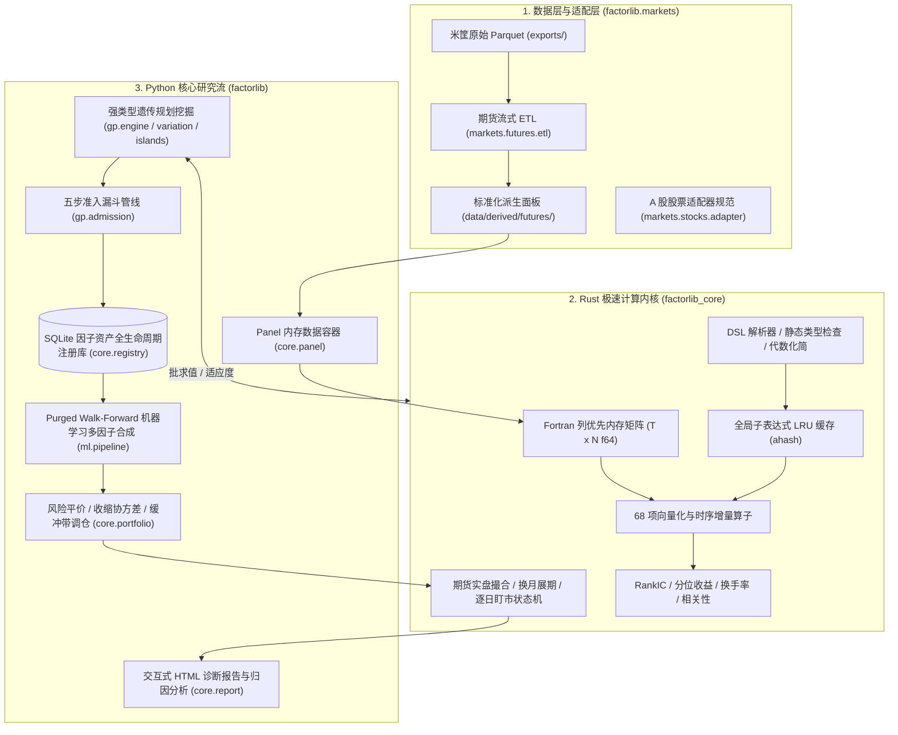

# FactorLibrary 工业级量化因子挖掘与回测平台 API 参考手册 (API Reference)

> **版本**：v2.0 (全阶段竣工版)  
> **语言**：Python 3.12+ / Rust 2021 Edition (PyO3)  
> **核心模块**：`factorlib` (上层算法流) + `factorlib_core` (底层计算内核)

---

## 1. 架构总览与分层设计

FactorLibrary 采用**单仓库、单内核**架构，遵循关注点分离原则，实现「市场无关计算内核（Core）」与「市场适配层（MarketAdapter）」的绝对解耦：



---

## 2. Python 算法层 (`factorlib`)

### 2.1 数据容器 (`factorlib.core.panel`)

#### `Panel`
- **定位**：高维截面研究面板核心内存容器。
- **内存布局**：所有字段均为 $(T, N)$ 形状且严格按 **Fortran-order (列优先)** 紧凑排列，保证品种连续时间序列内存局部性。
- **构造签名**：
  ```python
  class Panel:
      dates: np.ndarray          # 一维交易日数组, 形状 (T,)
      symbols: list[str]         # 品种代码列表, 长度 N
      fields: dict[str, np.ndarray]  # (T, N) float64 特征字段 (order='F')
      mask: np.ndarray           # (T, N) bool 可交易标的掩码
      labels: dict[str, np.ndarray] # (T, N) float64 预测目标标签 (order='F')
      meta: dict[str, Any]       # 构建元数据
  ```
- **核心方法**：
  - `load(cls, panel_dir: Path | str) -> Panel`：从派生目录秒级加载 Parquet 长表并重塑为宽矩阵。
  - `get_field(self, name: str) -> np.ndarray`：获取指定的特征矩阵。
  - `get_label(self, name: str) -> np.ndarray`：获取指定的预测目标矩阵。
  - `to_rust_engine(self) -> factorlib_core.Engine`：将全部特征与掩码直通转换为 Rust 极速计算引擎实例。
  - `slice_dates(self, start_date: str, end_date: str) -> Panel`：按时间区间切片子面板。

---

### 2.2 因子库资产管理 (`factorlib.core.registry`)

#### `FactorRegistry`
- **定位**：基于 SQLite + WAL 模式的因子全生命周期资产注册库（`factors.sqlite`）。
- **生命周期状态机**：`candidate`（初筛入围） $\to$ `accepted`（准入合格） $\to$ `active`（实盘在用） $\to$ `deprecated`（失效归档）。
- **核心方法**：
  - `register_factor(self, factor: FactorRecord, run_id: str | None = None, upsert: bool = False) -> int`：登记新因子，自动防重复（基于代数规范化指纹 `canon_hash`）。
  - `get_factor(self, factor_id: int) -> FactorRecord | None`：按 ID 获取因子及其多时段指标。
  - `get_factor_by_hash(self, canon_hash: str) -> FactorRecord | None`：按代数哈希检索因子。
  - `list_factors(self, status: str | None = None, source: str | None = None) -> list[FactorRecord]`：多维条件过滤因子清单。
  - `update_factor_status(self, factor_id: int, new_status: str) -> bool`：流转因子生命周期状态。
  - `record_run(self, run: ExperimentRunRecord) -> None`：记录实验运行批次追踪。
  - `finish_run(self, run_id: str, status: str, n_evaluated: int) -> None`：标记实验结束并记录评估规模。

---

### 2.3 强类型遗传规划 (`factorlib.gp`)

- **`GPEngine`**：STGP 自动化因子挖掘主引擎，多岛环形拓扑演化控制器。
  ```python
  engine = GPEngine(cfg=gp_config, panel=panel, registry=registry, tracker=tracker)
  admitted_factors = engine.run(run_id="gp_run_v1", register_to_db=True)
  ```
- **强类型系统 (`gp.primitives`)**：严格约束节点返回类型与入参类型：
  - `Series`：二维时间序列矩阵。
  - `Window`：滚动周期标量整数。
  - `Constant`：浮点常数。
  - `Bool`：布尔掩码。
- **演化算子 (`gp.variation`)**：
  - `crossover_trees(tree1, tree2)`：强类型兼容子树交叉。
  - `mutate_subtree(tree, primitives, p_leaf, max_depth)`：强类型子树随机变异。
  - `mutate_hoist(tree)`：提升突变（以子树替代母树，强力抑制树膨胀）。
  - `mutate_point(tree, primitives)`：同类型等价算子点变异。
- **五步准入漏斗管线 (`gp.admission`)**：
  1. *Step 1*：Top-K 名人堂初筛（按训练集适应度排序）；
  2. *Step 2*：验证集同向性与显著性约束（符号与训练集一致，且 $|\text{ICIR}_{\text{valid}}| \ge \text{threshold}$）；
  3. *Step 3*：截面换手率软门槛（过滤日内高频虚假翻转）；
  4. *Step 4*：贪心正交化去相关（与库内现有因子最大相关系数 $\max |\rho| < 0.60$）；
  5. *Step 5*：原子化入库登记（落盘 SQLite 并标记为 `accepted`）。

---

### 2.4 机器学习多因子合成 (`factorlib.ml`)

- **`PurgedWalkForwardSplitter` (`ml.splits`)**：
  - 扩展窗口（Expanding）与滚动窗口（Rolling）按年重训机制；
  - 严密因果隔离带：训练集与验证集末尾精确剔除 $h$ 天标签重叠（Purge Window）；
  - 验证集/测试集前端静默隔离（Embargo Window）。
- **特征工程 (`ml.dataset`)**：
  - `align_directions(factor_matrices, factor_signs)`：符号统一对齐；
  - `mad_winsorize(mat, n_sigmas=3.0)`：截面中位数极值截断，有效抑制跳空噪点；
  - `rank_gauss_transform(mat)`：截面排序高斯化，平滑极端离群值并呈标准正态分布；
  - `MLDatasetBuilder`：多特征平铺与时序折叠对齐重构。
- **模型族 (`ml.models`)**：
  - `EqualWeightModel`：等权合成基线；
  - `RollingICIRModel`：动态时序 ICIR 倒数加权模型；
  - `RidgeModel`：L2 正则化岭回归；
  - `LightGBMModel`：LightGBM 截面排序树模型（硬约束单调特征、步长早停）。
- **`WalkForwardPipeline` (`ml.pipeline`)**：
  - 统筹数据预处理、逐年滚动训练、样本外预测生成、特征增益提取；
  - 输出 `predictions.parquet` 样本外多模型预测宽表。

---

### 2.5 组合构建与实盘回测 (`factorlib.core.portfolio` / `factorlib.core.backtest`)

- **`build_portfolio_weights(scores, returns, mask, config)`**：
  - 波动率倒数平价加权（Inverse-Volatility Parity）；
  - Ledoit-Wolf 经验与常相关混合收缩协方差；
  - 目标波动率动态杠杆缩放；
  - 调仓缓冲带（Rebalance Buffer）：微小权重漂移不触发换手，大幅降低交易摩擦。
- **`run_backtest(panel, weights, config, adapter)`**：
  - Python 调度包装，底层调用 Rust `factorlib_core.run_futures_backtest`；
  - 真实实盘交易语义：目标权重 $\to$ 乘以总权益 $\to$ 合约乘数与开盘成交价离散化为整数手；
  - 涨跌停锁死与单边市禁止开平仓；
  - 换月展期日旧合约平仓、新合约开仓双边手续费与冲击成本；
  - 保证金占用超限动态去杠杆阻断；
  - 每日逐日盯市（Mark-to-Market）记账。
- **`BacktestResult` 属性**：
  - `equity`：每日总资产净值；
  - `cash`：每日可用现金；
  - `margin_used`：每日占用保证金；
  - `net_pnl`：每日净盈亏（扣除手续费、滑点与换月摩擦）；
  - `positions`：每日各品种实际持仓手数矩阵 $(T, N)$；
  - `turnover`：每日名义单边换手率。

---

### 2.6 市场适配层 (`factorlib.markets`)

- **`MarketAdapter`**：市场规范抽象基类。
  - `calendar(self) -> np.ndarray`：统一交易日历。
  - `universe_mask(self, panel: Panel) -> np.ndarray`：品种池过滤布尔矩阵 $(T, N)$。
  - `contract_spec(self, symbol: str) -> ContractSpec`：合约规格（乘数、最小手数、最小变动价位、保证金率）。
  - `cost_model(self, symbol: str) -> CostModel`：交易成本模型（开仓费、平仓费、平今费、跳数滑点）。
- **`FuturesMarketAdapter`**：中国商品与股指期货市场适配器。
  - 基于 `configs/futures/fees.yaml` 解析各大期货交易所非对称费率；
  - 基于 `bar_1m` 流式计算开盘 30 分钟真实成交价 $\text{VWAP} = \sum(\text{close} \times \text{volume}) / \sum \text{volume}$。
- **`StockMarketAdapter`**：A 股股票市场规范适配器（二期无缝对接）。
  - 合约规则：1 手 = 100 股，乘数恒为 1.0，报价最小变动价位 0.01 元，现货保证金率恒为 1.0（无杠杆）；
  - 非对称税费：买入佣金 + 过户费；卖出佣金 + 过户费 + 单向征收证券交易印花税；
  - 板块识别与涨跌停：主板 10%、创业板/科创板 20%、北交所 30%、ST 标的 5%；
  - 交易机制：T+1 交收机制，单向做多约束（默认禁止融券裸做空）。

---

## 3. Rust 极速计算内核 (`factorlib_core`)

### 3.1 核心引擎 (`Engine`)

- **绑定对象**：`factorlib_core.Engine`
- **初始化**：
  ```python
  engine = factorlib_core.Engine(dates, symbols, fields, mask)
  ```
- **核心方法**：
  - `eval(expr: str) -> np.ndarray`：解析、静态类型检查、代数规范化并求值单表达式，返回 Fortran-order $(T, N)$ 矩阵。
  - `eval_batch(exprs: list[str]) -> list[np.ndarray]`：Rayon 多线程批并行求值，充分释放 CPU 多核能力。
  - `clear_cache()`：清空全局子表达式 LRU 缓存。

---

### 3.2 68 项向量化与时序算子清单

| 类别 | 算子名称 | 数学含义与算法复杂度 |
|---|---|---|
| **逐元素一元算子** (11 项) | `abs`, `neg`, `sign`, `sqrt`, `square`, `cube`, `log`, `exp`, `inv`, `sin`, `cos` | 逐点向量化计算，$O(1)$ 吞吐，自动规避除零与负数开方。 |
| **逐元素二元算子** (7 项) | `add`, `sub`, `mul`, `div`, `max2`, `min2`, `clip` | 矩阵广播计算，NaN 传播安全。 |
| **时序滚动算子** (23 项) | `ts_delay(x, d)`, `ts_delta(x, d)`, `pct_change(x, d)` | 时序移位与一阶差分，$O(1)$ 环形缓冲区。 |
| | `ts_mean(x, d)`, `ts_sum(x, d)`, `ts_var(x, d)`, `ts_std(x, d)` | $O(1)$ 双栈增量 Welford 均值与方差算法，无精度漂移。 |
| | `ts_skew(x, d)`, `ts_kurt(x, d)` | 三阶偏度与四阶峰度增量累加器。 |
| | `ts_max(x, d)`, `ts_min(x, d)`, `ts_argmax(x, d)`, `ts_argmin(x, d)` | 基于**单调队列（Monotonic Queue）**的 $O(1)$ 极值搜索。 |
| | `ts_rank(x, d)`, `ts_zscore(x, d)`, `ts_mad(x, d)` | 时序百分比排名、时序 Z-Score 与中位数绝对偏差。 |
| | `ts_decay_linear(x, d)`, `ts_ema(x, d)` | 线性衰减加权与指数移动平均。 |
| | `ts_corr(x, y, d)`, `ts_cov(x, y, d)`, `ts_beta(x, y, d)` | $O(1)$ 增量时序相关系数、协方差与资产 Beta。 |
| | `ts_wmean(x, w, d)`, `ts_sharpe(x, d)` | 成交量加权滚动均值与时序夏普比率。 |
| **横截面算子** (6 项) | `cs_rank(x)`, `cs_scale(x)`, `cs_zscore(x)` | 截面百分比排名、绝对值和归一化与截面 Z-Score。 |
| | `cs_demean(x)`, `cs_quantile(x, q)`, `cs_mad(x)` | 截面去均值、截面分位数切分与截面 MAD 去极值。 |
| **行业/板块分组算子** (3 项) | `group_rank(x, g)`, `group_demean(x, g)`, `group_zscore(x, g)` | 预留 A 股申万行业/期货板块截面中性化算子。 |

---

### 3.3 指标计算库 (`metrics`)

- `calc_rank_ic(pred, target, mask)`：截面 Spearman Rank IC 与时序均值、标准差、ICIR、t 统计量。
- `calc_quantile_returns(factor, forward_ret, mask, n_quantiles=5)`：多头 Top 组、空头 Bottom 组收益率与多空利差（Long-Short Spread）。
- `calc_turnover(factor, mask)`：因子截面百分比排名的自相关衰减度与单边名义调仓换手率。
- `calc_corr_matrix(matrices, mask)`：多因子截面相关系数矩阵，用于因子去相关初筛。

---

## 4. 生产脚本与命令行工具 (`scripts/`)

| 脚本工具 | 核心功能与生产用法 |
|---|---|
| `scripts/verify.sh` | **提交前质量认证门禁**：一键执行 6 大门禁（数据泄漏、配置合规、Rust Clippy/Fmt/Test、Python Lint/Fmt/Pytest、因果摄动审计、CLI 健全性）。用法：`bash scripts/verify.sh --all` |
| `scripts/audit_data.py` | **原始数据全量自检**：遍历 12.7GB Parquet 资产，检验字段类型、缺失率与异常极值，输出审计报告。 |
| `scripts/build_panel.py` | **标准化研究面板构建**：流式解析米筐原始行情，生成带元数据指纹的标准长表与宽表 Parquet。 |
| `scripts/init_seed_factors.py` | **经典文献种子因子入库**：评估动量、展期收益率、仓单变动与龙虎榜会员净多变动 4 大经典因子并登记入库。 |
| `scripts/run_gp.py` | **强类型遗传规划自动化挖掘**：多岛并行演化，五步准入漏斗筛选，自动沉淀候选因子。 |
| `scripts/run_ml.py` | **Walk-Forward 机器学习多因子合成**：Purged 扩展窗口训练 LightGBM、Ridge 或等权模型，输出样本外预测评分。 |
| `scripts/run_backtest.py` | **期货实盘口径向量化回测**：基于离散手标准撮合状态机回测，产出交互式 HTML 诊断报告与财务账单。 |
| `scripts/run_pipeline.py` | **端到端全流程一键流水线 (P7 验收工具)**：串通面板检验、种子因子入库、GP 挖掘、ML 合成、风险平价优化与实盘回测。用法：`python scripts/run_pipeline.py` |

---

## 5. 配置文件规范 (`configs/futures/`)

1. **`data.yaml`**：指定米筐行情路径、rule=3/rank=1 主力映射策略、复权方法与开盘 30 分钟 VWAP 撮合窗口。
2. **`universe.yaml`**：流动性准入规则、最小上市天数门槛、交割月摘牌截断规则。
3. **`fees.yaml`**：品种级别合约乘数、交易所手续费率（按手固定或按金额比例）、平今仓规则、tick_size 与基准滑点。
4. **`gp_default.yaml`**：遗传规划种群规模、演化代数、交叉变异提升概率、树深与节点数奥卡姆惩罚、准入阈值。
5. **`ml_default.yaml`**：Purged Walk-Forward 滚动年份、时序隔离带 Purge 天数、LightGBM 树深度、学习率与早停轮数。
6. **`backtest.yaml`**：初始资金规模、目标波动率、组合构建模式（截面或时序）、最大杠杆上限与调仓缓冲带阈值。

---

## 6. 后续 A 股股票市场扩展指南 (Phase 2 Roadmap)

针对第二期接入 A 股股票市场，系统已在以下关键切面完成标准化接口固化：
1. **数据适配器**：继承 `MarketAdapter` 实现 `StockMarketAdapter`（已在 `factorlib.markets.stocks.adapter` 固化），接入 A 股日线/高频行情 Parquet；
2. **复权管理**：股票除权除息（送转、分红派息）通过前复权/后复权清洗后，统一向 `Panel` 注入 `close` 与 `open`，计算内核无需变动；
3. **交易机制适配**：在回测状态机中开启 `is_t_plus_one=True` 与 `allow_short=False`，施加卖出可用头寸约束；
4. **横截面中性化**：直接调用 Rust 内核中预留的 `group_rank` 与 `group_demean` 算子，挂载申万 31 个一级行业分类与流通市值；
5. **大规模常驻内存**：Rust Fortran 列优先矩阵可直接横向扩展至 5000 只股票 $\times$ 4000 交易日，单矩阵约 160MB，依然轻松常驻内存高速并行计算。

---

## 9. FactorLab 6 阶段工作流与声明式后处理接口 (`catalog` / `probe` / `styles` / `evaluate`)

- **`FactorCatalog` (`factorlib.core.catalog`)**：
  - `get_context() -> dict`：返回平台环境概览、算子分类统计与推荐后处理预设（`standard` / `minimal` / `style_neutral`）。
  - `stats(catalog="all") -> dict`、`search(query="", catalog="all", category="") -> list`、`get_entry(name) -> dict | None`。
- **`FactorDefinition` & `probe_factor` (`factorlib.core.probe`)**：
  - `probe_factor(definition, panel=None) -> dict`：执行毫秒级静态探针检查，输出显式依赖、后处理隐式依赖（含平滑窗口放大）与 4 级预热窗口要求。
  - `evaluate_factor_definition(definition, panel) -> tuple[np.ndarray, dict]`：执行 DSL 或 Python `def compute(context):` 因果求值并串联 Rust `apply_postprocess_op` 12 算子后处理管线。
- **期货 6 大风格因子与双层回测 (`factorlib.core.styles` & `factorlib.core.evaluate`)**：
  - `compute_futures_styles(panel) -> dict[str, np.ndarray]`：因果计算 `SIZE`、`VOLATILITY`、`MOMENTUM`、`CARRY`、`INVENTORY`、`POSITIONING` 6 大标准风格矩阵。
  - `evaluate_factor_v4_stats(factor_matrix, panel) -> dict`：生成 FactorLab Schema v4 标准统计归因字典（`ic_analysis`、`group_analysis`、`long_analysis`、`style_exposure`）。
  - `run_factor_workflow(panel, definition, ...) -> DualLayerWorkflowResult`：一键执行探针、物化、版本锁定、Layer 1 统计分布归因与 Layer 2 期货实盘逐日盯市回测。

---

## 10. 统一研发工作台与 Web 服务接口 (`workbench` & `server_main`)

- **`FactorWorkbenchService` (`factorlib.core.workbench`)**：
  - `get_context() -> dict`：获取平台状态、面板规格（支持真实/合成双模式）、模板集与默认组合参数；
  - `switch_panel_source(mode="auto"|"synthetic", panel_dir=None)`：动态切换真实面板与合成演示面板；
  - `probe(definition) -> dict`：毫秒级静态探针与预热窗口推导；
  - `save_draft(payload) -> dict`：保存或更新因子草稿；
  - `run_workflow(payload) -> dict`：执行双层回测、物化落盘与不可变版本快照锁定 (`v1, v2, ...`)；
  - `list_factors(status, source, mode, min_icir)`、`get_factor_detail(id)`、`update_factor_status(id, status)`、`delete_factor(id)`、`init_seed_factors()`：因子资产管理；
  - `run_e2e_pipeline(payload) -> dict`、`list_runs() -> list`、`get_run_report_html(run_id) -> str`：端到端流水线调用与实验查看。
- **Web 服务端与启动器 (`python/server_main.py` & `scripts/run_web.py`)**：
  - 启动命令：`python scripts/run_web.py --port 8080`；
  - 提供完整 REST API 路由 (`/api/context`, `/api/probe`, `/api/workflow/run`, `/api/factors`, `/api/runs` 等)；
  - 托管单页工作台 (`/`, `/app.js`, `/styles.css`)，开箱即用支持双模态编辑、12 算子编排与双层看板。
