# FactorLibrary 期货因子挖掘平台：详细改造与工程实施技术白皮书

> **版本**：v2.0（2026-10-16 详尽技术设计版）  
> **实施状态**：**技术方案蓝图阶段（文档完备，尚未修改任何业务代码）**  
> **核心目标**：将现有的 pyrust-bt 事件驱动回测原型重构为**工业级面向中国商品与股指期货的量化因子挖掘与回测平台**。  
> **技术主线**：**高频数据降采样与微结构特征提取 → 文本 DSL 算子表达式 → 强类型遗传规划（STGP）批量因子挖掘 → 因子库去相关与生命周期管理 → Purged Walk-Forward 机器学习多因子合成 → 严密防未来函数与期货实盘交易语义回测**。  
> **架构原则**：单仓库单内核，实现「市场无关计算内核（Core）」与「市场适配层（MarketAdapter）」的绝对解耦。第一期专注期货完整闭环，为后续 A 股股票数据与因子接入保留规范接口。

---

## 目录

1. [现状深度分析与重构必要性](#1-现状深度分析与重构必要性)
2. [设计决策全记录（14 项核心架构决议）](#2-设计决策全记录14-项核心架构决议)
3. [系统整体分层架构与数据流](#3-系统整体分层架构与数据流)
4. [严密防未来函数的时间戳与时空坐标规范](#4-严密防未来函数的时间戳与时空坐标规范)
5. [数据层与 ETL 详细数学规格](#5-数据层与-etl-详细数学规格)
6. [Rust 极速计算内核架构设计（factorlib_core）](#6-rust-极速计算内核架构设计factorlib_core)
7. [表达式 DSL 语法系统与 AST 规范化引擎](#7-表达式-dsl-语法系统与-ast-规范化引擎)
8. [多维度因子评价指标数学体系](#8-多维度因子评价指标数学体系)
9. [强类型遗传规划（STGP）自动化挖掘引擎设计](#9-强类型遗传规划stgp自动化挖掘引擎设计)
10. [因子库资产化存储与生命周期状态机](#10-因子库资产化存储与生命周期状态机)
11. [Walk-Forward 机器学习多因子合成架构](#11-walk-forward-机器学习多因子合成架构)
12. [期货实盘口径组合构建与向量化回测状态机](#12-期货实盘口径组合构建与向量化回测状态机)
13. [生产级配置文件完整规范](#13-生产级配置文件完整规范)
14. [全模块 API 接口蓝图与类结构设计](#14-全模块-api-接口蓝图与类结构设计)
15. [分阶段实施路线图与文件级执行清单](#15-分阶段实施路线图与文件级执行清单)
16. [风险审计矩阵与测试验证策略](#16-风险审计矩阵与测试验证策略)
17. [后续 A 股股票市场接入规范说明](#17-后续-a-股股票市场接入规范说明)

---

## 1. 现状深度分析与重构必要性

### 1.1 现有 pyrust-bt 代码库现状诊断

当前仓库代码（约 10,810 行）本质是一个**股票事件驱动单/多资产回测引擎**，其架构特征与大规模因子挖掘的需求存在根本性冲突：

| 现有模块 | 现有实现模式 | 因子挖掘与期货交易的致命缺陷 | 改造策略 |
|---|---|---|---|
| `engine_single.rs` / `engine_multi.rs` | 基于联合时间线的事件驱动循环，每根 Bar 均跨越 PyO3 回调 Python `strategy.next()` | 每秒处理上限仅数千至数万 Bar。GP 一代需评估 1000 表达式 × 4000 天 × 80 品种，事件循环耗时将达数小时甚至数天，完全不可行。 | 移至 `legacy/`，全新打造 Rust 宽表矩阵（$T \times N$）向量化计算内核。 |
| `accounting.rs` | 现货全额现金扣除记账逻辑（买入扣 `price * size + comm`，卖出加现金） | **无杠杆、无保证金占用、无合约乘数、无每日盯市结算（Mark-to-Market）、无浮动盈亏计入可用资金、无换月展期损益**，无法模拟期货真实盈亏。 | 移至 `legacy/`，在 Rust 内核中实现标准的期货保证金与盯市记账机制。 |
| `config.rs` | 全局单一滑点（bps）与单一佣金比率 | 期货各交易所费率极其复杂（有按手收固定金额、有按成交额百分比、有平今仓加倍或减免等），品种 tick_size 跨度大（如股指 0.2，铜 10，螺纹 1）。 | 移至 `legacy/`，设计品种级费率与规格配置系统 `fees.yaml`。 |
| `factor.rs` | 仅支持单资产时间序列的简易分位数切分和 Pearson IC | 缺乏截面 Rank IC、ICIR、截面换手率、行业/风格中性化，且无法并行处理表达式图。 | 废弃，由全新的高性能矩阵指标库取代。 |
| `database.rs` / `service.py` | 基于 DuckDB 通用 K 线表 + QMT/xtdata（主要对接股票） | 与本地米筐导出的 12.7GB Parquet 规范脱节，重复从磁盘建立索引和转换 dict，浪费内存。 | 移至 `legacy/`，以 Polars + Arrow IPC 零拷贝直通为核心构建本地期货数据流。 |
| `multi_factor_analyzer.py` / `cs_factor_backtester.py` | 纯 Python / pandas 实现截面分析 | 存在大量基于 `groupby(datetime).apply()` 的缓慢 Python 循环，内存碎片严重，效率极低。 | 移至 `legacy/`，将统计指标下沉至 Rust 并行计算。 |
| `server_main.py` / `frontend/` | 基于 FastAPI + Streamlit 的交互看板 | 面向旧单策略演示，不适应当下批量挖掘、海量因子评估展示。 | 移至 `legacy/`，后期重构专用的因子挖掘可视化看板。 |

**核心重构结论**：
“策略回测（Strategy Backtesting）”与“因子挖掘（Alpha Research）”属于两种截然不同的计算模型。因子挖掘需要的是**高维矩阵批处理、大规模算子图推导、极速统计计算**。必须将旧的事件驱动引擎归档隔离为 `legacy/`，采用现代计算金融架构重新构建 `factorlib`。

### 1.2 本地期货数据资产审计（`exports/`，约 12.7GB）

经深度勘测，本地存储了完整规范的米筐（Ricequant）期货历史数据，覆盖 2010-01 至 2026-08（部分元数据更早）：
- **行情类**：`bar_1d`（114MB，日线全量）、`bar_1m`（9.5GB，核心计算原料）、`dominant_bar_1m`（2.8GB，官方合成主力）
- **合约映射与复权**：`dominant_mapping`（1.9MB，主力映射）、`dominant_ex_factor`（24MB）、`ex_factor`（6.7MB）
- **衍生与微观结构**：`member_rank`（205MB，会员持仓龙虎榜）、`roll_yield`（18MB，展期收益率/期限结构）、`warehouse_stocks`（1.8MB，仓单库存）
- **静态与元数据**：`calendar`（交易日历）、`instruments_info`（乘数、保证金率、到期日）、`industry_mapping`（板块分类）

数据规模适中：截面约 60~80 个主要商品与股指期货品种，历史约 4,000 个交易日。全量日频宽表（$4000 \times 80$）单个指标矩阵仅需约 2.56 MB 内存，**全特征宽表可完整常驻内存**，具备支撑超大规模符号回归与遗传规划的极高吞吐条件。

---

## 2. 设计决策全记录（14 项核心架构决议）

经过严格的技术选型探讨，14 项核心决策已最终定版，构成整个系统的技术基石：

```mermaid
graph TD
    A["架构蓝图"] --> B["计算频率: 日频截面为主 (Q1)"]
    A --> C["标的定义: rule=3/rank=1 + 自拼接收益 (Q2)"]
    A --> D["代码结构: 核心与市场解耦, 旧引擎移 legacy (Q3)"]
    A --> E["计算内核: Rust + ndarray + rayon + PyO3 (Q4)"]
    A --> F["GP 方案: Python STGP + 批处理求值 (Q5)"]
    A --> G["样本隔离: 2011-18 训练 / 19-21 验证 / 22-26 测试 (Q6)"]
    A --> H["时空坐标: T 日收盘信号 → T+1 开盘 30m VWAP 执行 (Q7)"]
    A --> I["模型合成: 基线 + Purged Walk-Forward LightGBM (Q8)"]
    A --> J["实盘回测: 目标权重 → 整数手数 + 保证金盯市 (Q9)"]
    A --> K["特征工程: 日线 + 分钟合成 + 展期 + 仓单 + 龙虎榜 (Q10)"]
    A --> L["数据管道: Polars Lazy ETL → 规范 Parquet 长表 (Q11)"]
    A --> M["信号模式: 截面 (CS) 与时序 (TS) 双模支持 (Q12)"]
    A --> N["实验资产: SQLite 因子库 + 独立 Run 目录 (Q13)"]
    A --> O["工程规范: factorlib / factorlib_core (Q14)"]
```

具体决策细节对照表：
1. **Q1（研究频率）**：以**日频横截面**为主，预测未来 $1 \sim N$ 日收益。高频分钟数据作为特征原料，降采样为日内波动、微观结构特征，日内高频策略放二期。
2. **Q2（标的与拼接）**：主力合约映射采用 **rule=3（跳过最后交易日）、rank=1（主力）**。标签收益按真实持有合约逐日拼接，换月日通过旧合约平仓、新合约开仓严格杜绝虚假跳空；价格算子使用 `prev_close_ratio` 比例后复权价。
3. **Q3（分层架构）**：单仓库架构，划分为市场无关内核（`core`）与适配层（`markets/futures`，`markets/stocks`）。原有事件驱动回测框架完整移入 `legacy/`，保持独立性。
4. **Q4（计算核心）**：采用 **Rust 原生编写**，基于连续内存的 $T \times N$ 宽矩阵（`ndarray::Array2<f64>`），以 `NaN` 表达停牌或缺失；多表达式之间使用 `rayon` 充分释放 10 核并行能力；支持子表达式哈希级全局 LRU 缓存。
5. **Q5（GP 挖掘引擎）**：采用 Python 自研**强类型遗传规划（Strongly Typed GP, STGP）**，严谨约束节点类型（Series, Window, Constant）；按代生成表达式批次下发 Rust 引擎，毫秒级完成全种群适应度评估。
6. **Q6（样本切分与准入）**：**训练集 2011–2018 / 验证集 2019–2021 / 测试集 2022–2026.08**。适应度函数为训练集 RankIC 的 IR 减去复杂度惩罚；入库必须满足验证集符号一致、$|\text{ICIR}| \ge \text{threshold}$、且与现有库内因子最大相关系数 $< 0.6$；测试集仅在最终综合评价时调用。
7. **Q7（时空交易约定）**：**$T$ 日 15:00 收盘后生成信号，在 $T+1$ 开盘后前 30 分钟以 VWAP 成交**（有夜盘品种为夜盘 21:00-21:30）。预测主标签定义为持有 $h=5$ 日的 VWAP-to-VWAP 真实累计收益。
8. **Q8（多因子机器学习合成）**：采用严格的 **Purged Walk-Forward 扩展窗口机制**，按年滚动重训。基线模型（等权、动态 ICIR 倒数、Ridge）与核心模型（LightGBM 截面排序回归）结合，中间设置严密的时序隔离带（Purge Window = $h$）。
9. **Q9（组合构建与实盘回测）**：实现真实交易维度的向量化回测：目标名义权重 $\to$ 乘以总资产 $\to$ 合约乘数与价格取整为手；涨跌停锁死与单边市禁止开平仓；换月双边成本核算；保证金占用超限动态去杠杆；引入波动率倒数平价与调仓缓冲带。
10. **Q10（第一期特征集合）**：量价日线（复权价/成交量/持仓量）、分钟微结构合成特征（已实现波动率/日内动量/高阶矩/VWAP偏离）、期限结构（roll_yield）、仓单库存（warehouse_stocks）、会员持仓（member_rank 净多头与集中度）。
11. **Q11（数据存储与 ETL）**：`exports/` 保持只读原始数据资产。使用 Polars Lazy API 编写高性能流水线，统一产出带版本号（Metadata Hash）的标准研究面板 Parquet，秒级直接加载为内存宽表。
12. **Q12（信号模式）**：计算内核同时支持 **截面模式（CS: Cross-Sectional）** 与 **时序模式（TS: Time-Series CTA）** 的因子评估和权重映射逻辑。
13. **Q13（资产沉淀与追踪）**：引入 SQLite 因子注册库（记录表达式语法树、唯一哈希、各样本段核心指标、挖掘来源）。每次挖掘/训练/回测自动落盘唯一 `runs/` 目录，输出可追溯的 HTML 分析报告。
14. **Q14（工程体系）**：主 Python 包定名为 `factorlib`，底层 Rust 扩展库定名为 `factorlib_core`，规范统一。

---

## 3. 系统整体分层架构与数据流

系统整体遵循单向依赖与关注点分离（Separation of Concerns）原则，确保高内聚、低耦合：

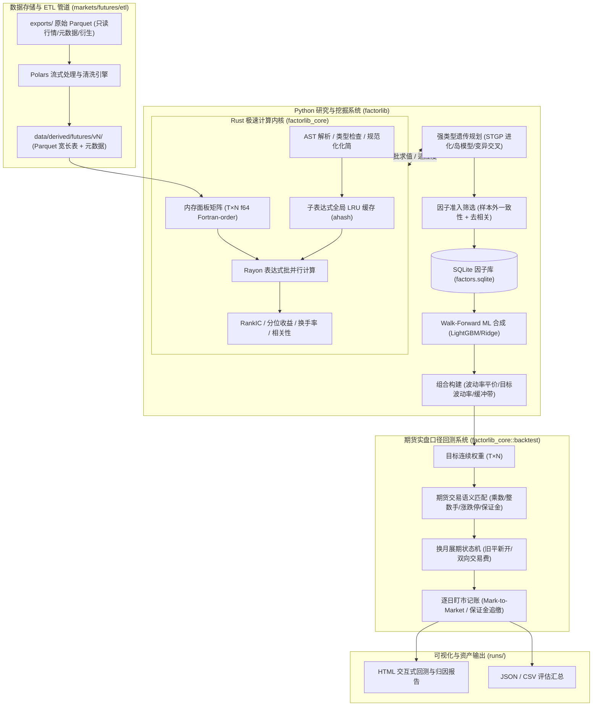

### 3.1 核心包目录树定义

```text
FactorLibrary/
├── pyproject.toml                         # uv 配置，包含 maturin 构建脚本与依赖
├── uv.lock                                # 依赖锁定文件
├── configs/
│   └── futures/
│       ├── data.yaml                      # 数据路径、主力规则、复权方法、执行窗口定义
│       ├── universe.yaml                  # 品种流动性准入、上市天数、到期日截断规则
│       ├── fees.yaml                      # 详细品种合约乘数、费率类型、tick_size、滑点表
│       ├── gp_default.yaml                # 遗传规划超参数、算子集、惩罚系数、岛模型配置
│       ├── ml_default.yaml                # Walk-Forward 滚动切分、LightGBM 树超参数
│       └── backtest.yaml                  # 初始资金、目标波动率、最大杠杆率、保证金阈值
├── rust/
│   └── factorlib_core/
│       ├── Cargo.toml                     # Rust 依赖声明
│       ├── benches/
│       │   └── eval_bench.rs              # 表达式批求值基准性能压测
│       └── src/
│           ├── lib.rs                     # PyO3 模块注册入口
│           ├── panel.rs                   # 核心面板数据结构、内存布局、对齐掩码
│           ├── nan.rs                     # NaN 安全浮点比较与计算实用函数
│           ├── ops/
│           │   ├── mod.rs                 # 算子集合定义与注册
│           │   ├── elem.rs                # 逐元素一元/二元算子实现
│           │   ├── ts.rs                  # 高性能时序滚动算子（增量与单调队列）
│           │   ├── cs.rs                  # 横截面排名、标准化、中性化算子
│           │   └── group.rs               # 行业/板块分组中性化算子
│           ├── expr/
│           │   ├── mod.rs
│           │   ├── ast.rs                 # 语法树节点、算子枚举、常数表示
│           │   ├── types.rs               # 类型系统（Series, Window, Constant, Bool）
│           │   ├── lexer.rs               # 词法分析器
│           │   ├── parser.rs              # 递归下降语法解析器
│           │   ├── typecheck.rs           # 静态类型检查器
│           │   ├── canon.rs               # 代数化简与规范化哈希生成
│           │   ├── eval.rs                # 表达式递归求值器
│           │   └── cache.rs               # 全局子表达式 LRU 缓存管理器
│           ├── metrics/
│           │   ├── mod.rs
│           │   ├── ic.rs                  # Spearman Rank IC 与时序 IC 计算
│           │   ├── quantile.rs            # 分位数收益率与多空净值统计
│           │   ├── turnover.rs            # 因子换手率与排名自相关
│           │   └── corr.rs                # 因子矩阵截面相关系数矩阵
│           ├── backtest/
│           │   ├── mod.rs
│           │   ├── fast.rs                # 快速无摩擦连续权重回测（用于前置粗筛）
│           │   └── futures.rs             # 期货实盘离散手数与保证金盯市完整状态机
│           └── py.rs                      # Python PyO3 导出类 Engine 封装
├── python/
│   └── factorlib/
│       ├── __init__.py
│       ├── core/
│       │   ├── config.py                  # 配置加载与强类型校验
│       │   ├── panel.py                   # Python 侧面板容器，与 Rust 零拷贝交互
│       │   ├── dsl.py                     # DSL 辅助解析与 AST 转换工具
│       │   ├── ops_ref.py                 # 算子的纯 NumPy 参考实现（用于对账）
│       │   ├── evaluate.py                # 单因子与多因子多维评估管线
│       │   ├── portfolio.py               # 信号到权重映射（波动率平价/收缩协方差）
│       │   ├── registry.py                # SQLite 因子库操作封装（增删查改与指标沉淀）
│       │   ├── runs.py                    # 实验追踪与运行上下文记录
│       │   └── report.py                  # 交互式 HTML 诊断分析报告生成器
│       ├── gp/
│       │   ├── primitives.py              # 强类型原语集与类型系统
│       │   ├── tree.py                    # 语法树个体表示与节点操作
│       │   ├── generate.py                # Ramped Half-and-Half 强类型生成算法
│       │   ├── variation.py               # 强类型安全子树交叉、变异、参数微调
│       │   ├── select.py                  # 锦标赛选择与精英保留机制
│       │   ├── canon.py                   # Python 侧规范化包装
│       │   ├── islands.py                 # 多岛模型并行与环形拓扑迁移管理
│       │   ├── engine.py                  # 遗传规划主循环演化控制器
│       │   └── admission.py               # 因子出海入库与去相关准入决策器
│       ├── ml/
│       │   ├── dataset.py                 # 多因子特征矩阵与标签对齐管道
│       │   ├── splits.py                  # Purged & Embargoed Walk-Forward 切分器
│       │   ├── pipeline.py                # ML 训练、调参、滚动预测全流程
│       │   └── models/
│       │       ├── base.py                # 统一模型抽象协议
│       │       ├── linear.py              # 动态 ICIR 加权、岭回归模型
│       │       └── lgbm.py                # LightGBM 截面排序学习模型封装
│       └── markets/
│           ├── base.py                    # MarketAdapter 抽象基类定义
│           ├── futures/
│           │   ├── adapter.py             # 期货市场适配器具体实现
│           │   ├── universe.py            # 期货可交易池构建规则
│           │   ├── contracts.py           # 期货合约生命周期管理与换月逻辑
│           │   ├── costs.py               # 期货多维交易成本模型
│           │   └── etl/
│           │       ├── io.py              # Parquet 流式安全读取
│           │       ├── audit.py           # 原始数据自检与异常审计
│           │       ├── calendar.py        # 交易日历对齐处理
│           │       ├── instruments.py     # 静态合约规格清洗
│           │       ├── dominant.py        # 主力合约连续映射构建 (rule=3, rank=1)
│           │       ├── daily.py           # 日线基础量价清洗
│           │       ├── adjust.py          # 比例后复权价差计算
│           │       ├── exec_price.py      # 分钟级开盘 30m VWAP 计算
│           │       ├── minute_features.py # 10 项高频微结构特征聚合
│           │       ├── aux_roll.py        # 展期收益率清洗
│           │       ├── aux_warehouse.py   # 仓单库存标准化
│           │       ├── aux_member.py      # 会员持仓龙虎榜多空指标聚合
│           │       ├── labels.py          # 链式未来多期标签构建
│           │       └── build.py           # 最终面板组装与元数据打标
│           └── stocks/
│               └── adapter.py             # A 股适配器占位实现（引发 NotImplementedError）
├── scripts/
│   ├── audit_data.py                      # 原始数据一键自检与生成报告脚本
│   ├── build_panel.py                     # 全量 ETL 面板构建与验证脚本
│   ├── run_gp.py                          # 自动化遗传规划因子挖掘入口
│   ├── run_ml.py                          # 多因子 Walk-Forward 合成入口
│   ├── run_backtest.py                    # 实盘口径回测与分析生成脚本
│   └── report.py                          # 独立可视化报告生成工具
├── tests/
│   ├── python/                            # Python 单元测试与集成测试
│   └── golden/                            # 验证数据 Golden Files
├── legacy/                                # 原 pyrust_bt 完整历史代码存档
├── data/                                  # 派生数据与本地因子库（已 gitignore）
├── runs/                                  # 实验运行痕迹与报告输出目录（已 gitignore）
└── exports/                               # 米筐 12.7GB 原始数据资产（已 gitignore）
```

---

## 4. 严密防未来函数的时间戳与时空坐标规范

在量化金融特别是国内期货市场，由于**夜盘时段跨日历日、主力合约日内不能切换、仓单与龙虎榜盘后披露**等特性，极其容易产生隐蔽的未来函数（Look-ahead Bias）。系统严格建立以下时空坐标基准：

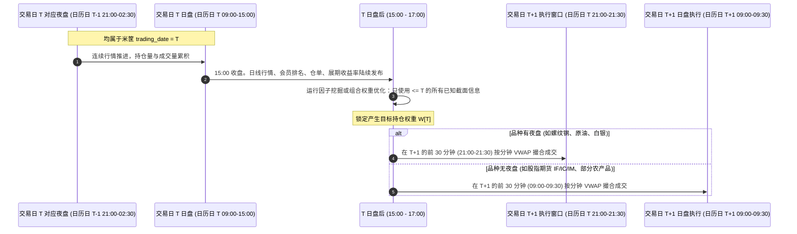

### 4.1 核心时序不变式规则

1. **统一坐标轴**：以米筐数据中的 `trading_date`（交易日）为统一主时间键。周五晚上 21:00 开启的夜盘，其 `trading_date` 归属于下周一。
2. **主力合约决策点**：交易日 $T$ 所交易的主力合约代码 $c_T$，取自 `dominant_mapping` 在日期 $T$ 对应的标的（该记录实质基于 $T-1$ 日收盘后的持仓量判定，满足 rule=3 且 rank=1）。日内严禁切换合约。
3. **信号截止点**：针对交易日 $T$ 生成的因子特征与策略信号向量 $S_T$，**其信息集合严格限制在 $T$ 日 15:00 收盘及之前可观测的数据**。
4. **执行价格（Execution Price）确定**：
   $$P_{\text{exec}}(c, T+1) = \frac{\sum_{m \in M_{30}} \text{close}_m \times \text{volume}_m}{\sum_{m \in M_{30}} \text{volume}_m}$$
   其中 $M_{30}$ 为合约 $c$ 在交易日 $T+1$ 开盘后最先到达的 30 根 1 分钟 Bar 集合。
   > **关键防坑点**：郑商所历史数据中成交额（`turnover`）存在被错误置零的现象，因此 **VWAP 计算一律采用 $\sum (\text{close} \times \text{volume}) / \sum \text{volume}$**，严禁使用 $\text{turnover} / \text{volume}$。
5. **无缝拼接单日收益率（Chain Return）**：
   交易日 $d$ 持仓至 $d+1$ 的真实实现收益率 $r_{d \to d+1}$ 严格区分为正常日与换月日：
   $$r_{d \to d+1} = \begin{cases} 
   \dfrac{P_{\text{exec}}(c_d, d+1)}{P_{\text{exec}}(c_d, d)} - 1, & \text{当 } c_{d+1} = c_d \text{ (无换月)} \\[10pt]
   \dfrac{P_{\text{exec}}(c_d, d+1)}{P_{\text{exec}}(c_d, d)} - 1, & \text{在换月日，旧合约平仓收益率；同时新合约 } c_{d+1} \text{ 以 } P_{\text{exec}}(c_{d+1}, d+1) \text{ 开仓}
   \end{cases}$$
   由于换月日平仓与开仓价格均使用各自分钟的真实成交价，**彻底消除跨合约换月跳空带来的虚假收益**。
6. **多期标签严格定义**：
   持有 $h$ 期的前向收益标签 $y_T^{(h)}$ 定义为未来链式收益的复利：
   $$y_T^{(h)} = \prod_{k=1}^{h} (1 + r_{T+k-1 \to T+k}) - 1$$
   **该标签仅存在于训练与评估阶段，在表达式 DSL 解析器中被设为系统保留字，禁止任何算子对其引用**。

---

## 5. 数据层与 ETL 详细数学规格

### 5.1 价格复权算法与检验（`etl/adjust.py`）

为了在因子计算中捕捉真实的形态和动量，价格类输入（open/high/low/close）必须消除换月跳空。采用 **比例后复权（`prev_close_ratio`）** 方式：
假设在日期 $s$ 发生主力合约从 $A$ 切换为 $B$（即 $c_{s-1}=A, c_s=B$），定义切换日前一日的调整比例因子：
$$k_s = \frac{\text{close}_{s-1}(A)}{\text{close}_{s-1}(B)}$$
设当前交易日为 $T$，历史上所有发生在 $T$ 日或之前的换月时点集合为 $\{s_1, s_2, \dots, s_m \le T\}$，则未复权价格转化为后复权价格的公式为：
$$P_{\text{adj}}(T) = P_{\text{raw}}(T) \times \prod_{j: s_j > T} \frac{1}{k_{s_j}}$$
同时，ETL 会自动读取米筐提供的官方 `ex_factor` 表进行数值对齐自检，若二者累计复权因子相对误差超过 $0.05\%$，则输出黄色警报并记录日志。

### 5.2 分钟线微观结构特征计算公式（`etl/minute_features.py`）

利用每个交易日的全量 1 分钟 Bar 序列 $\{p_m, v_m\}_{m=1}^M$（其中 $r_m = \ln(p_m / p_{m-1})$ 为分钟对数收益率），在 ETL 中向量化提取 10 项微观结构特征：

1. **已实现波动率（Realized Volatility, RV）**：
   $$\text{RV} = \sqrt{\sum_{m=2}^M r_m^2}$$
2. **上行已实现波动率（RV Up）与下行已实现波动率（RV Down）**：
   $$\text{RV}_{\text{up}} = \sqrt{\sum_{m=2}^M r_m^2 \cdot \mathbb{I}(r_m > 0)}, \quad \text{RV}_{\text{down}} = \sqrt{\sum_{m=2}^M r_m^2 \cdot \mathbb{I}(r_m < 0)}$$
3. **尾盘 30 分钟动量（Late Momentum）**：
   $$\text{ret}_{\text{last30}} = \frac{p_M}{p_{M-30}} - 1$$
4. **早盘 30 分钟收益（Early Return）**：
   $$\text{ret}_{\text{first30}} = \frac{p_{30}}{p_1} - 1$$
5. **日盘与夜盘收益差（Night-Day Spread）**：
   $$\text{spread}_{\text{night\_day}} = \text{ret}_{\text{night}} - \text{ret}_{\text{day}}$$
6. **日内成交量集中度（Volume Concentration, Herfindahl）**：
   $$\text{vol}_{\text{conc}} = \sum_{m=1}^M \left( \frac{v_m}{\sum_{j=1}^M v_j} \right)^2$$
7. **日内振幅（Normalized Daily Amplitude）**：
   $$\text{amp} = \frac{\max(p) - \min(p)}{\text{settle}_{T-1}}$$
8. **日内收益偏度（Intraday Skewness）与峰度（Intraday Kurtosis）**：
   $$\text{skew}_{\text{intra}} = \frac{\frac{1}{M}\sum (r_m - \bar{r})^3}{\left(\frac{1}{M}\sum (r_m - \bar{r})^2\right)^{3/2}}, \quad \text{kurt}_{\text{intra}} = \frac{\frac{1}{M}\sum (r_m - \bar{r})^4}{\left(\frac{1}{M}\sum (r_m - \bar{r})^2\right)^{2}} - 3$$
9. **收盘价对日内 VWAP 偏离度（VWAP Deviation）**：
   $$\text{vwap}_{\text{dev}} = \frac{p_M - \text{VWAP}_{\text{day}}}{\text{VWAP}_{\text{day}}}$$

### 5.3 衍生基本面与资金流特征清洗

1. **期限结构与展期收益率（`roll_yield`）**：
   - 近远月展期收益率（主力与次主力）：
     $$\text{RY}_{\text{main\_sub}} = \frac{\text{settle}(\text{main}) - \text{settle}(\text{sub})}{\text{settle}(\text{sub})}$$
   - 年化调整展期收益率：
     $$\text{RY}_{\text{ann}} = \text{RY}_{\text{main\_sub}} \times \frac{252}{\Delta \text{Days}(\text{sub}, \text{main})}$$
2. **仓单库存标准化（`warehouse_stocks`）**：
   - 考虑到各品种仓单物理单位不一致（吨、张、千克），严禁跨品种直接对比绝对值。
   - 统一计算单品种 5 日变动率与滚动 60 日时序 Z-Score：
     $$\text{wh}_{\text{chg5}} = \frac{\text{stock}_T - \text{stock}_{T-5}}{\text{stock}_{T-5} + \epsilon}, \quad \text{wh}_{z60} = \frac{\text{stock}_T - \mu_{60}(\text{stock})}{\sigma_{60}(\text{stock}) + \epsilon}$$
3. **会员持仓排名与龙虎榜异动（`member_rank`）**：
   - 过滤提取主力合约 $c_T$ 对应的多头前 20 名总持仓 $L_{20}$ 与空头前 20 名总持仓 $S_{20}$。
   - 计算**主力净多头占比（Net Long Ratio）**与**持仓集中度（Concentration Ratio 20）**：
     $$\text{net\_ratio} = \frac{L_{20} - S_{20}}{L_{20} + S_{20}}, \quad \text{cr}_{20} = \frac{L_{20} + S_{20}}{\text{open\_interest}_T}$$
   - 及其 5 日变动量：$\Delta \text{net\_ratio}_5 = \text{net\_ratio}_T - \text{net\_ratio}_{T-5}$。

---

## 6. Rust 极速计算内核架构设计（factorlib_core）

### 6.1 内存布局与底层数据结构

为达到 CPU 缓存命中率极致优化，Rust 内核内部所有连续面板数据使用 `ndarray::Array2<f64>`，形状为 $(T, N)$，采用 **Fortran 列优先布局（Column-Major）**：
- 在金融数据中，同一品种（列）跨越数千个交易日的数据在内存中连续排列。
- 绝大多数时序算子（`ts_mean`, `ts_std`, `delay`, `ts_rank`）以列为单元遍历，列优先存储能够完全利用 CPU 预取器和 SIMD 指令集，杜绝 Cache Miss。
- 横截面算子（`cs_rank`, `cs_zscore`）沿行处理，计算前按行取切片，或在密集截面处理时使用临时行缓冲。

```rust
// rust/factorlib_core/src/panel.rs 核心结构体设计
use ndarray::{Array2, ShapeError};
use std::collections::HashMap;
use std::sync::Arc;

pub struct Panel {
    /// 交易日时间轴 (长度 T)
    pub dates: Vec<String>,
    /// 品种代码符号列表 (长度 N, 如 ["RB", "CU", "IF", ...])
    pub symbols: Vec<String>,
    /// 基础字段矩阵映射表，键为字段名，值为 T x N 矩阵 (Fortran-order)
    pub fields: HashMap<String, Arc<Array2<f64>>>,
    /// 品种池有效性掩码 (True 代表当日在池)，形状 T x N
    pub universe_mask: Array2<bool>,
    /// 预测收益标签集合，键为标签名 (如 "y_5")，单独存储，防止 DSL 越权访问
    pub labels: HashMap<String, Arc<Array2<f64>>>,
}

impl Panel {
    pub fn shape(&self) -> (usize, usize) {
        (self.dates.len(), self.symbols.len())
    }
}
```

### 6.2 高性能时序滚动算法数学实现

内核摒弃每次重复计算滑动窗口的朴素低效做法，全量采用 $O(1)$ 或 $O(\log d)$ 增量算法：

1. **增量 Welford 滚动均值与方差（`ts_mean`, `ts_std`）**：
   维护当前有效窗口内元素计数 $k$、均值 $M_k$ 与二阶差分累积量 $S_k$。当新值 $x_{\text{in}}$ 进入、旧值 $x_{\text{out}}$ 滑出时，采用在线增量公式更新，时间复杂度严格 $O(1)$。
2. **双端单调队列极值算法（`ts_min`, `ts_max`）**：
   维护双端队列（`std::collections::VecDeque<(usize, f64)>`），保持队列中元素单调递增（求 min）或单调递减（求 max）。每个元素至多入队出队一次，每个时间步平摊复杂度严格为 $O(1)$。
3. **滚动截面排名（`ts_rank`）**：
   采用平衡二叉搜索树（基于跳表或双堆平衡结构）动态维护窗口内有效数值，单步更新复杂度为 $O(\log d)$。

### 6.3 多线程批并行与全局子表达式缓存

```rust
// rust/factorlib_core/src/expr/cache.rs
use ahash::AHashMap;
use std::sync::RwLock;

pub struct SubExprCache {
    /// 键为 AST 规范化化简后的 64 位哈希值
    cache: RwLock<AHashMap<u64, Arc<Array2<f64>>>>,
    max_memory_bytes: usize,
    current_memory_bytes: usize,
}
```

- **并行架构**：在 `eval_batch` 中，借助 `rayon::prelude::*` 将 Python 传递的数千个 AST 并行分发到 10 个物理线程。
- **并发控制**：在调用 Rust 前通过 `Python::allow_threads` 显式**释放 GIL**。
- **动态缓存剪枝**：当表达式深度增加时，公共子表达式（例如 `ts_std(close, 20)`）在种群中大量重复出现。求值器优先查询 `SubExprCache`，若命中直接克隆 `Arc` 指针，计算开销瞬间降为零。

---

## 7. 表达式 DSL 语法系统与 AST 规范化引擎

### 7.1 AST 节点与类型系统数据结构

```rust
// rust/factorlib_core/src/expr/types.rs
#[derive(Debug, Clone, Copy, PartialEq, Eq, Hash)]
pub enum DataType {
    Series,   // 连续时序面板矩阵 (T x N)
    Window,   // 离散时序滑动窗口整数 (如 5, 10, 20)
    Constant, // 浮点常数标量 (如 0.5, 2.0, -1.0)
    BoolCond, // 条件布尔掩码矩阵 (T x N)
}

// rust/factorlib_core/src/expr/ast.rs
#[derive(Debug, Clone, PartialEq)]
pub enum ASTNode {
    Field(String),                    // 终端特征字段 (如 "close", "volume")
    Constant(f64),                    // 常数标量
    Window(usize),                    // 窗口参数
    UnaryCall {
        op: UnaryOp,
        arg: Box<ASTNode>,
    },
    BinaryCall {
        op: BinaryOp,
        lhs: Box<ASTNode>,
        rhs: Box<ASTNode>,
    },
    TernaryCall {
        op: TernaryOp,
        cond: Box<ASTNode>,
        then_branch: Box<ASTNode>,
        else_branch: Box<ASTNode>,
    },
}
```

### 7.2 算子静态签名表与类型检查（Type Checker）

系统严格校验算子输入的类型合法性，拒绝非法嵌套：

| 算子类别 | 算子名称 | 输入签名 | 输出类型 | 非法用法阻断示例 |
|---|---|---|---|---|
| 算术一元 | `neg, abs, sign, inv, slog, ssqrt` | (Series) | Series | `abs(20)`（参数为窗口非法） |
| 算术二元 | `add, sub, mul, div, max2, min2` | (Series, Series) | Series | `add(close, 10)`（需用 `addc`） |
| 常数运算 | `addc, mulc, spow` | (Series, Constant) | Series | `spow(close, open)` |
| 条件分支 | `where` | (BoolCond, Series, Series) | Series | `where(close, open, high)` |
| 时序基础 | `delay, delta, pct_change` | (Series, Window) | Series | `delay(close, open)` |
| 时序统计 | `ts_mean, ts_std, ts_sum, ts_min, ts_max, ts_skew, ts_kurt, ts_ema, ts_decay_linear` | (Series, Window) | Series | `ts_mean(20, close)` |
| 时序排序 | `ts_rank, ts_zscore, ts_argmin, ts_argmax` | (Series, Window) | Series | `ts_rank(close, -5)` |
| 时序二元 | `ts_corr, ts_cov, ts_beta, ts_resid` | (Series, Series, Window) | Series | `ts_corr(close, 20, volume)` |
| 横截面 | `cs_rank, cs_zscore, cs_demean, cs_scale, cs_winsorize` | (Series) | Series | `cs_rank(20)` |
| 截面中性 | `cs_neutralize` | (Series, Series) | Series | `cs_neutralize(close, 10)` |

### 7.3 代数等价规范化（Canonicalization）与去重引擎

遗传规划中极易产生语义完全相同但字符表达式不同的膨胀冗余树。系统在求值前执行递归规范化化简：

1. **交换律排序（Commutative Sorting）**：
   对于 `add`, `mul`, `max2`, `min2`, `ts_corr` 等算子，子节点强制按照哈希值升序排列：
   $$\text{add}(y, x) \implies \text{add}(x, y) \quad (\text{若 } \text{Hash}(x) < \text{Hash}(y))$$
2. **幂等性化简（Idempotency Folding）**：
   - `cs_rank(cs_rank(x))` $\implies$ `cs_rank(x)`
   - `abs(abs(x))` $\implies$ `abs(x)`
   - `neg(neg(x))` $\implies$ $x$
3. **退化结构阻断（Degenerate Pruning）**：
   - `sub(x, x)` $\implies$ 0（直接标记为无效个体，返回适应度 $-\infty$）
   - `div(x, x)` $\implies$ 1（直接阻断）
   - `ts_std(常数, w)` $\implies$ 0（直接阻断）
4. **单调不变性压缩**：
   在截面排序算子 `cs_rank` 外层，若包裹严格单调递增无界函数（如 `slog` 在正半轴），剥离外层算子。

规范化后的 AST 转换为紧凑字符串，并通过 64 位 `ahash` 输出全局唯一指纹 `canon_hash`。

---

## 8. 多维度因子评价指标数学体系

设指定测试区间包含 $T_{\text{eval}}$ 个满足最小有效标的数（$\ge \text{min\_names}$）的有效交易日集合 $\mathcal{D}$。对交易日 $t \in \mathcal{D}$，在池标的集合为 $\mathcal{U}_t$（大小 $N_t = |\mathcal{U}_t|$）。因子截面向量为 $\mathbf{f}_t$，标签收益向量为 $\mathbf{y}_t$。

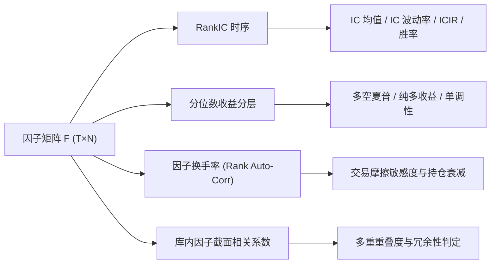

### 8.1 截面 Spearman Rank IC 与时序指标

1. **截面排名相关系数**：
   $$r_{\text{IC}}(t) = \text{Corr}\left( \text{rank}(\mathbf{f}_t), \text{rank}(\mathbf{y}_t) \right) = 1 - \frac{6 \sum_{i=1}^{N_t} d_{i,t}^2}{N_t (N_t^2 - 1)}$$
2. **Rank IC 均值与信息比率（ICIR）**：
   $$\mu_{\text{IC}} = \frac{1}{|\mathcal{D}|} \sum_{t \in \mathcal{D}} r_{\text{IC}}(t), \quad \sigma_{\text{IC}} = \sqrt{\frac{1}{|\mathcal{D}|-1} \sum_{t \in \mathcal{D}} (r_{\text{IC}}(t) - \mu_{\text{IC}})^2}, \quad \text{ICIR} = \frac{\mu_{\text{IC}}}{\sigma_{\text{IC}}}$$
3. **统计显著性检验（t 统计量）**：
   考虑到标签重叠期 $h$ 带来的自相关偏误，进行 Newey-West 或简易自由度调整：
   $$t_{\text{stat}} = \text{ICIR} \times \sqrt{\frac{|\mathcal{D}|}{h}}$$
4. **IC 符号胜率（IC Win Rate）**：
   $$\text{WinRate}_{\text{IC}} = \frac{1}{|\mathcal{D}|} \sum_{t \in \mathcal{D}} \mathbb{I}\left( \text{sign}(r_{\text{IC}}(t)) = \text{sign}(\mu_{\text{IC}}) \right)$$

### 8.2 分层收益与多空组合检验

将每日有效品种按因子值从小到大均分为 $K$ 组（默认 $K=5$）。第 $k$ 组在 $t$ 日等权组合的次日收益为：
$$R_k(t) = \frac{1}{|\mathcal{G}_{k,t}|} \sum_{i \in \mathcal{G}_{k,t}} r_{i, t \to t+1}$$
- **多空对冲收益（Long-Short Spread）**：
  若 $\mu_{\text{IC}} > 0$，做多第 $K$ 组，做空第 1 组：$R_{\text{LS}}(t) = R_K(t) - R_1(t)$（反之亦然）。
- **多空夏普比率（LS Sharpe Ratio）**：
  $$\text{Sharpe}_{\text{LS}} = \frac{\text{mean}(R_{\text{LS}}) \times 252}{\text{std}(R_{\text{LS}}) \times \sqrt{252}}$$
- **单调性评分（Monotonicity Score）**：
  计算 $K$ 个组全样本累计年化收益率与分位序号 $[1, 2, \dots, K]$ 的等级相关系数。

### 8.3 因子换手率与半衰期衰减分析

1. **截面换手率代理指标**：
   $$\text{Turnover} = 1 - \frac{1}{|\mathcal{D}|-1} \sum_{t=2}^{|\mathcal{D}|} \text{Corr}\left( \text{rank}(\mathbf{f}_t), \text{rank}(\mathbf{f}_{t-1}) \right)$$
2. **多期限衰减矩阵**：
   同步计算 $h \in \{1, 3, 5, 10, 20\}$ 日的 $\mu_{\text{IC}}(h)$，绘制因子预测能力衰减曲线。

---

## 9. 强类型遗传规划（STGP）自动化挖掘引擎设计

### 9.1 STGP 架构与种群拓扑模型

采用强类型树状表达式演化。为防止种群过早陷入局部最优，引入**分布式多岛模型（Island Model）**：
- 设置 4 个彼此独立的演化岛屿，各个岛屿使用不同的随机数种子并行进化。
- 采用环形拓扑结构（Ring Topology）：每隔 10 代，各岛将自己排名前 5% 的精英个体向相邻岛屿单向迁移，替换目标岛屿表现最差的个体。

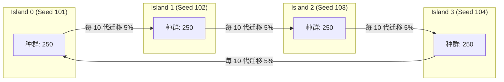

### 9.2 强类型初始化：Ramped Half-and-Half 算法

支持限制树深（默认 $\text{min\_depth}=2, \text{max\_depth}=5$）：
- 种群 50% 采用 **Grow 模式**（随机选择算子或终端叶子，生成非对称形态树）。
- 种群 50% 采用 **Full 模式**（在达到最大深度前只选择非终端算子，生成平衡饱满树）。
- **强类型递归保护**：当递归展开到目标类型为 `Window` 时，强制在全局离散参数池 $\{3, 5, 10, 20, 40, 60, 120, 250\}$ 中均匀抽样；当目标类型为 `Constant` 时，在 $\{-2.0, -1.0, -0.5, 0.5, 1.0, 2.0\}$ 中抽样；当目标为 `Series` 时，可选择时序/截面算子或终端特征列。

### 9.3 遗传变异与交叉算子

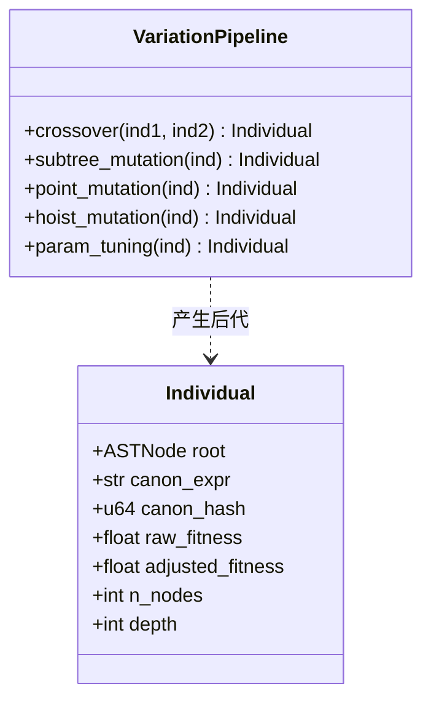

1. **强类型子树交叉（Typed Subtree Crossover，概率 60%）**：
   在父本 A 中随机选取一个非根节点 $u$，获取其输出类型 $\tau$。在父本 B 中寻找所有输出类型同为 $\tau$ 的候选节点集合，随机选取节点 $v$。将 $v$ 深度拷贝替换 $u$。若生成子代深度或节点数超标，则重试或退化保留父本。
2. **子树变异（Subtree Mutation，概率 15%）**：
   随机选取节点 $u$（类型 $\tau$），以该点为根调用 Grow 模式生成一棵新的最大深度为 3 的类型 $\tau$ 子树予以替换。
3. **点变异（Point Mutation，概率 10%）**：
   随机选取一个算子节点，用同类型签名的同级算子替换（例如 `ts_mean` 替换为 `ts_decay_linear`，`min2` 替换为 `max2`）。
4. **提升变异（Hoist Mutation，概率 5%）**：
   随机选取一个子树节点，直接将其“提升”替换掉其父节点，有效抑制代码膨胀（Bloat）。
5. **参数微调变异（Parameter Tuning，概率 10%）**：
   保持树形拓扑结构完全不变，随机扰动树中的某个窗口整数（例如 20 改为 40）或常数。

### 9.4 综合适应度函数设计

$$F(\text{expr}) = \underbrace{|\text{ICIR}_{\text{train}}|}_{\text{核心预测力}} - \underbrace{\lambda \cdot \text{NodesCount}}_{\text{奥卡姆剃刀节俭惩罚}} - \underbrace{\text{Penalty}_{\text{cov}}}_{\text{覆盖率惩罚}} - \underbrace{\text{Penalty}_{\text{corr}}}_{\text{与库内因子冗余惩罚}}$$

其中：
- 节点惩罚系数 $\lambda = 0.002$。若一个表达式包含 20 个节点，适应度扣减 0.04。
- 覆盖率惩罚：若有效覆盖率 $\text{Coverage} < 0.70$，则 $\text{Penalty}_{\text{cov}} = 10.0$（直接淘汰）。
- 相关性惩罚：计算该候选因子与**已入库全部因子**在训练集上的平均绝对相关系数 $\bar{\rho}$。若 $\max(\rho) > 0.60$，则将其适应度打五折：$\text{Penalty}_{\text{corr}} = 0.5 \times |\text{ICIR}_{\text{train}}|$。

### 9.5 准入筛选管线（`gp/admission.py`）

当 GP 完成设定代数后，触发全自动五步准入过滤器：
1. **Top-K 初筛**：合并所有岛屿的名人堂（Hall of Fame），按训练集适应度降序取前 200 个不重复个体。
2. **验证集符号与强度检验**：
   计算在验证集（2019–2021）上的表现，要求：
   $$\text{sign}(\mu_{\text{IC}}^{\text{valid}}) == \text{sign}(\mu_{\text{IC}}^{\text{train}}) \quad \text{且} \quad |\text{ICIR}_{\text{valid}}| \ge 0.30$$
3. **截面换手率约束**：
   单日换手率代理指标需满足 $\text{Turnover} \le 0.85$（排除极端高频随机噪声）。
4. **贪心正交化去相关（Greedy Orthogonalization）**：
   按验证集 $|\text{ICIR}|$ 降序遍历候选因子：仅当其与已入库集合及本批已入围集合的**所有因子**的最大相关系数均 $< 0.60$ 时，准予入选。
5. **入库登记**：将合格因子原子化写入 SQLite，状态标记为 `accepted`。

---

## 10. 因子库资产化存储与生命周期状态机

### 10.1 生产级 SQLite Schema 物理设计（`factors.sqlite`）

```sql
-- 因子元数据主表
CREATE TABLE IF NOT EXISTS factor (
    id              INTEGER PRIMARY KEY AUTOINCREMENT,
    canon_expr      TEXT NOT NULL,                       -- 规范化 DSL 文本
    canon_hash      TEXT NOT NULL UNIQUE,                -- 64 位唯一指纹 (HEX)
    mode            TEXT NOT NULL CHECK (mode IN ('cs', 'ts')),
    sign            INTEGER NOT NULL CHECK (sign IN (-1, 1)), -- 推荐方向 (1: 正向, -1: 反向)
    n_nodes         INTEGER NOT NULL,                    -- AST 节点总数
    depth           INTEGER NOT NULL,                    -- 树的最大深度
    source          TEXT NOT NULL CHECK (source IN ('gp', 'manual', 'seed')),
    source_run      TEXT,                                -- 产生该因子的 run_id (对应 runs/ 目录)
    data_version    TEXT NOT NULL,                       -- 生成该因子所基于的面板元数据指纹
    status          TEXT NOT NULL DEFAULT 'candidate' 
                    CHECK (status IN ('candidate', 'accepted', 'active', 'deprecated')),
    created_at      TEXT NOT NULL,                       -- ISO8601 时间戳
    updated_at      TEXT NOT NULL
);

-- 因子多时段评估指标明细表
CREATE TABLE IF NOT EXISTS factor_metrics (
    factor_id       INTEGER NOT NULL REFERENCES factor(id) ON DELETE CASCADE,
    split           TEXT NOT NULL CHECK (split IN ('train', 'valid', 'test', 'full')),
    horizon         INTEGER NOT NULL,                    -- 预测窗口期数 (如 1, 5, 10, 20)
    ic_mean         REAL NOT NULL,
    ic_std          REAL NOT NULL,
    ic_ir           REAL NOT NULL,
    ic_t            REAL NOT NULL,
    ic_win_rate     REAL NOT NULL,
    coverage        REAL NOT NULL,
    turnover        REAL NOT NULL,
    ls_sharpe       REAL NOT NULL,                       -- 多空夏普
    ls_annual_ret   REAL NOT NULL,                       -- 多空年化收益率
    ls_max_dd       REAL NOT NULL,                       -- 多空最大回撤
    computed_at     TEXT NOT NULL,
    PRIMARY KEY (factor_id, split, horizon)
);

-- 实验运行元数据追踪表
CREATE TABLE IF NOT EXISTS experiment_run (
    run_id          TEXT PRIMARY KEY,                    -- 目录标识符 (如 "gp_20261016_143022")
    kind            TEXT NOT NULL,                       -- "gp", "ml", "backtest"
    config_yaml     TEXT NOT NULL,                       -- 完整配置副本
    data_version    TEXT NOT NULL,
    git_sha         TEXT NOT NULL,
    n_evaluated     INTEGER DEFAULT 0,                   -- 累计求值独立表达式数
    started_at      TEXT NOT NULL,
    finished_at     TEXT,
    status          TEXT NOT NULL CHECK (status IN ('running', 'completed', 'failed'))
);

CREATE INDEX IF NOT EXISTS idx_factor_status ON factor(status);
CREATE INDEX IF NOT EXISTS idx_factor_hash ON factor(canon_hash);
CREATE INDEX IF NOT EXISTS idx_metrics_lookup ON factor_metrics(split, horizon);
```

### 10.2 因子生命周期流转状态机

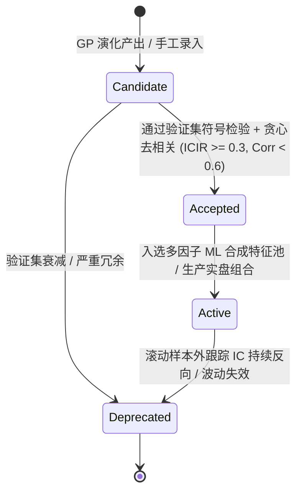

- **Candidate**：所有探索发现的新表达式，仅在训练集上具备高适应度。
- **Accepted**：通过验证集与相关性去重后的合格因子资产，具备独立预测能力。
- **Active**：当前处于生产回测和机器学习多因子合成模型中的特征输入。
- **Deprecated**：在最新的 Walk-Forward 测试中表现退化（如滚动 1 年 ICIR $< 0$）或被更强特征完全替代，退出有效特征池。

---

## 11. Walk-Forward 机器学习多因子合成架构

### 11.1 特征工程预处理标准流

所有状态为 `accepted` 或 `active` 的因子，在送入模型前必须完成标准截面变换，消除量纲差异与极值干扰：

1. **方向对齐**：所有因子矩阵乘以其注册表中的 `sign` 标量，使所有特征与标签正相关。
2. **截面极值中位数截断（MAD Winsorization）**：
   对每一天截面数据，计算中位数 $\text{med}$ 与绝对中位差 $\text{MAD} = \text{median}(|x - \text{med}|)$。将超出 $[\text{med} - 5 \times 1.4826 \text{MAD}, \text{med} + 5 \times 1.4826 \text{MAD}]$ 的数据截断。
3. **截面排序高斯化（Rank Gauss Transform）**：
   将截面数值转换为均匀分布分位数，再通过标准正态分布的逆累积分布函数映射为标准正态分布：
   $$\tilde{x}_{i,t} = \Phi^{-1}\left( \frac{\text{rank}(x_{i,t}) - 0.5}{N_t} \right)$$
   此举可大幅增强线性模型与梯度提升树的数值稳定性与泛化能力。

### 11.2 Purged & Embargoed 滚动扩展窗口架构

为彻底杜绝标签重叠导致的信息穿越，采用扩展窗口（Expanding Window）配合严格的时序净化（Purge）：

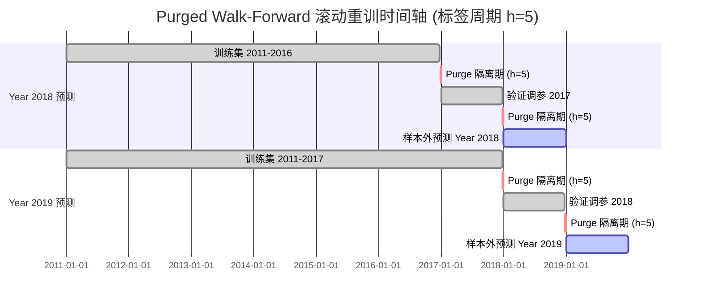

- **Purge 机制**：每个训练集的最末尾日期，必须向前剔除 $h$ 个交易日。因为第 $T$ 日计算标签 $y_T^{(h)}$ 包含了未来 $h$ 天价格，若不剔除将造成严重前瞻偏差。
- **Embargo 机制**：当验证集位于训练集之后时，在验证集起始端追加 $h$ 天的静默观察期。

### 11.3 核心预测模型体系

系统实现两级模型体系：

1. **基准线性模型族**：
   - **Equal Weight（等权基线）**：全因子直接简单平均，作为所有复杂模型的底线对照。
   - **Rolling ICIR Weight（动态信息比率加权）**：
     $$w_f(t) = \frac{\max(0, \text{ICIR}_{f, [t-252, t]})}{\sum_j \max(0, \text{ICIR}_{j, [t-252, t]})}$$
   - **Ridge 回归**：带 $L_2$ 正则化的线性截面回归，自动网格搜索最佳惩罚系数 $\alpha$。
2. **非线性梯度提升树模型（LightGBM）**：
   - **目标函数**：采用回归目标函数（`regression_l2`）拟合高斯化后的标签排名；或配置 `lambdarank`（以每日作为一个 query group）。
   - **防过拟合超参数强约束**：
     - `max_depth = 4`（限制树深，防止深层过拟合）
     - `num_leaves = 15`
     - `min_child_samples = 200`（保证叶子节点覆盖充足样本）
     - `colsample_bytree = 0.6`（每棵树随机抽取 60% 特征）
     - `subsample = 0.8`
     - `early_stopping_rounds = 50`

---

## 12. 期货实盘口径组合构建与向量化回测状态机

### 12.1 信号到连续目标权重的映射（`portfolio.py`）

从预测模型产出的复合信号评分矩阵 $\mathbf{S}_{T \times N}$ 转化为规范资产权重 $\mathbf{W}_{T \times N}$：

1. **截面标准化去均值**：
   $$s'_{i,t} = s_{i,t} - \frac{1}{N_t} \sum_{j \in \mathcal{U}_t} s_{j,t}$$
2. **波动率倒数平价缩放（Inverse Volatility Scaling）**：
   针对不同商品波动率巨大差异（如原油年化波动 35% vs 玉米 12%），按近 20 日已实现波动率进行风险平价加权：
   $$w''_{i,t} = \frac{s'_{i,t}}{\sigma_{i, t}} \quad \left(\text{其中 } \sigma_{i,t} = \text{std}_{20}(r_i) \times \sqrt{252}\right)$$
3. **组合目标波动率定标（Target Volatility Scaling）**：
   设定组合年化目标波动率 $\sigma_{\text{target}} = 10\%$。利用 60 日滚动收缩协方差矩阵（Ledoit-Wolf Shrinkage）$\boldsymbol{\Sigma}_t$ 估计当前组合波动：
   $$\sigma_{\text{port}, t} = \sqrt{\mathbf{w}''_t \boldsymbol{\Sigma}_t \mathbf{w}''_t{}^{\top}}, \quad \mathbf{w}^*_t = \mathbf{w}''_t \times \min\left( \frac{\sigma_{\text{target}}}{\sigma_{\text{port}, t}}, \text{Leverage}_{\max} \right)$$
4. **截断与集中度约束**：
   单品种最大绝对权重 $|w_{i,t}^*| \le 0.15$，总多头与空头杠杆率分别不超过设定上限。
5. **调仓缓冲带机制（Turnover Buffer）**：
   对比前一日目标权重 $w_{i, t-1}$，若变动幅度 $|w^*_{i,t} - w_{i, t-1}| < 0.01$，则**保持前一日权重不调整**，大幅降低低收益调仓所带来的滑点消耗。

### 12.2 离散手数与逐日盯市回测状态机（`backtest/futures.rs`）

回测内核在 Rust 中以纯状态机运行，逐日处理时间步 $d = T+1$：

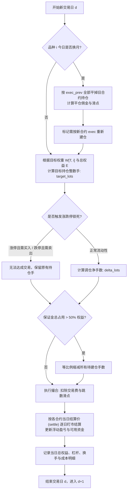

#### 关键核算方程组（数学级严密保证）：

1. **目标手数离散化取整**：
   $$\text{target\_lots}_{i, d} = \text{round}\left( \frac{w_{i, T} \times E_{T}}{P_{\text{exec}}(c_d, d) \times \text{Multiplier}_i} \right)$$
2. **涨跌停与单边市执行阻断**：
   - 若 $P_{\text{exec}} \ge \text{LimitUp}_{i,d}$ 且 $\Delta \text{lots} > 0$（试图做多开仓或买入平空）：**委托拒绝**。
   - 若 $P_{\text{exec}} \le \text{LimitDown}_{i,d}$ 且 $\Delta \text{lots} < 0$（试图做空开仓或卖出平多）：**委托拒绝**。
   - 若标的标记为单边市（`is_unilateral == true`）：**禁止一切反向平仓，保持原头寸**。
3. **交易摩擦费用核算**：
   针对每一笔成交的手数 $\Delta L$，扣除：
   $$\text{Fee} = \begin{cases}
   \Delta L \times \text{FeePerLot}_i, & \text{按手计费} \\
   \Delta L \times P_{\text{exec}} \times \text{Multiplier}_i \times \text{FeeRate}_i, & \text{按成交额计费}
   \end{cases}$$
   $$\text{Slippage} = \Delta L \times (\text{SlipTicks}_i \times \text{TickSize}_i) \times \text{Multiplier}_i$$
4. **逐日盯市结算损益（Mark-to-Market PnL）**：
   当日总盈亏严格拆分为：
   $$\Delta E_d = \text{PnL}_{\text{price}} - \text{Fee}_{\text{total}} - \text{Slippage}_{\text{total}} - \text{Cost}_{\text{roll}}$$
   其中：
   $$\text{PnL}_{\text{price}} = \sum_{i} \left[ \text{lots}_{i, \text{prev}} \times (\text{settle}_{i, d} - \text{settle}_{i, d-1}) + \Delta \text{lots}_i \times (\text{settle}_{i, d} - P_{\text{exec}, i}) \right] \times \text{Multiplier}_i$$
   回测系统逐日验证恒等式：$E_d - E_{d-1} == \Delta E_d$。若出现哪怕 1 分钱不一致，即刻中断报警。

---

## 13. 生产级配置文件完整规范

### 13.1 `configs/futures/data.yaml`
```yaml
raw_dir: "./exports"
derived_dir: "./data/derived/futures"
panel_version: "v1"

# 主力合约规则
dominant:
  rule: 3               # 排除最后交易日的主力映射规则
  rank: 1               # 主力合约 (次主力为 2)

# 复权规则
adjust:
  method: "prev_close_ratio" # 比例后复权
  verify_with_ex_factor: true

# 撮合成交价格定义
exec_price:
  window_minutes: 30    # 开盘后 30 根 1m bar
  calc_method: "vwap_close_volume" # sum(close*volume)/sum(volume)

# 时间跨度
timeline:
  start_date: "2010-01-01"
  end_date: "2026-08-31"

# 特征开关
features:
  intraday_minute_features: true
  roll_yield: true
  warehouse_stocks: true
  member_rank:
    enabled: true
    top_n: 20
```

### 13.2 `configs/futures/universe.yaml`
```yaml
# 品种流动性筛选规则
liquidity:
  min_adv20_turnover: 50000000.0  # 过去20日平均成交额 >= 5000 万
  min_listed_days: 60             # 品种上市天数 >= 60 天
  min_days_to_expiry: 5           # 距离合约到期日 >= 5 天 (避免交割月流动性枯竭)

# 截面有效性要求
evaluation:
  min_names_per_day: 10           # 截面至少有 10 个品种在池才纳入评估
```

### 13.3 `configs/futures/fees.yaml`
```yaml
default:
  fee_type: "rate"
  open: 0.00005
  close: 0.00005
  close_today: 0.00005
  tick_size: 1.0
  slip_ticks: 1
  margin_rate: 0.10

products:
  # 黑色系
  RB:
    fee_type: "rate"
    open: 0.0001
    close: 0.0001
    close_today: 0.0001
    tick_size: 1.0
    slip_ticks: 1
    multiplier: 10.0
    margin_rate: 0.09
  I:
    fee_type: "rate"
    open: 0.0001
    close: 0.0001
    close_today: 0.0001
    tick_size: 0.5
    slip_ticks: 1
    multiplier: 100.0
    margin_rate: 0.11
  # 有色系
  CU:
    fee_type: "rate"
    open: 0.00005
    close: 0.00005
    close_today: 0.0001
    tick_size: 10.0
    slip_ticks: 1
    multiplier: 5.0
    margin_rate: 0.10
  # 金融股指
  IF:
    fee_type: "rate"
    open: 0.000023
    close: 0.000023
    close_today: 0.000345 # 股指平今惩罚费率
    tick_size: 0.2
    slip_ticks: 1
    multiplier: 300.0
    margin_rate: 0.12
```

### 13.4 `configs/futures/gp_default.yaml`
```yaml
seed: 42
mode: "cs"                        # cs: 横截面模式, ts: 时序 CTA 模式
label: "y_5"                      # 目标预测标签

# 样本划分
splits:
  train: ["2011-01-01", "2018-12-31"]
  valid: ["2019-01-01", "2021-12-31"]
  test:  ["2022-01-01", "2026-08-31"]

# 种群演化超参数
population: 1000
generations: 50
islands: 4
migration:
  interval: 10
  k_individuals: 20

# 树结构限制
limits:
  init_min_depth: 2
  init_max_depth: 5
  max_depth: 6
  max_nodes: 30

# 变异概率
variation:
  crossover_prob: 0.60
  subtree_mut_prob: 0.15
  point_mut_prob: 0.10
  hoist_mut_prob: 0.05
  param_mut_prob: 0.10

# 适应度函数配置
fitness:
  metric: "ic_ir"
  parsimony_penalty: 0.002
  min_coverage: 0.70
  corr_penalty_threshold: 0.60
  corr_penalty_factor: 0.50

# 准入规则
admission:
  min_valid_ic_ir: 0.30
  require_sign_consistency: true
  max_library_corr: 0.60
```

### 13.5 `configs/futures/ml_default.yaml`
```yaml
target_label: "y_5"
features_status: ["accepted", "active"]

# Walk-Forward 滚动配置
walk_forward:
  start_predict_year: 2018
  end_predict_year: 2026
  train_window: "expanding"       # expanding: 扩展窗口; rolling: 固定滚动
  min_train_years: 5
  purge_window: 5                 # 必须与标签期数一致 (h=5)
  validation_size_days: 252       # 早停验证集取最后 1 年

# LightGBM 超参数
lightgbm:
  objective: "regression_l2"
  metric: "rmse"
  boosting_type: "gbdt"
  max_depth: 4
  num_leaves: 15
  learning_rate: 0.03
  n_estimators: 1000
  min_child_samples: 200
  feature_fraction: 0.70
  bagging_fraction: 0.80
  bagging_freq: 1
  early_stopping_rounds: 50
  seed: 42
```

### 13.6 `configs/futures/backtest.yaml`
```yaml
capital:
  init_cash: 10000000.0           # 初始本金 1000 万元

portfolio:
  mode: "cs"                      # 横截面多空
  target_volatility: 0.10         # 组合目标年化波动率 10%
  vol_lookback: 20                # 波动率平价回看 20 天
  cov_shrink_lookback: 60         # 协方差估计回看 60 天
  max_single_weight: 0.15         # 单品种最大持仓权重绝对值 15%
  max_gross_leverage: 3.0         # 最大总杠杆 300%
  rebalance_buffer: 0.01          # 1% 调仓缓冲带

execution:
  max_margin_ratio: 0.50          # 保证金总占用不得超过净资产的 50%
  margin_safety_multiplier: 1.1   # 在交易所基础保证金率上加收 10% 安全垫
  lot_rounding: "round"           # 权重转整数手方式: "round" | "floor"
```

---

## 14. 全模块 API 接口蓝图与类结构设计

### 14.1 Python 面板容器（`factorlib/core/panel.py`）

```python
from dataclasses import dataclass
import numpy as np
import polars as pl
from typing import Dict, List, Tuple, Optional
import factorlib_core

@dataclass
class Panel:
    dates: np.ndarray             # 一维日期数组 (格式: datetime64[D] 或 int32)
    symbols: List[str]            # 品种代码列表 (长度 N)
    fields: Dict[str, np.ndarray] # 字段矩阵映射表，键为字段名，值为 T x N 浮点二维数组 (Fortran-order)
    mask: np.ndarray              # 可交易品种池布尔矩阵 T x N (bool)
    labels: Dict[str, np.ndarray] # 预测标签字典 T x N
    meta: Dict[str, object]       # 元数据 (版本哈希、生成时间)

    @classmethod
    def load(cls, path: str, fields_subset: Optional[List[str]] = None) -> "Panel":
        """从 data/derived/futures/vN 目录极速加载长表 Parquet，并转换为内存矩阵"""
        ...

    def to_rust_engine(self, cache_mb: int = 4096, n_threads: Optional[int] = None) -> factorlib_core.Engine:
        """零拷贝将矩阵指针借给底层 Rust 计算引擎"""
        return factorlib_core.Engine(
            self.fields,
            self.mask,
            self.labels,
            self.dates,
            self.symbols,
            cache_mb=cache_mb,
            n_threads=n_threads or 0
        )
```

### 14.2 遗传规划驱动器（`factorlib/gp/engine.py`）

```python
class GPEngine:
    def __init__(self, cfg: GPConfig, panel: Panel):
        self.cfg = cfg
        self.panel = panel
        self.rust_engine = panel.to_rust_engine()
        self.islands: List[Island] = []
        self.hall_of_fame: HallOfFame = HallOfFame(capacity=200)

    def initialize_population(self) -> None:
        """按配置构建多个岛屿并进行强类型 Ramped Half-and-Half 初始化"""
        ...

    def evolve_one_generation(self, gen_idx: int) -> GenerationStats:
        """单代演化：变异交叉 -> 规范化去重 -> 下发 Rust 批求值 -> 适应度指派 -> 环形迁移"""
        ...

    def run(self) -> List[AdmittedFactor]:
        """完整演化循环控制，收敛后调用 Admission Pipeline 进行准入筛选并落库"""
        ...
```

### 14.3 因子库管理器（`factorlib/core/registry.py`）

```python
class FactorRegistry:
    def __init__(self, db_path: str = "data/registry/factors.sqlite"):
        self.db_path = db_path
        self._init_tables()

    def register_factor(self, factor: AdmittedFactor, run_id: str) -> int:
        """原子化插入新因子及其验证集指标，返回 factor_id"""
        ...

    def get_active_factors(self) -> List[FactorRecord]:
        """查询当前状态为 accepted 或 active 的全部因子元数据"""
        ...

    def update_factor_status(self, factor_id: int, status: str, note: str = "") -> None:
        """更新因子生命周期状态"""
        ...
```

---

## 15. 分阶段实施路线图与文件级执行清单

每个阶段设置明确的前置条件、产出工件与量化验收测试指标，按工序严格推进：

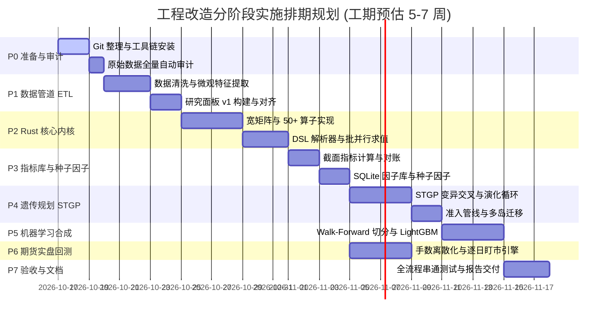

### P0：仓库卫生、开发环境配置与数据深度审计（1–2 天）
- [ ] **代码库卫生整理**：
  - 更新并固化 `.gitignore`，严防 `exports/`, `data/`, `runs/`, `target/` 误入版本控制。
  - 创建初始基线 commit。
  - 将所有原有的代码安全迁移至 `legacy/` 目录。
- [ ] **工具链安装**：
  - 安装 Rustup（Stable 工具链）与 `cargo`。
  - 安装 `uv`，创建标准虚拟环境并锁定 `pyproject.toml`。
- [ ] **数据自检脚本**（`scripts/audit_data.py`）：
  - 遍历 12.7GB Parquet 文件，验证字段类型、极端异常值、空值率。
  - 输出 `data/derived/futures/audit_report.md`，对确认项给出确凿数字。

### P1：期货 ETL 管道与标准化研究面板构建（4–6 天）
- [x] 实现 `etl/dominant.py`：构建严密的 rule=3, rank=1 主力映射表，精准记录换月日与新旧合约。
- [x] 实现 `etl/exec_price.py`：流式解析 `bar_1m`，计算各品种每日开盘前 30m 的真实 VWAP。
- [x] 实现 `etl/minute_features.py`：高性能流式聚合日内 10 项微观结构特征。
- [x] 实现 `etl/aux_*.py`：清洗展期收益率、仓单库存变动率、龙虎榜会员净多头占比。
- [x] 实现 `etl/build.py`：多表关联，组装长表 `panel_daily.parquet`，生成 `fields.json` 字段规格书。
- [x] **验收测试**：执行“未来扰动测试（Perturbation Test）”——篡改 $T$ 日之后原始文件，校验生成的 $T$ 日面板特征完全不变。

### P2：Rust 计算内核开发（factorlib_core）（5–7 天）
- [ ] 实现 `panel.rs`：构建列优先 Fortran 矩阵容器与多线程借用机制。
- [ ] 实现 `ops/{elem, ts, cs}.rs`：实现 50+ 个基本算子，时序算子全量采用增量或单调队列算法。
- [ ] 实现 `expr/{lexer, parser, ast, typecheck, canon, eval}.rs`：完整的 DSL 递归下降语法解析与代数规范化去重。
- [ ] 实现 `expr/cache.rs`：基于 `ahash` 的全局子表达式 LRU 缓存系统。
- [ ] 实现 `py.rs`：使用 PyO3 包装暴露 `Engine`，彻底释放 Python GIL。
- [ ] **验收测试**：编写 `proptest` 性质测试，对比纯 NumPy 实现（`ops_ref.py`），50+ 算子在随机矩阵（含大量 NaN）上误差必须 $< 10^{-9}$；压测吞吐量达 1000 表达式/秒。

### P3：评估指标库、SQLite 因子注册表与种子因子验证（3–4 天）
- [ ] 实现 `metrics/{ic, quantile, turnover, corr}.rs`：Rust 原生高速指标库。
- [ ] 实现 `factorlib/core/registry.py`：创建 `factors.sqlite` 数据库与增删查改 ORM。
- [ ] 录入经典经典文献种子因子（动量、展期收益率、仓单时序变化、会员净多变动）。
- [ ] **验收测试**：验证种子因子在 2011–2018 训练集的 RankIC 统计方向与学术界共识完全一致。

### P4：强类型遗传规划（STGP）批量挖掘引擎（5–7 天）
- [ ] 实现 `gp/primitives.py` 与 `gp/generate.py`：强类型原语集与 Ramped Half-and-Half 生成器。
- [ ] 实现 `gp/variation.py`：强类型约束下的交叉、变异、提升算子。
- [ ] 实现 `gp/islands.py`：多岛环形拓扑迁移控制器。
- [ ] 实现 `gp/admission.py`：自动五步准入决策器。
- [ ] 编写 `scripts/run_gp.py` 挖掘脚本，自动记录实验轨迹到 `runs/`。
- [ ] **验收测试**：固定种子可 100% 稳定复现结果；1000 个体 × 50 代在单机 10 分钟内完成；成功挖掘出进入库中的候选因子。

### P5：Walk-Forward 机器学习多因子合成（4–5 天）
- [ ] 实现 `ml/splits.py`：支持 Purge & Embargo 的扩展窗口切分器。
- [ ] 实现 `ml/dataset.py`：特征截面 MAD 截断与 Rank Gauss 高斯化转换。
- [ ] 实现 `ml/models/{linear, lgbm}.py`：封装基线加权与 LightGBM 学习模型。
- [ ] 编写 `scripts/run_ml.py`：生成样本外多因子预测矩阵 `pred_panel.parquet`。
- [ ] **验收测试**：严格验证时序边界，无任何未来数据泄漏；LightGBM 样本外 RankIC 显著优于等权基线。

### P6：期货实盘语义组合构建与向量化回测（4–6 天）
- [ ] 实现 `factorlib/core/portfolio.py`：波动率倒数平价、Ledoit-Wolf 收缩协方差、调仓缓冲带。
- [ ] 实现 `backtest/futures.rs`：整数手数转换、涨跌停阻断、换月双边成本、逐日盯市净值计算。
- [ ] 实现 `factorlib/core/report.py`：输出交互式 HTML 净值回撤、换手、交易成本拆解瀑布图。
- [ ] **验收测试**：执行手工推演小样本（包含涨跌停和换月），逐日核验 $\Delta E_d == \Delta \text{PnL}$ 绝对一致。

### P7：整体验收与股票扩展接口固化（2–3 天）
- [ ] 编写端到端一键执行流水线测试。
- [ ] 实现 `markets/stocks/adapter.py` 抽象规范占位符。
- [ ] 整理项目文档、API Reference，交付用户验收。

---

## 16. 风险审计矩阵与测试验证策略

### 16.1 关键风险与工程应对矩阵

| 风险序号 | 风险场景描述 | 严重级别 | 系统级预防与应对方案 |
|---|---|---|---|
| **R1** | `dominant_mapping` 中未包含 rule=3 规则 | 高 | 在 P0 阶段执行 `audit_data.py`。若缺失，立即启用备选方案：依据持仓量及退市日期，在 ETL 中自建 rule=3 连续映射。 |
| **R2** | `dominant_mapping` 日期含义歧义（$T$ 日交易还是 $T$ 日盘后选定） | 致命 | 审计新旧合约在切换日前后 3 天的日线持仓量。若判定该字段记录的是当日盘后选出的主力，则在 ETL 中将映射表整体向后平移 1 个交易日。 |
| **R3** | 郑商所成交额 `turnover` 历史异常置零 | 高 | 计算均价 VWAP 统一使用 $\sum(\text{close} \times \text{volume}) / \sum \text{volume}$，严禁除以 `turnover`。 |
| **R4** | 合约元数据缺少真实历史保证金率与手续费 | 中 | 在 `configs/futures/fees.yaml` 中由用户配置或维护工业标准静态费率表，回测时加入 1.1 倍安全垫。 |
| **R5** | 2010–2012 年商品期货上市品种过少 | 中 | 设定截面最小有效标的数门槛（$\text{min\_names} = 10$）。少于 10 个品种的交易日不计入因子 IC 评价。 |
| **R6** | 遗传规划产生语义过拟合（Data Snooping） | 致命 | 严格封存 2022–2026.08 测试集，严禁在 GP 适应度与准入中触碰；引入奥卡姆剃刀节点数强惩罚；限制最大树深 $\le 6$。 |
| **R7** | 机器内存溢出（OOM） | 高 | `bar_1m` 分钟线按月流式读取，提取 10 项特征后即刻释放原始分钟数据，峰值内存牢牢控制在 4GB 以内。 |

### 16.2 三层自动化测试验证金字塔

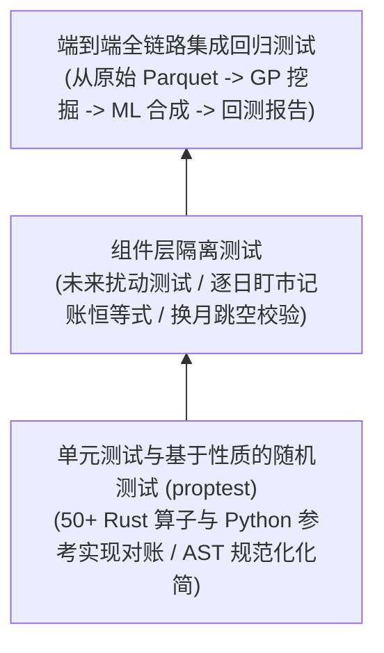

1. **底层算子对账测试（Proptest）**：
   在 Rust 中使用 `proptest` 随机生成包含正负无穷、大数、高密度 `NaN` 的 $T \times N$ 随机矩阵，对比 `factorlib/core/ops_ref.py` 中的 NumPy 纯实现，每个算子验证 10,000 次，浮点误差必须在 $10^{-9}$ 内。
2. **未来数据扰动测试（Perturbation Test）**：
   抽取 3 年测试集，首先生成基准因子矩阵 $\mathbf{F}_{\text{base}}$。随后编写测试脚本，随机篡改 $T_0$ 日之后的所有原始行情与持仓数据。重新运行全量计算，断言 $T \le T_0$ 的所有因子值逐比特（Bit-for-Bit）完全一致。
3. **逐日记账恒等式守恒测试**：
   在实盘回测状态机中，开启严格调试模式，对每日产生的所有交易记录验证：
   $$\text{Cash}_{d} + \sum (\text{lots}_{i,d} \times \text{settle}_{i,d} \times \text{Multiplier}_i) == \text{Equity}_d$$
   确保无任何资金泄漏。

---

## 17. 后续 A 股股票市场接入规范说明

为确保第一期期货平台完工后，无缝接入 A 股股票量化因子研究，系统在 `core` 内核与 `MarketAdapter` 抽象协议中做好了全方位预留：

### 17.1 股票与期货的核心差异与适配方案

| 市场特性 | 商品/股指期货（第一期实施） | A 股股票市场（第二期无缝接入） | MarketAdapter 统一抽象策略 |
|---|---|---|---|
| **标的存续周期** | 存在到期日与换月展期，需连续拼接 | 长期存续（除退市外），代码固定 | 适配器统一输出规整的面板矩阵，内核不感知换月细节 |
| **复权逻辑** | 比例后复权（基于换月收盘比） | 除权除息（送转股、分红派息除权因子） | 适配器内部完成复权清洗，向内核统一暴露 `*_adj` 字段 |
| **交易机制** | $T+0$ 交易，双向多空对冲自由 | $T+1$ 交易机制，通常仅支持单向做多 | 适配器在 `tradable_mask` 与 `backtest` 中施加卖出可用头寸约束 |
| **涨跌停规则** | 各品种浮动（4%~10%不等），单边市 | 主板 10%，创业/科创 20%，ST 5% | 适配器提供 `limit_locked` 掩码阻止不合规买卖 |
| **最小交易单位** | 1 手（合约乘数根据品种 1~300 不等） | 1 手固定等于 100 股（卖出零股除外） | `contract_spec` 统一输出乘数矩阵 |
| **交易税费** | 交易所手续费（平今差异）+ 跳数滑点 | 券商佣金 + 过户费 + 卖出单向印花税 | `CostModel` 协议统一支持多维非对称税费计算 |
| **行业与市值** | 5~6 个工业板块，品种少，通常不强求中性化 | 申万 31 个一级行业，强烈的行业/市值偏好 | 启用 Rust 内核中预留的 `group_rank` 与 `cs_neutralize` |
| **数据吞吐规模** | 约 80 品种 $\times$ 4000 天（矩阵极小） | 约 5000 只股票 $\times$ 4000 天（矩阵约 160MB） | Rust 内核列优先内存天然支持横向拓展，内存依然轻松常驻 |

### 17.2 适配器实现蓝图骨架（`markets/stocks/adapter.py`）

```python
from factorlib.markets.base import MarketAdapter, ContractSpec, CostModel
from factorlib.core.panel import Panel
import numpy as np

class StockMarketAdapter(MarketAdapter):
    name = "stocks"

    def calendar(self) -> np.ndarray:
        # 读取 A 股交易日历 (剔除周末与法定节假日)
        raise NotImplementedError("Stock market will be implemented in Phase 2.")

    def universe_mask(self, panel: Panel) -> np.ndarray:
        # A 股特有品种池过滤: 剔除 ST、*ST、上市不足 180 天次新股、停牌股
        raise NotImplementedError("Stock market will be implemented in Phase 2.")

    def contract_spec(self) -> ContractSpec:
        # 1手 = 100股, 乘数恒为 1.0
        return ContractSpec(multiplier=1.0, lot_size=100)

    def cost_model(self) -> CostModel:
        # 买入: 佣金万分之 1; 卖出: 佣金万分之 1 + 印花税千分之 1
        ...
```

---

## 结语

本技术白皮书已完成所有细节设计，涵盖从底层内存布局、数学公式、DSL 语法规范、演化算法、机器学习集成到期货实盘记账状态机的每一个工程切面。所有设计均严格遵从“单向数据流、无未来函数、生产级防过拟合、零拷贝高并发”原则。

后续工作可以在不改动既定架构的前提下，按照第 15 节的任务清单直接推进代码实现。
