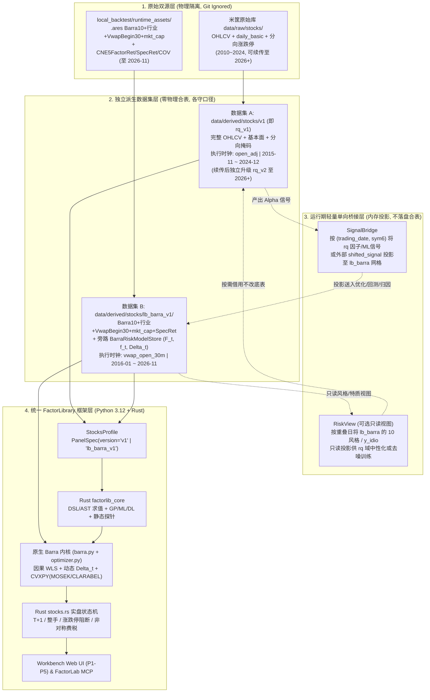
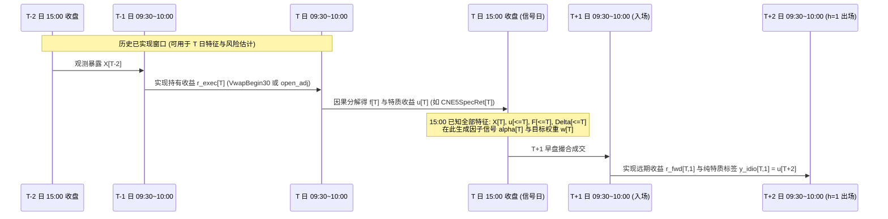

# A 股双数据源（米筐 + Barra 本地资产）独立托管与原生回测架构设计文档

> **文档状态**：架构设计与落地实施方案（Design & Implementation Spec，v2 修订版）  
> **适用代码库**：FactorLibrary（Python 3.12 + Rust `factorlib_core`）  
> **关联外部资产**：`local_backtest/`（含 `runtime_assets/` 与 `service/`）  
> **核心架构原则**：**一套 FactorLibrary 框架 + 两套彻底独立数据源（`stocks/rq` 与 `stocks/lb_barra`，零物理合表）+ 运行期轻量单向桥接（`SignalBridge` / `RiskView`）**；去黑盒纯原生重构，不部署 Python 3.10 `factorsim` 二进制；暂不修改代码，按 Phase 0–4 分阶段落地。

---

## 0. 核心架构决策与高危安全提醒

### 0.1 设计决策总览

| 决策维度 | 最终架构方案 | 关键理由 |
|---|---|---|
| **交付定位** | 全栈架构设计与落地实施方案文档（`docs/stocks_barra_backtest_integration.md`） | 先对齐双源边界、数学定义与配置契约，再分阶段实施并通过 `verify.sh` 门禁 |
| **数据组织模式** | **一套框架 + 两套彻底独立数据源（`stocks/rq` 与 `stocks/lb_barra`）+ 运行期轻量单向桥接** | 实证表明两套数据底层价格/日历/行业高度一致，但存在**结构性字段断层**（`lb` 缺 OHLCV/分向涨跌停/上市天数，`rq` 缺 Barra/开盘 30m VWAP/2025–2026）。独立分库杜绝物理合表导致的 `NaN` 断层与掩码污染，轻量桥接则打通「米筐挖因子 → Barra 评估/优化/归因」闭环 |
| **动态个股特质收益** | **全链路三合一**：① `lb_barra` 域直接零前视复用 `CNE5SpecRet`（`vwap_open_30m` 时钟）；② 平台内新增因果 Constrained WLS 动态分解（适配 `rq` 的 `open_adj`/`close_hfq` 时钟及 2026-11 后新数据）+ 动态特质方差 $\Delta_t$ 滚动估计；③ 统一服务特征挖掘、纯 Alpha 标签与组合优化/归因 | 兼顾历史精准复用与多时钟/未来增量动态计算 |
| **回测服务模式** | **去黑盒化纯原生重构**：不部署 Python 3.10 `factorsim` `.so` 二进制，仅提取数据资产与 `mosek.lic`，在 FactorLibrary（Python 3.12 + Rust）原生重建 Barra 优化器与 `VwapBegin30` 撮合配置 | 消除跨 Python 版本隔离与硬编码路径债务，与 Rust `stocks.rs` 状态机、SQLite 注册表、Web 工作台无缝一体 |
| **组合优化策略形态** | **纯多头指数增强 + 风格/行业中性为主**（严格遵守 A 股 `allow_short=false` 与 `T+1`）；缺成分权重 $w_b$ 时支持市值代理/绝对中性降级；求解器 `MOSEK` 优先 + `CLARABEL` 开源兜底 | 贴合 A 股现货真实约束，避免 `mosek.lic`（`2027-07-07` 到期）成为单点故障；多空市场中性仅作二期扩展预留 |

> [!CAUTION]
> **高危数据安全隔离提醒（Phase 0 必须首步执行）**：  
> 当前仓库根目录下的 `local_backtest/` 处于 Git 未追踪状态（`?? local_backtest/`），且 `.gitignore` **尚未配置忽略该目录**。该目录包含约 **2.7 GB** 的 `.ares` / `.parquet` 数据文件与 `.so` 二进制库，直接违反 `AGENTS.md` 中的**数据资产保护**与**单文件 1 MB 提交上限**红线。  
> 在开展任何代码提交前，**必须**将 `local_backtest/` 追加至 `.gitignore`，严禁将其暂存或提交至 Git 仓库。

---

## 1. `local_backtest/` 资产盘点与双数据源实证体检

### 1.1 `runtime_assets/` 底层数据全量清单

下表基于对磁盘文件的直接解析校验（结合 `local_backtest/README.md` 与脚本实测结果）：

| 资产路径（相对 `local_backtest/runtime_assets/`） | 格式与存储布局 | 维度（行 × 列） | 有效日期范围 | 核心内容与角色 |
|---|---|---|---|---|
| `Cache/AshareCache/1d_BarraCNE5/BarraCNE5.{BETA,BTOP,EARNYILD,GROWTH,LEVERAGE,LIQUIDTY,MOMENTUM,RESVOL,SIZE,SIZENL}` | 23 分片 `.ares` (`float64`, 每块 ≤125 行) + `index/columns/meta.npy` | `2781 × 5642` × 10 张 | `20150601` – `20261110` | 官方 Barra CNE5 10 维风格因子暴露 |
| `Cache/AshareCache/1d_BarraCNE5/BarraCNE5.INDUSTRY` | 同上 | `2781 × 5642` | `20150601` – `20261110` | 31 个申万一级行业编码（取值 `1..31`，与 `CNE5FactorRet` 列名对齐） |
| `Cache/AshareCache/1d_IntraVwap/IntraVwap.VwapBegin30` | 同上 | `2781 × 5642` | `20150601` – `20261110` | 不复权开盘 30 分钟（09:30–10:00）VWAP 执行价 |
| `Cache/AshareCache/1d_DailyFdm/DailyFdm.mkt_cap` | 31 分片 `.ares` | `3849 × 5642` | `20110104` – `20261110` | 个股总市值（单位：人民币元） |
| `Cache/AshareCache/1d_DailyKline/DailyKline.{close,pre_close}` | 31 分片 `.ares` | `3849 × 5642` | `20110104` – `20261110` | 不复权收盘价与昨收价（提供精确除权比 `pre_close[t]/close[t-1]`） |
| `Cache/AshareCache/1d_StockMask2/StockMask2.{BaseUnivMask,LimitMask,SuspendStock}` | 31 分片 `.ares` | `3849/3851 × 5642` | `20110104` – `20261110/12` | 基础池、双边涨跌停与停牌掩码（**注意极性反转**） |
| `Cache/BaseCache/BarraCNE5_RET/CNE5FactorRet.parquet` | 单文件 Parquet（索引列 `__index_level_0__`） | `2637 × 42` | `20160106` – `20261110`（有效 2628 日） | 42 因子日收益（10 风格 + `country` + 31 行业） |
| `Cache/BaseCache/BarraCNE5_RET/CNE5SpecRet.parquet` | 单文件 Parquet（索引列 `date`） | `2637 × 5642` | `20160106` – `20261110`（有效 2628 日） | 预计算个股日度特质收益（`VwapBegin30` 收益时钟） |
| `Cache/BaseCache/BarraCNE5_COV/*.parquet` | `2,386` 个日频 Parquet | 每日 `42 × 42` | `20170112` – `20261112` | 每日 Barra CNE5 因子**日频**协方差矩阵 $F_t$ |
| `combo/signal/signal_data/shifted_signal.parquet` | 单文件 Parquet（索引列 `__index_level_0__`） | `1213 × 5642` | `20200702` – `20250702` | 外部参考 Alpha 信号（**已前移 1 日**，用于回测对账） |
| `benchmark_000905_SH.csv` | CSV（`ts_code,trade_date,close`） | `1211` 行 | `20200702` – `20250702` | 中证 500 指数收盘价基准 |

---

### 1.2 米筐 vs `local_backtest` 实证对账与结构性断层分析

为何**不强行物理合并**两套数据、却可以**放心在运行期做轻量投影桥接**？以下两组实证对账结果给出了完整依据：

#### (1) 重叠区间底层事实高度一致（保证运行期桥接无语义偏差）
在重叠期（`2015-11-01` – `2024-12-31`，截面抽样 `2023-06-15`）：

| 核对维度 | 实测结果 | 对架构的意义 |
|---|---|---|
| **交易日历** | 米筐 `2,231` 日 vs `local_backtest` `2,231` 日，差集为 `[]` | 日期轴可直接精准内连接 |
| **收盘价 `close_raw`**（$N=4,976$） | 精确一致率（$< 10^{-6}$）= **`100.00%`**，最大差 `0.000000` | 价格基准无数据源偏差 |
| **日收益率 `c2c_ret`**（$N=4,972$） | 中位差 `0.00`，99 分位差 `1.78 × 10⁻⁶` | 除权因子口径一致 |
| **行业分类映射** | `Barra.INDUSTRY` vs 米筐 `industry_sw` 匹配纯度 **`4,196 / 4,196 = 100.00%`**（31 行业） | 本质为同一套申万 2021 一级行业，仅整数 ID 排序不同 |
| **标的交集** | 米筐 `5,323` 只 vs `local_backtest` `5,642` 只，交集 **`5,298` 只（99.53%）** | 按 `symbol.split(".")[0]` 映射 6 位代码即可覆盖绝大部分标的 |
| **基础池 `BaseUnivMask`** | Jaccard = **`0.9864`**（4,787 重合，66 只边缘差异） | 边缘差异保留在各自域内，互不污染 |

#### (2) 结构性字段断层矩阵（决定两套数据必须底层分库托管）

| 字段 / 能力维度 | 米筐数据源（`stocks/rq`） | `local_backtest` 数据源（`stocks/lb_barra`） | 物理合并会引发的致命问题 |
|---|---|---|---|
| **时间跨度** | `2010`–`2024-12-31`（`v1` 为 `2015-11`–`2024-12`） | `2011`–**`2026-11-10`** | 强合导致 `2025`–`2026` 的 OHLCV 全为 `NaN`，引发因子静默失真 |
| **完整 OHLCV**（`open/high/low/volume/amount`） | **完整具备** | **完全缺失**（仅有 `close` / `pre_close`） | 单靠 `lb_barra` 无法计算 80%+ 传统量价因子 |
| **基本面估值**（`pe/pb/ps/turnover_rate/circ_mv`） | **已落盘 `daily_basic`**（2010–2024） | **缺失**（仅有总市值 `mkt_cap`） | 估值与换手类因子仅属 `rq` 域 |
| **精细买卖掩码**（`limit_up/limit_down/listed_days/is_st`） | **完整具备**（买卖分向涨跌停 + `dropNewStock:120`） | **缺失**（仅双边 `LimitMask` 与 `BaseUnivMask`） | 强合会破坏买卖分向拦截或丢失上市天数 |
| **开盘 30 分钟 VWAP**（`VwapBegin30`） | **缺失** | **完整具备**（`2015-06`–`2026-11`） | 价格时钟不同（`open_adj` vs `vwap_open_30m`） |
| **Barra CNE5 全套**（10 风格 + 收益 + 特质收益 + COV） | **缺失**（除非另购 RQRisk） | **完整具备**（`2016-01`–`2026-11`） | 风险模型能力仅属 `lb_barra` 域 |

---

### 1.3 六项底层口径防坑红线（实证校验结果）

1. **股票代码规范**：`local_backtest` 为 6 位纯数字（`000001`–`920118`，含北交所 `4/8/92xxxx`），米筐为带交易所后缀（`000001.XSHE`/`600519.XSHG`）；跨源桥接统一以 **6 位纯代码 `sym6 = symbol.split(".")[0]`** 作为逻辑连接键。
2. **`CNE5SpecRet` 与 `CNE5FactorRet` 的真实收益时钟是 `VwapBegin30`**：
   - 实测（`2023-06-15`，有效 $N=4,109$）：`CNE5SpecRet[t]` 与 `c2c_ret[t]` 相关系数仅 **`0.3046`**；
   - 而对除权调整后的开盘 30 分钟 VWAP 日收益
     $$r^{\text{vwap30}}_{i,t} = \frac{\text{VwapBegin30}_{i,t}}{\text{VwapBegin30}_{i,t-1} \cdot \left(\frac{\text{pre\_close}_{i,t}}{\text{close}_{i,t-1}}\right)} - 1$$
     减去 $X_{i,t-2} f_t$ 后的残差，与 `CNE5SpecRet[t]` 的截面相关系数高达 **`0.999812`**，中位绝对误差 **`3.19 × 10⁻⁵`**；
   - **因果含义**：`CNE5SpecRet[T]` 在 $T$ 日 10:00（收盘前）已 100% 已知（无前视，`lag_days=0`）；而对 $T$ 日收盘信号，次日持仓 $[T+1 \text{ 早盘}, T+2 \text{ 早盘}]$ 对应的 1 日纯特质收益标签是 **`CNE5SpecRet[T + 2]`**！
3. **`BarraCNE5_COV` 为日频方差量纲（非年化）**：$\sqrt{\text{diag}(F_t)}$ 与 `CNE5FactorRet` 过去 252 日日频经验标准差比值在 `0.92 ~ 0.99`。优化器中 $\Delta_t$ 必须同处**日频方差量纲**。
4. **`StockMask2` 掩码极性与 FactorLibrary 完全相反**：`BaseUnivMask`、`LimitMask`、`SuspendStock` 全采用**乘法透传语义**（`1.0` = 正常/可交易，`NaN` = 被过滤/停牌/涨跌停）。转换 `lb_barra` 面板时必须显式取反：`is_suspended = np.isnan(SuspendStock)`，`can_buy_mask = can_sell_mask = np.isfinite(LimitMask)`。
5. **`shifted_signal.parquet` 已前移 1 个交易日（行索引 = 执行日 `T_exec`）**：实测 `shifted_signal[t]` 与 `c2c[t-1]` 相关 **`-0.3781`**、与 `c2c[t]` 相关 `-0.0164`、与 `vwap_ret[t+1]` 均值 IC 为 **`+0.0417`**（滞后一日的 `vwap_ret[t+2]` 衰减为 `+0.0260`）。导入 FactorLibrary（行索引 = 信号生成日 $T$ 收盘）时必须前移 1 行：`signal_fl[t - 1] = shifted_signal[t]`。
6. **`.ares` 存储与单位**：`index.npy`（`int64` `YYYYMMDD`）+ `columns.npy`（6 位代码）+ 若干每块 ≤125 行的 C-order 裸 `float64` `.ares` 文件；`DailyFdm.mkt_cap` 单位为**人民币元**（如 `600519` 约 `2.20 × 10¹²`），`DailyKline.close` 与 `VwapBegin30` 均为**不复权原始价格**。

### 1.4 `service/` 资产去黑盒取舍

| `service/` 组件 | 处置策略 | 用途 |
|---|---|---|
| `site-packages/factorsim/**/*.cpython-310-*.so` | **不部署、不运行** | 仅作原生功能对齐清单参考 |
| `config/mosek.lic` | **提取复用** | `HOSTID=DEMO` 许可（有效至 `2027-07-07`），供 Python 3.12 下 `cvxpy` 调用 `MOSEK` |
| `bin/run_pc_wrapper` & `pcmaster_manifest.txt` | **复刻工程参数** | `MSK_IPAR_NUM_THREADS=1`、`OMP_NUM_THREADS=1`、`OPENBLAS_NUM_THREADS=1`、`ARROW_IO_THREADS=1` |

---

## 2. 「一套框架 + 两套独立数据源 + 运行期轻量桥接」架构设计

### 2.1 整体双源分层架构图



---

### 2.2 两套独立数据源的定位、存储结构与能力契约

FactorLibrary 现有 [`StocksProfile`](file:///home/cr9294/repos/FactorLibrary/python/factorlib/markets/stocks/profile.py) 已原生通过 `PanelSpec(version=...)` 区分不同派生数据集，无需强造第三个市场域，只需在 `stocks` 市场下平等托管两套独立数据集：

#### 数据集 A：`stocks/v1`（逻辑别名 `rq_v1`，米筐量价基本面生产域）
- **落盘目录**：`data/derived/stocks/v1/`（完全保持现有目录与 Schema，零破坏兼容；后续米筐补齐 2025–2026 后独立产出 `v2` / `rq_v2`）
- **覆盖范围**：`2015-11-01` – `2024-12-31`（2,231 交易日 × 5,323 标的）
- **核心字段**：
  - `fields`：`close_hfq`, `open_adj`, `high_adj`, `low_adj`, `vwap_adj`, `amount`, `volume`, `log_amount`, `c2c_ret`, `stock_listed_days`, `industry_code`（后续 `v2` 可把 `data/raw/stocks/daily_basic` 的 `market_cap/pe_ratio_ttm/pb_ratio_lf/turnover_rate` 一并入库）
  - `aux_fields`：`open_raw`, `close_raw`, `high_raw`, `low_raw`, `ex_cum_factor`, `limit_up`, `limit_down`, `is_suspended`, `is_st`, `can_buy_mask`, `can_sell_mask`, `bench_ret`（`000985.XSHG`）
- **默认执行时钟**：`open_adj`（精确买卖分向涨跌停 + 120 日新股过滤）
- **核心定位**：**全量量价与基本面因子研发工厂**（DSL / GP / ML / DL 特征挖掘与常规分位回测）。

#### 数据集 B：`stocks/lb_barra_v1`（`local_backtest` Barra 风险与组合回测域）
- **落盘目录**：`data/derived/stocks/lb_barra_v1/`（与米筐完全隔离的独立派生目录）
  - `panel_daily.parquet`：由 `.ares` + `CNE5SpecRet.parquet` 一次性转换的标准 Zstd 长表
  - `labels.parquet`：基于 `vwap_open_30m_adj` 构造的远期总收益标签 `y_1/2/5/10` + 基于 `CNE5SpecRet` 构造的纯特质远期标签 `y_idio_1/2/5/10`
  - `risk_store/`（旁路非 `(T, N)` 风险库）：
    - `store.json`（元数据：`source="local_backtest"`, `return_clock="vwap_open_30m"`, `variance_unit="daily"`, 42 因子有序列表）
    - `factor_returns.parquet`（`CNE5FactorRet`，`2637 × 42`）
    - `factor_cov.npz` 或按年分片 Parquet（将 `2,386` 个小文件打包为紧凑 `(T, 42, 42)` 张量，大幅加速回测 I/O）
    - `specific_variance.parquet`（预缓存的滚动动态特质方差 $\Delta_t$）
  - `fields.json` & `meta.json`（含显式 `capabilities` 能力声明）
- **覆盖范围**：**`2016-01-06` – `2026-11-10`**（2,628 有效交易日 × 5,642 标的，**立即可覆盖 2025–2026 最新两年样本外**）
- **核心字段**：
  - `fields`：`close_adj`（基于 `pre_close[t]/close[t-1]` 因果递推后复权）、`vwap_open_30m_adj`、`c2c_ret`、`vwap30_ret`、`mkt_cap`、`log_mkt_cap`、10 维 `barra_{beta,btop,earnyild,growth,leverage,liquidty,momentum,resvol,size,sizenl}`、`barra_industry`（同时别名 `sector`/`industry_code`）、`spec_ret_vwap30`、`spec_vol_ewma`
  - `aux_fields`：`close_raw`, `pre_close_raw`, `vwap_open_30m_raw`, `ex_cum_factor`（递推复权因子）, `is_suspended`（由 `isnan(SuspendStock)` 反转）, `can_buy_mask` / `can_sell_mask`（由 `isfinite(LimitMask)` 映射，双边保守拦截）, `bench_ret`（来自 `benchmark_000905_SH.csv` 或可选外部指数）
- **显式能力声明（`meta.json["capabilities"]`）**：
  ```json
  {
    "dataset_id": "lb_barra_v1",
    "source": "local_backtest",
    "symbol_format": "6digit",
    "return_clock": "vwap_open_30m",
    "has_ohlcv": false,
    "has_volume_amount": false,
    "has_directional_limit": false,
    "has_listed_days": false,
    "has_barra_exposures": true,
    "has_barra_risk_store": true,
    "has_vwap_open_30m": true
  }
  ```
  - **工程保护价值**：当用户在 `lb_barra_v1` 域尝试运行依赖 `open/high/low/volume/amount` 或 `dropNewStock` 的因子时，[`probe_factor`](file:///home/cr9294/repos/FactorLibrary/python/factorlib/core/probe.py) 与 Workbench 会立刻依据 `capabilities` 给出清晰提示（建议在 `rq_v1` 域求值后通过 `SignalBridge` 桥接回测），绝不产生隐晦的 `KeyError` 或全 `NaN` 假回测。

---

### 2.3 运行期轻量单向桥接层（`SignalBridge` & `RiskView`）

新增轻量模块 `python/factorlib/markets/stocks/bridge.py`，**彻底不合底表、只在内存按需投影**，提供两个严格单向接口：

#### (1) `SignalBridge`：因子/预测信号 → `lb_barra_v1` 组合优化与归因引擎
- **典型场景**：在 `rq_v1` 域用完整 OHLCV + 基本面挖出单因子、GP 因子或 LightGBM/DL 多因子合成信号 `scores_src (T_src, N_src)`（或者直接导入外部 `shifted_signal.parquet`），需要送入 `lb_barra_v1` 执行 **Barra 中性化 → 特质 RankIC 评估 → Barra QP 组合优化 → `VwapBegin30` Rust 回测 → Barra 收益归因**。
- **核心映射契约**：
  1. **代码归一**：`sym6 = str(sym).split(".")[0]`；按 `target_panel.symbols` 顺序左连接映射，未匹配列填 `NaN`；
  2. **日期内连接**：仅保留 `source_dates ∩ target_dates` 区间（或按指定 `start_date`/`end_date` 截断）；
  3. **显式时间平移校验（`input_signal_alignment`）**：
     - `"T_close"`（默认，FactorLibrary 标准）：`dates` 直接对齐，不平移；
     - `"T_exec"`（专用于 `shifted_signal.parquet` 等已前移信号）：按 `target_panel.dates` 交易日历严格前移 1 行（`aligned[t - 1] = raw[t]`），严禁手工猜测偏移；
  4. **桥接体检报告（`BridgeAuditReport`）**：强制输出并记入运行日志：`date_overlap_count`、`date_range`、`symbol_match_ratio`（预期 `rq_v1 -> lb_barra_v1` 为 `99.53%`）、`non_null_coverage_ratio`。

#### (2) `RiskView`（可选只读视图）：`lb_barra_v1` 风格/特质收益 → `rq_v1` 按需借用
- **典型场景**：用户在 `rq_v1` 域做 `riskNeutMulti`（10 风格 Barra 中性化）或在 `rq_v1` 域用纯特质标签训练 ML/DL 模型，且不想破坏 `rq_v1` 的 OHLCV 与买卖分向掩码。
- **实现方式**：在内存将 `lb_barra_v1` 的指定字段（如 10 维 `barra_*`、`barra_industry`、`mkt_cap` 或 `y_idio_h`）按 `(trading_date, sym6)` 投影到 `(T_rq, N_rq)` 只读 Fortran 数组，以**临时只读视图**附加到 `rq_panel`（不写回 `data/derived/stocks/v1/*.parquet`）；非重叠日期自动为 `NaN` 并受 `valid_mask` 保护。

---

### 2.4 米筐数据后续续传与新 Barra 数据的无缝演进

双数据源架构让未来数据升级变得极其干净：

1. **米筐 2025–2026 日线续传（零改造影响 `lb_barra`）**：
   - 继续运行 [`scripts/download_rq_stocks.py`](file:///home/cr9294/repos/FactorLibrary/scripts/download_rq_stocks.py)（当前 [`watermarks.json`](file:///home/cr9294/repos/FactorLibrary/data/raw/stocks/_state/watermarks.json) 断点在 `2024-12-31`，目标 `2026-11-07`）补齐 2025–2026 年的 `bar_1d`、`trade_status`、`daily_basic`、`industry_sw`、`ex_factor`、`benchmark`，并可选增量拉取 `000905.XSHG` 日线及 `rqdatac.index_weights('000905.XSHG')` 成分权重；
   - 运行 `python scripts/build_panel.py --market stocks --version v2` 独立构建 `stocks/v2`（`2015-11`–`2026-11+`）；
   - **立竿见影的效果**：`stocks/lb_barra_v1` 无需任何重铸，`SignalBridge` 在 `v2 -> lb_barra_v1` 之间的桥接重叠期自动从 `2024-12` 延伸至 `2026-11`！
2. **新增 Barra 数据（`2026-11-10` 之后）**：
   - 本地 `.venv-rqsdk` 中的 `rqdatac 3.8.2` 已具备 RQRisk 接口（`get_factor_exposure`、`get_factor_return`、`get_factor_covariance`、`get_specific_return`、`get_specific_risk`）；
   - 若账号有 RQRisk 权限，可独立落盘为新风险源版本 `stocks/rq_barra_v1`（显式标记 `return_clock = "close_to_close"`），与 `lb_barra_v1`（`return_clock = "vwap_open_30m"`）平行隔离，**严禁把不同收益时钟的数据硬拼成同一张表**；
   - 若账号无 RQRisk 权限，`2026-11-10` 之后可在 `stocks/v2` 上启用 §3.2 的平台内自研因果 WLS 动态 Barra 分解无缝续接。

---

## 3. 动态个股特质收益（Dynamic Stock Idiosyncratic Returns）全链路设计

### 3.1 严格因果时钟对齐规范

两套数据源各有明确的交易执行时钟，特质收益计算严格绑定对应时钟，绝不混用：



**双时钟下标与因果边界对照表（以 $T$ 日 15:00 收盘信号为锚点）**：

| 用途类型 | `lb_barra_v1` 域（`vwap_open_30m` 时钟） | `rq_v1`/`v2` 域（`open_adj` 或 `c2c` 时钟） | 因果合法性 |
|---|---|---|---|
| **$T$ 日特质特征输入** | `spec_ret_vwap30[t]`（$t \le T$，直取 `CNE5SpecRet`） | 动态 WLS 残差 `u_dyn[t]`（仅用 $\le T$ 价格与 $X_{t-\Delta}$） | **合法**（`lag_days=0`） |
| **$T$ 日特质方差 $\Delta_T$ 估计** | `spec_ret_vwap30[T-L+1 .. T]` | `u_dyn[T-L+1 .. T]` | **合法** |
| **$T$ 日 1 日特质标签 `y_idio_1[T]`** | `CNE5SpecRet[T + 2]` | 对 $r^{\text{open}}_{T+1 \to T+2}$ 回归 $X_T$ 的残差 $u^{\text{fwd}}_{T,1}$ | **仅作 Label，隔离于 `Panel.labels`** |
| **$T$ 日 $h$ 日特质标签 `y_idio_h[T]`** | $\prod_{k=2}^{h+1}(1 + \text{CNE5SpecRet}[T+k]) - 1$ | 逐日动态残差复利或对 $h$ 日收益回归 $X_T$ | **仅作 Label，隔离于 `Panel.labels`** |

---

### 3.2 双模式动态特质收益引擎（`markets/stocks/barra.py`）

新增核心模块 `python/factorlib/markets/stocks/barra.py`，同时服务 `lb_barra` 域与 `rq` 域：

#### 模式 A：预计算 `CNE5SpecRet` 零前视复用（`lb_barra_v1` 默认模式）
- 直接加载转换后的 `spec_ret_vwap30`，与 `CNE5FactorRet`、`BarraCNE5_COV` 同源同钟、零重算耗时，覆盖 `2016-01-06` – `2026-11-10` 全 10 年区间。

#### 模式 B：因果横截面 Constrained WLS 动态特质收益分解
适用于：① `rq` 域按自身 `open_adj` / `close_hfq` 收益时钟计算动态特质收益（通过 `RiskView` 读取 Barra 暴露）；② 对任意自定义持仓周期 $h$ 做残差剥离；③ `2026-11-10` 之后的增量交易日续算。

- **数学建模**：在每个交易日 $t$ 的有效回归股票集 $\mathcal{U}_t$ 上，设收益向量为 $r_t$，事前暴露矩阵为 $X_{t-\Delta} = [\mathbf{1}, \, X^{\text{ind}}_{t-\Delta}, \, X^{\text{style}}_{t-\Delta}] \in \mathbb{R}^{N_t \times 42}$（`c2c_ret` 取 $\Delta=1$，`open_adj` / `vwap_open_30m` 取 $\Delta=2$），权重矩阵为 $W_{t-\Delta} = \text{diag}(\sqrt{\text{mkt\_cap}_{i, t-\Delta}})$。
- **行业共线性识别约束**：施加 Barra CNE5 标准市值加权行业收益零和约束：
  $$\sum_{k=1}^{31} \omega_{k, t-\Delta} f^{\text{ind}}_{k, t} = 0, \qquad \omega_{k, t-\Delta} = \frac{\sum_{i \in \text{ind } k} \text{mkt\_cap}_{i, t-\Delta}}{\sum_{j \in \mathcal{U}_t} \text{mkt\_cap}_{j, t-\Delta}}$$
- **闭式满秩求解**：通过约束消除矩阵 $R_t \in \mathbb{R}^{42 \times 41}$ 转化为无约束正规方程（加微量岭正则 $\varepsilon = 10^{-10}$ 防极端停牌日奇异）：
  $$\hat{\theta}_t = \left(R_t^\top X_{t-\Delta}^\top W_{t-\Delta} X_{t-\Delta} R_t + \varepsilon I\right)^{-1} R_t^\top X_{t-\Delta}^\top W_{t-\Delta} r_t, \qquad \hat{f}_t = R_t \hat{\theta}_t$$
- **动态特质收益输出**：
  $$u_{i, t} = r_{i, t} - X_{i, t-\Delta} \hat{f}_t$$
  - 估计 $\hat{f}_t$ 时对极端收益 $|r_{i,t}| > 0.35$ 做缩尾保护，计算残差 $u_{i,t}$ 时保留原始真实收益；
  - 2,700 日全历史在 NumPy/LAPACK 下耗时 ~1.2 秒，后续可下沉至 Rust `factorlib_core` 并在 [`core/ops_ref.py`](file:///home/cr9294/repos/FactorLibrary/python/factorlib/core/ops_ref.py) 保留参考实现对账（$\max |u_{\text{rust}} - u_{\text{ref}}| < 10^{-9}$）。

---

### 3.3 动态特质方差 $\Delta_t$ 与完整 Barra 风险矩阵 $\Sigma_t$ 滚动估计

在 `barra.py` 中基于历史因果特质收益 $u_{i, 1..t}$ 滚动估计每日对角特质方差阵 $\Delta_t = \text{diag}(\hat{\sigma}_{u,1,t}^2, \dots, \hat{\sigma}_{u,N,t}^2)$，并与 `BarraCNE5_COV`（$F_t$）拼装为完整风险模型 $\Sigma_t = X_t F_t X_t^\top + \Delta_t$：

1. **EWMA 因果滚动方差 + Newey-West 滞后修正**：
   - 回看窗 $L = 252$ 日、半衰期 $H_{\text{vol}} = 42$ 日（$\lambda = 0.5^{1/42} \approx 0.9836$）：
     $$\hat{v}^{\text{raw}}_{i,t} = \frac{\sum_{s=0}^{L-1} \lambda^s u_{i,t-s}^2}{\sum_{s=0}^{L-1} \lambda^s}$$
   - 施加 $q=2$ 阶 Bartlett 核 Newey-West 自相关修正，并以 $0.25 \, \hat{v}^{\text{raw}}_{i,t}$ 作为正定下界截断防止负方差。
2. **市值分层贝叶斯收缩（Bayesian Shrinkage）**：
   - 将当日有效股票按 `mkt_cap` 分为 10 组，以同组市值加权平均特质标准差 $\bar{\sigma}_{g(i), t}$ 作为先验目标，按有效观测数 $n_{\text{eff}}(i,t)$ 动态收缩：
     $$\hat{\sigma}_{i,t} = (1 - \gamma_{i,t}) \sqrt{\hat{v}^{\text{nw}}_{i,t}} + \gamma_{i,t} \bar{\sigma}_{g(i), t}, \qquad \gamma_{i,t} = \frac{v_{\text{prior}}}{v_{\text{prior}} + n_{\text{eff}}(i,t)}$$
   - 彻底解决新股、长期停牌复牌股因观测样本少导致的极端特质方差失真。
3. **波动率体制调整（VRA）与 $F_t$ 半正定保护**：
   - 依据横截面标准化残差 $z_{i,t} = u_{i,t} / \hat{\sigma}_{i,t-1}$ 的短半衰期（$H_{\text{vra}} = 21$ 日）横截面均方值因果缩放特质风险乘子；
   - 对每日 42×42 因子协方差阵 $F_t$ 执行对称化与最小特征值截断（$\lambda_{\min} \ge 10^{-10}$），确保因子分解 $F_t = L_t L_t^\top$ 数值永远稳定。

---

### 3.4 三大下游应用场景（跨双源协同工作流）

1. **纯特质因子挖掘（`lb_barra_v1` 域独立直跑至 `2026-11`）**：
   - 直接在 `lb_barra_v1` 上通过 Rust DSL / GP 挖掘特质反转（`-ts_sum(spec_ret_vwap30, 5)`）、特质夏普动量（`ts_sum(spec_ret_vwap30, 20) / (ts_std(spec_ret_vwap30, 20) + 1e-6)`）、特质波动率异象（`-ts_std(spec_ret_vwap30, 20)`）、特质偏度及 Barra 风格交互因子；
   - [`markets/stocks/styles.py`](file:///home/cr9294/repos/FactorLibrary/python/factorlib/markets/stocks/styles.py) 升级为自适应模式：在 `lb_barra_v1` 域（或 `rq` 域挂载 `RiskView` 时）直接提供全部 **10 维 Barra CNE5 风格矩阵**，未挂载时回退至原有 4 风格近似。
2. **纯 Alpha 标签与去噪模型训练（`lb_barra_v1` 原生 + `rq` 域按需借用）**：
   - 单因子评估（[`core/evaluate.py`](file:///home/cr9294/repos/FactorLibrary/python/factorlib/core/evaluate.py)）同时输出「总收益 RankIC」与「纯特质 RankIC（对 `y_idio_1/5`）」，一眼拆穿伪装成选股 Alpha 的小市值/行业暴露因子；
   - ML（`ml/dataset.py`）与 DL（`dl/dataset.py`）支持将 `target_label` 设为 `y_idio_1` 或 `y_idio_5`（`rq` 域通过 `RiskView` 只读借用，不改主面板），大幅降低市场共性噪声对模型梯度的污染。
3. **Barra 事后多维绩效归因（`evaluate_factor_v4_stats` & HTML 诊断报告）**：
   - 在 `lb_barra_v1` 域（含通过 `SignalBridge` 桥接进来的 `rq` 信号）回测完成后，将每日主动净收益精确拆解为：
     $$R^{\text{act}}_{t+1} = (X^{\text{country}}_{t-1}{}^\top w^{\text{act}}_t) f^{\text{country}}_{t+1} + \sum_{s=1}^{10} (X^{\text{style}}_{s,t-1}{}^\top w^{\text{act}}_t) f^{\text{style}}_{s,t+1} + \sum_{k=1}^{31} (X^{\text{ind}}_{k,t-1}{}^\top w^{\text{act}}_t) f^{\text{ind}}_{k,t+1} + w^{\text{act}}_t{}^\top u_{t+1} - \text{Cost}_{t+1}$$
   - 输出 10 风格 + 31 行业累计收益贡献、纯特质 Alpha 占比、事前预测跟踪误差 vs 事后实现跟踪误差。

---

## 4. 纯原生 Barra 组合优化与回测服务配置设计

### 4.1 去黑盒架构替代映射

| 原 `factorsim` 组件 | FactorLibrary 原生模块 | 核心职责 |
|---|---|---|
| `Memmaper2` (`.ares` 读写) | `markets/stocks/ares_bridge.py`（新增 ETL） | 一次性将 `.ares` + Parquet 转换为独立数据集 `data/derived/stocks/lb_barra_v1/` |
| `DataLoader` | `StocksProfile.load_panel(version="lb_barra_v1")` + `BarraRiskModelStore` | 加载独立 Barra 面板与旁路风险库；跨源信号通过 `SignalBridge` 投影 |
| `StrategyBase` | `markets/stocks/optimizer.py`（新增）+ `markets/stocks/portfolio.py`（路由） | `BarraPortfolioOptimizer`（低秩 SOCP/QP）并向下兼容 `top_quantile` 分位等权 |
| `Engine` | `markets/stocks/backtest.py` + Rust [`stocks.rs`](file:///home/cr9294/repos/FactorLibrary/rust/factorlib_core/src/backtest/stocks.rs) | T+1 锁仓、100 股整手、涨跌停/停牌拦截、非对称印花税/佣金、`VwapBegin30` / `open_adj` 撮合 |
| `tusharesql.Querytool` | `Panel.aux_fields["bench_ret"]` | 离线支持 `000905.SH`（`lb_barra_v1` 默认）与 `000985.XSHG`（`rq_v1` 默认） |
| `run_pc_wrapper` | `configs/stocks/{data,barra,backtest,fees}.yaml` + `scripts/run_backtest.py` | 声明式双源配置、`mosek.lic` 自动发现与单线程环境变量守护 |

---

### 4.2 原生 Barra 组合优化器数学模型（`markets/stocks/optimizer.py`）

#### (1) 低秩因子分解建模（避免 $N \times N$ 稠密矩阵爆炸）
针对 $N \approx 5,000$ 股票截面，引入 42 维辅助变量 $y = X_t^\top (w - w_b)$ 与平方根因子 $F_t = L_t L_t^\top$，将非零元素规模从 $O(N^2) \approx 2.5 \times 10^7$ 压缩至 $O(42N) \approx 2 \times 10^5$：

$$\max_{w \in \mathbb{R}^N, \; y \in \mathbb{R}^{42}} \quad \alpha_t^\top w - \frac{\lambda_{\text{risk}}}{2} \left( \|L_t^\top y\|_2^2 + \sum_{i=1}^{N} \hat{\sigma}_{u,i,t}^2 (w_i - w_{b,i})^2 \right) - \lambda_{\text{tc}} \|w - w_{t-1}\|_1$$

单日 `MOSEK` 单线程求解耗时约 30–80 ms，全 10 年（~2,400 日）可在 2–3 分钟内完成。

#### (2) 严格遵循 A 股现货语义的约束集

| 约束类别 | 数学表达 | 工程要点 |
|---|---|---|
| **资金与纯多头** | $\mathbf{1}^\top w = 1 - c_{\text{cash}}$，$0 \le w_i \le w_{\max}$ | 严格 `allow_short=false`；支持现金缓冲 $[0, c_{\max}]$ |
| **个股主动偏离上限** | $-a_{\max} \le w_i - w_{b,i} \le a_{\max}$ | 指数增强默认 ±1.5% |
| **Barra 10 风格中性** | $-\delta_s \le (X^{\text{style}}_{s,t})^\top (w - w_b) \le \delta_s$ | 支持全局默认（±0.25 std）+ 单风格精细覆写（如 `SIZE: 0.15`） |
| **Barra 31 行业中性** | $-\delta_{\text{ind}} \le (X^{\text{ind}}_{k,t})^\top (w - w_b) \le \delta_{\text{ind}}$ | 默认 ±2% |
| **单日双边换手硬上限** | $\|w - w_{t-1}\|_1 \le 2 \cdot \text{TO}_{\max}$ | 配合目标函数 $\lambda_{\text{tc}}$ 线性惩罚双重控换手 |
| **$T$ 日已知停牌/退池锁定** | 停牌股 $w_i = w_{i,t-1}$；退池且未持有股 $w_i = 0$ | **严禁偷看 $T+1$ 日涨跌停掩码**；次日早盘真实涨跌停拦截与 T+1 锁仓全权交由 Rust `stocks.rs` 执行并计入 `blocked_orders` |

#### (3) 基准权重 $w_b$ 三级降级与求解器双轨兜底
- **基准权重模式（`benchmark_weight_mode`）**：
  1. `constituent`（首选）：消费由米筐 `rqdatac.index_weights` 补充的逐日成分权重（如中证 500）；
  2. `mkt_cap_proxy`（立即可用）：基于 `lb_barra_v1` 自带的 `mkt_cap`，在当日可投池（或模拟中证 500 的市值第 301–800 名段）按市值归一化构造代理基准 $w_b^{\text{proxy}}$；
  3. `absolute_neutral`：纯多头绝对风格中性（$|X^{\text{style}}_t{}^\top w| \le \delta_s$），无需任何 $w_b$。
- **求解器优先级与不可行容错**：
  - 优先级 `["MOSEK", "CLARABEL", "OSQP"]`：`MOSEK` 自动探测 `local_backtest/service/config/mosek.lic` 并强制 `MSK_IPAR_NUM_THREADS=1`；若许可过期（`2027-07-07` 后）或未安装 `mosek`，自动无感切换开源 `CLARABEL`；
  - 不可行三级恢复：硬约束求解 → 引入大惩罚 $L_1$ 松弛变量重试 → 沿用昨日归一化持仓并记录至 `BacktestResult.extras["optimizer_fallbacks"]`。

---

### 4.3 执行价解析与掩码粒度差异说明（`rq` vs `lb_barra`）

升级 [`markets/stocks/backtest.py`](file:///home/cr9294/repos/FactorLibrary/python/factorlib/markets/stocks/backtest.py#L21-L62) 的 `_resolve_exec_and_close_prices` 与两套数据源的执行语义如下：

| 执行语义 | `rq_v1` / `rq_v2` 域 | `lb_barra_v1` 域 |
|---|---|---|
| **默认执行价** | `open_adj`（`entry_window: "open"`） | `vwap_open_30m_adj`（`entry_window: "vwap_open_30m"`） |
| **防前视修正** | 当 `entry_window == "vwap_open_30m"` 且缺少 `vwap_open_30m_adj` 时**拒绝静默回退至全天 `vwap_adj`**，显式报错防止日内前视 | 原生具备 `vwap_open_30m_adj` 与 `vwap_open_30m_raw`，零日内前视 |
| **涨跌停拦截精度** | 精细买卖分向拦截（`can_buy_mask` 仅拦开盘/一字涨停，`can_sell_mask` 仅拦收盘/一字跌停） | 保守双边拦截（`can_buy_mask = can_sell_mask = isfinite(LimitMask)`，在 `BacktestResult.extras` 显式标注 `limit_mask_mode: "bilateral_conservative"`） |
| **多空对冲扩展** | 一期严格 `allow_short: false`；二期可在 Rust `stocks.rs` 扩展股指期货对冲腿（IC/IM 贴水与保证金） | 同左 |

---

### 4.4 完整双源 YAML 配置体系草案（`configs/stocks/`）

#### 1. 双数据源声明配置：`configs/stocks/data.yaml`

```yaml
# configs/stocks/data.yaml (双数据源独立托管版)
default_dataset: "rq_v1"                 # 默认研究数据集: "rq_v1" | "rq_v2" | "lb_barra_v1"

datasets:
  rq_v1:
    source: "ricequant"
    raw_dir: "./data/raw/stocks"
    derived_dir: "./data/derived/stocks"
    panel_version: "v1"                  # 物理路径 data/derived/stocks/v1 (向下兼容)
    benchmark_id: "000985.XSHG"
    price_basis: "hfq"
    entry_window: "open"
    exec_price_mode: "open_adj"
    timeline:
      start_date: "2015-11-01"
      end_date: "2024-12-31"
    universe_filters:
      exclude_suspended: true
      exclude_st: true
      min_listed_days: 120
    labels:
      horizons: [1, 2, 5, 10]
      include_idiosyncratic: false       # rq 域默认仅算总收益标签, 可选通过 RiskView 动态算

  lb_barra_v1:
    source: "local_backtest"
    raw_dir: "./local_backtest/runtime_assets"
    derived_dir: "./data/derived/stocks"
    panel_version: "lb_barra_v1"         # 独立物理路径 data/derived/stocks/lb_barra_v1
    benchmark_id: "000905.SH"
    benchmark_csv: "./local_backtest/runtime_assets/benchmark_000905_SH.csv"
    price_basis: "hfq"
    entry_window: "vwap_open_30m"
    exec_price_mode: "vwap_open_30m_adj"
    timeline:
      start_date: "2016-01-06"
      end_date: "2026-11-10"
    universe_filters:
      use_source_base_univ_mask: true    # 直接使用反极性后的 StockMask2.BaseUnivMask
      exclude_bjse: true                 # 默认剔除北交所 4/8/92 开头标的 (可按需放开)
    labels:
      horizons: [1, 2, 5, 10]
      include_idiosyncratic: true        # 原生构建 y_idio_1/2/5/10 纯特质收益标签
```

#### 2. Barra 风险模型与动态特质收益配置：`configs/stocks/barra.yaml`

```yaml
# configs/stocks/barra.yaml
risk_dataset: "lb_barra_v1"
risk_store_dir: "./data/derived/stocks/lb_barra_v1/risk_store"
return_clock: "vwap_open_30m"            # vwap_open_30m | open_adj | close_to_close

exposures:
  style_factors:
    - "BETA"
    - "BTOP"
    - "EARNYILD"
    - "GROWTH"
    - "LEVERAGE"
    - "LIQUIDTY"
    - "MOMENTUM"
    - "RESVOL"
    - "SIZE"
    - "SIZENL"
  industry_field: "barra_industry"       # 1..31 申万一级行业
  mkt_cap_field: "mkt_cap"               # 人民币元

idiosyncratic_return:
  mode: "auto"                           # precomputed | dynamic_wls | auto
  # auto: 在 lb_barra_v1 且 return_clock==vwap_open_30m 时直取 CNE5SpecRet;
  #       在 rq 域 (open_adj/c2c) 或 2026-11 之后自动运行因果 Constrained WLS
  dynamic_wls:
    weight_scheme: "sqrt_mkt_cap"        # sqrt_mkt_cap | equal
    exposure_lag_days: 2                 # vwap_open_30m/open_adj=2; close_to_close=1
    industry_zero_sum_constraint: true
    return_winsor_abs: 0.35
    ridge_eps: 1.0e-10

specific_risk:
  window_days: 252
  half_life_days: 42
  newey_west_lags: 2
  min_obs: 30
  shrinkage:
    enabled: true
    mkt_cap_deciles: 10
    prior_strength: 20.0
  vra:
    enabled: true
    half_life_days: 21

factor_covariance:
  variance_unit: "daily"                 # 严格日频方差
  min_eigenvalue: 1.0e-10
```

#### 3. 统一回测与跨源桥接配置：`configs/stocks/backtest.yaml`

```yaml
# configs/stocks/backtest.yaml (支持单源直跑 & 跨源 SignalBridge 回测)
dataset: "lb_barra_v1"                   # 回测执行数据集: "rq_v1" | "lb_barra_v1"

signal_bridge:
  enabled: false                         # true 时接收来自 rq_v1 或外部文件的信号投影至 dataset
  source_dataset: "rq_v1"                # "rq_v1" | "rq_v2" | "external_parquet"
  external_signal_path: null             # 如 "./local_backtest/runtime_assets/combo/signal/signal_data/shifted_signal.parquet"
  input_signal_alignment: "T_close"      # "T_close" (FactorLibrary 标准) | "T_exec" (shifted_signal 自动前移 1 日)
  min_symbol_match_ratio: 0.90           # 映射覆盖率低于 90% 时显式告警/拦截

capital:
  init_cash: 10000000.0

portfolio:
  mode: "barra_qp"                       # "quantile" (保留分位等权) | "barra_qp" (Barra 凸优化)
  # --- quantile 模式参数 (rq_v1 / lb_barra_v1 均可用) ---
  top_quantile: 0.10
  industry_neutral: false
  max_single_weight: 0.03
  max_gross_leverage: 1.0
  rebalance_buffer: 0.005
  long_only: true

  # --- barra_qp 模式专属参数 (需 lb_barra_v1 或挂载 RiskStore) ---
  optimizer:
    barra_config: "./configs/stocks/barra.yaml"
    benchmark_weight_mode: "mkt_cap_proxy"   # "constituent" | "mkt_cap_proxy" | "absolute_neutral"
    benchmark_weights_path: null             # 补充米筐 index_weights 后切换 constituent 模式
    proxy_rank_range: [301, 800]             # 市值段模拟中证 500 (null 表示全市场市值加权)

    objective:
      alpha_scale: 1.0
      risk_aversion: 2.5                     # lambda_risk (日频方差量纲)
      turnover_penalty: 0.0015               # lambda_tc (15 bps 单边换手惩罚)
      include_specific_risk: true

    constraints:
      cash_buffer_max: 0.02
      max_single_weight: 0.03
      max_active_weight: 0.015
      max_daily_turnover: 0.15
      style_deviation_default: 0.25
      style_deviation_overrides:
        SIZE: 0.15
        BETA: 0.20
      industry_deviation: 0.02
      respect_t_close_suspend: true

    solver:
      priority: ["MOSEK", "CLARABEL", "OSQP"]
      mosek_license_file: "./local_backtest/service/config/mosek.lic"
      mosek_num_threads: 1
      allow_slack_fallback: true
      slack_penalty: 1000.0

execution:
  lot_size: 100
  t_plus_one: true
  allow_short: false
  entry_window: "vwap_open_30m"              # rq_v1 用 "open", lb_barra_v1 用 "vwap_open_30m"
  price_basis: "hfq"
```

#### 4. Python 可选依赖与环境变量规范
- **`pyproject.toml`** 新增可选依赖组（修改后须执行 `uv lock --check`）：
  ```toml
  [project.optional-dependencies]
  barra = [
      "cvxpy>=1.6.5",
      "clarabel>=0.9.0",
      "mosek>=11.0.0",
  ]
  ```
- **环境变量守护**：优化器自动探测 `MOSEKLM_LICENSE_FILE`（默认指向 `local_backtest/service/config/mosek.lic`），批处理入口强制单线程变量 `OMP_NUM_THREADS=1`、`OPENBLAS_NUM_THREADS=1`、`ARROW_IO_THREADS=1`。

---

## 5. 平台全栈接入：Profile、注册表、Workbench 与 MCP

### 5.1 核心模块改造清单

| 模块文件 | 规划改造点 | 向下兼容性 |
|---|---|---|
| [`markets/stocks/profile.py`](file:///home/cr9294/repos/FactorLibrary/python/factorlib/markets/stocks/profile.py) | 支持通过 `PanelSpec(version="v1" \| "lb_barra_v1")` 无缝切换双数据集；新增 `load_risk_model()` 与 `bridge_signal()`；`build_weights()` 按 `mode` 分发 `BarraPortfolioOptimizer` 或等权基线 | 100% 兼容现有 `v1` 调用 |
| `markets/stocks/ares_bridge.py`（新增） | 无依赖解析 `.ares` + `CNE5FactorRet`/`CNE5SpecRet`/`BarraCNE5_COV` 并落盘为独立数据集 `data/derived/stocks/lb_barra_v1/` | 纯新增模块 |
| `markets/stocks/bridge.py`（新增） | 实现 `SignalBridge`（含 `T_close`/`T_exec` 对齐、覆盖率审计）与只读 `RiskView` | 纯新增模块 |
| `markets/stocks/barra.py`（新增） | 实现 `BarraRiskModelStore`、因果 Constrained WLS 与动态特质方差 $\Delta_t$ | 纯新增模块 |
| `markets/stocks/optimizer.py`（新增） | 实现低秩 SOCP/QP `BarraPortfolioOptimizer`（MOSEK/CLARABEL 双轨 + 三级容错） | 纯新增模块 |
| [`markets/stocks/styles.py`](file:///home/cr9294/repos/FactorLibrary/python/factorlib/markets/stocks/styles.py) | 检测到 `barra_*` 字段时返回全量 10 风格，否则平滑回退 4 风格近似 | 保留原有风格键名别名 |
| [`core/evaluate.py`](file:///home/cr9294/repos/FactorLibrary/python/factorlib/core/evaluate.py) & [`core/report.py`](file:///home/cr9294/repos/FactorLibrary/python/factorlib/core/report.py) | 新增特质 RankIC（对 `y_idio_1/5`）与 `barra_attribution` 多维收益归因报告 | 无风险库时静默跳过归因 |

### 5.2 SQLite 注册表与实验追溯（`core/registry.py`）

- **`ResearchRecipe` & `ExperimentRunRecord`**：新增追溯字段 `source_dataset`（如 `rq_v1`）、`backtest_dataset`（如 `lb_barra_v1`）、`bridge_overlap_stats`、`return_clock`、`target_label`（`y_1` vs `y_idio_1`）、`portfolio_mode`（`quantile` vs `barra_qp`）与 `solver_used`。
- **`FactorMetricsRecord`**：支持按 `label_type`（`total_return` vs `idiosyncratic`）与 `dataset_version` 隔离记录，便于直接按「特质 RankIC IR」筛选纯粹选股因子。

### 5.3 Web 工作台（`workbench_server.py` / P1–P5）与 MCP

依托现有 [`workbench_server.py`](file:///home/cr9294/repos/FactorLibrary/python/factorlib/workbench_server.py) 的多市场工作台路由（如 `/api/{market}/panel/switch`）：

- **P1 数据与特征池中心**：顶部面板选择器直接支持在 `stocks/v1 (米筐量价域, 2015–2024)` 与 `stocks/lb_barra_v1 (Barra 风险优化域, 2016–2026-11)` 之间一键切换，清晰展示各数据集的 `capabilities` 徽章（OHLCV / Barra / `VwapBegin30` / 风险库状态）；
- **P2 单因子实验室**：依据当前激活数据集的 `capabilities` 动态过滤推荐模板（`rq` 域展示量价/基本面模板，`lb_barra` 域展示特质反转/特质动量/IVOL/Barra 风格模板），并在提交时前置拦截缺字段表达式；
- **P3 回测结果与 A/B 对比**：
  - 回测配置支持勾选「**通过 SignalBridge 桥接至 `lb_barra_v1` 执行 Barra QP 优化与归因**」，一键实现「在米筐域写因子 → 在 Barra 域跑指数增强与多维归因」；
  - 同台 A/B 对比「分位等权（`open_adj`）」与「Barra 指数增强（`vwap_open_30m`）」，展示 Barra 风格/行业/特质归因瀑布图；
- **P4 自动化挖掘与 ML/DL 训练中心**：支持在 `lb_barra_v1` 上直接用 `y_idio_h` 挖掘纯特质因子，或在 `rq_v1` 上通过只读 `RiskView` 借用 `y_idio_h` 训练去噪 LightGBM/DL 模型；
- **P5 因子资产审核晋升中心**：三关正交准入审计增加可选 Barra 准入门槛（特质 RankIC 下限、最大风格暴露上限）；
- **FactorLab MCP & 基线对账**：透传 `dataset` 与 `signal_bridge` 参数；通过 `SignalBridge(input_signal_alignment="T_exec")` 导入 `shifted_signal.parquet` 在 `lb_barra_v1` 上跑通原生回测并与 `FIN6106` 基线指标核对。

---

## 6. 反未来函数审计与 `AGENTS.md` 质量门禁验证方案

### 6.1 因果摄动回归测试（扩展 `tests/python/test_perturbation.py`）

分别在 `lb_barra_v1` 独立模式与 `rq_v1 -> lb_barra_v1` 桥接模式下，随机选取 $T_{\text{perturb}}$ 并大幅篡改 $T > T_{\text{perturb}}$ 的全部行情、市值、Barra 暴露与协方差数据，严格断言在全部 $T \le T_{\text{perturb}}$ 交易日上：
1. `lb_barra_v1` 的递推复权价 `close_adj`、`vwap_open_30m_adj`、`spec_ret_vwap30` **0 差值**；
2. 因果 Constrained WLS 分解出的 $\hat{f}_t$ 与动态特质收益 $u_{i,t}$ **0 差值**；
3. 滚动估计的动态特质方差 $\Delta_t$（EWMA + Newey-West + 贝叶斯收缩 + VRA）**0 差值**；
4. `SignalBridge` 投影信号、`BarraPortfolioOptimizer` 目标权重 $W_t$ 与 Rust `stocks.rs` 净值曲线 **0 差值**。

### 6.2 专项单元与数值性质测试（新增 `tests/python/test_stocks_barra.py`）

1. **双源独立与边界拦截检验**：验证 `lb_barra_v1` 独立加载零依赖米筐目录；验证在 `lb_barra_v1` 误用 `open`/`volume` 或 `dropNewStock` 时被静态探针精准拦截；
2. **掩码极性与 `SignalBridge` 对齐检验**：
   - 验证 `SuspendStock` / `LimitMask` 反极性转换无误；
   - 验证 `SignalBridge` 对 `000001.XSHE -> 000001` 的精确映射与 `T_exec` 前移 1 日对齐（验证 `shifted_signal` 桥接后次日 `vwap_ret` IC 恢复至 ~`+0.04` 而非滞后衰减值）；
3. **WLS 正交性与 `CNE5SpecRet` 还原度检验**：验证 $\|X_{t-\Delta}^\top W_{t-\Delta} u_t\|_\infty < 10^{-8}$、行业收益零和误差 $< 10^{-10}$，且在 `VwapBegin30` 口径下自算 WLS 残差与 `CNE5SpecRet` 截面相关性 $> 0.999$；
4. **优化器约束、双求解器一致与容错检验**：
   - 断言纯多头、满仓、个股上限、换手上限、10 风格/31 行业偏离与停牌锁定全部严格满足；
   - 断言 `MOSEK` 与 `CLARABEL` 求解目标值与权重高度一致（$L_1$ 容差 $< 10^{-4}$）；
   - 构造极端不可行场景验证 Level 2 软松弛与 Level 3 持仓保底安全通过；
5. **全量质量门禁**：确认 `.gitignore` 已隔离 `local_backtest/`、`uv lock --check` 通过、全量运行 `bash scripts/verify.sh --all` 100% 绿灯。

---

## 7. 分阶段落地实施路线图（Phased Implementation Roadmap）

### Phase 0：安全隔离与依赖准备
- [x] 在 `.gitignore` 中补充忽略 `local_backtest/`（防 2.7 GB 数据与 `.so` 误提交）
- [x] 在 `pyproject.toml` 新增可选依赖组 `barra = ["cvxpy>=1.6.5", "clarabel>=0.9.0", "mosek>=11.0.0"]` 并刷新 `uv.lock`
- [x] 在 Python 3.12 `.venv` 验证 `cvxpy` + `MOSEK`（指向 `local_backtest/service/config/mosek.lic`）与 `CLARABEL` 双求解器最小冒烟

### Phase 1：独立数据源 `lb_barra_v1` 构建管线与执行价防前视修正
- [x] 实现 `python/factorlib/markets/stocks/ares_bridge.py` 与 CLI `scripts/build_stocks_lb_barra.py`
- [x] 将 `local_backtest/runtime_assets/` 转换为独立标准面板 `data/derived/stocks/lb_barra_v1/`（含 `panel_daily.parquet`、`labels.parquet`、`risk_store/` 与 `capabilities` 元数据）
- [x] 修正 [`markets/stocks/backtest.py`](file:///home/cr9294/repos/FactorLibrary/python/factorlib/markets/stocks/backtest.py) 执行价解析：支持 `vwap_open_30m_adj` 且禁止 `vwap_open_30m` 静默回退至全天 `vwap_adj`
- [x] 升级 [`StocksProfile`](file:///home/cr9294/repos/FactorLibrary/python/factorlib/markets/stocks/profile.py) 与 `configs/stocks/data.yaml` 支持 `rq_v1` 与 `lb_barra_v1` 双数据集独立加载

### Phase 2：动态特质收益、风险模型内核与轻量桥接层
- [ ] 实现 `python/factorlib/markets/stocks/barra.py`（`BarraRiskModelStore`、因果 Constrained WLS、EWMA + Newey-West + 市值分层贝叶斯收缩 + VRA 动态 $\Delta_t$）
- [ ] 实现 `python/factorlib/markets/stocks/bridge.py`（`SignalBridge` 跨源信号投影与覆盖率审计、`RiskView` 只读风险视图）
- [ ] 升级 [`markets/stocks/styles.py`](file:///home/cr9294/repos/FactorLibrary/python/factorlib/markets/stocks/styles.py) 支持 10 维 Barra 风格自适应，并打通 `ml/` 与 `dl/` 的 `y_idio_h` 目标标签支持
- [ ] 补齐 `tests/python/test_stocks_barra.py` 与 `tests/python/test_perturbation.py` 因果摄动用例

### Phase 3：原生 Barra 组合优化器与双源回测服务
- [ ] 新增 `configs/stocks/barra.yaml`，升级 `configs/stocks/backtest.yaml` 与 [`core/config.py`](file:///home/cr9294/repos/FactorLibrary/python/factorlib/core/config.py) 配置校验
- [ ] 实现 `python/factorlib/markets/stocks/optimizer.py`（低秩 SOCP/QP、三种基准权重模式、MOSEK/CLARABEL 双轨与三级不可行容错）
- [ ] 接入 `StocksProfile.build_weights()` 与 [`scripts/run_backtest.py`](file:///home/cr9294/repos/FactorLibrary/scripts/run_backtest.py)
- [ ] 跑通两条端到端基线验证：① 外部 `shifted_signal.parquet`（`T_exec` 对齐）在 `lb_barra_v1` 上回测对账；② `rq_v1` 经典量价因子通过 `SignalBridge` 桥接至 `lb_barra_v1` 执行 Barra QP 回测

### Phase 4：全栈工作台、多维归因与米筐 2025–2026 增量续传
- [ ] 扩展 [`core/evaluate.py`](file:///home/cr9294/repos/FactorLibrary/python/factorlib/core/evaluate.py) 与 [`core/report.py`](file:///home/cr9294/repos/FactorLibrary/python/factorlib/core/report.py) 上线特质 RankIC 与 Barra 多维收益归因报告
- [ ] 扩展 [`workbench_server.py`](file:///home/cr9294/repos/FactorLibrary/python/factorlib/workbench_server.py) 与前端 P1–P5 页面（双数据集切换、能力徽章提示、跨源桥接回测开关与 Barra 归因图表）
- [ ] 续跑 [`scripts/download_rq_stocks.py`](file:///home/cr9294/repos/FactorLibrary/scripts/download_rq_stocks.py) 补齐 2025–2026 米筐日线及 `000905.XSHG` 成分权重，独立构建 `stocks/v2`，并同步更新技术白皮书 [`docs/futures_platform_plan.md`](file:///home/cr9294/repos/FactorLibrary/docs/futures_platform_plan.md)
