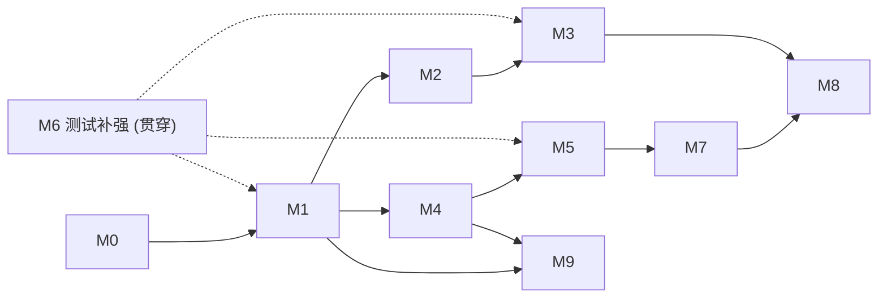

# FactorLibrary 架构重构实施计划

> **创建日期**：2026-11-14
> **依据**：架构审查报告（P0/P1/P2/D1–D10）与 `docs/superpowers/specs/2026-11-14-hybrid-research-and-dl-alpha-design.md`
> **数据现状**：期货 1d、股票 1d、期货 1m
> **原则**：每个阶段独立可合并，并通过 `bash scripts/verify.sh --all`。所有改动必须符合 `AGENTS.md` 红线（防未来函数、FFI 只读视图、算子双端对账、白皮书同步）。

---

## 0. 总览

| 阶段 | 主题 | 解决的问题 | 依赖 | 预估 |
| :--- | :--- | :--- | :--- | :--- |
| **M0** | 基线与安全网 | 先建立回归基线，防止重构破坏现有行为 | 无 | 2d |
| **M1** | `MarketProfile` 与股票标签/回测内核 | P0-1, D7, P1-2（标签重复） | M0 | 10d |
| **M2** | Engine 复用、零拷贝与面板加载提速 | P1-1, P1-3 | M1 | 5d |
| **M3** | 成本进入评估与目标函数；多重检验与 lockbox；数据指纹 | P0-2, P0-3, P2-4 | M1, M2 | 7d |
| **M4** | 控制面：迁移、`market` 隔离、recipe、run 心跳 | D1–D3, P1-5 | M1 | 6d |
| **M5** | 依赖倒置、统一 CLI、单栈 HTTP | P1-4, P2-5 | M4 | 5d |
| **M6** | 测试与门禁补强 | P2-1, P2-2, P2-3, P2-6 | 贯穿，收口于 M5 之后 | 5d |
| **M7** | Web 分市场工作区 | 设计稿 §4 | M4, M5 | 8d |
| **M8** | `1d` DL Alpha | 设计稿 §5, D4–D6 | M3, M4, M7 | 10d |
| **M9** | `1m` 扩展包与时点可得性 | D9 | M1, M4 | 5d |

> [!IMPORTANT]
> M7（Web）与 M8（DL）**必须在 M1–M4 之后**开始。顺序不可调换，否则 Web 市场切换只是 UI 皮肤，DL 会在零成本、无多重检验的目标上过拟合。



---

## M0：基线与安全网

**目标**：重构前固化现有数值行为，让后续每一步都能证明“没有改变结果”。

| 任务 | 文件 | 验收 |
| :--- | :--- | :--- |
| M0-1 运行全量门禁，记录现状（含已失败项） | `scripts/verify.sh` | 记录到 `docs/superpowers/plans/baseline.md` |
| M0-2 期货黄金快照：用合成面板（`create_synthetic_futures_panel(seed=42)`）对种子因子输出 IC/分位/回测 `metrics`，存为 JSON | `tests/python/golden/futures_*.json`（<1MB） | 新增 `tests/python/test_golden_futures.py`，容差 1e-12 |
| M0-3 股票黄金快照：用小型合成股票面板（N=60, T=300）固化 `compute_forward_returns`、`calc_long_excess_metrics` 输出 | `tests/python/golden/stocks_*.json` | 新增 `tests/python/test_golden_stocks.py` |
| M0-4 规模冒烟基准：合成 N=5000, T=1500, 20 字段，记录 `Panel.load`、`to_rust_engine`、`evaluate_factor` 的耗时与峰值内存 | `scripts/bench_scale.py` | 输出 `runs/bench_scale_baseline.json`（不入库），数值写入 baseline.md |

**说明**：黄金快照里的“股票回测”指现在的分组收益口径。M1 引入的持仓级回测会产生**新**结果，不替换这份旧快照。

---

## M1：`MarketProfile` 与股票标签/回测内核

### M1.1 定义 `MarketProfile` 协议

新增 `python/factorlib/markets/profile.py`：

```python
@dataclass(frozen=True)
class ExecutionRules:
    t_plus_one: bool
    allow_short: bool
    lot_size: int
    price_limit_aware: bool
    entry_window: str            # "vwap_open_30m" | "open"
    price_basis: str             # "raw" | "hfq"

class MarketProfile(Protocol):
    name: str
    def paths(self, version: str) -> ResearchPaths: ...
    def load_panel(self, spec: PanelSpec) -> Panel: ...          # 必含 labels 与 aux_fields
    def build_labels(self, panel: Panel, horizons: Sequence[int]) -> dict[str, np.ndarray]: ...
    def style_factors(self, panel: Panel) -> dict[str, np.ndarray]: ...
    def default_postprocess(self) -> PostprocessSpec: ...
    def execution_rules(self) -> ExecutionRules: ...
    def backtester(self) -> Backtester: ...
    def cost_model(self) -> CostModelSpec: ...
```

- 新增 `markets/registry.py`：`PROFILES: dict[str, Callable[[], MarketProfile]]`，`get_profile(name)`。
- 现有 `MarketAdapter`（`markets/base.py`）保留为 profile 内部的合约规格与费率来源，不再被 `core/` 直接引用。

### M1.2 解除 `core/` 对期货的依赖

| 当前耦合点 | 改法 |
| :--- | :--- |
| `core/panel.py:209` 导入 `AUX_BACKTEST_FIELDS` | `Panel.load(path, aux_field_names=...)` 由 profile 传入；删除 `core` 内的 `markets` 导入 |
| `core/backtest.py` 导入 `FuturesMarketAdapter` | `run_backtest(panel, weights, config, profile)`；`core/backtest.py` 只做分发，期货实现迁入 `markets/futures/backtest.py` |
| `core/evaluate.py:run_factor_workflow` 固定 `compute_futures_styles` | 改为 `profile.style_factors(panel)` 与 `profile.backtester()` |
| `core/probe.py:682` 同上 | 同上 |
| `core/styles.py` 的 `compute_futures_styles` | 迁至 `markets/futures/styles.py`；`core/styles.py` 仅保留 `STYLE_DEFINITIONS` 通用结构 |

**验收**：`grep -rn "factorlib.markets" python/factorlib/core` 无结果（`core/` 不再导入 `markets`）。增加 `tests/python/test_import_boundaries.py` 做静态检查。

### M1.3 统一标签生成（Rust 化）

**目的**：消除期货（Polars）与股票（NumPy 循环）两套 T+1 语义。

Rust 端新增 `rust/factorlib_core/src/labels.rs`：

```rust
pub fn forward_returns(
    entry_price: ArrayView2<f64>,     // T+1 日入场价
    exit_price: ArrayView2<f64>,      // T+1+h 日出场价（换月场景为 old 价）
    entry_ok: ArrayView2<bool>,
    exit_ok: ArrayView2<bool>,
    horizons: &[usize],
    strict: bool,                     // true: 出场不可交易则 NaN；false: 顺延到下一可平日
) -> Vec<Array2<f64>>
```

- PyO3 导出 `build_forward_labels(...)`；输出数组走 `make_nonwriteable()`（`AGENTS.md` 第 5 条）。
- 先查 Context7 的 PyO3 / rust-numpy 最新 API，再写绑定，不凭记忆。
- Python 参考实现：`ops_ref.py` 新增 `forward_returns_ref`；`tests/python/test_rust_core.py` 对账；`proptest_ops.rs` 加性质：`y_h[T]` 的值不随 `T` 及以前的价格改变（因果性）。
- 期货 `etl/labels.py` 保留链式 VWAP 逻辑，但计算 `r_exec_next` 之后的 h 期复合改为调用 Rust；输出与 M0-2 快照逐位比对。
- 股票 `StockPanelData.compute_forward_returns` 改为调用 Rust；`execution_simulation` 对应 `strict=false`。M0-3 快照必须不变。
- **顺带修正**：现有股票实现 `max_t = T-1-h; range(max_t)` 会少算最后一个可用交易日，Rust 版以 `t+1+h <= T-1` 为准，并在黄金快照对比里单独标注这一差异。

### M1.4 股票 Profile 与面板

- 新增 `markets/stocks/profile.py` 实现 `MarketProfile`。
- `StockPanelData.to_panel()` 调用 `build_labels` 后写入 `Panel.labels`（至少 `y_1, y_2, y_5, y_10`），并把基准收益 `bench_fwd_*` 放入 `aux_fields`（不进入 `fields`，避免 DSL 越权）。
- 新增 `configs/stocks/{data,universe,fees,backtest,gp_default,ml_default}.yaml`，以及 `python/factorlib/core/config.py` 的按 profile 校验：
  - `stocks/data.yaml`：时间区间、基准代码、`price_basis`、停牌/ST/新股剔除参数；
  - `stocks/fees.yaml`：佣金率、最低佣金、印花税、过户费、滑点；
  - 校验规则：费率非负、`min_commission >= 0`、`lot_size == 100`。
- 新增 `scripts/build_panel.py --market stocks`，使股票也能构建 `data/derived/stocks/<version>/`，包含 `panel_daily.parquet`、`labels.parquet`、`meta.json`。

### M1.5 股票持仓级回测内核

Rust 新增 `rust/factorlib_core/src/backtest/stocks.rs`，导出 `run_stock_backtest`：

| 语义 | 规则 |
| :--- | :--- |
| 执行价 | T+1 开盘（或 `open_adj` / 首 30 分钟 VWAP，由 `entry_window` 决定） |
| 整手 | 买入向下取整到 100 股；卖出清仓允许零股 |
| T+1 约束 | 当日买入的股票次日才可卖 |
| 涨跌停 | `can_buy_mask` / `can_sell_mask` 阻断，未成交部分顺延，留在目标权重与持仓差里 |
| 停牌 | 不可交易，持仓按最后有效价盯市 |
| 成本 | 买：佣金（含最低）+ 过户费；卖：再加印花税；滑点按 tick 与成交额比例 |
| 做空 | 默认关闭；`allow_short` 打开后走融券费率（暂不实现，预留接口并在文档标注） |
| 输出 | `equity / returns / positions / turnover / fee / slippage / tax / blocked_orders` 与基准超额 |

- 文件拆分：沿用 `backtest/futures.rs`，新增 `stocks.rs`，抽取公共账务结构到 `backtest/common.rs`。
- `Backtester` trait 在 Python 层统一返回 `BacktestResult`；股票的 `margin_*`、`roll_cost` 字段允许为 0，增加 `tax` 与 `blocked_orders`。`BacktestResult` 改为含 `extras: dict`，避免为每个市场加字段。
- **对账**：编写 `tests/python/oracles/stock_ledger_ref.py`，纯 Python 逐日账本；`tests/python/test_stock_backtest.py` 与 `proptest` 随机权重/价格/停牌对账，`|Δequity| < 1e-9`。
- 反未来函数：在 `tests/python/test_perturbation.py` 增加股票用例：篡改 `T > T_perturb` 的价格、停牌、ST 与基准，`T <= T_perturb` 的因子、标签之外的所有历史输出必须 bit 等价（标签中依赖未来的部分除外，单测断言其仅依赖 `T+1…`）。

### M1.6 组合构建按市场拆分

- `core/portfolio.py` 保留通用的截面去均值、截断与缓冲带；
- 期货专用的 `LedoitWolf` 目标波动率定标移到 `markets/futures/portfolio.py`；
- 股票新增 `markets/stocks/portfolio.py`：分位等权多头（默认 Top 10%）、行业中性可选、个股上限、换手缓冲带；**不使用全协方差**。

### M1 验收

- 期货 M0-2 快照零差异；股票旧快照差异仅限已标注的 `max_t` 修正。
- `evaluate_factor` / `run_factor_workflow` 在两个 profile 上都可运行。
- 完成 `docs/futures_platform_plan.md` 的“市场抽象”“股票回测语义”章节同步。

---

## M2：Engine 复用、零拷贝与面板加载提速

### M2.1 Engine 单例与零拷贝

1. `Panel` 增加惰性属性 `engine`（带 `_engine` 缓存），`to_rust_engine()` 保留为兼容别名，返回缓存实例。
2. 全仓 9 处调用改为复用 `panel.engine`：`evaluate.py`（2 处）、`gp/engine.py`、`ml/pipeline.py`、`ml/dataset.py`、`probe.py`、`scripts/run_pipeline.py`（3 处）。
3. Rust `PyEngine::new`：对已是 F-contiguous 且 `float64` 的数组，保留 `Py<PyArray2<f64>>` 引用并通过只读借用构造 `ArrayView`，不再复制；非 F 序或非 float64 才复制。**实现前先用 Context7 查证 rust-numpy 的借用/生命周期约定，并评估 Python 端数组被释放或原地改写的风险**。若无法保证安全，则退而求其次：保持复制，但由 Python 端 `Panel` 在 `engine` 创建后释放自身对应字段（`Panel` 与 `Engine` 共享 `Arc` 的方案）。
4. `cache_mb` 由 profile 提供默认值（期货 1024，股票按 `N` 计算上限）。
5. 对导出数组继续强制 `flags.writeable == False`，并扩充测试：对 `Engine.eval()` 输出赋值必须抛 `ValueError`。

### M2.2 `Panel.load` 提速

- 用 Polars 在表达式内计算行列整数索引：
  ```python
  df = df.with_columns(
      _r=pl.col("trading_date").rank("dense").cast(pl.Int32) - 1,
      _c=pl.col("symbol").rank("dense").cast(pl.Int32) - 1,
  )
  ```
  不再有 `.to_list()` 与 Python 列表推导；`sector` 编码同理用 `replace_strict` / `join`。
- 标签的 join 同样走 Polars `join` 而不是 `enumerate(zip(...))`。
- 可选（M2 末尾评估）：ETL 同时产出宽矩阵 `*.npy` 缓存，`Panel.load` 优先 `mmap`。

### M2 验收

- M0-4 基准：`Panel.load` 耗时与峰值内存下降（目标：≥5× 与 ≤50% 内存），结果写入 baseline.md。
- M0-2 / M0-3 快照零差异；`cargo test`、`pytest tests/python` 通过。

---

## M3：成本、多重检验与数据指纹

### M3.1 成本进入 Layer 1 指标

- Rust `factor_metrics` 增加参数 `cost_bps_buy`、`cost_bps_sell`、`slip_bps`，输出：
  `net_ls_annual_ret`、`net_ls_sharpe`、`net_top_annual_ret`、`cost_drag`。成本 = `换手 × (买卖费率 + 滑点)`，换手使用已有 `top_turnover` 逐日序列。
- `FactorMetricsRecord` 与 `factor_metrics` 表增加对应列（走 M4 的迁移机制）。
- 费率来源统一取自 `profile.cost_model()`；期货按品种费率的加权平均，股票取买卖非对称。
- `ops_ref.py` / `test_metrics.py` / `proptest_metrics.rs` 补净值指标对账。

### M3.2 目标函数改造

| 模块 | 修改 |
| :--- | :--- |
| `gp/engine.py` 适应度 | 增加 `fitness.metric` 选项 `net_ls_sharpe`、`icir_minus_turnover`；默认保持 `ic_ir` 以兼容，新增配置 `fitness.turnover_penalty` |
| `gp/admission.py` | 门槛加入 `min_net_ls_sharpe` 与 `max_cost_drag_ratio` |
| `ml/pipeline.py` | 评估输出加入净指标；`ml_default.yaml` 增加 `cost_aware: true` |
| 设计稿 §5.3.5 | 由“可选”升级为 DL 验证集**必选**扣费指标 |

### M3.3 多重检验与 lockbox（平台级）

- 新增 `core/stats_guard.py`：
  - `record_trials(run_id, n_trials)`：GP/DL/ML 每个 run 写入试验次数；
  - `deflated_sharpe(sharpe, n_trials, n_obs, skew, kurt)`；
  - `bh_adjust(pvalues)`（Benjamini-Hochberg）。
- 配置 `splits.lockbox: ["2024-01-01", "2026-08-31"]`：
  - GP 适应度、admission、ML 超参选择、DL 早停**一律不得读取** lockbox 行；
  - `Engine` 级保护：`factor_metrics` 在 `purpose="selection"` 时若 `end_row` 越入 lockbox 则抛错；
  - 每个 recipe 只允许一次 lockbox 揭盲，揭盲事件写入 `experiment_run`。
- 准入输出增加 `dsr` 与 `adj_p`，写入 `factor_metrics`。

### M3.4 数据指纹与 `data_version`

- `build_panel.py` 结束时计算 `data_fingerprint = sha256(parquet 内容哈希 + config 规范化 JSON 哈希 + git sha + 扩展包 id 与哈希)`，写入 `meta.json`，`panel_version` 保留为人类可读版本号。
- `RunTracker`、`AdmissionPipeline`、`FactorRecord.data_version` 全部改用指纹（保留 `panel_version` 字段单独存放）。
- 加载面板时校验：`meta.json` 指纹与重算值一致，否则抛错（可用 `--skip-fingerprint-check` 绕过，且记录告警）。
- 大文件哈希使用 mmap 分块计算，避免读入内存。

### M3.5 去除静默回退

- `evaluate._evaluate_factor_matrix_core`：请求的 `y_{h}` 不存在时直接抛 `ValueError`（含可用标签列表），删除回退到 `y_5`/`y_1` 的逻辑。
- `gp/engine._resolve_splits` 的“短样本优雅回退”改为：回退时写 `warnings.warn` 并写入 `RunTracker` 的 `run_warnings`，在报告与 Web 中展示；严格模式（`strict_splits: true`，生产默认）下直接报错。
- 加载期校验 `splits`：互斥、有序、`purge >= max(horizons)`，在 `core/config.py` 的 `__post_init__` 中完成。

### M3 验收

- 新增测试：净指标对账、lockbox 越界抛错、`deflated_sharpe` 已知值、指纹变更检测、缺失 horizon 抛错。
- 现有 GP/ML 测试在默认配置下仍通过。
- `docs/futures_platform_plan.md` 增加“成本口径与多重检验”章节。

---

## M4：控制面（迁移、market 隔离、recipe、run 心跳）

### M4.1 Schema 迁移框架（D2）

- 新增 `core/migrations/`：`0001_baseline.sql`（当前 schema）、`0002_market.sql` 等有序脚本；`FactorRegistry._init_db` 用 `PRAGMA user_version` 逐个执行，并取代 `registry.py` 里逐列 `ALTER`。
- 迁移前自动备份 `factors.sqlite` → `factors.sqlite.bak.<ts>`（位于 `data/`，已 gitignore）。
- 每个迁移在事务内执行，失败回滚。

### M4.2 `market` 隔离

- `factor`、`experiment_run`、`factor_metrics`、`factor_version` 增加 `market TEXT NOT NULL DEFAULT 'futures'`。
- 唯一键由 `canon_hash` 改为 `(market, canon_hash)`；`register_factor` / 查询接口全部增加 `market` 参数，默认从 `profile.name` 取。
- `factor_type` 扩展 `dl_alpha`，`source` 扩展 `dl_alpha`（同设计稿 §3.1）。
- 物化目录改为 `data/factors/<market>/<factor_id>.npz`，迁移脚本搬迁旧文件并更新 `materialization_path`。

### M4.3 新表

```sql
CREATE TABLE feature_set (
  id INTEGER PRIMARY KEY, market TEXT NOT NULL, name TEXT NOT NULL,
  content_json TEXT NOT NULL, created_at TEXT NOT NULL,
  UNIQUE(market, name)
);
CREATE TABLE research_recipe (
  recipe_id TEXT PRIMARY KEY,          -- 内容哈希
  market TEXT NOT NULL, kind TEXT NOT NULL,   -- gp | dl | ml | backtest
  feature_set_json TEXT NOT NULL,      -- 深拷贝冻结
  params_json TEXT NOT NULL, label TEXT NOT NULL,
  splits_json TEXT NOT NULL, data_fingerprint TEXT NOT NULL,
  seed INTEGER NOT NULL, created_at TEXT NOT NULL
);
CREATE TABLE run_heartbeat (
  run_id TEXT PRIMARY KEY, ts TEXT NOT NULL,
  progress_json TEXT NOT NULL, log_tail TEXT
);
```

- `experiment_run` 增加 `recipe_id`、`pid`、`started_at`、`heartbeat_at`、`status`（`queued|running|completed|failed|cancelled`）、`run_warnings`。
- `research_recipe` 的哈希取规范化 JSON（键排序、浮点固定精度）；同内容 recipe 复用同一 id，且**不可更新**（触发器拒绝 UPDATE/DELETE）。

### M4.4 并发约定（D1）

- 所有连接设置 `PRAGMA busy_timeout=5000`、`PRAGMA synchronous=NORMAL`；
- 写事务保持短小，心跳单独写 `run_heartbeat`（不更新 `factor` 相关表）；
- 重计算过程的进度先写 `runs/<run_id>/heartbeat.json`，由节流器（≥2s）同步到 `run_heartbeat`，避免高频写锁。

### M4.5 `RunContext`

新增 `core/run_context.py`，替换各脚本中分散的 `RunTracker` 使用：

```python
with RunContext.start(kind="gp", recipe_id=..., market=...) as ctx:
    ctx.heartbeat(progress={"gen": 3, "total": 50})
    ctx.check_cancel()          # 检查取消标志或 SIGTERM
```

- 进入时：写 `experiment_run(status=running, pid, started_at)`，保存配置快照、git sha、指纹；
- 退出时：异常 → `failed` 并记录 traceback；正常 → `completed`；
- 注册 SIGTERM 处理器置取消标志，由训练循环在 checkpoint 处检查，保证 `cancelled` 状态落盘；
- 启动时 reaper：扫描 `running` 且 pid 不存在或心跳超时（默认 120s）的记录，置为 `failed`（D3）。

### M4.6 派发协议

- 新增 `core/dispatch.py`：`launch_run(recipe_id) -> run_id` 用 `subprocess.Popen([... "factorlib", "run", "--recipe", id], start_new_session=True, stdout=日志文件)` 启动；`cancel_run(run_id)` 发送 SIGTERM，超时 SIGKILL；
- pid 复用防护：`experiment_run` 同时记录进程启动时间（`psutil.Process.create_time` 或 `/proc/<pid>/stat`），校验一致才视为同一进程。

### M4 验收

- 迁移测试：旧版 sqlite 文件可升级；重复执行幂等；失败回滚。
- 并发测试：3 个进程同时写 run 心跳与因子，无 `database is locked`。
- 取消、崩溃、reaper 的端到端测试。
- `docs/api_reference.md` 与白皮书同步 schema。

---

## M5：依赖倒置、统一 CLI、单栈 HTTP

### M5.1 依赖倒置

- 把 `scripts/run_pipeline.py` 的 `run_pipeline` 主体移入 `python/factorlib/pipeline/e2e.py`；`scripts/run_pipeline.py` 只保留参数解析并调用该函数；`workbench.py` 改为 `from factorlib.pipeline.e2e import run_pipeline`。
- 静态检查：`tests/python/test_import_boundaries.py` 增加规则 —— `python/factorlib` 内不得出现 `from scripts` / `import scripts`；`core/` 不得导入 `markets/`、`gp/`、`ml/`；`gp/`、`ml/` 不得导入 `markets/<specific>`。

### M5.2 统一 CLI

- 在 `pyproject.toml` 增加 `[project.scripts] factorlib = "factorlib.cli:main"`（依赖变更须执行 `uv lock` 并通过 `uv lock --check`）。
- 子命令：

| 命令 | 说明 |
| :--- | :--- |
| `factorlib build --market M [--version V]` | 构建面板（调用各 profile 的 ETL） |
| `factorlib audit --market M` | 数据审计 |
| `factorlib recipe create|show|list` | 管理 recipe |
| `factorlib run --recipe ID` | 按 recipe 执行（kind 决定 gp/dl/ml/backtest） |
| `factorlib gp|ml|dl --market M [--recipe ID | --config YAML]` | 直接运行，内部先物化为 recipe 再执行，保证可复现 |
| `factorlib backtest --market M --factor ...` | 回测 |
| `factorlib serve --market M` | 启动 Web |

- 现有 `scripts/run_gp.py`、`run_ml.py`、`run_backtest.py`、`build_panel.py` 保留为一个版本周期的薄包装并打印弃用提示（满足门禁 7 的 `--help` 检查）。
- **关键点**：命令行直接传 YAML 时也生成 recipe，这样“所有运行都有 recipe”成为不变量。

### M5.3 HTTP 单栈

- 保留 FastAPI，移入必选依赖（`pyproject.toml`），删除 `run_std_server` 与 `WorkbenchHTTPHandler` 分支；
- 路由与业务解耦：`FactorWorkbenchService` 方法保持纯函数式，路由层只做参数校验（pydantic 模型）；
- 所有路由增加 `market` 路径前缀：`/api/{market}/...`；
- `/api/pipeline/run` 改为 `POST /api/{market}/runs`（创建 recipe 并 `launch_run`，立即返回 `run_id`），新增 `GET /api/{market}/runs`、`GET /api/{market}/runs/{id}`（含进度与日志尾行）、`POST .../cancel`。旧接口返回 410 并指向新接口。

### M5.4 对账脚本归档

- 将 `scripts/backtest_multi_factors.py`、`scripts/backtest_volume_price_factor.py` 移至 `scripts/recon/`，保留其 `--help`；
- 把可复用部分抽取到 `core/`：`calc_long_excess_metrics`（已在 `evaluate.py`）、分年度统计函数 → `core/attribution.py`；脚本改为调用它；
- 脚本内硬编码的线上因子 ID 移到 `scripts/recon/factors.yaml`。

### M5 验收

- `import` 边界测试通过；`factorlib --help` 与各子命令 `--help` 状态码 0；
- 旧脚本仍可运行并有弃用提示；Web API 新旧路由测试通过。

---

## M6：测试与门禁补强（贯穿）

| 任务 | 内容 | 位置 |
| :--- | :--- | :--- |
| M6-1 指标对账 | IC / RankIC / 分位收益 / 换手的 NumPy 参考实现，含 22% NaN、±Inf、全常量、单点、窗口过长；`|Δ| < 1e-9` | `ops_ref.py`（新增 `metrics_ref`）、`test_metrics.py`、`proptest_metrics.rs` |
| M6-2 后处理链对账 | 12 个后处理算子链式组合的参考实现，掩码收缩与 decay 重施掩码的语义 | `test_postprocess_and_probe.py` |
| M6-3 回测 oracle | 期货与股票各一份逐日账本参考实现 + proptest 随机场景 | `tests/python/oracles/`、`rust/factorlib_core/tests/proptest_backtest.rs` |
| M6-4 股票扰动审计 | 见 M1.5；扩展到 `is_st`、`listed_days`、`bench_*`、扩展包字段 | `test_perturbation.py` |
| M6-5 标签因果断言 | 对每个 profile：`y_h[T]` 仅依赖 `[T+1, T+1+h]` 的价格 | `test_labels_causality.py` |
| M6-6 配置校验 | recipe JSON Schema、`splits` 互斥与 purge 校验、特征池字段存在性、各 profile 的 `data.yaml` | `test_config.py`、`test_recipe.py` |
| M6-7 规模冒烟 | `scripts/bench_scale.py` 在 CI 可选运行（`verify.sh --perf`）；设定耗时与内存上限，超限告警 | `scripts/verify.sh` |
| M6-8 门禁脚本 | `verify.sh --all` 加入：import 边界、黄金快照、迁移测试、`factorlib --help` | `scripts/verify.sh` |

---

## M7：Web 分市场工作区

> 前置：M4 的 recipe / run API 与 M5 的 `/api/{market}` 路由。

### M7.1 前端模块化

- `python/factorlib/frontend/app.js`（1340 行）拆分为 ES modules：`router.js`、`api.js`、`state.js`、`pages/{data,lab,diagnostics,mining,registry}.js`、`components/*.js`；
- 保持“零构建”：使用原生 `<script type="module">`，由 FastAPI 静态托管，随 wheel 打包（延续既有 Wheel 打包方式）；
- 路由：`#/futures/lab`、`#/stocks/lab` 等；顶栏市场切换器更新路由前缀与主色调。

### M7.2 页面落地顺序

1. **Page 4 Mining & DL Studio**（优先，因为解决同步阻塞）：recipe 组装器、双出口（后台启动 / 复制 CLI 命令）、任务监控表（进度、PID、日志抽屉、取消）。
2. **Page 5 Registry & Admission**：`candidate` 队列、批量准入（相关性 + 正交残差 + 消融，三关逻辑落在 `core/admission_audit.py`）。
3. **Page 1 Data & FeatureSet**：面板体检卡（指纹、跨度、缺失率）、`feature_set` CRUD、扩展包挂载台（M9 后启用）。
4. **Page 2 Factor Lab**、**Page 3 Diagnostics**：接入 profile 的默认后处理与市场专属区块；多因子 A/B 对比（严格 OOS 交集、相关性热力图、正交残差累积 IC）。

### M7.3 性能预算（D10）

| 接口 | 预算 | 超限处理 |
| :--- | :--- | :--- |
| 因子探针 | < 1s | 返回 `408` 并建议转异步 |
| 单因子诊断 | < 5s | 否则创建 `backtest` 类型 run |
| 相关性热力图 | 2~6 因子 < 3s | 使用 Rust `cross_correlation`，不得在 Python 里循环 |
| 股票风格暴露 | 缓存 | 以 `(fingerprint, style_set)` 为键落盘缓存 |

### M7 验收

- 主要流程的 API 测试 + 浏览器冒烟（chrome-devtools 脚本）；
- 关闭页面不中断任务；刷新后任务表恢复；取消按钮生效；
- 两个市场的数据、因子库、run 列表互相隔离。

---

## M8：`1d` DL Alpha

> 前置：M3（成本与 lockbox）、M4（recipe/run）、M7 Page 4。

### M8.1 模块结构

```
python/factorlib/dl/
  dataset.py      # (T,N,L,C) 滑窗 Dataset；Fold 内拟合的预处理
  models/         # gated_mlp.py, gru.py, tcn.py, st_attention.py
  loss.py         # 日内分组 IC / RankIC loss + 小权重 Huber + 换手惩罚
  trainer.py      # Purged Walk-Forward、多种子、早停（Valid RankICIR）
  stitch.py       # 逐折 OOS 拼接与多种子 Z-Score 融合
  materialize.py  # 写 .npz 并注册 factor_type="dl_alpha"
scripts/ → factorlib dl --recipe ID
```

- 依赖（PyTorch 等）放入 `pyproject.toml` 的可选 extra `dl`，并同步 `uv lock`；
- 论证与 API 选型需用 Context7 核验 PyTorch 当前版本的 API；
- 数据输入直接来自 `panel.engine` 的只读视图，转换为 `torch.from_numpy` 时保持只读，不得原地修改。

### M8.2 关键约束的落地

| 设计要求 | 实现 |
| :--- | :--- |
| 防泄漏预处理 | 缩放器、去极值边界在每个 Fold 的训练集内 `fit`；截面标准化只用当日截面；时序状态特征只用因果滚动统计 |
| 标签去 Beta | `label.neutralize: demean | sector`；标签来自 M1.3 统一 `build_labels` |
| Purged + Embargo | 复用 `ml/splits.py`，断言 `purge >= h` |
| 多种子 | 每折 3~5 个种子，验证集 RankICIR 早停；每日截面 Z-Score 后等权融合 |
| Lockbox | 复用 M3.3；训练、超参选择只见 selection period |
| 成本感知 | 验证指标用 M3.1 净指标；损失含换手惩罚项 |
| 期货小截面（D4） | 默认**池化训练**：品种 embedding + 全部 `(T×N)` 样本；验证用 block bootstrap 的 ICIR 区间 |
| 股票大截面 | 按日打包 batch，GRU/TCN 加每日截面 Attention |

### M8.3 三关准入

- 新增 `core/admission_audit.py`：
  1. **第一关**：OOS `|ICIR|`、分年度方向、换手上限、`max|ρ| < 0.60`；
  2. **第二关（Spanning Test）**：每日截面多元回归，求残差 IC 序列的 ICIR 与 t-stat；Rust 实现（`metrics/spanning.rs`）并在 `ops_ref.py` 提供参考实现；
  3. **第三关**：在 `WalkForwardPipeline` 里对比 `Base` 与 `Base + DL` 的费后 OOS 夏普与回撤。**嵌套隔离（D6）**：二层模型只读 DL 的 OOS 输出，其超参选择不得使用 lockbox 与 DL 的 selection 期。
- 同一 `FeatureSet` 的 DL 变体族去重：按族保留残差 ICIR 最优的 1~2 个。
- 样本量校正（D5）：同时展示 OOS 交集窗口和全样本成绩；t-stat 阈值按有效样本量缩放。

### M8 验收

- 在合成数据上：随机噪声特征训练得到的 OOS ICIR 接近 0（无泄漏的负控制）；把标签偷偷平移 -1 日则 ICIR 显著异常被扰动测试捕获；
- 期货与股票各跑通一个 `dl_alpha` 候选入库并走完三关；
- 同 recipe + 同种子，两次运行 OOS 矩阵逐位一致。

---

## M9：`1m` 扩展包与时点可得性

### M9.1 扩展包契约

- 目录：`data/extensions/<market>/<pack_id>/{features.parquet, pack.json}`；
- `pack.json` 必含：`pack_id`、`market`、`version`、`fields[]`、`coverage`、`lag_days`、`asof_rule`（`T_close` | `T+1_open`）、`source_fingerprint`；
- 特征按 `(trading_date, symbol)` 对齐，**日期语义为信息可得日**，而非数据发生日。

### M9.2 抽取器

- 将 `markets/futures/etl/minute_features.py` 改造为 `markets/futures/extensions/minute_pack.py`，从 `build.py` 的日频 ETL 链路剥离，支持独立构建与流式分月处理；
- 保留夜盘归属、`max_gap_minutes`、换月边界保护、郑商所成交额置零保护（沿用 `audit_data.py` 的检查）；
- 股票 `1m` 抽取器接口 `StockMinutePackBuilder` 仅预留 Protocol 与文档，不在本期实现。

### M9.3 挂载与审计

- `Panel.attach_extension(pack_id)`：按 `lag_days` 强制 shift 后写入 `fields`，记录进 `meta["extensions"]` 并并入 `data_fingerprint`；
- `feature_set` 与 recipe 引用 `pack_id@version`；
- 另类数据（仓单、席位）与股票财务数据复用同一机制，取代各自零散的 `alt_data_lag_days`；
- `test_perturbation.py` 覆盖扩展包字段：篡改 `T > T_perturb` 的 1m 数据，`T <= T_perturb` 的挂载特征必须 bit 等价；
- 日内张量（设计稿产物 B）本期不实现，仅保留 `pack.json` 的 `kind: "intraday_tensor"` 枚举与文档。

### M9 验收

- 期货 1m 包可独立构建与挂载，主面板内存占用不变；
- 未声明 `lag_days` / `asof_rule` 的扩展包拒绝挂载。

---

## 横切规范（每个阶段都适用）

1. **提交前门禁**：`bash scripts/verify.sh --all`；Rust 改动额外跑 `rust-analyzer diagnostics`、`cargo clippy -- -D warnings`、`cargo fmt --check`。
2. **FFI 规范**：新增导出数组一律 `make_nonwriteable()`；禁止 `uninit().assume_init()`；PyO3 / rust-numpy / PyTorch 的 API 选择先经 Context7 核对。
3. **算子/指标对账**：新增或修改的 Rust 计算必须同时更新 `ops_ref.py`、`tests/python/test_rust_core.py`、`rust/factorlib_core/tests/proptest_*.rs`，覆盖极端数值场景。
4. **依赖变更**：改 `pyproject.toml` 后执行 `uv lock` 并通过 `uv lock --check`。
5. **文档同步**：每个阶段更新 `docs/futures_platform_plan.md`、`docs/api_reference.md` 与三份 README 的相关章节。
6. **数据安全**：`git add` 前检查 `git status` 与 `git diff --cached --name-only`，黄金快照单文件 < 1MB；不得提交 `data/`、`exports/`、`runs/`、`*.parquet`、`*.sqlite`。
7. **提交信息**：中文 Angular 规范，例如：
   - `refactor(markets): 引入 MarketProfile 并解除 core 对期货的依赖`
   - `feat(backtest): 添加 A 股 T+1 整手持仓级回测内核`
   - `feat(registry): 引入 user_version 迁移与 market 隔离`
8. **向后兼容**：旧脚本和旧 API 保留一个版本周期，并带弃用提示。
9. **每个任务拆成独立 PR/提交**，避免把重构与行为变更混在一起；行为变更（如 `max_t` 修正、取消静默回退）单独提交并说明数值影响。

---

## 风险与缓解

| 风险 | 缓解 |
| :--- | :--- |
| M1 重构导致期货结果漂移 | M0 黄金快照；每个子任务单独验证 |
| 零拷贝借用 Python 数组的生命周期风险 | 先 Context7 核验；保守方案（复制 + 释放）作为后备；增加“Python 端释放/改写原数组”的压力测试 |
| 股票回测内核语义分歧 | 纯 Python oracle 对账；与 `backtest_volume_price_factor.py` 的线上对账结果交叉验证 |
| SQLite 迁移损坏数据 | 迁移前自动备份、事务内执行、幂等测试 |
| DL 依赖体积与环境差异 | 作为可选 extra；CPU 路径必须可跑通小规模测试 |
| 范围过大 | 严格按 M0→M9 顺序，每阶段验收后再开下一阶段；M7/M8 可裁剪页面与模型族 |

## 里程碑检查点

| 检查点 | 完成标志 |
| :--- | :--- |
| **A（M1–M3 完成）** | 两个市场都能 `build → evaluate → backtest`，指标含成本，lockbox 生效，面板有指纹 |
| **B（M4–M6 完成）** | 控制面可复现，统一 CLI 与单栈 API 就绪，测试与门禁覆盖全链路 |
| **C（M7 完成）** | Web 分市场工作区与异步任务闭环可用 |
| **D（M8–M9 完成）** | `1d` DL Alpha 与 `1m` 扩展包通过三关准入与扰动审计 |
