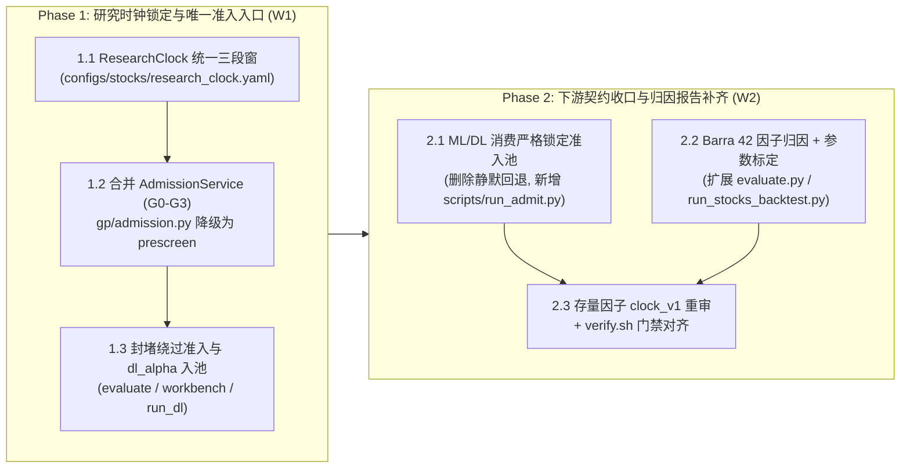

# FactorLibrary A 股核心演进路线图（精简锁定版 v2）

> **文档状态**：修订定稿 v2（基于当前 `stocks/{rq, barra}` 双源合一底座与流程锁定决策大幅瘦身）
> **修订日期**：2026-11-21
> **整合来源**：
> 1. [`docs/stocks_barra_backtest_integration.md`](file:///home/cr9294/repos/FactorLibrary/docs/stocks_barra_backtest_integration.md)（核心数据、优化器与统一回测底座已基本落地）
> 2. [`docs/superpowers/specs/2026-11-20-explicit-factor-mining-refactor-design.md`](file:///home/cr9294/repos/FactorLibrary/docs/superpowers/specs/2026-11-20-explicit-factor-mining-refactor-design.md)（已同步裁减冗余设计）

---

## 0. 本次架构审查与裁剪裁决

对照当前已落地的代码底座（`stocks/{rq, barra}`、`optimizer.py`、`run_stocks_backtest.py`）对 v1 路线图进行冗余审查后，作出以下 6 项收口裁决：

| # | 原规划内容 | 审查结论 | 修订后方案 |
|---|---|---|---|
| **R1** | **Stage A1/A2 与 Stage C1/C2 仍列为待办** | **已实际完成并升级**：`rq`（50+ 1d 字段）与 `barra`（`vwap_open_30m` + 42 因子协方差）已物理收口；Rust 106 算子、`optimizer.py` 三层凸优化、`last_hold` 漂移、双费率与 `run_stocks_backtest.py` 已上线；加载 `rq` 已自动挂载 `barra` `RiskView` 标签与风格 | 从待办路线图**核销**，列为当前已完成基线，不再重复投入 |
| **R2** | **双源字段冗余与期货同步包袱** | 原计划在 `registry` 加 `source_dataset`/`backtest_dataset`，且处处并行维护期货版 `research_clock`/拥挤度阈值 | **聚焦 A 股单主线**（期货保持独立现状）；A 股已统一为「`rq` 算特征 + `barra` 统一执行」，`registry` 无需双源冗余字段 |
| **R3** | **MLSelectMiner 与 DLLatentMiner** | `MLSelectMiner`（3k–5k 模板扫描）与 `DLLatentMiner`（黑盒潜因子拼接）会与现有 `GP + ML/DL 合成` 形成多余挖掘分支，且黑盒潜因子违背显式因子定位 | **暂不实施**：挖掘层锁定 `Manual/Seed + GP`，`ML/DL` 专注下游 `Predictions` 合成 |
| **R4** | **机构级治理外环（5 张新表 + 4 Actor + 周度滚动 + 重挖审批）** | `factor_pool_snapshot`、`factor_pool_member`、`factor_monitor`、`remine_request`、`factor_status_log` 及 `clock.advance()`/`production roll` 对当前阶段属于重型运维过度设计 | **砍掉全部 5 张新表与周度守护流**：直接复用现有 `factor` / `factor_metrics` 表，仅锁定 `ResearchClock` + 唯一 `AdmissionService` |
| **R5** | **新建 9 子命令 `factorlib/cli.py`** | 现有 `scripts/run_{gp,ml,dl,stocks_backtest}.py` 已覆盖研发与回测各环节，再建 `cli.py` 会造成双套 CLI 入口 | **取消 `cli.py`**：继续沿用现有 `scripts/run_*.py`，仅新增唯一准入入口 `scripts/run_admit.py` |
| **R6** | **Web 原型全面拆除或打大量补丁** | 前端只读浏览与单因子实验室仍有使用价值，但必须封堵绕过准入的直接写状态入口 | **冻结页面 + 最小协议封堵**：保留只读浏览与实验室，删除 `auto_promote` 与绕过 `AdmissionService` 写 `accepted`/`active` 的接口能力 |

---

## 1. 当前基线状态（已完成，不再重复投入）

- **数据与双源协同底座**：`data/raw/stocks/{rq, barra}` 与 `data/derived/stocks/{rq, barra}` 已收口完成；[`StocksProfile.load_panel`](file:///home/cr9294/repos/FactorLibrary/python/factorlib/markets/stocks/profile.py#L357) 加载 `rq` 时自动挂载 `barra` 的 `vwap_open_30m` 标签（`y_h` / `y_idio_h`）与 10 维 Barra 风格暴露；`v1` 已彻底废弃。
- **Rust 内核与 106 算子**：106 个 FactorLab 1d 算子及变量别名映射（[`core/variable_aliases.py`](file:///home/cr9294/repos/FactorLibrary/python/factorlib/core/variable_aliases.py)）已就绪并通过对账测试。
- **组合优化与统一回测**：[`markets/stocks/optimizer.py`](file:///home/cr9294/repos/FactorLibrary/python/factorlib/markets/stocks/optimizer.py)（`SignalShaper` + `DynamicRiskGuard` + `MOSEK`/`CLARABEL` 低秩 QP/Horizon LP）、[`markets/stocks/backtest.py`](file:///home/cr9294/repos/FactorLibrary/python/factorlib/markets/stocks/backtest.py) 与独立入口 [`scripts/run_stocks_backtest.py`](file:///home/cr9294/repos/FactorLibrary/scripts/run_stocks_backtest.py)（含 `factorsim_match` 预设）已就绪。

---

## 2. 精简后待实施路线图（仅 2 个阶段，约 2 周）

---

## 3. 分阶段任务清单与验收标准

### Phase 1：研究时钟锁定、唯一准入与越权封堵（Week 1）

**目标**：彻底消除训练窗与准入窗重叠、GP/Web 绕过准入直接写 `accepted`/`active`、以及 DL 预测矩阵混入因子池的问题。

| 任务 | 关键交付与文件 | 验收标准 |
|---|---|---|
| **1.1 `ResearchClock` 统一三段窗** | 新增 `python/factorlib/core/clock.py` 与 `configs/stocks/research_clock.yaml`： • `mine: ["2016-01-06", "2021-12-31"]` • `admit: ["2022-01-01", "2023-12-31"]` • `test: ["2024-01-01", "2026-11-06"]` • `purge_days: 10`，准入标签锁定 `y_idio_5` | `test_clock_isolation.py` 因果摄动测试：篡改 `admit`/`test` 段数据后，`mine` 段切片与 GP 输出绝对 0 差值；GP `splits` 由 `clock` 注入而非各处手写 |
| **1.2 合并为唯一 `AdmissionService`** | • 将 `core/admission_audit.py` 与 `gp/admission.py`（中重复的 IC/相关性逻辑）收口为唯一 `core/admission.py`（保留 `audit_candidates` 兼容导出），阈值固化至 `configs/stocks/admission.yaml`（默认 `y_idio_5` + NW `t ≥ 3.0` 多重检验约束）； • `gp/admission.py` 降级为 `gp/prescreen.py`（只做挖掘窗内预筛与批内去重），`gp/engine.py` 强制只写 `candidate`（修复 `_extract_horizon_from_label` 对 `y_idio_h` 解析）； • 直接复用现有 `factor` 与 `factor_metrics` 表记录准入结果（不新增表） | 同一因子无论来自 Manual、Seed 还是 GP，送入 `AdmissionService` 得到完全一致的 G0–G3 判定；GP 运行结束后因子状态严格为 `candidate` |
| **1.3 封堵绕过准入与 `dl_alpha` 入池** | • `core/evaluate.py` 的 `register_seed_factors` 默认状态改为 `candidate`； • `workbench.py` 与 `workbench_server.py` 移除 `auto_promote`，禁止 `batch-status` 绕过 `AdmissionService` 写入 `accepted`/`active`（审核按钮统一调 `AdmissionService`）； • `scripts/run_dl.py` 停止调用因子注册写 `dl_alpha`，仅输出 OOS 预测产物到 `runs/` 供下游回测 | 全仓 `grep` 检查无硬编码直接写 `status="accepted"`；Web 端尝试非法状态跃迁返回明确错误 |

---

### Phase 2：下游统一消费、Barra 归因补齐与存量重审（Week 2）

**目标**：打通「`Factors (rq)` → `AdmissionService` → `ML/DL Predictions` → `run_stocks_backtest.py (barra)`」端到端闭环。

| 任务 | 关键交付与文件 | 验收标准 |
|---|---|---|
| **2.1 下游严格消费与 `run_admit.py`** | • 新增 `scripts/run_admit.py`（对 `candidate` 批量运行 `AdmissionService` 并写入 `accepted`/`rejected`）； • 修改 `ml/pipeline.py`（`WalkForwardPipeline.from_registry`）：删除"无匹配因子时静默回退全库/动量因子"逻辑，仅加载 `accepted`/`active` 因子并统一套用版本锁定的后处理管线与 `sign`；空池直接显式报错； • 更新 `scripts/run_ml.py` / `scripts/run_dl.py` 对接 `clock.admit` / `clock.test` 边界 | 空因子池时显式报错阻断；`predictions.parquet` 与回测 `metrics.json` 可追溯参与合成的 `factor_id` 与版本清单 |
| **2.2 Barra 42 因子归因与产物补齐** | • 在 `core/evaluate.py` / `core/report.py` 补齐 Barra 42 因子（国家 + 10 风格 + 31 行业 + 特质 Alpha + 交易成本）收益与风险拆解； • 在 `scripts/run_stocks_backtest.py` 中补充 `n_holdings`（每日持股数）写入 `daily_equity.csv`、支持 `--quantiles 10` 分层输出及可选参数网格扫描标定 `configs/stocks/backtest.yaml` | `report.html` 清晰拆解 2024 年 1–2 月微盘回撤归因；`daily_equity.csv` 包含每日收益与持股数明细 |
| **2.3 存量因子重审与门禁对齐** | • 在当前 `factors.sqlite` 上用 `scripts/run_admit.py` 对现有 5 条 A 股因子（3 条 seed + 2 条 manual）按 `clock.admit` 重审校准 `admission.yaml` 阈值； • 将 `test_clock_isolation.py`、`test_admission_unified.py` 纳入 `scripts/verify.sh` 并跑通 `bash scripts/verify.sh --all` | 全量 `verify.sh --all` 100% 通过 |
