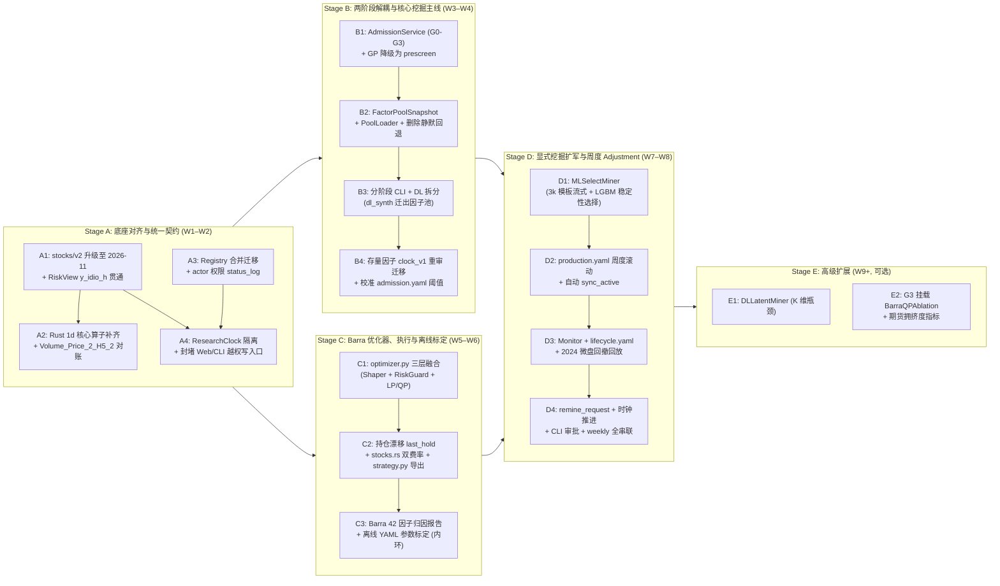

# FactorLibrary 统一演进时间线与编排计划

> **文档状态**：合并编排计划 v1（不修改现有两份源文档，仅对未实施部分重新排序与消解冲突）
> **创建日期**：2026-11-20
> **整合来源**：
> 1. [`docs/stocks_barra_backtest_integration.md`](file:///home/cr9294/repos/FactorLibrary/docs/stocks_barra_backtest_integration.md)（Phase 0–2 已完成，Phase 3–4 待办）
> 2. [`docs/superpowers/specs/2026-11-20-explicit-factor-mining-refactor-design.md`](file:///home/cr9294/repos/FactorLibrary/docs/superpowers/specs/2026-11-20-explicit-factor-mining-refactor-design.md)（显式挖因子两阶段解耦 + 无头化闭环 v2）

---

## 0. 冲突排查与合并裁决

两份计划在数据时间跨度、Schema 变更、Adjustment 定义、Web 定位以及组合优化器依赖上存在 6 处冲突，合并时按以下裁决消解：

| # | 冲突点 | Barra 计划现状 | 显式挖因子 v2 计划 | 合并裁决 |
|---|---|---|---|---|
| **C1** | **数据跨度与字段断层** | `stocks/v1`（`rq_v1`）仅到 `2024-12-31`，缺 `daily_basic`、`num_trades`、指数权重与补齐算子；`rq_v2`（至 `2026-11-06`）与 Rust 1d 算子扩充列在 Phase 3 P0 | `research_clock.yaml` 需用 `2024-01 ~ 2026-11` 作为 `monitor` 窗口，且 `MLSelectMiner` 需要完整变量与算子 | **`rq_v2` 升级与 Rust 算子扩充前置为阶段 A1/A2**。没有完整变量、算子和 `2025–2026` 区间，后续挖掘、迁移与监控都会返工 |
| **C2** | **Registry Schema 多次迁移** | §5.2 需为 `research_recipe` / `experiment_run` / `factor_metrics` 加双源追溯与 `label_type` 字段 | §2.4 需改 `factor` CHECK 约束并新增状态日志、快照、监控、重挖 5 张表 | **合并为单次原子迁移（阶段 A3）**，一次备份、一次 DDL 升级，避免表结构反复重建 |
| **C3** | **Research Clock 与双源交集** | `rq_v2` 为 `2010-01 ~ 2026-11-06`，`lb_barra_v1` 为 `2016-01-06 ~ 2026-11-10` | `clock_v1` 定义了 `mine / admit / monitor` 三段，但依赖 `y_idio_5` | **锁定双源交集 `[2016-01-06, 2026-11-06]`**：`mine=[2016-01-06, 2021-12-31]`、`admit=[2022-01-01, 2023-12-31]`、`monitor=[2024-01-01, 2026-11-06]`（直接覆盖 2024 微盘危机并保留近 3 年监控验证窗口） |
| **C4** | **Web 工作台 P1–P5 接入** | Phase 4 P3 计划在 `workbench_server.py` 交付全栈 P1–P5 页面、YAML 编辑器与审核晋升 | §7 明确**放弃前端原型作为目标设计，主线全面无头化**，只保留只读台账与单因子实验室 | **取消 Barra 计划的 Phase 4 P3**。双源切换、`SignalBridge` 桥接、YAML 调参和 Barra 42 因子归因全部通过 CLI + 静态产物交付 |
| **C5** | **Adjustment 双重含义** | Phase 4 P2-2 指的是「Returns → Barra 归因 → 扫描调整 `backtest.yaml` 参数并导出 `strategy.py`」 | §5 指的是「周度 Monitor → 因子降权/淘汰（`watch`/`retired`）→ `remine_request`」 | **拆分为内外双环**：**内环（离线标定）**在阶段 C 用归因+网格扫描固定一组稳健 `backtest.yaml` 参数；**外环（周度在线）**在阶段 D 按 `lifecycle.yaml` 动态管理因子池 |
| **C6** | **G3 消融与 `optimizer.py` 依赖** | `optimizer.py`（SignalShaper + DynamicRiskGuard + Barra 低秩 QP）在 Phase 3 P1-1 | P0-3 先用快速 `RidgeAblation`，把 `BarraQPAblation` 排在 P3-2 | 阶段 B 的 `AdmissionService` 保留可插拔 `MarginalEvaluator` 接口，默认用 `RidgeAblation` 先跑通；阶段 C 完成 `optimizer.py` 后，既支撑生产回测，也挂载为可选 `BarraQPAblation` |

---

## 1. 当前基线状态（已完成，不重复投入）

- **Barra 计划 Phase 0–2（Commit `83d9f69` 等）**：`.gitignore` 已隔离 `local_backtest/`，`cvxpy`/`clarabel`/`mosek` 依赖已就绪；`data/derived/stocks/lb_barra_v1/`（`2016-01-06 ~ 2026-11-10`）已独立落盘；`markets/stocks/{ares_bridge,barra,bridge,backtest}.py` 已上线 `BarraRiskModelStore`、因果 WLS、`SignalBridge`、`RiskView` 与 `vwap_open_30m_adj` 执行价；`ml/` 与 `dl/` 已支持 `y_idio_h` 标签。
- **短板所在**：米筐侧仍停留在 `data/derived/stocks/v1`（2024-12，缺基本面/指数权重）；`markets/stocks/optimizer.py` 尚未建立；`core/registry.py`、`gp/admission.py`、`core/admission_audit.py`、`ml/pipeline.py`、`run_dl.py` 仍处于旧的混合状态。

---

## 2. 全局依赖与里程碑时间线

全计划拆为 **5 个阶段（Stage A–E），共计约 8–9 周**。两条并行支线在 Stage B/C 交汇，Stage D 收敛为完整的周度无头闭环。

---

## 3. 分阶段实施清单与验收门禁

### Stage A：双源底座对齐、算子库补齐与统一 Schema（Week 1–2）

**目标**：消除数据时间断层与算子缺失，一次性完成数据库 Schema 与研究时钟的底层锁定，并封堵所有越权入口。

| 任务 | 来源归属 | 关键交付与文件 | 验收标准 |
|---|---|---|---|
| **A1. `rq_v2` 全量面板升级** | Barra P0-1 | 升级 `markets/stocks/panel_loader.py`、`configs/stocks/data.yaml`，合入截至 `2026-11-06` 的 `daily_basic`、`num_trades`、三大指数权重、`daily_derived_returns_intra`；打通 `RiskView` 与 `docs/factorlab_mcp_catalog.md` 变量别名；落盘 `data/derived/stocks/v2/` | `rq_v2` 覆盖至 `2026-11-06`；`RiskView` 在 `2016-01 ~ 2026-11` 上稳定产出 `y_idio_{1,2,5,10}` 与 10 维 Barra 暴露 |
| **A2. Rust 1d 算子扩充与黄金对账** | Barra P0-2 | 在 `rust/factorlib_core/src/ops/` 与 `core/ops_ref.py` 补齐 `cs_multi_wls_resi`、`barra5_zScore`、`ts_median/quantile`、`fillna/purify/zero_to_nan`、`exp/sign_power`、`cs_mean/std/var/sum/max/min/median/quantile` 及别名；清理冗余测试因子 | 新增算子 Rust vs NumPy 误差 $< 10^{-9}$；`Volume_Price_2_H5_2` 在 `rq_v2 → SignalBridge → lb_barra_v1` 链路对账通过 |
| **A3. Registry 单次合并迁移** | Barra §5.2 + v2 P0-2 | 修改 `core/registry.py`：合并双源追溯字段（`source_dataset`, `backtest_dataset`, `label_type` 等）、`factor` 新状态与来源 CHECK、新增 `factor_status_log` / `factor_pool_snapshot` / `factor_pool_member` / `factor_monitor` / `remine_request`；实现按 `actor` 授权的 `transition()` | 自动备份旧库后平滑迁移；`test_registry.py` 与新增 `test_registry_actor_auth.py` 全绿（越权调用抛异常） |
| **A4. ResearchClock 与入口封堵** | v2 P0-1 & P0-5 & §7.2 | 新增 `core/clock.py`、`configs/{stocks,futures}/research_clock.yaml`（股票 `mine=[2016-01-06, 2021-12-31]`, `admit=[2022-01-01, 2023-12-31]`, `monitor=[2024-01-01, 2026-11-06]`）；修改 `workbench.py`、`workbench_server.py`、`evaluate.py` 封堵直接写 `accepted`/`active` 及 `auto_promote` | `test_clock_isolation.py` 摄动测试 0 差值；`batch-status` 仅允许 `human` 写 `retired`；全仓 grep 无硬编码 `status="accepted"` |

---

### Stage B：两阶段解耦、统一准入与存量重审（Week 3–4）

**目标**：建立「Miner → AdmissionService → Registry → FactorPoolSnapshot → Predictions」唯一主干，并完成存量因子迁移。

| 任务 | 来源归属 | 关键交付与文件 | 验收标准 |
|---|---|---|---|
| **B1. `AdmissionService` 与 GP 降级** | v2 P0-3 & P0-4 | 合并 `core/admission_audit.py` 为 `core/admission.py`（G0–G3，业界初值落 `configs/*/admission.yaml`，股票默认 `y_idio_5` + NW `t ≥ 3.0` 多重检验，强制同 `clock_version` 一次性判定）；`gp/admission.py` 降级为 `gp/prescreen.py`，`gp/engine.py` 只产出 `candidate` | `test_admission_unified.py` 通过：同一因子无论经 GP、Manual 还是 CLI 送审得到完全一致的判定与 `factor_status_log` |
| **B2. `FactorPoolSnapshot` 下游契约** | v2 P1-1 | 实现 `registry.create_snapshot()`、新增 `core/pool_loader.py`（统一应用 version 锁定的 12 步后处理 × sign）；`ml/pipeline.py` 改造为 `from_snapshot(panel, cfg, pool_id)` 并删除静默回退 | 空快照直接报错；`predictions.parquet` 与 `summary.json` 强制携带 `pool_id` |
| **B3. 分阶段 CLI 与 DL 角色拆分** | v2 P1-2 & P1-3 | 新增 `factorlib/cli.py`（`mine/admit/snapshot/predict/backtest`），`scripts/run_pipeline.py` 改为薄封装；`scripts/run_dl.py` 迁为 `predict/dl_synth.py`，只消费快照输出 `pred_id`，不再调用 `register_dl_alpha` | 所有 CLI `--help` 门禁通过；`dl_alpha` 历史记录不再进入研究/生产快照 |
| **B4. 存量重审与阈值校准** | v2 P1-4 & D1 | 编写 `scripts/migrate_pool_v1.py`：将现有 `accepted`/`active`（含种子因子、GP 因子）全部重置为 `candidate`，在 `clock_v1`（`2022–2023` 准入窗）下跑 `AdmissionService` 重审 | 生成迁移对比报告（通过率、各关淘汰分布）；根据实际分布微调固化 `configs/*/admission.yaml` |

---

### Stage C：Barra 组合优化器、持仓漂移执行与离线标定（Week 5–6）

**目标**：落地高保真执行底座与归因体系（4. Positions → 5. Orders → 6. Returns），完成策略超参的离线内环标定。

> [!TIP]
> Stage C 对 `AdmissionService`（Stage B）无强阻塞，若人手充足可在 Stage A 完成后与 Stage B 并行推进。

| 任务 | 来源归属 | 关键交付与文件 | 验收标准 |
|---|---|---|---|
| **C1. 模块化融合凸优化器** | Barra P1-1 | 新增 `markets/stocks/optimizer.py`：实现 `SignalShaper`（居中秩分/软行业中性 `0.42`/低波倾斜/幂次放大/EMA 记忆）、`DynamicRiskGuard`（`FactorRet['SIZE']` 10 日异动防守）、`ConvexOptimizer`（Horizon LP + Barra 42 因子低秩 QP/SOCP + 非对称买卖惩罚 + `buy_hurdle`，MOSEK/CLARABEL 双轨与三级松弛） | `test_stocks_barra.py` 通过：纯多头/换手/风格行业硬偏离满足；MOSEK 与 CLARABEL 权重 $L_1$ 差 $< 10^{-4}$；不可行边界安全降级 |
| **C2. 持仓漂移闭环与双费率模式** | Barra P1-2 | 升级 `markets/stocks/backtest.py` 与 `rust/factorlib_core/src/backtest/stocks.rs`：按真实价格涨跌 + 停牌/涨跌停掩码 + `reserve_cash` 递推 `last_hold`；支持「A 股真实非对称税费」与「统一单边 `0.003`」双费率；支持导出兼容 `factorsim` 的 `strategy.py` | 因果摄动回归（`test_perturbation.py`）0 差值；双费率模式均可跑通 `rq_v2 → SignalBridge → lb_barra_v1` 全链路回测 |
| **C3. Barra 42 因子归因与内环标定** | Barra P2-1 & P2-2 | 扩展 `core/evaluate.py` 与 `core/report.py`：输出分年度及 2024 年 1–2 月微盘危机段的 Barra 42 因子（国家 + 10 风格 + 31 行业 + 特质 Alpha + 成本）归因；在 `scripts/run_backtest.py` 增加离线网格扫描，标定稳健的 `configs/stocks/backtest.yaml` | 产出的 HTML 归因报告清晰拆解 2024 微盘回撤来源；固定标定出一组通过验证的 `backtest.yaml` 与同步 `local_backtest/strategy.py` |

---

### Stage D：显式挖掘扩军与周度 Adjustment 在线闭环（Week 7–8）

**目标**：上线 ML 显式挖因子，并将每周一轮的监控、生命周期流转、生产滚动与事件重挖全自动串联。

| 任务 | 来源归属 | 关键交付与文件 | 验收标准 |
|---|---|---|---|
| **D1. `MLSelectMiner`** | v2 P2-3 & D4 | 新增 `mining/ml_select.py` 与 `3k`（上限 `5k`）表达式模板库：按族流式借 Rust 批量初筛（内存用完即丢）→ 周采样 `float32` 进 LightGBM（约 2GB）→ purged walk-forward 跨折保留率 `≥ 60%` 稳定性选择 → 产出显式 DSL `candidate` | 峰值内存 $< 8\text{GB}$；在 `clock_v1.mine` 上产出的候选能有稳定比例通过 `AdmissionService` |
| **D2. 生产配方周度自动 `active`** | v2 P2-1 & D2 | 新增 `configs/{stocks,futures}/production.yaml` 与 `core/production.py`：实现 `factorlib production roll`，生成 `kind=production` 快照、跑通预测（`ml_lgbm`）与 Stage C 优化器回测、调用 `registry.sync_active(pool_id)` 自动切换 `accepted ↔ active` | `active` 集合与最新生产快照 100% 一致；人工不可再直接篡改 `active` |
| **D3. 周度 Monitor 与生命周期规则** | v2 P2-2 & D3 | 新增 `core/monitor.py`、`core/lifecycle.py`、`configs/*/lifecycle.yaml`：每周最后一个交易日写 `factor_monitor`（60/120/250d IC/ICIR、半衰期、秩自相关换手、池内相关性、基于 `barra.py`/`RiskView` 的多空腿拥挤度 z-score、边际贡献）并执行 `watch`/`retired`/恢复规则 | 历史回放 `monitor=[2024-01-01, 2026-11-06]` 时，2024 年初高微盘/高拥挤度因子准确落入 `watch` 或 `retired`；`test_lifecycle.py` 全绿 |
| **D4. 重挖请求、时钟推进与周度串联** | v2 P2-4 | 新增 `core/remine.py`，扩展 `cli.py`：`remine list|approve|reject` 与 `factorlib weekly --market stocks`（`monitor → lifecycle → production roll → remine check → weekly digest.{md,html}`）；`approve` 后触发 `clock.advance()`（推进至 `clock_v2`）并调度 GP + MLSelect 用 `negative_json`/`gap_json` 补矿 | 端到端跑通：`retired` 触发 `remine_request` → CLI `approve` → 时钟推进至 `clock_v2` → 新批因子带 `clock_version=2` 入池 |

---

### Stage E：二期高级扩展（Week 9+，不阻塞主线）

1. **`DLLatentMiner`（`mining/dl_latent.py`）**：改造 `dl/models/` 导出带正交/去相关正则的 $K$ 维瓶颈潜因子（$K \approx 4\text{--}8$），逐维通过 `dl/stitch.py` 严格 OOS 拼接后送入 `AdmissionService`（受 `family_key` 配额 ≤ 2 约束）。
2. **G3 升级与期货拥挤度**：为 `MarginalEvaluator` 挂载基于 Stage C `optimizer.py` 的 `BarraQPAblation` 可选严格模式；为期货补充基于品种持仓量/成交额/基差与池内相关性的拥挤度度量。

---

## 4. 关键风险与门禁同步

- **数据隔离与合规门禁**：每阶段收口必须执行 `bash scripts/verify.sh --all`，确保 `local_backtest/`、`data/`、`runs/` 不进 Git，单文件 `< 1MB`，`uv lock --check` 与全部单元测试/属性测试通过。
- **文档同步**：`docs/stocks_barra_backtest_integration.md` Phase 3–4 的执行顺序以本合并时间线为准（Phase 4 P3 Web 接入取消）；Stage A/B 完成后同步更新 `AGENTS.md` 六阶映射表、`docs/futures_platform_plan.md` 与 `docs/web_ui/webui_ia_wireframes.md`（标注原型冻结）。
