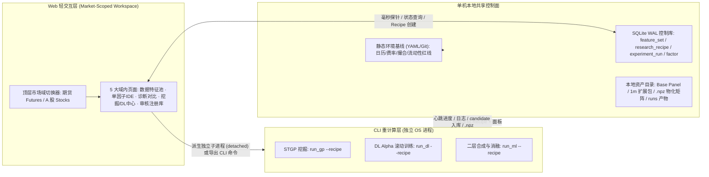
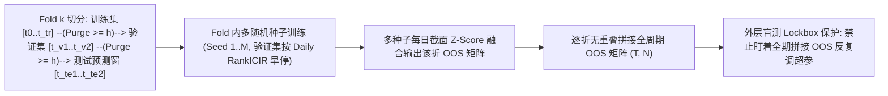

# FactorLibrary 混合投研工作流与深度学习因子（DL Alpha）架构设计文档

> **文档状态**：设计已确认（架构与方法论阶段，未含具体实现代码）  
> **创建日期**：2026-11-14  
> **适用范围**：`FactorLibrary` 单机本地量化投研平台（期货 `1d` + 另类 + `1m` 扩展；A 股 `1d` + 预留 `1m` 扩展）

---

## 1. 背景与设计目标（Why & Goals）

### 1.1 现状诊断与核心痛点

基于当前仓库结构，平台已具备较完整的计算与展示基础：
- **底层引擎与注册中心**：`python/factorlib/core/panel.py`（`Panel` Fortran 列优先容器）、`python/factorlib/core/catalog.py`（`FactorCatalog` 与 `POSTPROCESS_SPECS`）、`python/factorlib/core/registry.py`（`FactorRegistry` 与 `factor` / `factor_metrics` / `factor_version` / `experiment_run` 表）。
- **Web 交互工作台**：`python/factorlib/workbench_server.py`、`python/factorlib/core/workbench.py`（`FactorWorkbenchService`）与 `python/factorlib/frontend/index.html`（4 个 Tab：`tab-ide`、`tab-analytics`、`tab-registry`、`tab-pipeline`）。
- **CLI 与市场适配**：`scripts/run_gp.py`、`scripts/run_ml.py`、`python/factorlib/gp/admission.py`、`python/factorlib/ml/pipeline.py`，以及 `python/factorlib/markets/futures/etl/`（含 `minute_features.py`、`exec_price.py`）和 `python/factorlib/markets/stocks/panel_loader.py`（`StockPanelData`）。

但在向**“日常交互研究 + 重计算自动挖矿 + 深度学习因子 + 双市场统一底座”**演进时，存在四个显著断点：
1. **Web 与 CLI 配置割裂**：Web 侧交互筛选的字段、算子和因子库状态，无法直接冻结并传递到 CLI 端（`run_gp.py` / `run_ml.py` 仍主要依赖静态 YAML）；同时 `/api/pipeline/run` 在 Web 进程内同步阻塞执行，不适合数小时级的 GP/DL 重任务。
2. **双市场隔离缺失**：当前前端与元数据模型默认绑定单一期货上下文，接入 A 股日频研究后缺少按市场隔离的工作区、特征池与评价/回测规则。
3. **1m 高频数据定位边界模糊**：期货 `1m` 聚合目前耦合在日频 ETL 构建链路中，未来加入体量更大的股票 `1m` 数据时，若直接混入 `1d` 主面板会严重拖累交互响应与内存开销。
4. **缺少端到端 DL Alpha 体系**：现有 `ml/` 模块仅面向已入库因子的二层合成（Ridge/LightGBM），尚无从原始/微结构面板出发、经严格滚动样本外（Walk-Forward OOS）防过拟合训练、并与传统/GP 因子在统一尺度下对比去重的深度学习研究闭环。

### 1.2 设计目标（Goals）

1. 建立**单机本地共享控制面**，实现“Web 特征池与实验配方编排 ↔ CLI 异步重计算执行 ↔ Web 审核晋升”的零手工搬运闭环。
2. 确立**“一套统一引擎 + 市场域隔离（`MarketProfile`） + Web 分市场工作区”**的多市场架构，支撑期货与 A 股高效共底座演进。
3. 确立**“1d 日频为主干、1m 高频为可插拔离线扩展”**的数据分层方案。
4. 建立**`DL-as-a-Factor` 方法论**：覆盖特征与标签构造、分市场模型选型、Purged Walk-Forward 多重防过拟合、统一 `.npz` 物化入库与三关正交增量准入。

### 1.3 非目标与红线约束（Non-Goals & Constraints）

- **非目标（Non-Goals）**：
  - 不引入分布式集群调度（如 K8s/Ray/远程任务队列），一切设计立足**单机本地工作站**；
  - 不追求在 Web 端实现复杂神经网络的可视化拖拽搭积木，模型结构与训练逻辑仍由模块化 Python 代码/预设骨架承载；
  - 第一阶段 DL Alpha 不强上“日频 + 原始 1m”多模态耦合训练，先跑通纯 `1d` 面板闭环。
- **硬性约束（Constraints）**：
  - **严禁未来函数**：严格遵循日频 `T` 日收盘截至线与 `T+1` 开盘执行窗口，特征与标签物理隔离（延续 `Panel.fields` 与 `aux_fields` 分离约定）；
  - **本地数据资产隔离**：SQLite 元数据、派生面板与实验产物目录（`data/`、`runs/`、`exports/`）不进入 Git 版本控制；
  - **只读与可复现性**：每次重计算实验必须绑定不可变配置快照与 `data_version` 指纹。

---

## 2. 核心架构决策与备选方案权衡（Approaches）

| 决策维度 | 备选方案 | 最终选定方案与权衡理由 |
| :--- | :--- | :--- |
| **Web-CLI 任务协同** | A. 共享 SQLite 配方快照 + 独立子进程/CLI 通用入口 B. Web 导出静态 YAML + 纯终端手动执行 C. 常驻独立 Task Daemon 守护进程 | **选 A**：兼顾“终端 tmux/CLI 自由度”与“Web 一键派发/状态监控”，无需额外维护常驻 Daemon，且通过冻结 `Recipe ID` 彻底消除手工搬运配置。 |
| **特征池与准入治理** | A. Web 管命名特征池（`FeatureSet`）+ CLI 产出默认进 `candidate` 人工审核 B. CLI 产出直接自动 `accepted` C. 特征池仍由静态 YAML 维护 | **选 A**：防止自动化挖矿/DL 产生海量低质或高共线性因子污染合成池；人工在 Web 对比诊断后晋升 `accepted/active`。 |
| **双市场 Web 形态** | A. 单套前端骨架 + 顶层市场域切换（路由隔离 `#/futures/...` 与 `#/stocks/...`） B. 两套完全独立的 HTML/JS 项目 | **选 A**：与后端 `Unified Engine + MarketProfile` 对齐，避免前端公共组件双份维护，同时在状态、目录、回测语境上严格隔离。 |
| **1m 数据架构定位** | A. 独立离线 1m 预处理层 → 输出按需挂载的日频扩展包与可选日内张量 B. 并入核心 `1d` 主面板统一存储与加载 | **选 A**：隔离体量（股票 1m 为日频 240 倍）与市场专属清洗陷阱（期货夜盘/换月/郑商所零成交额 vs 股票连续竞价/一字板）。 |
| **DL Alpha 角色定位** | A. `DL-as-a-Factor`（端到端学特征，严格 OOS 拼接物化为 `dl_alpha` 因子资产） B. 仅作二层多因子合成器 C. 端到端直接输出组合权重 | **选 A**：让黑盒非线性特征与公式/GP 因子接受同一套中性化后处理、相关性去重、正交残差检验与实盘回测，避免黑盒绕开风控审计。 |
| **DL 去重与增量基准** | A. 严格 OOS 窗口对齐 + 同构后处理 + 正交残差检验（Spanning Test）与合成消融 B. 仅两两相关性 `< 0.60` C. 训练源头残差收益目标 | **选 A**：既允许 DL 完整学习特征结构，又通过多因子正交回归拦截“用复杂网络重新拟合几个已知传统因子”的伪创新。 |

---

## 3. “Web 轻交互 + CLI 重计算”混合架构设计

### 3.1 总体拓扑与控制面职责切分

#### 三类真值源分离（Single Source of Truth）
1. **静态环境基线（Git/YAML）**：交易日历、合约乘数与费率、撮合规则（如 `configs/futures/data.yaml`、`universe.yaml`）以及各市场的 `MarketProfile` 默认策略。
2. **动态研究控制面（SQLite，强制开启 WAL 模式）**：
   - **`feature_set`（命名特征池）**：记录 `market`、选中的 `1d` 基础字段、挂载的 `1m` 扩展特征包 ID、算子与窗口白名单（供 GP）、辅助因子 ID 与默认后处理 Preset。
   - **`research_recipe`（不可变实验配方快照）**：将某次实验引用的 `feature_set` 内容、目标标签 `y_h`、样本切分日期、算法超参（GP/DL/ML）、`data_version` 指纹与随机种子深拷贝冻结，生成唯一 `recipe_id`（附内容哈希），彻底保证“Web 后续修改特征池不影响历史实验可复现性”。
   - **`experiment_run`（运行态与心跳）**：记录 `run_id`、`market`、`recipe_id`、`kind`（`gp | dl | ml | backtest`）、OS `pid`、进度快照 JSON、状态（`running | completed | failed | cancelled`）与产物目录。
   - **`factor` / `factor_metrics` / `factor_version`**：在现有 schema 基础上显式增加 `market` 隔离字段，并扩展 `factor_type`（`expression | code | dl_alpha`）与 `source`（`seed | manual | gp | dl_alpha`）。
3. **重产物与矩阵存储（文件系统）**：`runs/<run_id>/` 存储训练日志、心跳文件、各 Fold 验证明细、HTML 报告及模型 Checkpoint；因子评估矩阵物化为 `.npz` 并在 SQLite 记录指针。

### 3.2 Web ↔ CLI 双向闭环流转协议

1. **Web → CLI（零搬运触发）**：
   - 用户在 Web 组装 `FeatureSet` 与实验超参后生成不可变 `recipe_id`；
   - 支持双出口：**① Web 一键派发独立后台子进程**（脱离 HTTP 请求生命周期，页面关闭/刷新不中断）或 **② 复制标准化 CLI 命令**（如 `python scripts/run_dl.py --recipe <recipe_id>`）在终端/tmux 中运行；
   - CLI 进程不依赖静态默认 YAML 的手改参数，直接从 SQLite 加载冻结后的 `Recipe` 与指定 `MarketProfile` 面板。
2. **CLI → Web（心跳回流与候选审核）**：
   - CLI 运行期间定期刷新 `experiment_run` 状态与轻量化进度文件（例如当前代数 `Gen 24/50` 或 `Fold 3/5 · Seed 2/5`、当前 Valid ICIR），Web 轮询展示进度与日志尾行；
   - 所有批量挖掘或训练出的因子默认以 `status = 'candidate'` 入库并关联 `source_run`，在 Web 端通过审核看板对比后人工晋升为 `accepted` 或 `active`。

### 3.3 多市场统一引擎与 `1d` 主干 / `1m` 扩展分层

#### 1. `MarketProfile` 抽象差异
| 维度 | 期货研究域（`futures`） | A 股研究域（`stocks`） |
| :--- | :--- | :--- |
| **截面规模与结构** | 几十个主力连续品种（`N ≈ 40~80`），含 7 大板块 | 全市场数千只个股（`N ≈ 3000~5000`），含申万行业与宽基池 |
| **特色基础数据** | 主力连续 `1d` + 展期 `roll_yield` + 仓单 `warehouse_stocks` + 前 20 会员席位 `member_rank` | 个股复权 `1d` + 停牌/ST/新股状态 + 申万行业 + Barra/风格暴露基准 |
| **可交易与中性化默认** | `indNeut`（板块去均值）+ 期货 6 风格中性化 + 涨跌停单边市过滤 | `dropNewStock` + 申万行业中性化 + 市值/波动率中性化 + 一字板买卖掩码 |
| **Layer 2 回测语义** | 逐日盯市、保证金占用、主力换月日平旧开新双边损耗、`T+1` 开盘 30m VWAP | `T+1` 开盘执行、涨跌停成交阻断、T+1 持仓约束、相对基准指数超额归因 |

#### 2. 1m 数据独立扩展管线（Plug-in Extension Plane）
- **职责剥离**：`1m` 原始数据绝不进入核心 `1d` 主面板内存。按市场各自实现离线流式抽取器：
  - **期货 `1m` Extractor**：隔离处理夜盘跨日 `trading_date` 归属、交易段间隔保护（`max_gap_minutes`）、换月边界保护及郑商所历史成交额置零保护（延续现有 `minute_features.py` 与 `audit_data.py` 经验）；
  - **未来 A 股 `1m` Extractor**：隔离处理 09:30–11:30 / 13:00–15:00 连续竞价、集合竞价剔除、后复权对齐与分片并行。
- **统一输出契约**：
  1. **产物 A（主用）：日频扩展特征包**——按 `(trading_date, symbol)` 对齐的轻量 Parquet 插件，Web 端在 `FeatureSet` 中勾选后，由底座按需挂载进 `Panel.fields`，不破坏 `1d` 主面板结构；
  2. **产物 B（远期 DL 多模态预留）：日内分箱张量**——离线聚合为每日固定 `K` 个时段切片 `(T, N, K_bins, C_intra)`，仅当未来某 DL Recipe 显式启用日内分支时按需加载。

---

## 4. Web 页面拆分细节与功能规格

### 4.1 总体布局与导航结构

采用**“顶层市场域开关 + 域内 5 大核心页面”**的单骨架路由架构：
- **全局顶栏（Global Context Bar）**：
  - 左侧：市场切换器 `[期货 Futures]` / `[A 股 Stocks]`（切换即切换路由前缀、主色调标识、当前 `Panel` 与隔离数据库视图）；
  - 右侧：当前主面板版本徽标（含已挂载扩展包计数）、活跃后台任务数提示、因子库状态概览。

### 4.2 域内 5 大页面功能明细

#### Page 1：数据与特征池中心（`Data & FeatureSet Studio`，新增）
- **核心定位**：管理当前市场的面板、扩展包与可复用 `FeatureSet`，打通 Web 与 CLI 的参数源头。
- **共性功能**：
  - 主面板体检卡（`data_version`、日期跨度、有效标的数量、缺失率分布、样本 Split 切分预览）；
  - `1m` 扩展特征包挂载台（列出可用扩展包、覆盖区间与字段清单，一键启用/卸载挂载）；
  - 命名特征池（`FeatureSet`）编辑器：可视化勾选基础字段 + 扩展特征 + 辅助因子 + GP 算子/窗口白名单 + 默认后处理 Preset，支持复制与版本对比。
- **市场专属区块**：
  - **期货页**：展示主力映射规则（`rule=3`）、滞后开关（`alt_data_lag_days`）及展期/仓单/席位三大另类数据覆盖率；
  - **A 股页**：展示全市场/宽基覆盖率、ST/停牌/新股剔除统计与行业/市值风格基准就绪状态。

#### Page 2：单因子实验室（`Factor Lab / IDE`，升级现有 `tab-ide`）
- **核心定位**：毫秒级单因子灵感验证、静态防未来审计与入库前打磨。
- **共性功能**：
  - 左侧 Catalog 目录树（统一检索 `1d` 基础字段、已挂载 `1m` 扩展特征、68+ 算子、12 后处理算子）；
  - 中部双模态编辑器（Rust DSL / Python `compute(context)` 因果沙箱）+ 声明式后处理链编排器；
  - 右侧实时探针面板（AST 合法性、未来函数静态拦截告警、计算耗时、覆盖率与截面分位数分布）+ 保存 `candidate` / 发起快速双层评估。
- **市场专属区块**：
  - 各自市场经典模板下拉库、默认后处理 Preset（期货偏向板块+6 风格，A 股偏向新股+申万行业+市值/涨跌停掩码）及对应的组合回测超参数表单。

#### Page 3：诊断与横向对比看板（`Diagnostics & Compare`，升级现有 `tab-analytics`）
- **核心定位**：单因子双层深入归因 + **传统/GP/DL 多因子公平同台对比**。
- **共性功能**：
  - 单因子 Layer 1（分层净值、RankIC 累积曲线、年度/月度表现表、风格暴露）与 Layer 2（实盘回测净值、回撤、换手）；
  - **多因子 A/B 同台对比模式**：支持勾选 2~6 个不同来源因子（如 `dl_alpha` vs `gp` vs `manual`），强制裁剪到**严格交集 OOS 时间窗**，同屏展示：并排指标表、两两截面 Rank 相关性热力图、以及目标因子对基准组的**正交残差累积 IC 曲线**。
- **市场专属区块**：
  - **期货页**：品种/板块盈亏拆解、换月双边费损耗占比、保证金占用曲线；
  - **A 股页**：相对基准指数（如中证 500/1000）超额净值、纯多头 vs 多空收益拆解、申万行业偏离度与涨跌停阻断统计。

#### Page 4：自动化挖掘与 DL 训练中心（`Mining & DL Studio`，重构现有 `tab-pipeline`）
- **核心定位**：异步重计算任务配方生成台与实时 Run 监控台（彻底移除同步阻塞调用）。
- **共性功能**：
  - 三个任务子页签：**STGP 批量挖掘** / **DL Alpha 滚动训练** / **二层多因子合成与消融**；
  - 配方组装器：选定 Page 1 的 `FeatureSet` + 目标标签 `y_h` + 样本日期 + 算法超参 → 一键生成冻结 `recipe_id`；提供**“后台独立启动”**与**“复制 CLI 命令”**双出口；
  - 实时任务监控表：展示所有 `running / completed / failed` 任务的进度条（如 GP 代数、DL Fold/Seed 进度）、PID、日志尾行抽屉、安全中止按钮，以及一键跳转该 Run 产出的候选因子清单。
- **市场专属区块**：
  - 按当前 `MarketProfile` 自动切换默认网络骨架与正则约束提示（期货 DL 默认小容量防过拟合模板；A 股默认大截面批量模板）。

#### Page 5：因子资产与审核晋升中心（`Registry & Admission`，升级现有 `tab-registry`）
- **核心定位**：当前市场专属资产库，承接 CLI 产出的 `candidate` 因子审核与准入。
- **共性功能**：
  - 双视图切换：**待审候选队列（`candidate`）** vs **资产台账（`accepted / active / deprecated`）**；
  - 按 `source`（`seed / manual / gp / dl_alpha`）、`source_run`、`factor_type`、OOS ICIR、换手率过滤排序；弹窗可完整回溯关联 `Recipe`、`factor_version` 与 `.npz` 物化详情；
  - **批量准入审计动作**：勾选候选因子一键触发“对现存 `active` 库的两两相关性 + 正交残差检验 + 合成消融校验”，通过后批量晋升为 `accepted` / `active`。

---

## 5. 深度学习因子（DL Alpha）研究方法论

围绕 **“以 `1d` 日频为主干、严格 Walk-Forward OOS、产出物化为 `dl_alpha` 单因子并接受正交增量审计”** 构建完整研发链路：

### 5.1 特征张量构造、预处理与标签设计

1. **输入特征边界（现阶段聚焦 `1d`）**：
   - **期货 `1d` 张量 `(T, N, L_day, C_day)`**：包含复权量价衍生（收益/振幅/波动/换手）、盘后另类特征（`ry_ann`、`wh_z60`、`mr_net_ratio_chg5` 等）以及挂载的 `1m` 扩展微结构特征（如 `rv`、`ret_last30`、`vwap_dev`），回看长度通常取 `L_day ∈ [20, 60]`；
   - **A 股 `1d` 张量**：个股复权量价、流动性、换手率与风格衍生特征，同样取回看窗口 `L_day ∈ [20, 60]`；
   - 所有特征均从 `FeatureSet` 白名单抽取，严格隔离回测执行字段（`aux_fields`）。
2. **分布预处理与防泄漏原则**：
   - **截面特征优先无参标准化**：每日截面先做 MAD 去极值，再做截面 Rank-Gauss 或 Z-Score（保留跨标的相对排序，消除量纲漂移）；
   - **时序状态特征**：强量纲或绝对水平特征（如库存历史水位分位、展期斜率）仅允许使用**因果滚动历史统计量**，禁止在全样本时间轴上计算全局均值/方差；
   - 任何涉及训练期拟合的参数化缩放器（如异常截断边界）必须**在每个 Fold 训练集内部独立拟合**。
3. **预测标签与损失函数**：
   - **标签去 Beta 化**：直接回归原始远期收益会被大宗商品通胀/宏观趋势或 A 股大盘系统性波动主导。面向截面排序交易，优先构造**截面去均值（或行业/板块中性化）后的前向超额收益**（如 `y_5`、`y_10`），撮合基准严格对齐 `T+1` 开盘执行窗；
   - **损失函数**：以**按交易日分组的截面 Pearson IC Loss / Rank-IC Loss（Cosine Similarity）**为核心（`1 batch = 若干完整交易日 × 当日全截面`），可辅以小权重 Huber/MSE 锚定及相邻交易日预测差分惩罚（抑制不必要换手）。

### 5.2 分市场模型选型矩阵

核心原则：**先由有效截面宽度 `N` 约束模型参数量上限，再选择时间/截面归纳偏置。**

| 市场场景 | 数据规模特征 | 推荐模型阶梯 | 设计要点与防坍塌策略 |
| :--- | :--- | :--- | :--- |
| **期货 `1d`** | `N ≈ 40~80`，样本数万~十余万，高噪声 | 1. **基线**：Linear Decay / Gated-MLP 2. **主力**：轻量 **GRU（1~2 层，隐层 32~64）** 或 **因果扩张 1D-TCN** 3. **截面交互**：板块均值特征拼接 / 轻量 1 层 **Sector-Aware Cross-Asset Attention** | 严禁堆叠深层全连接 Transformer；重用高 Dropout（0.3~0.5）、高 Weight Decay 与强早停；复杂网络必须在同 OOS 窗显著击败 Gated-MLP 基线才准入。 |
| **A 股 `1d`** | `N ≈ 3000~5000`，样本百万级，强行业/风格切换 | 1. **基线**：Gated-MLP / 轻量 GRU 2. **主力**：**时空解耦双阶段网络**（共享参数的 GRU/TCN/PatchTST 提取单股时序表征 → 每日截面层做多头 **Self-Attention / Market-Guided Routing**） | 按日打包 Batch，让截面 Attention 学习行业轮动与拥挤度状态；隐层可适当放宽，但仍需严格控制参数膨胀。 |

### 5.3 严格的滚动样本外（Walk-Forward OOS）防过拟合机制

1. **Purged & Embargoed 滚动重训**：严禁全样本一次训练。按年度或半年度滚动推进（Expanding 或长窗口 Rolling），训练集与验证集之间、验证集与测试预测窗之间均强制设置 `purge_window >= horizon`（及可选 `embargo`），彻底切断跨界标签重叠。
2. **验证集早停指标对齐**：早停与学习率调度监控 **Valid Daily RankICIR**（附带有效覆盖率检查），而不是训练集或验证集 MSE。
3. **多种子集成（Seed Bagging）**：神经网络在低信噪比金融数据上随机初始化方差极高，每个 Fold 强制训练 `3~5` 个不同随机种子（可辅以 EMA/SWA 权重平滑），每日对多种子预测做截面标准化后等权融合作为该折最终 OOS 输出。
4. **外层盲测锁定（Nested OOS / Lockbox）**：模型结构搜索与超参定型仅在**模型定型期（Selection Period）**内完成；最近 1~2 年作为盲测 Lockbox 冻结超参后一次性跑出，避免把全周期拼接 OOS 曲线调成新的“过拟合训练集”。
5. **换手鲁棒性检查**：若某 DL 因子换手率显著高于传统因子（或接近换手红线），优先在验证集纳入扣费净夏普与 `emadecay` 平滑对比，防止毛 IC 虚高而实盘亏损。

### 5.4 `DL-as-a-Factor` 统一物化与三关正交增量准入

1. **统一物化契约**：仅将严格滚动拼接的**纯样本外 `(T, N)` 矩阵**写入 `.npz`，在 `factors.sqlite` 中注册为 `factor_type = "dl_alpha"`、`source = "dl_alpha"`、`status = "candidate"`，关联完整 `recipe_id` 与各 Fold 诊断。
2. **公平评估对齐**：
   - 与传统公式/GP 因子对比时，强制对齐到**完全一致的 OOS 交集日期区间**；
   - `dl_alpha` 原始输出必须经过与传统因子完全一致的 `PostprocessPipeline`（`baseUniMask -> trdMask -> MAD -> 行业/板块与风格中性化 -> zScore`），剥离网络隐式拟合出的市场 Beta 与风格暴露。
3. **三关递增式准入与组合规范**：
   - **第一关（单因子基础门槛 + 两两去重）**：检验 OOS `|ICIR|`、分年度方向一致性、换手率上限，以及与现存 `accepted/active` 库（含公式、GP、已有 DL）的截面 Rank 相关系数 `max|ρ| < 0.60`；
   - **第二关（多因子正交残差检验 / Spanning Test）**：将候选 `dl_alpha` 对当前 `active` 因子库做每日截面多元回归，校验其**正交残差序列的 Residual ICIR 与 t-stat**，专门拦截“用神经网络重新拼出几个已知线性因子”的伪增量；
   - **第三关（二层合成消融校验）**：放入现有 `WalkForwardPipeline`（Ridge / 浅层受限 LightGBM），对比 `Base Active Pool` 与 `Base Active Pool + DL` 的**真实费后 OOS 夏普与回撤净改善**，确认正贡献后在 Web 端人工晋升为 `active`；
   - **组合共线性防线**：避免将同一 `FeatureSet` 下仅微调超参产出的多个高度相似 DL 变体同时放入二层合成器，同一家族仅保留残差 ICIR 最优的 1~2 个代表性 `dl_alpha` 与透明公式/GP 因子互补配权。

---

## 6. 建议分阶段实施路线（供后续规划参考）

1. **Phase 1：控制面与双市场底座重构**
   - SQLite 开启 WAL 并扩展 `market`、`feature_set`、`research_recipe` 与 `dl_alpha` 契约；抽离 `MarketProfile` 适配器（期货 / A 股）与 `1m` 扩展特征包挂载接口；改造 `run_gp.py` / `run_ml.py` 支持 `--recipe <id>`。
2. **Phase 2：Web 分市场工作区与异步闭环改造**
   - 前端落地顶层市场域切换与域内 5 大页面；将阻塞式 `/api/pipeline/run` 升级为独立后台子进程派发与实时进度/日志看板；打通 `candidate` 批量审核流与多因子 A/B 对比视图。
3. **Phase 3：`1d` DL Alpha 研发管线与正交审计**
   - 实现双市场统一的 `1d` 时序 Dataset 构建器（Fold 内防泄漏预处理）、分市场基准模型族（Gated-MLP / GRU / TCN / 时空解耦 Attention）、Purged Walk-Forward 多种子训练器与三关正交增量准入工具，在期货与 A 股 `1d` 上跑通首个增量 `dl_alpha` 闭环；后续按需挂载独立 `1m` 高频扩展模块。
