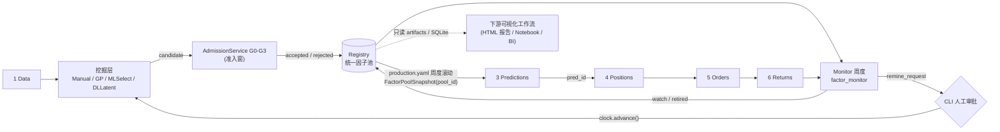

# FactorLibrary 重构设计（v2）：显式挖因子两阶段解耦 + 无头化闭环

> **文档状态**：设计定稿 v2，代码尚未改动。v1 讨论稿已归档在会话产物 `factor_mining_refactor_design.md` 中。
> **创建日期**：2026-11-20
> **相对 v1 的变更**：
> 1. 准入与生命周期阈值改用业界常用经验区间（§3.3、§5.2）；
> 2. `active` 由生产配方自动标记（§2.5）；
> 3. Monitor 与调仓频率对齐，按周运行（§5.1）；
> 4. MLSelect 模板规模定为约 3k（上限 5k），并补充内存方案（§3.2）；
> 5. **重新评估前端原型，结论是放弃原型作为目标设计，主线全面无头化，可视化交给下游工作流**（§7）。



---

## 0. 设计决策总表

| # | 决策点 | 结论 |
|---|---|---|
| Q1 | DL 定位 | 拆分：**DL 潜因子提取器**进入因子池；**直接拟合标签的 DL** 作为 Predictions 合成器，不入池 |
| Q2 | 研究时钟 | `configs/{market}/research_clock.yaml` 固定三段：挖掘窗 → 准入窗 → 监控窗 |
| Q3 | 准入协议 | 挖掘器只在窗口内做廉价预筛；统一 `AdmissionService`（G0–G3）是**唯一**能写 `accepted` 的入口 |
| Q4 | 生命周期 | `candidate → rejected / accepted → active → watch → retired`，全部迁移写入 `factor_status_log` |
| Q5 | ML 显式挖掘 | 模板枚举 DSL → LightGBM gain/SHAP + 跨 purged fold 稳定性选择 → 输出显式表达式 |
| Q6 | 下游契约 | 不可变 `FactorPoolSnapshot(pool_id)`；统一 loader 套 12 步后处理；删除静默回退 |
| Q7 | 监控 | `factor_monitor` 时序表 + YAML 规则（IC 衰减 / 换手 / 拥挤度 / 冗余漂移 / 边际贡献） |
| Q8 | 重挖 | 事件驱动 `remine_request` + 时钟版本推进 + 因子记录 `clock_version`；**人工审批** |
| Q9 | 市场优先级 | 先在 A 股 `stocks/rq`（`y_idio`）端到端打通；期货通过 MarketProfile 兼容 |
| Q10 | G3 消融 | 可插拔评估器：默认 Ridge ΔSharpe + Δ合成 RankIC；股票标签用 `y_idio_h` |
| Q11 | 编排与迁移 | 拆成分阶段子命令，阶段间传 ID；存量因子全部重置为 candidate，在 clock_v1 下重审 |
| **D1** | 阈值 | 采用业界常用经验区间作为初值（§3.3、§5.2），由 clock_v1 迁移报告校准 |
| **D2** | `active` | 由 `configs/{market}/production.yaml` 周度滚动**自动**标记，人工不可直接写 |
| **D3** | 频率 | Monitor、生产滚动、重挖检查**与调仓对齐，按周运行**（as_of 取周最后一个交易日） |
| **D4** | 模板规模 | MLSelect 初始约 3k 个表达式，上限 5k，按族流式求值 |
| **D5** | 前端 | **放弃原型作为目标设计**：现有前端冻结（只读加作者实验室），删除与协议冲突的写操作；可视化交给下游 |

---

## 1. 现状诊断

### 1.1 Data → Factors

| # | 问题 | 证据 | 后果 |
|---|---|---|---|
| D1 | 准入双轨 | `gp/admission.py`（5 步，只看相关性，直接写 `accepted`）与 `core/admission_audit.py`（3 关，不写回状态，只有 Workbench `auto_promote` 会晋升） | 池内因子标准不一；GP 因子没有经过 spanning 与消融检验 |
| D2 | 绕过准入 | `run_pipeline.py` 种子因子、`register_seed_factors(status="accepted")`、`workbench.init_seed_factors` 都直接写 accepted；前端 `registry.js` 可以把状态批量设为 `active` | 池的质量没有下限，`active` 语义被人工任意改写 |
| D3 | 时钟不统一 | GP 读 `gp_default.yaml` splits，DL 用 folds + lockbox，审计用 `oos_start = T//3` | 审计窗口与 GP 的 valid 段重叠，**不是样本外检验** |
| D4 | ML 没有挖掘能力 | `ml/` 只有 `WalkForwardPipeline` | "ML 显式挖因子"整支缺失 |
| D5 | DL 角色错位 | `run_dl.py` 把直接拟合 `y_h` 的 OOS 预测登记为 `dl_alpha` 因子，再被 ML 合成二次使用 | 构成 stacking；矩阵在首个 OOS 折前全是 NaN |
| D6 | 来源枚举写死 | `factor.source` / `factor_type` 有 CHECK 约束 | 新增来源必须先做 schema 迁移 |
| D7 | 去相关口径不一致 | GP 在 `0:val_end` 上算相关，审计在 `T//3:` 上算 | 同一对因子在两条路径上可能得出相反结论 |

### 1.2 Factors → Predictions

| # | 问题 | 证据 |
|---|---|---|
| P1 | 静默回退 | `WalkForwardPipeline.from_registry`：没有匹配状态的因子时退回同市场**全部**因子 |
| P2 | 状态口径不一致 | `run_pipeline` 只读 `accepted`；`MLConfig.features_status` 是 `(accepted, active)` |
| P3 | 后处理不一致 | 合成层直接 `engine.eval(canon_expr)`，没有统一套用 12 步后处理 |
| P4 | 不可追溯 | 回测产物只记录 `alpha_mode`，没有因子快照 ID |
| P5 | 回退掩盖失败 | WF 失败时退化为前 6 个因子等权，库空时退化为动量 |

### 1.3 Adjustment

`factor_metrics` 只有静态切分快照，没有时序数据；代码中没有任何地方写入 `deprecated`；没有漂移和拥挤度计算；状态更新没有状态机约束，也不留日志。

---

## 2. Data → Factors 标准流转协议

### 2.1 研究时钟

```yaml
# configs/stocks/research_clock.yaml
version: 1
mine:    ["2016-01-01", "2021-12-31"]   # 挖掘器可见
admit:   ["2022-01-01", "2023-12-31"]   # 仅 AdmissionService 可见
monitor: ["2024-01-01", null]           # 仅 Monitor 可见，向前滚动
purge_days: 10                          # ≥ max(horizon)
labels: { admission: y_idio_5, horizons: [1, 5, 10] }
```

- `core/clock.py`：`ResearchClock.load(market)`，`.rows(panel, stage)`。挖掘器拿到的是在 `mine.end + purge` 处截断的只读 Panel 视图；
- 推进规则：`v(n+1).mine = v(n).mine ∪ v(n).admit`，`v(n+1).admit` 取 `v(n).monitor` 中**已累积满 ≥ 12 个月**的部分；
- 期货使用同结构的 `configs/futures/research_clock.yaml`，标签为 `y_5`。

### 2.2 挖掘器统一接口（`factorlib/mining/`）

```python
class CandidateFactor(TypedDict):
    definition: FactorDefinition          # expression | code | materialized
    source: Literal["manual", "seed", "gp", "ml_select", "dl_latent"]
    source_run: str
    recipe_id: str | None
    prescreen: dict                       # 挖掘窗指标，仅供参考
    family_key: str | None                # 同族配额键

class Miner(Protocol):
    def mine(self, panel_view: Panel, clock: ResearchClock, recipe: Recipe) -> list[CandidateFactor]: ...
```

| 挖掘器 | 复用 | 改动 |
|---|---|---|
| Manual / Seed | `get_seed_factors`、Workbench draft | 只产出 candidate |
| GP | `gp/engine.py` | `gp/admission.py` 改为 `gp/prescreen.py`：保留 TopK、符号一致、换手与候选间自去重；删除对库去相关与写库逻辑；splits 从 clock 读取 |
| MLSelect（新） | `ml/splits`、`ml/dataset`、`core/catalog` | 见 §3.2 |
| DLLatent（新） | `dl/dataset`、`dl/trainer`、`dl/stitch` | 模型增加 K 维瓶颈层（带正交正则）；每一维单独物化为 `materialized` 候选，`family_key=dl_latent:<recipe>` |

### 2.3 AdmissionService（`core/admission.py`）

只在 `clock.admit` 窗口、`clock.labels.admission` 标签上运行。四关的定义见 §3.3。输出 `AdmissionReport`，并原子写入以下内容：`status`、`admitted_clock_version`、`factor_metrics(split='admit')`、`factor_status_log`、锁定 `factor_version`。

**一次性判定**：同一 `clock_version` 下，每个 `canon_hash` 只判定一次；被拒的 hash 进入黑名单，防止换随机种子反复刷准入窗。

### 2.4 Registry 迁移

```sql
-- factor
source      CHECK IN ('gp','manual','seed','ml_select','dl_latent','dl_alpha')  -- dl_alpha 仅为历史兼容
factor_type CHECK IN ('expression','code','materialized','dl_alpha')
status      CHECK IN ('candidate','rejected','accepted','active','watch','retired')
ADD COLUMN admitted_clock_version INTEGER;
ADD COLUMN family_key TEXT;
ADD COLUMN weight_cap REAL NOT NULL DEFAULT 1.0;

CREATE TABLE factor_status_log (id, factor_id, from_status, to_status, reason, actor, evidence_json, clock_version, created_at);
CREATE TABLE factor_pool_snapshot (pool_id PK, market, as_of_date, clock_version, kind CHECK IN ('research','production'), recipe_id, created_at);
CREATE TABLE factor_pool_member (pool_id, factor_id, version, sign, weight_cap, PRIMARY KEY(pool_id, factor_id));  -- immutable trigger
CREATE TABLE factor_monitor (factor_id, as_of, window, ic_mean, ic_ir, ic_t_nw, ic_halflife, turnover,
                             pool_corr_avg, pool_corr_max, crowd_json, marginal_contrib, PRIMARY KEY(factor_id, as_of, window));
CREATE TABLE remine_request (id, market, as_of, trigger_json, negative_json, gap_json, recipe_id,
                             status CHECK IN ('pending','approved','rejected','done'), approved_by, created_at);
```

状态迁移统一走 `registry.transition(fid, to, reason, actor, evidence)`。合法边（`ALLOWED_TRANSITIONS`）**按 actor 授权**：

| actor | 允许的迁移 |
|---|---|
| `admission` | candidate → accepted / rejected |
| `production:<recipe_id>` | accepted ↔ active |
| `monitor` | accepted/active → watch；watch → accepted/active（恢复）；watch → retired |
| `human` | 任意 → retired（紧急下架，必须填写 reason）；**不能**写 accepted 或 active |

### 2.5 `active` 的自动标记（生产配方）

```yaml
# configs/stocks/production.yaml
recipe_name: stocks_prod_v1
pool_policy:
  statuses: [accepted, active, watch]   # watch 以 weight_cap 进入
  max_factors: 40
  selection: residual_icir_greedy       # 按准入残差 ICIR 贪心取，池内 |ρ| < 0.6
synthesizer: { kind: ml_lgbm, config: configs/stocks/ml_default.yaml }
backtest: configs/stocks/backtest.yaml
schedule: weekly                        # 与调仓对齐
```

每周执行 `factorlib production roll --market stocks`：

1. 生成 `kind=production` 的快照；
2. 运行 predict 与 backtest；
3. 成功后调用 `registry.sync_active(pool_id)`：快照内状态为 accepted 的因子 → active；不在新快照内的 active 因子 → accepted；
4. 状态优先级为 `retired > watch > active > accepted`。watch 因子仍可留在生产快照中（受 weight_cap 约束），但状态保持 watch；**从 watch 恢复时，若因子在最新生产快照内则回到 active，否则回到 accepted**。

---

## 3. 挖掘细节与准入阈值

### 3.1 统一口径

- IC 统一使用截面 **Spearman RankIC**，标签为准入标签：股票 `y_idio_5`，期货 `y_5`；
- t 统计量采用 **Newey-West 调整**，lag 取 `h−1`，用于修正 h 日重叠标签造成的序列相关；
- 换手定义为因子排名的 **h 日秩自相关**（`1 − autocorr` 视作换手代理），与周度调仓对齐；
- ICIR 采用**日频、不年化**口径（`mean(IC)/std(IC)`）。

### 3.2 MLSelectMiner：规模与内存方案

- 模板库约 3k 个表达式（上限 5k）：约 15 个模板族 × 约 20 个基础字段 × 5 个窗口 {5, 10, 20, 60, 120}，剔除非法组合后得到；
- **内存约束**：A 股单个 `(T≈2500, N≈5300)` float64 矩阵约 106MB，3k 个全量驻留不可行。因此采用三段流式处理：
  1. 每批 100 个，在挖掘窗内用 Rust 批量求值和 RankIC 初筛（|IC| ≥ 0.01），**矩阵用完即丢**；
  2. 保留约 300 个，按周采样（÷5），转 float32 后构建 LightGBM 样本，规模约 2GB；
  3. 在 purged walk-forward 的各折上计算 gain/SHAP，取**跨折保留频率 ≥ 60%** 且按模板族去重（每族 ≤ 3 个）的表达式，作为 candidate 输出；
- 模型本身丢弃，只保留表达式和 `prescreen`（各折重要度、保留频率）。

### 3.3 AdmissionService 阈值（业界常用经验区间的初值）

> [!NOTE]
> 以下数值取自 A 股多因子研究中常见的经验区间（券商金工报告常用 |IC| 2%–3%、ICIR 0.3–0.5、相关性 0.5–0.7；多重检验参考 Harvey-Liu-Zhu 2016 提出的 t ≥ 3.0）。它们不是硬性标准。clock_v1 存量重审出迁移报告后，再根据通过率分布做一次校准，并固化到 `configs/{market}/admission.yaml`。

| 关卡 | 指标 | A 股（`stocks/rq`，h=5） | 期货（约 60 个品种，h=5） |
|---|---|---|---|
| **G0 有效性** | 日均有效覆盖率（占当日股票池） | ≥ 70% | ≥ 80% |
| | 有效交易日占比 | ≥ 90% | ≥ 90% |
| | 每日最少有效标的数 | ≥ 300 | ≥ 20 |
| | 非常量、无 ±Inf；AST 防未来检查；不在黑名单 | 必须 | 必须 |
| **G1 单因子** | \|RankIC 均值\| | ≥ 0.02 | ≥ 0.03 |
| | \|ICIR\|（日频） | ≥ 0.30 | ≥ 0.15 |
| | NW t 统计量：manual / seed | ≥ 2.0 | ≥ 2.0 |
| | NW t 统计量：gp / ml_select / dl_latent（多重检验） | **≥ 3.0** | **≥ 3.0** |
| | IC 胜率（符号与均值一致的天数占比） | ≥ 55% | ≥ 53% |
| | 半年子窗方向一致率 | ≥ 3/4 | ≥ 3/4 |
| | h 日秩自相关（换手代理） | ≥ 0.5 | ≥ 0.4 |
| | 五分组收益单调性 Spearman(组号, 组收益) | ≥ 0.8 | 不检查（截面过小） |
| **G2 冗余** | 与池内因子的最大 \|ρ\|（截面秩相关的时间均值） | < 0.60 | < 0.70 |
| | Spanning 残差 \|ICIR\| | ≥ 0.15 | ≥ 0.10 |
| | Spanning 残差 NW t | ≥ 2.0 | ≥ 2.0 |
| | 同族配额（`family_key`） | ≤ 2 | ≤ 2 |
| **G3 边际贡献** | Ridge ΔSharpe（基准池 vs 基准池 + 候选） | > 0 | > 0 |
| | Δ合成 RankICIR | ≥ +0.02 | ≥ +0.02 |

批内处理顺序：G0/G1 并行过滤 → 按残差 ICIR 降序在 G2 做贪心去重（批内已通过的候选会加入对比池）→ 逐个跑 G3。

---

## 4. Factors → Predictions 契约

```python
pool_id = registry.create_snapshot(market, kind="research" | "production", policy=...)
X = PoolLoader(panel, registry).load(pool_id)   # 用 version 中锁定的定义与后处理，乘以 sign
```

- 新增 `WalkForwardPipeline.from_snapshot(panel, cfg, pool_id)` 取代 `from_registry`；**空池直接报错**，同时删除 P1 和 P5 中的回退逻辑；
- `weight_cap` 由合成器负责落实；
- `predictions/<pred_id>.parquet` 与回测 `summary.json` 都必须带上 `pool_id` 和 `pred_id`；
- 直接拟合标签的 DL 迁到 `predict/dl_synth.py`，作为合成器之一，只消费快照。

---

## 5. Adjustment 闭环（按周）

### 5.1 节奏

每周最后一个交易日收盘、数据就绪后，按以下顺序执行（`factorlib weekly --market stocks`）：

```text
monitor  →  lifecycle rules  →  production roll  →  remine check  →  weekly digest
```

指标窗口仍按交易日计（60/120/250），但只在周度 as_of 写入 `factor_monitor`，状态迁移也只在周度检查点发生，避免日内抖动引起状态反复切换。

### 5.2 指标与规则（`configs/{market}/lifecycle.yaml`）

| 维度 | 指标 | 实现 |
|---|---|---|
| 预测力 | 60/120/250 日 RankIC、ICIR、NW t、IC 半衰期 | `engine.rank_ic` |
| 换手 | h 日秩自相关 | `engine.factor_turnover` |
| 冗余漂移 | 与池内因子的平均 / 最大 \|ρ\| | `engine.cross_correlation` |
| 拥挤度（股票） | 多空腿 Barra SIZE/LIQUIDTY/RESVOL 暴露差；多空腿 BP 分位价差；多空腿平均换手率，各取 250 日自身 z 分数 | `markets/stocks/barra.py`、`RiskView` |
| 拥挤度（期货） | 延后实现（P3） | — |
| 边际贡献 | Leave-one-out Δ合成 RankIC | G3 `MarginalEvaluator` |

```yaml
# configs/stocks/lifecycle.yaml
watch_if:                    # 任一命中
  icir_120_ratio_to_admit: "< 0.5"
  ic_sign_flip_120: { t_nw: ">= 1.0" }      # 方向反转且有一定显著性
  crowding_z_max: "> 2.0"
  pool_corr_max: ">= 0.75"                  # 与其他因子趋同
watch_weight_cap: 0.5
retire_if:                   # 任一命中
  ic_t_nw_250: "< 1.0"
  watch_weeks: ">= 13"                      # 约一个季度
recover_if:
  icir_120_ratio_to_admit: ">= 0.8"
  consecutive_weeks: 4
remine_if:                   # 任一命中则生成 remine_request
  effective_pool_size: "< 15"               # 按 |ρ|≥0.6 聚类后的簇数；期货为 8
  composite_icir_120_ratio_to_snapshot: "< 0.7"
  retired_in_4_weeks: ">= 3"
```

### 5.3 重挖

`remine_request` 包含：

- `negative_json`：retired 因子用过的字段、算子和模板族，GP 用作适应度惩罚，MLSelect 用作模板排除；
- `gap_json`：池内 Barra 风格与行业覆盖的缺口；
- 自动生成的 recipe。

**审批走 CLI**：`factorlib remine list|approve <id>|reject <id>`。批准后依次执行 `clock.advance()`、Miner、AdmissionService，新入池因子带上新的 `clock_version`。

---

## 6. 编排：分阶段子命令

```text
factorlib mine      --market stocks --miner gp|ml_select|dl_latent|manual --recipe <id>  -> run_id, candidate_ids
factorlib admit     --market stocks --candidates <run_id|ids>                            -> admission report
factorlib snapshot  --market stocks --kind research|production                           -> pool_id
factorlib predict   --pool <pool_id> --synth ml_lgbm|ridge|equal|ic_weight|dl_synth       -> pred_id
factorlib backtest  --pred <pred_id>                                                     -> summary.json, report.html
factorlib monitor   --market stocks [--as-of D]
factorlib production roll --market stocks
factorlib remine    list|approve|reject
factorlib weekly    --market stocks          # 按 §5.1 顺序串联，由 cron/systemd timer 调度
```

`scripts/run_pipeline.py` 保留为薄封装，内部依次调用 mine、admit、snapshot、predict、backtest。

---

## 7. 前端判断：放弃原型，主线无头化

### 7.1 判断依据

新主线有三个特征：

1. **批处理、按周运行**，长任务由调度器驱动；
2. **状态写入必须由规则驱动并可审计**，各类状态只能由对应的 actor 写入：accepted 只能由 admission 写，active 只能由 production 写，watch 和 retired 只能由 monitor 写；
3. **人工决策点只剩两个**：编写手工因子，以及审批重挖。

据此逐页评估 `docs/web_ui/prototype.html` 的五个页面：

| 原型页面 | 原定职责 | 与新主线的关系 | 判断 |
|---|---|---|---|
| ① 数据底座与特征池 | 浏览双源字段、别名、FeatureSet | 只读浏览，不在闭环内 | **冻结现状**，不再投入 |
| ② 单因子实验室 | 编写、探针、桥接 | 即 Manual Miner 的输入端，交互式 REPL 有真实价值 | **保留**，但"保存"只能生成 candidate |
| ③ 组合回测与 YAML 调参 | 在 Web 内编辑 backtest.yaml，"一键把 Adjustment 建议写回 YAML" | 与新 Adjustment（因子生命周期自动化）定义冲突；回测由 `backtest` 阶段产出静态报告 | **放弃** |
| ④ 挖掘 / ML·DL 合成 | 配方表单、后台启动、Run 监控 | 配方表单与 recipe YAML 加 CLI 重复；挖掘由周度调度或重挖审批触发 | **放弃表单**；Run 列表降级为只读 |
| ⑤ 审核与注册库 | 批量三关审计、`auto_promote`、手工改状态 | **直接破坏协议**：可以绕过 AdmissionService 写 accepted，也可以人工写 active | **改为只读台账**（状态、准入报告、状态日志） |

**结论**：前端不适合作为本主线的工作界面。原型（`prototype.html`、`webui_ia_wireframes.md`）**不再作为目标设计**，只作历史参考保留。不再开发新页面，也不为 monitor 或重挖做 Web 页面。

### 7.2 对现有前端与 API 的最小处置（P0，属于协议完整性改动）

| 现有入口 | 处置 |
|---|---|
| `POST /api/{market}/factors/batch-status`（前端 `registry.js` 可以写 `active`） | 限制为只能写 `retired`（`actor=human`，必须填 reason），其余返回 403 |
| `POST /api/{market}/factors/audit` 的 `auto_promote` | 删除该参数；审计改为调用 AdmissionService 的**只读预览模式**（不写库，也不占用该 hash 在当前 clock 版本下的一次性判定额度） |
| `POST /api/{market}/factors/init-seeds` | 改为只登记 candidate |
| `POST /api/{market}/factors/draft`、`/probe` | 保留（实验室） |
| `POST /api/{market}/runs`（Web 启动重任务） | 冻结，不再新增配方种类；推荐使用 CLI |

前端代码（`python/factorlib/frontend/`，约 3.7k 行）**不删除**，只同步上述 API 行为变化。

### 7.3 可视化交给下游工作流：产物契约

每个阶段都产出机器可读的标准产物。任何可视化工作流（静态 HTML、Notebook、BI、另立的前端项目）都只读消费这些产物，不回写：

```text
runs/
  admit/<run_id>/admission_report.{json,parquet}     # 每个候选的 G0–G3 指标与判定
  snapshot/<pool_id>/members.json
  predict/<pred_id>/predictions.parquet, meta.json   # 含 pool_id
  backtest/<bt_id>/summary.json, equity.csv, report.html   # 复用 core/report.generate_html_report
  weekly/<as_of>/digest.{md,html}                    # 状态迁移、watch/retired 清单、拥挤度 Top、remine 请求
```

- SQLite 注册库对外**只读**开放：下游以 `mode=ro` URI 连接，可直接查询 `factor_monitor`、`factor_status_log`、`factor_pool_member`；
- `weekly digest` 是唯一的"推送式"可视化，也是人工审批重挖的信息来源。

---

## 8. 精简改造路径（按优先级）

| 优先级 | 任务 | 主要文件 | 验收 |
|---|---|---|---|
| **P0-1** | 研究时钟 | `core/clock.py`、`configs/*/research_clock.yaml` | 摄动测试：改动 admit/monitor 段数据后，挖掘输出 bit 等价 |
| **P0-2** | Registry 迁移 + 按 actor 授权的 `transition()` | `core/registry.py` | 旧库备份后自动迁移；越权迁移抛出异常 |
| **P0-3** | AdmissionService + `admission.yaml` 阈值 | `core/admission_audit.py` → `core/admission.py` | 同一候选经任意入口得到相同判定；一次性判定生效 |
| **P0-4** | GP 准入降级为预筛 | `gp/admission.py` → `gp/prescreen.py`、`gp/engine.py` | GP 只产出 candidate |
| **P0-5** | 封堵绕过准入（含 §7.2 的 API 处置） | `run_pipeline.py`、`evaluate.py`、`workbench.py`、`workbench_server.py` | 全仓不再出现硬编码写 `accepted` / `active` |
| **P1-1** | Snapshot + PoolLoader + `from_snapshot` | `registry.py`、`core/pool_loader.py`、`ml/pipeline.py` | 删除静默回退；产物带 pool_id |
| **P1-2** | 分阶段 CLI | `factorlib/cli.py`（`pyproject` 入口），`run_pipeline.py` 改为薄封装 | `--help` 门禁 |
| **P1-3** | DL 拆分 | `run_dl.py` → `predict/dl_synth.py` | 存量 `dl_alpha` 不进入快照 |
| **P1-4** | 存量迁移 | `scripts/migrate_pool_v1.py` | 全部重置为 candidate → clock_v1 重审 → 迁移报告 → 校准阈值 |
| **P2-1** | `production.yaml` + `production roll` + `sync_active` | `core/production.py` | 周度滚动后 active 集合与生产快照一致 |
| **P2-2** | Monitor + `lifecycle.yaml` + weekly digest | `core/monitor.py`、`core/lifecycle.py` | 回放 2024 年初微盘回撤段，相关因子进入 watch |
| **P2-3** | MLSelectMiner | `mining/ml_select.py`、模板库 | 峰值内存 < 8GB；产出 DSL 并通过准入 |
| **P2-4** | remine_request + 时钟推进 + CLI 审批 + `weekly` 串联 | `core/remine.py`、`cli.py` | 端到端：retire → 请求 → approve → 新 clock_version 入池 |
| **P3-1** | DLLatentMiner | `mining/dl_latent.py`、`dl/models` | K 个潜因子各自过准入，受同族配额约束 |
| **P3-2** | `BarraQPAblation`、期货拥挤度 | 依赖 `markets/stocks/optimizer.py` | 可选 |

**同步事项**：

- 更新 `docs/futures_platform_plan.md` 与 `AGENTS.md` 六阶映射表：Factors 阶段增加挖掘层与准入层，Monitor 阶段增加 monitor、lifecycle、remine，并注明 Web 原型已冻结；
- `verify.sh` 新增 `test_clock_isolation.py`、`test_admission_unified.py`、`test_lifecycle.py`、`test_registry_actor_auth.py`；
- 在 `docs/web_ui/webui_ia_wireframes.md` 顶部加上"已冻结，见本文 §7"的说明。
