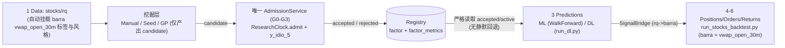

# FactorLibrary 重构设计（v2.1）：显式挖因子两阶段解耦与流程锁定

> **文档状态**：精简定稿 v2.1（已完成冗余裁剪，并与现有 `stocks/{rq, barra}` 双源架构及 `scripts/run_stocks_backtest.py` 对齐）
> **创建日期**：2026-11-20（2026-11-21 修订）
> **相对 v2 的核心裁剪**：
> 1. **锁定当前主流程，暂不实现 `MLSelectMiner` 与 `DLLatentMiner`**（§0、§2.2）；挖掘器收敛为 `Manual/Seed + GP`，`ML/DL` 专注下游 `Predictions` 合成；
> 2. **取消重型运维状态机与 5 张新表**：不新增 `factor_pool_snapshot`、`factor_pool_member`、`factor_monitor`、`remine_request`、`factor_status_log`，不建 `production.yaml` 自动滚动与 `clock.advance()` 多版本推进，直接复用现有 `factor` / `factor_metrics` 表（§2.4）；
> 3. **取消新建 9 子命令 `factorlib/cli.py`**：沿用现有 `scripts/run_{gp,ml,dl,stocks_backtest}.py`，仅新增唯一准入入口 `scripts/run_admit.py`（§5）；
> 4. **先聚焦 A 股主线**：立足 `data/derived/stocks/{rq, barra}`（加载 `rq` 自动挂载 `barra` 的 `vwap_open_30m` 标签与 CNE5 风格，回测统一落至 `barra`），期货暂保持独立现状；
> 5. **Web 端最小封堵**：保留只读浏览与单因子实验室，仅封堵绕过 `AdmissionService` 直接写 `accepted`/`active` 的接口（§6）。



---

## 0. 设计决策总表

| # | 决策点 | 修订后结论 |
|---|---|---|
| Q1 | **DL 定位** | `DL` 仅作为下游 `Predictions` 合成器（`scripts/run_dl.py`），产出样本外预测供回测消费；**停止向 `factor` 表写入 `dl_alpha`** |
| Q2 | **研究时钟** | `configs/stocks/research_clock.yaml` 固定三段不重叠窗口：挖掘窗 (`mine`) → 准入窗 (`admit`) → 测试/观察窗 (`test`) |
| Q3 | **GP 与准入协议** | 保留 `GP`（`gp/engine.py`）作为唯一自动化显式 DSL 挖掘引擎；`gp/admission.py` 降级为候选预筛（`gp/prescreen.py`），只写 `candidate`；唯一 `AdmissionService`（合并自 `core/admission_audit.py`）是唯一能写 `accepted`/`rejected` 的入口 |
| Q4 | **Registry 表结构** | **不新增新表**，直接复用现有 `factor` 与 `factor_metrics` 表（通过代码层统一状态跃迁入口约束） |
| Q5 | **ML/DL 挖掘扩展** | **暂不实现** `MLSelectMiner` 与 `DLLatentMiner`，避免当前阶段多套挖掘器与黑盒潜因子带来的复杂度 |
| Q6 | **下游契约** | `WalkForwardPipeline`（`ml/pipeline.py`）严格读取准入后因子并统一套用版本锁定的后处理管线 × `sign`；**删除空库/失败时静默回退全库或动量因子的逻辑** |
| Q7 | **监控与重挖** | **暂不实现**周度 `factor_monitor`、`lifecycle.yaml`、`production.yaml` 与 `remine_request` 审批流；离线评估归因直接通过 `evaluate_factor_v4_stats` 与 `run_stocks_backtest.py` 产出 |
| Q8 | **数据与回测** | A 股统一采用「`rq` 特征域（自动挂载 `RiskView`）→ `SignalBridge` → `barra` (`vwap_open_30m`) 执行域」；暂不改造期货 |
| Q9 | **CLI 入口** | 不新建 `factorlib/cli.py`，复用 `scripts/run_gp.py`、`run_ml.py`、`run_dl.py`、`run_stocks_backtest.py`，仅新增 `scripts/run_admit.py` |
| Q10 | **Web 前端** | 保留只读台账与单因子实验室，冻结页面与原型；封堵 `auto_promote` 与直接修改 `accepted`/`active` |

---

## 1. 现状诊断（待解决的核心结构问题）

| # | 问题 | 代码证据 | 后果 |
|---|---|---|---|
| D1 | **准入双轨** | [`gp/admission.py`](file:///home/cr9294/repos/FactorLibrary/python/factorlib/gp/admission.py)（5 步，只看相关性，直接写 `accepted`）与 [`core/admission_audit.py`](file:///home/cr9294/repos/FactorLibrary/python/factorlib/core/admission_audit.py)（3 关，审计后不写回，除非触发 `auto_promote`） | 入池因子标准不一；GP 因子未经过统一的 Spanning 与消融检验 |
| D2 | **绕过准入** | [`core/evaluate.py`](file:///home/cr9294/repos/FactorLibrary/python/factorlib/core/evaluate.py#L1137) `register_seed_factors(status="accepted")`、[`core/workbench.py`](file:///home/cr9294/repos/FactorLibrary/python/factorlib/core/workbench.py#L1518) `auto_promote`、[`workbench_server.py`](file:///home/cr9294/repos/FactorLibrary/python/factorlib/workbench_server.py#L335) `batch-status` 与前端 `registry.js` 可直接写 `accepted`/`active` | 因子池没有统一质量下限 |
| D3 | **时钟不统一** | GP 读 `gp_default.yaml` `splits`、DL 用自定 folds、审计用 `oos_start = T // 3` | 准入窗口与挖掘验证窗重叠，**不是严格样本外检验** |
| D4 | **DL 角色错位** | `scripts/run_dl.py` 会把拟合 `y_h` 的 OOS 预测作为 `dl_alpha` 写入 `factor` 表再被 ML 二次合成 | 构成隐式 stacking，且首折前矩阵全 NaN |
| P1 | **下游静默回退与后处理分叉** | `WalkForwardPipeline.from_registry` 无匹配状态时退回全部因子，且合成层直接 `engine.eval` 未统一套用 12 步后处理；空池时退化为动量 | 回测结果不可严格归因到准入池 |

---

## 2. Data → Factors 标准流转协议

### 2.1 研究时钟（`core/clock.py` + `configs/stocks/research_clock.yaml`）

```yaml
# configs/stocks/research_clock.yaml
version: 1
mine:  ["2016-01-06", "2021-12-31"]   # 挖掘器 (GP / 手工探索) 可见
admit: ["2022-01-01", "2023-12-31"]   # 仅 AdmissionService 准入判定可见
test:  ["2024-01-01", "2026-11-06"]   # 样本外评价、监控与组合回测验证窗
purge_days: 10                        # >= max(horizon)
labels:
  admission: y_idio_5
  horizons: [1, 2, 5, 10]
```

- `ResearchClock.load("stocks")` 提供 `.rows(panel, stage)` 与 `.slice(panel, stage)`；
- `stocks/rq` 加载时已自动通过 `RiskView` 挂载 `barra` 的 `vwap_open_30m` 标签（含 `y_idio_5`），因此整个研发与回测链路完全运行在同一执行时钟下。

### 2.2 挖掘器收口（`Manual / Seed + GP`）

- **Manual / Seed**：`register_seed_factors` 与工作台草稿统一以 `status="candidate"` 入库；
- **GP（`python/factorlib/gp/`）**：
  - `gp/admission.py` 精简/重命名为 `gp/prescreen.py`，仅在 `clock.mine` 窗内执行 TopK、符号一致、换手与批内自去重预筛，**删除对正式库去相关与直接写 `accepted` 的逻辑**；
  - `gp/engine.py` 的 `splits` 接入 `ResearchClock`，固定产出 `status="candidate"`；同时修复 `_extract_horizon_from_label` 以正确解析 `y_idio_{1,2,5,10}`。

### 2.3 唯一准入服务 `AdmissionService`（`core/admission.py`）

合并现有 `core/admission_audit.py` 与 `gp/admission.py` 中的重复统计计算，仅在 `clock.admit` 窗口与 `y_idio_5` 标签上运行 G0–G3 判定，并将结果写回现有 `factor`（`status` 更新为 `accepted` 或 `rejected`）与 `factor_metrics`（`split='admit'`）：

| 关卡 | 指标 | A 股默认值（`configs/stocks/admission.yaml`） |
|---|---|---|
| **G0 有效性** | 日均有效覆盖率 / 有效交易日占比 / 每日最少标的数量 | ≥ 70% / ≥ 90% / ≥ 300 |
| | 非常量、无 ±Inf、AST 防未来检查 | 必须 |
| **G1 单因子** | \|RankIC 均值\| / 日频 \|ICIR\| | ≥ 0.02 / ≥ 0.30 |
| | NW t 统计量（`manual`/`seed` vs `gp` 多重检验） | ≥ 2.0 / ≥ 3.0 |
| | IC 胜率 / 半年子窗方向一致率 / h 日秩自相关 / 5分组单调性 | ≥ 55% / ≥ 3/4 / ≥ 0.5 / ≥ 0.8 |
| **G2 冗余** | 与池内已有因子最大 \|ρ\| | < 0.60 |
| | Spanning 残差 \|ICIR\| / 残差 NW t | ≥ 0.15 / ≥ 2.0 |
| **G3 边际贡献** | Ridge 合成 ΔSharpe / Δ合成 RankICIR | > 0 / ≥ +0.02 |

> 注：上述经验区间初值将在现有 `factors.sqlite` 存量因子重审时按实际通过率微调并固化到 `configs/stocks/admission.yaml`。

### 2.4 状态流转边界（复用现有 `factor` 表）

- `factor.status` 保持在现有契约内流转：`candidate → accepted / rejected`（仅允许由 `AdmissionService` 写入），`accepted ↔ active`、`* → deprecated`（手工下架）。
- **不新增** `factor_status_log`、`factor_pool_snapshot`、`factor_pool_member`、`factor_monitor`、`remine_request` 表，保持 SQLite Schema 零膨胀。

---

## 3. Factors → Predictions 契约

- `WalkForwardPipeline.from_registry`（`ml/pipeline.py`）仅读取 `status in ("accepted", "active")` 的因子；**若池内无满足条件因子，直接抛异常报错，严禁静默回退全部因子或动量因子**；
- 特征提取统一通过 `evaluate_factor_definition` 执行版本锁定的 12 步后处理管线并对齐方向 `sign`；
- `scripts/run_dl.py` 仅生成并落盘样本外预测矩阵（`runs/dl_*/predictions.parquet`），不再注册为 `dl_alpha` 因子入池；
- ML/DL 预测完成后直接交由 [`scripts/run_stocks_backtest.py`](file:///home/cr9294/repos/FactorLibrary/scripts/run_stocks_backtest.py) 通过 `SignalBridge` 投影至 `barra` 执行组合优化与撮合。

---

## 4. 组合优化与实盘回测（已完成底座）

- 统一入口：[`scripts/run_stocks_backtest.py`](file:///home/cr9294/repos/FactorLibrary/scripts/run_stocks_backtest.py)（支持 `--factor` / `--factor-file` / `--pred` / `--signal` 与 `--profile default|quantile|factorsim_match`）；
- 待补充收口（Phase 2.2）：在 `evaluate.py` / `report.py` 中补齐 Barra 42 因子归因拆解，并在 `daily_equity.csv` 增补每日持股数量 `n_holdings`、支持参数网格扫描标定 `configs/stocks/backtest.yaml`。

---

## 5. 命令行编排（复用现有 `scripts/`）

不引入新的 `factorlib/cli.py`，保持各阶段单一职责脚本：

```text
1. 挖掘候选:  python scripts/run_gp.py --market stocks ...               # 仅产出 candidate
              或通过单因子实验室/种子脚本登记 candidate
2. 统一准入:  python scripts/run_admit.py --market stocks ...            # 唯一准入入口 -> accepted/rejected
3. 下游合成:  python scripts/run_ml.py --market stocks ...               # 严格消费准入池 -> predictions.parquet
              python scripts/run_dl.py --market stocks ...               # 独立合成器 -> predictions.parquet
4. 统一回测:  python scripts/run_stocks_backtest.py --pred ... / --factor ... / --profile ...
```

---

## 6. Web 前端与工作台处理原则

- 保留 [`python/factorlib/frontend/`](file:///home/cr9294/repos/FactorLibrary/python/factorlib/frontend) 的只读台账浏览与单因子实验室能力，**不新增页面，冻结前端原型**；
- 对 [`workbench.py`](file:///home/cr9294/repos/FactorLibrary/python/factorlib/core/workbench.py) 与 [`workbench_server.py`](file:///home/cr9294/repos/FactorLibrary/python/factorlib/workbench_server.py) 做最小协议封堵：
  1. `init_seed_factors` / 草稿保存只写 `candidate`；
  2. 移除 `auto_promote` 参数，禁止 `POST /api/{market}/factors/batch-status` 直接写入 `accepted`/`active`（Web 端发起审核统一调用 `AdmissionService`）；
  3. 仅允许手工执行下架操作（`deprecated`）。
